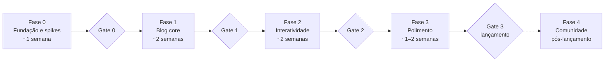

# Roadmap

A ordem de implementação do blog. O **quê** está em `SPEC.md`; aqui ficam as tarefas, as dependências entre elas, os gates e o status. Este arquivo muda a cada PR; a spec muda raramente.

## Como usar

1. Pegue a primeira tarefa `pendente` cujas dependências estejam todas `concluída`. Uma fase só começa depois que o gate da anterior estiver `aprovado`.
2. Marque-a `em andamento` no primeiro commit do PR. Branch: `t-XX-descricao-curta`.
3. Leia só as seções da SPEC ligadas aos requisitos citados na tarefa.
4. Ao fechar o PR, marque `concluída` e acrescente uma linha no [Registro de handoff](#registro-de-handoff), no mesmo PR.
5. Se a tarefa revelar trabalho novo, adicione uma tarefa nova com o próximo ID livre; não amplie a tarefa atual.
6. O PR que cumpre o último critério de um gate também muda a linha **Status do gate** para `aprovado (AAAA-MM-DD)`.

Status de tarefa: `pendente`, `em andamento`, `concluída`, `bloqueada (motivo)`, `cancelada (motivo)`. Status de gate: `pendente`, `aprovado (data)`.

## Fase 0 — Fundação e spikes

| ID   | Tarefa                                                                                                                                                                                                                                                                                                                                                                                                                                                                                                 | Requisitos             | Depende de | Status    |
| ---- | ------------------------------------------------------------------------------------------------------------------------------------------------------------------------------------------------------------------------------------------------------------------------------------------------------------------------------------------------------------------------------------------------------------------------------------------------------------------------------------------------------ | ---------------------- | ---------- | --------- |
| T-01 | Scaffold **Astro 7** + TypeScript strict + Tailwind v4 + ESLint/Prettier/Ruff, com `unified()` configurado em `markdown.processor` e no MDX. Vitest e Playwright configurados, com os cenários da SPEC §11 escritos como `test.fixme`. Arquivos de base: `.node-version`, `.python-version`, `.gitignore` (`dist/`, `.astro/`, `public/notebooks/`), `.cursorignore` (`exports/`) e `.github/pull_request_template.md` com "Requisitos afetados". Confirmar os comandos do AGENTS.md e remover o aviso | RNF-12, ADR-01         | —          | concluída |
| T-02 | `wrangler.jsonc`, primeiro deploy estático, variável `SITE_URL` apontando para o `workers.dev` e workflow do Actions com preview por PR (`wrangler versions upload`)                                                                                                                                                                                                                                                                                                                                   | ADR-04                 | T-01       | concluída |
| T-03 | Spike mdx-marimo a partir de `examples/with-astro` (Astro 7, runtime em custom element). Responder: peso e tempo até interativo; se o `remarkMarimo` executa Python no build (e, se sim, como acha o marimo e qual versão usa); qual versão do runtime marimo o pacote npm carrega e como alinhá-la ao `uv.lock`; se o `<script type="module">` dispara o Pyodide antes do primeiro paint; convivência com `remark-math` no mesmo `unified()` e com islands Svelte; origens que a CSP precisa liberar  | ADR-02, RNF-03, RNF-07 | T-01       | concluída |
| T-04 | Spike `marimo export html-wasm` em iframe com um notebook `torch` real: `cache_cells` + `--execute`, tamanho do export e da pasta `public/cache/`, o que continua interativo, o que vira stub, e como o `--execute` trata `torch` (a doc diz que ele usa, quando possível, um ambiente isolado com pacotes compatíveis com WASM)                                                                                                                                                                       | ADR-02, SPEC §7        | —          | concluída |
| T-05 | Validar `_headers`/`_redirects` em Static Assets servindo o export da T-04: `! Content-Security-Policy` seguido de nova CSP no mesmo bloco, padrão de URL com e sem barra final, CSP com `wasm-unsafe-eval` e as origens do Pyodide                                                                                                                                                                                                                                                                    | RNF-06, RNF-07         | T-02, T-04 | concluída |

Os spikes (T-03, T-04, T-05) rodam em branch própria. O código fica nesse branch e não entra na `main`. O doc em `specs/spikes/T-0X-<nome>.md` e o handoff entram por um PR próprio: perguntas, o que foi medido e o veredito. O branch da T-05 foi publicado só para o preview, num PR em rascunho fechado sem merge.

**Gate 0 — passa quando:**

- O deploy de preview funciona num PR real e o `_headers` é aplicado com detach de CSP (ou o plano B da SPEC §10 está escolhido).
- O doc da T-04 tem veredito com números e responde às perguntas da tarefa. O critério do mdx-marimo não se aplica: inline adiado por manutenção, ver doc da T-03.
- ADR-02 substituído em 14/10/2026 (inline adiado; ver doc da T-03). O ramo inline saiu da SPEC §6 e da T-15.

**Status do gate:** aprovado (2026-10-15)

## Fase 1 — Blog core

| ID   | Tarefa                                                                                                                                                                                                                                       | Requisitos             | Depende de       | Status   |
| ---- | -------------------------------------------------------------------------------------------------------------------------------------------------------------------------------------------------------------------------------------------- | ---------------------- | ---------------- | -------- |
| T-06 | `site.config.ts` (com `SITE_URL`), `content.config.ts` com a collection `posts` (única; autor vem do config; `generateId` pelo nome da pasta) e `getPublishedPosts()` com `SHOW_DRAFTS`. Testes unitários do slug e dos dois valores da flag | RF-11, RNF-09          | T-01             | pendente |
| T-07 | `BaseLayout`, header, footer, tema base e variáveis CSS de cor                                                                                                                                                                               | —                      | T-01             | pendente |
| T-08 | Home com destaque, grid de cards e paginação (`/page/[n]`)                                                                                                                                                                                   | RF-01, RF-03           | T-06, T-07       | pendente |
| T-09 | `PostLayout` com autor, datas, tempo de leitura (plugin remark no `unified()`) e TOC                                                                                                                                                         | RF-04, RF-05           | T-06, T-07       | pendente |
| T-10 | Shiki com botão copiar (`markdown.shikiConfig.themes` claro e escuro; conferir na doc atual como ele interage com `unified()`) + KaTeX                                                                                                       | RF-06, RF-07           | T-09             | pendente |
| T-11 | Páginas de tag                                                                                                                                                                                                                               | RF-02                  | T-06, T-08       | pendente |
| T-12 | SEO, JSON-LD, RSS e sitemap, com URLs absolutas a partir de `SITE_URL`                                                                                                                                                                       | RF-10, RF-12           | T-06, T-09       | pendente |
| T-13 | Lighthouse CI, verificação de JS por página, `size-limit` por island e verificador de links no pipeline, com os limites da SPEC §4. A ferramenta de links não está na lista pré-aprovada: proponha e pergunte                                | RNF-01, RNF-02, RNF-05 | T-02, T-08, T-09 | pendente |

T-06 e T-07 vêm primeiro; depois disso, T-08 a T-12 podem correr em paralelo.

**Gate 1 — passa quando:**

- Home e um post sem notebook passam nos budgets de RNF-01 e RNF-02 no CI.
- O cenário de rascunhos (SPEC §11) está verde contra o build de produção.
- O RSS valida no W3C Validator e o JSON-LD passa no Rich Results Test.

**Status do gate:** pendente

## Fase 2 — Interatividade

Duas trilhas independentes; a T-21 junta as duas.

| ID                | Tarefa                                                                                                                                                                                                                                            | Requisitos             | Depende de             | Status   |
| ----------------- | ------------------------------------------------------------------------------------------------------------------------------------------------------------------------------------------------------------------------------------------------- | ---------------------- | ---------------------- | -------- |
| **Trilha marimo** |                                                                                                                                                                                                                                                   |                        |                        |          |
| T-14              | `scripts/build-notebooks.py` com cache por hash (`.py` + `uv.lock`) para notebooks iframe leves, saída em `public/notebooks/`. Decidir se o export mostra o código, para tutoriais passo a passo, em vez de `--no-show-code`; atualizar a SPEC §7 na mesma tarefa | RF-08, RNF-08          | Gate 0, T-06, T-35     | pendente |
| T-15              | `MarimoFrame` (iframe) com carga condicional. Remover ou reescrever os `test.fixme` de cenários inline em `tests/e2e/spec-11.spec.ts`                                                                                                               | RF-08, RNF-03, RNF-09  | T-14, T-09             | pendente |
| T-16              | Integração `src/integrations/headers.ts` que gera `dist/_headers` com a CSP global e a de `/notebooks/*` (SPEC §10), teste de artefato das regras e falha do build acima de 100 regras                                                            | RNF-06, RNF-07         | T-05, T-15             | pendente |
| T-17              | Modo `--heavy`: export local em `exports/<slug>/<nome>/`, `export.lock`, upload ao R2 acima de 25 MiB, verificação de frescor no CI e cópia de `exports/` para `public/notebooks/` no build; falha o build se a saída do export tiver `Cache save failed`; o `export.lock` registra o `marimo`, o `numpy` do `--execute` e o `Pyodide`                                                       | RF-08, RNF-09, SPEC §7 | T-14, T-33, T-34                   | pendente |
| T-18              | Componente `RunOnGpu` e botão "Ativar interatividade"                                                                                                                                                                                             | RF-08, SPEC §7         | T-15                   | pendente |
| T-33              | Spike `precomputed`: a partir do `treino.py` da T-04, treino dentro de uma função com `@mo.persistent_cache(method="lazy")` que retorna `numpy`. Prazo: meio dia. Pergunta única: as células dependentes funcionam no navegador? Se não, notebooks com `torch` ficam em `onnx` ou `static`. Atualiza a SPEC §7 com o resultado. | RF-08, SPEC §7 | Gate 0 | pendente |
| T-34              | Runtime do marimo compartilhado: um único `assets/` para os exports da mesma versão do marimo, ou commitar só `index.html` e `public/` e gerar os assets no CI. Contar os arquivos por versão contra o limite de 20.000. | RNF-08, SPEC §7 | T-14 | pendente |
| T-35              | Excluir `public/notebooks/` e `exports/` do `tsconfig.json`; o `astro check` analisa os JS do runtime do marimo e derruba o Node | RNF-12 | Gate 0 | pendente |
| **Trilha viz**    |                                                                                                                                                                                                                                                   |                        |                        |          |
| T-19              | `LineChart` e `BarChart` com testes e fallback acessível; datas ISO convertidas no componente; fixa o contrato que a T-20 copia                                                                                                                   | RF-09, RNF-04          | T-07                   | pendente |
| T-20              | `Scatter`, `Heatmap`, `Explorable`                                                                                                                                                                                                                | RF-09, RNF-04          | T-19                   | pendente |
| **Junção**        |                                                                                                                                                                                                                                                   |                        |                        |          |
| T-21              | Post de demonstração com um notebook iframe leve, um pesado com `compute: precomputed` e três gráficos                                                                                                                                                  | RF-08, RF-09           | T-16, T-17, T-18, T-20 | pendente |

Antes de começar a T-14, crie `src/components/marimo/AGENTS.md` com o que os spikes ensinaram. Antes da T-19, crie `src/components/viz/AGENTS.md` a partir da SPEC §8. O Cursor lê AGENTS.md aninhados e combina cada um com o da raiz, com prioridade para o mais específico.

**Gate 2 — passa quando:**

- Todos os cenários de notebook, CSP e gráfico da SPEC §11 estão verdes contra o post de demonstração.
- A home continua sem requisitar `pyodide*` (RNF-03).
- O build completo fica abaixo de 5 min (RNF-08).

**Status do gate:** pendente

## Fase 3 — Polimento e lançamento

| ID   | Tarefa                                                                                                          | Requisitos     | Depende de       | Status          |
| ---- | --------------------------------------------------------------------------------------------------------------- | -------------- | ---------------- | --------------- |
| T-22 | Pagefind indexando só o corpo dos posts                                                                         | RF-15          | T-09             | pendente        |
| T-23 | Imagens OG geradas no build                                                                                     | RF-16          | T-12             | pendente        |
| T-24 | Tema escuro com toggle e sem flash; conferir os gráficos no escuro                                              | RF-17          | T-07, T-19       | pendente        |
| T-25 | Página Sobre e link "Editar no GitHub"                                                                          | RF-13, RF-14   | T-07, T-09       | pendente        |
| T-26 | Posts relacionados                                                                                              | RF-18          | T-09             | pendente        |
| T-27 | Domínio, troca de `SITE_URL`, `X-Robots-Tag: noindex` no `workers.dev`, Web Analytics e checklist de lançamento | RNF-10, RNF-11 | Q4b, T-22 a T-26 | bloqueada (Q4b) |

**Gate 3 — lançamento — passa quando:**

- Lighthouse ≥ 95 nas quatro categorias, na home e num post sem notebook.
- Todos os requisitos Must da SPEC §3 estão entregues.
- Produção responde no domínio próprio com os headers de segurança (RNF-06).

**Status do gate:** pendente

## Fase 4 — Comunidade (pós-lançamento)

| ID   | Tarefa                                                                                                  | Requisitos | Depende de | Status   |
| ---- | ------------------------------------------------------------------------------------------------------- | ---------- | ---------- | -------- |
| T-28 | Giscus para comentários e reações, com carregamento lazy                                                | RF-19      | Gate 3     | pendente |
| T-29 | Componente `<Embed>` para HF Spaces e iframes genéricos                                                 | RF-20      | Gate 3     | pendente |
| T-30 | i18n, se fizer sentido                                                                                  | P5         | Gate 3     | pendente |
| T-31 | Avaliar migrar o preview por PR de Version URLs com alias para Workers Previews, via `wrangler preview` | ADR-04     | Gate 3     | pendente |
| T-32 | Reavaliar o modo inline adiado na T-03. Gatilho: mdx-marimo a partir de 0.1, ou uma opção pública para controlar Python e projeto no build | ADR-02 | Gate 3 | pendente |

RF-21 (artigos da comunidade com login e upvote) fica fora: não combina com um blog pessoal.

## Registro de handoff

Uma linha por tarefa concluída, escrita por quem a fechou. Diz o que a próxima sessão precisa saber e que não está óbvio no código: decisões tomadas durante a tarefa, o que foi tentado e descartado, pendências deixadas de propósito. Se o número do PR ainda não existir quando a linha for escrita, use o nome do branch.

- **T-01** (2026-10-13, branch t-01-scaffold): Astro 7.3.8, TypeScript 6.0.3 (o latest 7.0.2 quebra `astro check` e `typescript-eslint`; os peers pedem `^5 || ^6`), Tailwind 4.3.3. `unified()` está em `markdown.processor` e em `mdx({ processor })`. Rotas temporárias `/exemplo-md` e `/exemplo-mdx` só exercitam os dois processadores; apagar quando houver páginas de verdade. O comentário HTML do aviso não estava no `AGENTS.md` em disco; a tabela de comandos ficou intacta. Ainda não rodam: `scripts/build-notebooks.py`, `wrangler dev`, `marimo check`. `SHOW_DRAFTS` não muda o build (T-06). CI fica na T-02. `pnpm dev` escuta só em `[::1]:4321`: `localhost` responde, `127.0.0.1` não.
- **T-02** (2026-10-14, branch t-02-deploy-cloudflare): wrangler 4.150.0 (devDependency), Worker só de assets, sem `main`. `workers_dev` e `preview_urls` explícitos (omitir `preview_urls` mantém o setting do placeholder). Jobs `lint`, `test`, `build`, `preview`, `deploy`; exigir os quatro primeiros no ruleset (`deploy` não roda em PR). Preview pula fork e `dependabot[bot]`; alias `https://pr-<n>-blog.p-giacometo.workers.dev`. `versions upload` não troca a produção: o Hello World só sai no primeiro push em `main`. `deploy` usa `--no-autoconfig`: sem ele, o Wrangler rodaria `astro add cloudflare` e instalaria o adapter que o ADR-05 dispensa. `esbuild` e `workerd` negados em `allowBuilds` (`pnpm-workspace.yaml`): o pnpm 12 falha o install com scripts não revisados e nada da T-02 precisa deles; reavaliar se o `wrangler dev` falhar (T-05). Actions pinadas por SHA (`setup-uv` v10.3.0; o guia da Astral cita v9.0.0). Playwright fora (cenários em `test.fixme`). `SHOW_DRAFTS` e `SITE_URL` já entram no build, mas só a T-06 os lê. Version URLs habilitadas no dashboard em 2026-10-14: `versions upload` não aplica `preview_urls`, só o `deploy` aplica.
- **T-03** (2026-10-14, branch t-03-resultado-spike): Veredito adiado por manutenção. A pergunta 2 mostrou o uv embutido no npm, Python 3.12 fixo, `marimo>=0.23.15` resolvido na hora, `uv.lock` ignorado, rede obrigatória e falha com `requires-python >=3.14`. Perguntas 1, 3, 4, 5 e 6 não medidas. ADR-02 substituído: só iframe. Evidência no commit local `056cd88` do branch `t-03-spike-mdx-marimo`, que não entra na `main`. Perguntas abertas e gatilho no doc do spike. Reavaliação na T-32. Pendência: decidir na T-14 se o export de tutorial mostra o código em vez de `--no-show-code`, e atualizar a SPEC §7 nessa tarefa. Os `test.fixme` em `tests/e2e/spec-11.spec.ts` ainda descrevem os cenários inline; a T-15 remove ou reescreve.
- **T-04** (2026-10-15, branch t-04-resultado-spike): Veredito: `compute: cache` não funciona no marimo 0.25.1 para notebooks que treinam com `torch`. A célula de treino não entra no cache, nas variantes A e B; no navegador ela reexecuta, o `torch` vira stub e as células dependentes caem. O export sai com status 0 mesmo com `Cache save failed`. O `--execute` roda em `uv run --isolated --no-project --python 3.14`, com `marimo` 0.25.1, igual ao `uv.lock`, `numpy` 2.5.4 e `torch` 2.14.1; o navegador carrega `numpy` 2.4.3, do `Pyodide` 314.0.0. Export: 26 MB, cerca de 495 arquivos, maior de 4,4 MB, nenhum acima de 25 MiB; o runtime se repete a cada export, ver T-34. Origens para a T-05: `wasm.marimo.app`, `cdn.jsdelivr.net` e `files.pythonhosted.org`. A T-05 também investiga o aviso de interrupts indisponíveis, provavelmente COOP/COEP. Evidência nos commits locais `b8d736c` e `915ee3d` do branch `t-04-spike-html-wasm`, que não entra na `main`; a T-05 serve o `spike/t04/out` desse branch. O marimo entrou só no spike; na `main` ele chega com a T-14. Pendência: abrir uma issue no marimo com o `treino.py` do spike, gatilho para reabrir o `compute: cache`.
- **T-05** (2026-10-15, branch t-05-resultado-spike): Veredito: o detach no mesmo bloco funciona. `! Content-Security-Policy` seguido de nova CSP em `/notebooks/*` entrega uma única CSP, com `wasm-unsafe-eval`; a página que embute o iframe fica com a CSP global. Headers repetidos chegam como linhas separadas; os testes da T-16 contam ocorrências do header e de `default-src`. O `index.html` redireciona direto para a forma com barra. A regra de cache usa placeholders (`/notebooks/:slug/:nome/assets/*`). A CSP de notebook final leva hashes por export. Cada linha do `_headers` tem limite de 2.000 caracteres (a linha medida tem 577 com 4 hashes, cerca de 55 por hash); a T-16 coloca a CSP numa regra por export, `/notebooks/<slug>/<nome>/*`, cada uma com `! Content-Security-Policy` e os hashes do próprio `index.html`, calculados no build, e confere os limites de 100 regras e de 2.000 caracteres por linha. Interrupts fora da v1, por falta de isolamento de origem. O HEAD falhou numa rodada e não foi investigado; os testes usam GET. O export traz um `CLAUDE.md` do marimo (pendência da T-14). O `MarimoFrame` usa barra final e dimensões explícitas (T-15). O `astro check` derruba o Node ao analisar os JS de `public/notebooks/`; só essa pasta foi medida, e `exports/` é extrapolação. Isso é a T-35. O leitor vê as saídas do `--execute` e depois as perde quando a célula de `torch` falha, o que reforça a T-33. Evidência no branch local `t-05-spike-headers` e no PR #5 (rascunho, fechado sem merge). Gate 0 aprovado.

