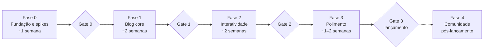

# Roadmap

A ordem de implementação do blog. O **quê** está em `SPEC.md`; aqui ficam as tarefas, as dependências entre elas, os gates e o status. Este arquivo muda a cada PR; a spec muda raramente.

## Como usar

1. Pegue a primeira tarefa `pendente` cujas dependências estejam todas `concluída`. Uma fase só começa depois que o gate da anterior estiver `aprovado`.
2. Marque-a `em andamento` no primeiro commit do PR. Branch: `t-XX-descricao-curta`.
3. Leia só as seções da SPEC ligadas aos requisitos citados na tarefa.
4. Ao fechar o PR, marque `concluída` e acrescente uma linha no [Registro de handoff](https://claude.ai/chat/86ea8e33-1d98-4582-a9c5-3a641fdb4917#registro-de-handoff), no mesmo PR.
5. Se a tarefa revelar trabalho novo, adicione uma tarefa nova com o próximo ID livre; não amplie a tarefa atual.
6. O PR que cumpre o último critério de um gate também muda a linha **Status do gate** para `aprovado (AAAA-MM-DD)`.

Status de tarefa: `pendente`, `em andamento`, `concluída`, `bloqueada (motivo)`, `cancelada (motivo)`. Status de gate: `pendente`, `aprovado (data)`.

## Fase 0 — Fundação e spikes

| ID   | Tarefa                                                                                                                                                                                                                                                                                                                                                                                                                                                                                                 | Requisitos             | Depende de | Status    |
| ---- | ------------------------------------------------------------------------------------------------------------------------------------------------------------------------------------------------------------------------------------------------------------------------------------------------------------------------------------------------------------------------------------------------------------------------------------------------------------------------------------------------------ | ---------------------- | ---------- | --------- |
| T-01 | Scaffold **Astro 7** + TypeScript strict + Tailwind v4 + ESLint/Prettier/Ruff, com `unified()` configurado em `markdown.processor` e no MDX. Vitest e Playwright configurados, com os cenários da SPEC §11 escritos como `test.fixme`. Arquivos de base: `.node-version`, `.python-version`, `.gitignore` (`dist/`, `.astro/`, `public/notebooks/`), `.cursorignore` (`exports/`) e `.github/pull_request_template.md` com "Requisitos afetados". Confirmar os comandos do AGENTS.md e remover o aviso | RNF-12, ADR-01         | —          | concluída |
| T-02 | `wrangler.jsonc`, primeiro deploy estático, variável `SITE_URL` apontando para o `workers.dev` e workflow do Actions com preview por PR (`wrangler versions upload`)                                                                                                                                                                                                                                                                                                                                   | ADR-04                 | T-01       | concluída |
| T-03 | Spike mdx-marimo a partir de `examples/with-astro` (Astro 7, runtime em custom element). Responder: peso e tempo até interativo; se o `remarkMarimo` executa Python no build (e, se sim, como acha o marimo e qual versão usa); qual versão do runtime marimo o pacote npm carrega e como alinhá-la ao `uv.lock`; se o `<script type="module">` dispara o Pyodide antes do primeiro paint; convivência com `remark-math` no mesmo `unified()` e com islands Svelte; origens que a CSP precisa liberar  | ADR-02, RNF-03, RNF-07 | T-01       | pendente  |
| T-04 | Spike `marimo export html-wasm` em iframe com um notebook `torch` real: `cache_cells` + `--execute`, tamanho do export e da pasta `public/cache/`, o que continua interativo, o que vira stub, e como o `--execute` trata `torch` (a doc diz que ele usa, quando possível, um ambiente isolado com pacotes compatíveis com WASM)                                                                                                                                                                       | ADR-02, SPEC §7        | —          | pendente  |
| T-05 | Validar `_headers`/`_redirects` em Static Assets servindo o export da T-04: `! Content-Security-Policy` seguido de nova CSP no mesmo bloco, padrão de URL com e sem barra final, CSP com `wasm-unsafe-eval` e as origens do Pyodide                                                                                                                                                                                                                                                                    | RNF-06, RNF-07         | T-02, T-04 | pendente  |

Os spikes (T-03, T-04) rodam em branch própria, não entram em `main` e registram o resultado em `specs/spikes/T-0X-<nome>.md`: perguntas, números medidos e veredito. O código do spike é descartável.

**Gate 0 — passa quando:**

- O deploy de preview funciona num PR real e o `_headers` é aplicado com detach de CSP (ou o plano B da SPEC §10 está escolhido).
- Os dois docs de spike têm veredito com números e respondem às perguntas da tarefa. O mdx-marimo é aprovado se o notebook inline fica interativo em ≤ 10 s em desktop banda larga, sem quebrar as islands Svelte.
- ADR-02 confirmado ou substituído. Se o mdx-marimo reprovar: registrar em `specs/adr/`, tirar o ramo `inline` do schema `notebook` na SPEC §6 e cortar o modo inline da T-15.

**Status do gate:** pendente

## Fase 1 — Blog core

| ID   | Tarefa                                                                                                                                                                                                                                       | Requisitos             | Depende de       | Status   |
| ---- | -------------------------------------------------------------------------------------------------------------------------------------------------------------------------------------------------------------------------------------------- | ---------------------- | ---------------- | -------- |
| T-06 | `site.config.ts` (com `SITE_URL`), `content.config.ts` com a collection `posts` (única; autor vem do config; `generateId` pelo nome da pasta) e `getPublishedPosts()` com `SHOW_DRAFTS`. Testes unitários do slug e dos dois valores da flag | RF-11, RNF-09          | T-01             | pendente |
| T-07 | `BaseLayout`, header, footer, tema base e variáveis CSS de cor                                                                                                                                                                               | —                      | T-01             | pendente |
| T-08 | Home com destaque, grid de cards e paginação (`/page/[n]`)                                                                                                                                                                                   | RF-01, RF-03           | T-06, T-07       | pendente |
| T-09 | `PostLayout` com autor, datas, tempo de leitura (plugin remark no `unified()`) e TOC                                                                                                                                                         | RF-04, RF-05           | T-06, T-07       | pendente |
| T-10 | Shiki com botão copiar (`markdown.shikiConfig.themes` claro e escuro; conferir na doc atual como ele interage com `unified()`) + KaTeX                                                                                                       | RF-06, RF-07           | T-09             | pendente |
| T-11 | Páginas de tag                                                                                                                                                                                                                               | RF-02                  | T-06, T-08       | pendente |
| T-12 | SEO, JSON-LD, RSS e sitemap, com URLs absolutas a partir de `SITE_URL`                                                                                                                                                                       | RF-10, RF-12           | T-06, T-09       | pendente |
| T-13 | Lighthouse CI, verificação de JS por página, `size-limit` por island e verificador de links no pipeline, com os limites da SPEC §4. A ferramenta de links não está na lista pré-aprovada: proponha e pergunte                                | RNF-01, RNF-02, RNF-05 | T-02, T-08, T-09 | pendente |

T-06 e T-07 vêm primeiro; depois disso, T-08 a T-12 podem correr em paralelo.

**Gate 1 — passa quando:**

- Home e um post sem notebook passam nos budgets de RNF-01 e RNF-02 no CI.
- O cenário de rascunhos (SPEC §11) está verde contra o build de produção.
- O RSS valida no W3C Validator e o JSON-LD passa no Rich Results Test.

**Status do gate:** pendente

## Fase 2 — Interatividade

Duas trilhas independentes; a T-21 junta as duas.

| ID                | Tarefa                                                                                                                                                                                                                                            | Requisitos             | Depende de             | Status   |
| ----------------- | ------------------------------------------------------------------------------------------------------------------------------------------------------------------------------------------------------------------------------------------------- | ---------------------- | ---------------------- | -------- |
| **Trilha marimo** |                                                                                                                                                                                                                                                   |                        |                        |          |
| T-14              | `scripts/build-notebooks.py` com cache por hash (`.py` + `uv.lock`) para notebooks iframe leves, saída em `public/notebooks/`                                                                                                                     | RF-08, RNF-08          | Gate 0, T-06           | pendente |
| T-15              | `MarimoRuntime.astro` (custom element do mdx-marimo, sem React) e `MarimoFrame` (iframe) com carga condicional; checagem que falha o build quando fences e `{ mode: inline }` não batem; teste de alinhamento de versão do marimo conforme a T-03 | RF-08, RNF-03, RNF-09  | T-14, T-09             | pendente |
| T-16              | Integração `src/integrations/headers.ts` que gera `dist/_headers` com CSP por rota (SPEC §10), teste de artefato das regras e falha do build acima de 100 regras                                                                                  | RNF-06, RNF-07         | T-05, T-15             | pendente |
| T-17              | Modo `--heavy`: export local em `exports/<slug>/<nome>/`, `export.lock`, upload ao R2 acima de 25 MiB, verificação de frescor no CI e cópia de `exports/` para `public/notebooks/` no build                                                       | RF-08, RNF-09, SPEC §7 | T-14                   | pendente |
| T-18              | Componente `RunOnGpu` e botão "Ativar interatividade"                                                                                                                                                                                             | RF-08, SPEC §7         | T-15                   | pendente |
| **Trilha viz**    |                                                                                                                                                                                                                                                   |                        |                        |          |
| T-19              | `LineChart` e `BarChart` com testes e fallback acessível; datas ISO convertidas no componente; fixa o contrato que a T-20 copia                                                                                                                   | RF-09, RNF-04          | T-07                   | pendente |
| T-20              | `Scatter`, `Heatmap`, `Explorable`                                                                                                                                                                                                                | RF-09, RNF-04          | T-19                   | pendente |
| **Junção**        |                                                                                                                                                                                                                                                   |                        |                        |          |
| T-21              | Post de demonstração com um notebook inline, um pesado com `compute: cache` e três gráficos                                                                                                                                                       | RF-08, RF-09           | T-16, T-17, T-18, T-20 | pendente |

Antes de começar a T-14, crie `src/components/marimo/AGENTS.md` com o que os spikes ensinaram. Antes da T-19, crie `src/components/viz/AGENTS.md` a partir da SPEC §8. O Cursor lê AGENTS.md aninhados e combina cada um com o da raiz, com prioridade para o mais específico.

**Gate 2 — passa quando:**

- Todos os cenários de notebook, CSP e gráfico da SPEC §11 estão verdes contra o post de demonstração.
- A home continua sem requisitar `pyodide*` (RNF-03).
- O build completo fica abaixo de 5 min (RNF-08).

**Status do gate:** pendente

## Fase 3 — Polimento e lançamento

| ID   | Tarefa                                                                                                          | Requisitos     | Depende de       | Status          |
| ---- | --------------------------------------------------------------------------------------------------------------- | -------------- | ---------------- | --------------- |
| T-22 | Pagefind indexando só o corpo dos posts                                                                         | RF-15          | T-09             | pendente        |
| T-23 | Imagens OG geradas no build                                                                                     | RF-16          | T-12             | pendente        |
| T-24 | Tema escuro com toggle e sem flash; conferir os gráficos no escuro                                              | RF-17          | T-07, T-19       | pendente        |
| T-25 | Página Sobre e link "Editar no GitHub"                                                                          | RF-13, RF-14   | T-07, T-09       | pendente        |
| T-26 | Posts relacionados                                                                                              | RF-18          | T-09             | pendente        |
| T-27 | Domínio, troca de `SITE_URL`, `X-Robots-Tag: noindex` no `workers.dev`, Web Analytics e checklist de lançamento | RNF-10, RNF-11 | Q4b, T-22 a T-26 | bloqueada (Q4b) |

**Gate 3 — lançamento — passa quando:**

- Lighthouse ≥ 95 nas quatro categorias, na home e num post sem notebook.
- Todos os requisitos Must da SPEC §3 estão entregues.
- Produção responde no domínio próprio com os headers de segurança (RNF-06).

**Status do gate:** pendente

## Fase 4 — Comunidade (pós-lançamento)

| ID   | Tarefa                                                                                                  | Requisitos | Depende de | Status   |
| ---- | ------------------------------------------------------------------------------------------------------- | ---------- | ---------- | -------- |
| T-28 | Giscus para comentários e reações, com carregamento lazy                                                | RF-19      | Gate 3     | pendente |
| T-29 | Componente `<Embed>` para HF Spaces e iframes genéricos                                                 | RF-20      | Gate 3     | pendente |
| T-30 | i18n, se fizer sentido                                                                                  | P5         | Gate 3     | pendente |
| T-31 | Avaliar migrar o preview por PR de Version URLs com alias para Workers Previews, via `wrangler preview` | ADR-04     | Gate 3     | pendente |

RF-21 (artigos da comunidade com login e upvote) fica fora: não combina com um blog pessoal.

## Registro de handoff

Uma linha por tarefa concluída, escrita por quem a fechou. Diz o que a próxima sessão precisa saber e que não está óbvio no código: decisões tomadas durante a tarefa, o que foi tentado e descartado, pendências deixadas de propósito. Se o número do PR ainda não existir quando a linha for escrita, use o nome do branch.

- **T-01** (2026-10-13, branch t-01-scaffold): Astro 7.3.8, TypeScript 6.0.3 (o latest 7.0.2 quebra `astro check` e `typescript-eslint`; os peers pedem `^5 || ^6`), Tailwind 4.3.3. `unified()` está em `markdown.processor` e em `mdx({ processor })`. Rotas temporárias `/exemplo-md` e `/exemplo-mdx` só exercitam os dois processadores; apagar quando houver páginas de verdade. O comentário HTML do aviso não estava no `AGENTS.md` em disco; a tabela de comandos ficou intacta. Ainda não rodam: `scripts/build-notebooks.py`, `wrangler dev`, `marimo check`. `SHOW_DRAFTS` não muda o build (T-06). CI fica na T-02. `pnpm dev` escuta só em `[::1]:4321`: `localhost` responde, `127.0.0.1` não.
- **T-02** (2026-10-14, branch t-02-deploy-cloudflare): wrangler 4.150.0 (devDependency), Worker só de assets, sem `main`. `workers_dev` e `preview_urls` explícitos (omitir `preview_urls` mantém o setting do placeholder). Jobs `lint`, `test`, `build`, `preview`, `deploy`; exigir os quatro primeiros no ruleset (`deploy` não roda em PR). Preview pula fork e `dependabot[bot]`; alias `https://pr-<n>-blog.p-giacometo.workers.dev`. `versions upload` não troca a produção: o Hello World só sai no primeiro push em `main`. `deploy` usa `--no-autoconfig`: sem ele, o Wrangler rodaria `astro add cloudflare` e instalaria o adapter que o ADR-05 dispensa. `esbuild` e `workerd` negados em `allowBuilds` (`pnpm-workspace.yaml`): o pnpm 12 falha o install com scripts não revisados e nada da T-02 precisa deles; reavaliar se o `wrangler dev` falhar (T-05). Actions pinadas por SHA (`setup-uv` v10.3.0; o guia da Astral cita v9.0.0). Playwright fora (cenários em `test.fixme`). `SHOW_DRAFTS` e `SITE_URL` já entram no build, mas só a T-06 os lê. Version URLs habilitadas no dashboard em 2026-10-14: `versions upload` não aplica `preview_urls`, só o `deploy` aplica.

