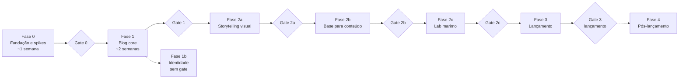
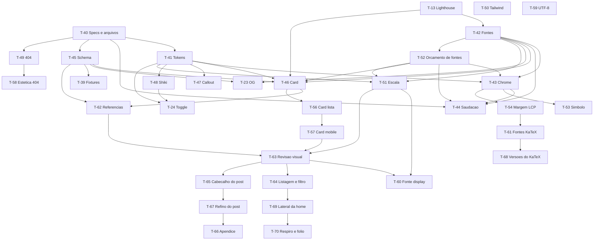

# Roadmap

A ordem de implementação do blog. O **quê** está em `SPEC.md`; aqui ficam as tarefas, as dependências entre elas, os gates e o status. Este arquivo muda a cada PR; a spec muda raramente.

## Como usar

1. Pegue a primeira tarefa `pendente` cujas dependências estejam todas `concluída`. Uma fase só começa depois que o gate da anterior estiver `aprovado`, salvo quando a coluna Depende de cita um gate anterior.
2. Marque-a `em andamento` no primeiro commit do PR. Branch: `t-XX-descricao-curta`.
3. Leia só as seções da SPEC ligadas aos requisitos citados na tarefa.
4. Ao fechar o PR, marque `concluída` e acrescente a entrada no [Registro de handoff](#registro-de-handoff), no mesmo PR: 1 linha na tarefa leve, até 3 na completa (AGENTS.md, Trilhas). O detalhe da tarefa fica na descrição do PR.
5. Se a tarefa revelar trabalho novo, adicione uma tarefa nova com o próximo ID livre; não amplie a tarefa atual.
6. O PR que cumpre o último critério de um gate também muda a linha **Status do gate** para `aprovado (AAAA-MM-DD)`.

Posts não são tarefas e não entram aqui: seguem a trilha Post do AGENTS.md (RNF-14).

Status de tarefa: `pendente`, `em andamento`, `concluída`, `bloqueada (motivo)`, `cancelada (motivo)`. Status de gate: `pendente`, `aprovado (data)`.




## Fase 0 — Fundação e spikes


| ID   | Tarefa                                                                                                                                                                                                                                                                                                                                                                                                                                                                                                 | Requisitos             | Depende de | Status    |
| ---- | ------------------------------------------------------------------------------------------------------------------------------------------------------------------------------------------------------------------------------------------------------------------------------------------------------------------------------------------------------------------------------------------------------------------------------------------------------------------------------------------------------ | ---------------------- | ---------- | --------- |
| T-01 | Scaffold **Astro 7** + TypeScript strict + Tailwind v4 + ESLint/Prettier/Ruff, com `unified()` configurado em `markdown.processor` e no MDX. Vitest e Playwright configurados, com os cenários da SPEC §11 escritos como `test.fixme`. Arquivos de base: `.node-version`, `.python-version`, `.gitignore` (`dist/`, `.astro/`, `public/notebooks/`), `.cursorignore` (`exports/`) e `.github/pull_request_template.md` com "Requisitos afetados". Confirmar os comandos do AGENTS.md e remover o aviso | RNF-12, ADR-01         | —          | concluída |
| T-02 | `wrangler.jsonc`, primeiro deploy estático, variável `SITE_URL` apontando para o `workers.dev` e workflow do Actions com preview por PR (`wrangler versions upload`)                                                                                                                                                                                                                                                                                                                                   | ADR-04                 | T-01       | concluída |
| T-03 | Spike mdx-marimo a partir de `examples/with-astro` (Astro 7, runtime em custom element). Responder: peso e tempo até interativo; se o `remarkMarimo` executa Python no build (e, se sim, como acha o marimo e qual versão usa); qual versão do runtime marimo o pacote npm carrega e como alinhá-la ao `uv.lock`; se o `<script type="module">` dispara o Pyodide antes do primeiro paint; convivência com `remark-math` no mesmo `unified()` e com islands Svelte; origens que a CSP precisa liberar  | ADR-02, RNF-03, RNF-07 | T-01       | concluída |
| T-04 | Spike `marimo export html-wasm` em iframe com um notebook `torch` real: `cache_cells` + `--execute`, tamanho do export e da pasta `public/cache/`, o que continua interativo, o que vira stub, e como o `--execute` trata `torch` (a doc diz que ele usa, quando possível, um ambiente isolado com pacotes compatíveis com WASM)                                                                                                                                                                       | ADR-02, SPEC §7        | —          | concluída |
| T-05 | Validar `_headers`/`_redirects` em Static Assets servindo o export da T-04: `! Content-Security-Policy` seguido de nova CSP no mesmo bloco, padrão de URL com e sem barra final, CSP com `wasm-unsafe-eval` e as origens do Pyodide                                                                                                                                                                                                                                                                    | RNF-06, RNF-07         | T-02, T-04 | concluída |


Os spikes (T-03, T-04, T-05) rodam em branch própria. O código fica nesse branch e não entra na `main`. O doc em `specs/spikes/T-0X-<nome>.md` e o handoff entram por um PR próprio: perguntas, o que foi medido e o veredito. O branch da T-05 foi publicado só para o preview, num PR em rascunho fechado sem merge.

**Gate 0 — passa quando:**

- O deploy de preview funciona num PR real e o `_headers` é aplicado com detach de CSP (ou o plano B da SPEC §10 está escolhido).
- O doc da T-04 tem veredito com números e responde às perguntas da tarefa. O critério do mdx-marimo não se aplica: inline adiado por manutenção, ver doc da T-03.
- ADR-02 substituído em 14/10/2026 (inline adiado; ver doc da T-03). O ramo inline saiu da SPEC §6 e da T-15.

**Status do gate:** aprovado (2026-10-15)

## Fase 1 — Blog core


| ID   | Tarefa                                                                                                                                                                                                                                       | Requisitos             | Depende de       | Status   |
| ---- | -------------------------------------------------------------------------------------------------------------------------------------------------------------------------------------------------------------------------------------------- | ---------------------- | ---------------- | -------- |
| T-06 | `site.config.ts` (com `SITE_URL`), `content.config.ts` com a collection `posts` (única; autor vem do config; `generateId` pelo nome da pasta) e `getPublishedPosts()` com `SHOW_DRAFTS`. Testes unitários do slug e dos dois valores da flag | RF-11, RNF-09          | T-01             | concluída |
| T-07 | `BaseLayout`, header, footer, tema base e variáveis CSS de cor. Base: `lang`, landmarks, link de pular, um `h1` por página | RNF-04, RNF-05 | T-01 | concluída |
| T-08 | Home com destaque, grid de cards e paginação (`/page/[n]`)                                                                                                                                                                                   | RF-01, RF-03           | T-06, T-07       | concluída |
| T-09 | `PostLayout` com autor, datas, tempo de leitura (plugin remark no `unified()`) e TOC. Usar `prose` do `@tailwindcss/typography` com as cores dos tokens; remover `/exemplo-md` e `/exemplo-mdx`. O plugin já está registrado | RF-04, RF-05           | T-06, T-07       | concluída |
| T-10 | Shiki com botão copiar (`markdown.shikiConfig.themes` claro e escuro; conferir na doc atual como ele interage com `unified()`) + KaTeX                                                                                                       | RF-06, RF-07           | T-09             | concluída |
| T-11 | Páginas de tag                                                                                                                                                                                                                               | RF-02                  | T-06, T-08       | concluída |
| T-12 | SEO, JSON-LD, RSS e sitemap, com URLs absolutas a partir de `SITE_URL`. O `<title>` segue `{Título do fólio} · {site.title} · {autor}` com o config da hora. Os literais `pk.log` e `Pedro Knoll` entram na T-43. Não depende da Fase 1b; o Gate 1 não espera essa troca                                                                                                                                                                       | RF-10, RF-12           | T-06, T-09       | concluída |
| T-13 | Lighthouse CI, verificação de JS por página e verificador de links (`linkinator`, aprovado nesta tarefa) no pipeline, com os limites da SPEC §4. O `size-limit` por island foi para a T-19                                | RNF-01, RNF-02, RNF-05 | T-02, T-08, T-09 | concluída |
| T-36 | Job e2e no CI: Playwright e axe contra astro preview do build de produção; incluir e2e nos checks obrigatórios                                                                                                                               | RNF-04, RF-11          | T-02, T-07       | concluída |
| T-37 | Tornar exatas as asserções de texto de `tests/e2e/layout.spec.ts`: `exact: true` nos locators por nome acessível (ex.: linha 68, link do header) e comparação exata nos textos literais. Hoje "Nome do blog QUEBRA" passa no teste do link do header, porque o match é por substring (achado da T-36) | RNF-04, RNF-05 | T-07 | concluída |


T-06 e T-07 vêm primeiro; depois disso, T-08 a T-12 podem correr em paralelo.

**Gate 1 — passa quando:**

- Home e um post sem notebook passam nos budgets de RNF-01 e RNF-02 no CI.
- O cenário de rascunhos (SPEC §11) está verde contra o build de produção.
- O RSS valida no W3C Validator e o JSON-LD passa no Rich Results Test.

**Status do gate:** aprovado (2026-10-26)

## Fase 1b — Identidade

A Fase 1b não tem gate e não bloqueia a Fase 2. O texto do Gate 1 permanece. A T-13 não ganha dependência desta fase. T-40, T-41 e T-45 podem correr em paralelo com a T-12 e a T-13; não são critério do Gate 1. Fontes (T-42) e card (T-46) é que dependem da T-13. A trilha marimo é a Fase 2c e começa depois do Gate 2b.

Nenhuma tarefa depende da T-43 por causa de arquivo. A seta T-43 → T-44 é o `Wordmark`: a T-43 cria o componente e a saudação da T-44 usa. Os `<link>` do favicon entram no `BaseLayout`, em cima dos arquivos que a T-40 já deixou em `public/`.



| ID | Tarefa | Requisitos | Depende de | Status |
| --- | --- | --- | --- | --- |
| T-40 | Atualiza SPEC, ROADMAP e AGENTS. Adiciona `specs/BRAND.md` e, no mesmo PR, a seção 0, os caminhos do apêndice, a §4 (lápis não é texto menor que 24 px sobre folha clara) e a §5 (Cormorant; a assinatura, Wordmark, também é exceção ao mínimo de 28 px, por ser desenho da marca e não texto). Move `pklog-brand/` para a árvore da SPEC §9 e apaga a pasta. `icon-192.png` e `icon-512.png` não são versionados. Prettier em `src/styles/shiki`. O comentário do `pk-claro.json` passa a `#5E5345`; o tema escuro não muda o comentário nesta tarefa | RF-01, RF-04, RF-06, RF-12, RF-16, RF-17, RF-22, RNF-04 | — | concluída |
| T-41 | Em `src/styles/global.css`, os nomes finais são `surface`, `sheet`, `ink`, `muted`, `pencil`, `line`, `accent`, `kind-concept`, `kind-tutorial`, `kind-lab`, `kind-playbook`. `kind-concept` é alias de `accent`. `muted` continua o grafite. Sem `graphite`, `gold`, `pixel`. `grid` não nasce aqui: só na tarefa que desenhar a grade (T-23 ou o diagrama da T-19). Prosa do código usa `sheet`. Paleta escura em `:root[data-theme="dark"]`, sem botão e sem `@custom-variant dark`. Pode sair antes do Gate 1. Foco: contorno 2 px em `accent`, afastamento 3 px, no lugar do `outline-offset-2` do link em `Card.astro` e do `outline-offset: 2px` de `.code-copy-button`. A tarefa escolhe um dos dois mecanismos e registra no PR: uma regra global de `:focus-visible`, ou a troca local nesses dois pontos. A nav de `TagFilter.astro` tem `overflow-x-auto` e `pb-2`; conferir que esse `pb-2` ainda deixa o contorno de 3 px visível | RNF-04 | T-40 | concluída |
| T-42 | Fonts API do Astro: `fontProviders.fontsource()` em `astro.config.mjs` e `<Font>` de `astro:assets` no `BaseLayout.astro`. Famílias: Cormorant Garamond, IBM Plex Sans, IBM Plex Mono, Caveat. Subset `latin`, `woff2`. Sem `fontProviders.google()` e sem `pnpm add` de `@fontsource/*`. A SPEC §9 não ganha esses pacotes. Conferir o HTML gerado: se o `<Font>` emitir `<style>` inline, o hash entra na lista da T-16. A CSP de página não ganha `unsafe-inline` por causa da fonte | RNF-01 | T-13 | concluída |
| T-43 | Não move arquivo. Cria `src/components/ui/Wordmark.astro` com `<span class="nome"><em>pk</em><span class="ponto">.</span><span class="ext">log</span></span>`, sem tamanho próprio: o tamanho vem de quem usa. O `Header.astro` usa esse componente no link para `/`, sem o símbolo, que fica para a T-53. `site.title` `pk.log`, autor `Pedro Knoll`, `author.bio` `Aprendizados e experimentos em IA`. O rodapé continua com autor e ano em texto, sem assinatura. No `BaseLayout.astro`, três `<link>`: `favicon.svg` com `type="image/svg+xml"`, `favicon.ico` com `sizes="32x32"` e `apple-touch-icon.png`; `favicon-16.png` e `favicon-32.png` ficam em `public/` sem `<link>`. Atualiza os literais em `tests/e2e/layout.spec.ts`, `tests/e2e/post.spec.ts` linhas 34–35 e `tests/e2e/site-literals.ts`. O orçamento de fontes da SPEC §9 vale aqui: o pk é Cormorant 600 normal, e o ponto e o log são Plex Mono 400. | RF-12 | T-41, T-42, T-52 | concluída |
| T-44 | Saudação e texto de apresentação. O nome dentro da saudação é o `Wordmark` da T-43. O aceno é um SVG component (`import Aceno from "~/assets/brand/icones/aceno.svg"`), com `aria-hidden` dentro do `h1`. 48 px, 32 px abaixo de 560 px. Esse é o único `h1` de `/`: o heading `Blog` sai da home. Em `/page/n` o `h1` permanece o do Listing, hoje `Blog — página N`. Páginas de tag seguem com o `h1` `Tag: <tag>`. Sem newsletter. E2E com `page.emulateMedia({ reducedMotion: "reduce" })`: a animação do aceno fica parada. Keyframes saem do `<style>` do SVG e vão para `global.css`. O orçamento de fontes da SPEC §9 vale aqui; o LCP da home hoje é a capa e esta tarefa o troca pela saudação. | RF-01 | T-40, T-42, T-43, T-52 | concluída |
| T-45 | Estende `src/content.config.ts`. `folio` inteiro, exibição `Fól. 006`. `kind`: `concept`, `tutorial`, `lab` ou `playbook`; rótulos pt-BR num mapa (`Conceito`, `Tutorial`, `Lab`, `Playbook`), não no frontmatter. `level`: `z.int().min(1).max(3)`. `benchMinutes`, `material` e `track` opcionais; `benchMinutes` não substitui `minutesRead`; `track` é `z.string().regex(/^[a-z0-9-]+$/).optional()`, mesma regra de tags, sem rota. `tags` continuam; temas da marca são rótulo em `src/data/tags.ts`, não um segundo campo. Lab exige ao menos um item em `notebooks`. Colab segue `gpuUrl`. Unicidade: função pura em `src/lib/`, chamada por `getPublishedPosts` sobre todas as entradas, rascunho incluído, antes do filtro de publicados. Teste unitário: dois fólios iguais falham e citam os ids; a série única passa. Fól. 001 é `2026-10-por-que-este-blog`; Fól. 002 é `2026-10-como-o-blog-e-feito`; os dois entram como `kind: concept` e `level: 1`. Pode sair antes do Gate 1 | RF-01, RF-04, SPEC §6 | T-40 | concluída |
| T-46 | Ícone parado na lista, animado no cabeçalho do post, os dois como SVG component. Os ícones vêm da T-40 por T-41; não depende da T-43. Hachura de três traços, com 1, 2 ou 3 marcados. Data visível `21.out.2026` em `src/lib/format-date.ts`; o `datetime` continua ISO. Atualiza `tests/e2e/home.spec.ts` linha 50, `tests/unit/format-date.test.ts` e `tests/e2e/post.spec.ts` linha 45. Capa, autor, tempo de leitura e tags permanecem. Meta em `pencil` sobre `surface`. Comentário de código não usa `pencil`. Título do card: Cormorant peso 600, cerca de 1,45rem, nunca abaixo de 22 px. E2E com `emulateMedia({ reducedMotion: "reduce" })` no ícone animado do cabeçalho. Keyframes no `global.css`, como na T-44. A ficha da seção 9.3 do BRAND foi para a T-55. O título do card em Cormorant 600 cabe no orçamento de fontes da SPEC §9. | RF-01, RF-04 | T-13, T-41, T-42, T-45, T-52 | concluída |
| T-47 | `src/components/ui/Callout.astro`, prop `variant` `note`, `caution` ou `result`. As três formas da seção 9.4 do BRAND, tudo em tinta. Rótulos visíveis: `// NOTA DE BANCADA`, `[!] CUIDADO`, `= RESULTADO` | RF-22 | T-41 | concluída |
| T-48 | Os temas `pk-claro` e `pk-escuro` entraram na T-41. `defaultColor: false` fica. Uma cerca com a meta `title=<arquivo>` depois da linguagem (```` ```py title=fol-001_embeddings.py ````) mostra o nome do arquivo na barra do bloco; sem `title=`, a barra não mostra nome. Teste prova que essa meta chega ao transformer do Shiki. O botão visível passa de "Código copiado" para "Copiado" (1,5 s). O `copyResetMs` está duplicado com `tests/e2e/code.spec.ts` (T-10); os dois passam a 1,5 s. O aria-label é "Copiar código" e vira "Código copiado" junto com o texto (WCAG 2.5.3) | RF-06 | T-41, T-10 | concluída |
| T-49 | `src/pages/404.astro` com "Esta página foi arrancada do caderno." Não depende da T-43. Os E2E que só checam status 404 ganham a frase | BRAND §10 | T-40 | concluída |
| T-50 | Limitar a detecção de classes do Tailwind a `src/`, com `@import "tailwindcss" source("..");` na linha 1 de `src/styles/global.css`. Hoje a detecção parte da raiz e varre os 71 arquivos versionados fora de `src/`, entre eles `tests/`, `specs/` e o `AGENTS.md`: a amostra `dark:bg-surface` de `tests/unit/color-tokens.test.ts`, também escrita nesta linha, gera `.dark\:bg-surface` dentro de `@media (prefers-color-scheme: dark)` no CSS do site (achado da T-41), e texto de doc pode gerar CSS. Tirar só `tests/` não basta. Sem teste novo: um teste permanente de zero `prefers-color-scheme` brigaria com a T-24 (BRAND §4); prova pela saída do pipeline, como tarefa de infra. Prova: `grep -o "prefers-color-scheme" dist/_astro/*.css \| wc -l` vai a 0; nenhuma regra entra no CSS; nenhuma classe que sai aparece no HTML de `dist/`; o teste unitário continua verde | Q12 | — | concluída |
| T-51 | Escala tipográfica da BRAND §5 no site: texto 17 px, altura de linha 1,65, coluna de cerca de 65 caracteres; h1 44 e h2 30 em Cormorant, nunca abaixo de 28 px, inclusive a 360 px; h3 22 em IBM Plex Sans 600; rótulo 12; `text-wrap: balance` nos títulos. Usa os tokens da T-42. Troca o `font-serif` do h1 do `Listing.astro` e do h1 do `PostLayout.astro` pelo token de display; o título do card, hoje `font-serif` em `Card.astro`, é da T-46. Os rótulos de metadados (Destaque, no card; Autor, Leitura e Tags, no cabeçalho do post), hoje `text-xs` com `small-caps`, passam ao rótulo da BRAND §5: IBM Plex Mono 12 px, maiúsculas, letter-spacing de 0,08 a 0,14 em, sem `small-caps`. Achado da T-42: com a Plex Sans, as versaletes sintetizadas ficaram pequenas demais. Não inclui Wordmark (T-43), saudação (T-44) nem card (T-46). Refaz o Lighthouse e o teste de foco da T-41. A escala cabe no orçamento de fontes da SPEC §9: Cormorant só 600 normal nas páginas, h3 em Plex Sans 600 e rótulo em Plex Mono 400. | RNF-01, RNF-04 | T-41, T-42, T-52 | concluída |
| T-52 | Orçamento de fontes no LCP. Com as fontes da T-42, o LCP simulado subiu 300 ms na home e no post A e até 600 ms no post B (pior caso 1954 ms, a 46 ms do teto de 2000 ms). Cada arquivo de fonte usado na página entra antes do LCP na simulação de Slow 4G. Antes de pôr Cormorant ou Caveat acima da dobra, medir o custo de cada arquivo de fonte no Lighthouse do projeto e escolher a estratégia, sem mexer no budget. Candidatas: menos pesos, variable font, preload da família de display, `font-display: optional`. O preload da Plex Sans 400 não é a causa: sem ele a home ficou igual e os posts perderam 150 ms de FCP (experimento da T-42) | RNF-01 | T-42 | concluída |
| T-53 | Símbolo na assinatura do header, BRAND §3: `pklog-simbolo-currentcolor.svg` como SVG component com `aria-hidden` no uso, antes do `Wordmark`, em 1,55em, com gap de 0,42em e altura de linha 1. O nome acessível e o texto do link continuam `pk.log`. O arquivo é editado no lugar e perde `<title>`, `role`, `aria-label`, `width`, `height` e os dois hex: o traço e os nós das pontas herdam o `ink` do link; o nó central fica em `text-accent` e o halo, um traço por cima do nó, em `text-surface`, com `currentColor`, como na T-58. Conferir as cores do nó e do halo nos dois temas e medir a largura da assinatura contra o mínimo da BRAND §3, que passou de 140 px para 100 px, o tamanho do header; o header não muda (T-43). Mede LCP e CLS antes e depois | RF-12, RNF-04 | T-43 | concluída |
| T-54 | Margem de LCP dos posts. Lighthouse local depois da T-53, mediana de 3: post A a 1654 ms, com 3 arquivos de fonte da marca (Plex Sans 400, Plex Mono 400 e Cormorant 600); post B a 1954 ms, com 4 (esses e a Plex Sans 600), a 46 ms do teto, menos que um degrau de cerca de 150 ms do Lantern. A guarda de fontes admite um 5º arquivo nos posts, a Plex Sans 400 itálico, que nenhum post publicado pede; o `lighthouserc.json` só mede a home e os posts A e B. Medir com ênfase em itálico só no working tree dos posts A e B, fora dos commits, como as variantes da T-52, e decidir entre tetos da guarda, estratégia de fonte ou URLs do Lighthouse CI, sem relaxar o RNF-01; fixture versionada, se a decisão pedir, fica com a T-39. Hipótese a testar: limite de 6 conexões por origem em HTTP/1.1 no Lantern, contra o custo por byte; o post A subiu dois degraus na T-43, quando a previsão era um, e desceu dois na T-51, com um arquivo a menos | RNF-01 | T-43 | concluída |
| T-55 | Ficha do cabeçalho do post, item 4 da seção 9.3 do BRAND. Quando o post tem `benchMinutes`, `material` ou `track`, o cabeçalho mostra só os itens presentes: tempo de bancada (`≈ 90 min`), material e caderno. `track` mostra a posição e o total de posts publicados com o mesmo `track` (`LLMs · 4 de 12`). A posição é calculada numa função pura em `src/lib/`, com entrada estrutural. A tarefa decide a ordem da contagem (sugestão: `pubDate` crescente, desempate por `id`) e o rótulo do caderno, já que `track` é um slug e `src/data/tags.ts` não existe. Saiu da T-46 porque nenhum post publicado tem esses campos; a prova usa a fixture da T-39. Mede LCP e CLS antes e depois, por causa da margem dos posts (T-54) | RF-04 | T-39, T-46 | cancelada (sem tempo de bancada, material e caderno, a ficha deixa de existir; ver T-62) |
| T-56 | Card da listagem num DOM só: fólio e data, título sem sublinhado em repouso, resumo, tipo, nível e tempo de leitura com relógio parado; sem tags; capa só no destaque; destaque com borda embaixo e capa centralizada. O número do fólio é Cormorant 600 desde 22 px, via `folioDigits`. O tempo é o `minutesRead` da página do post, lido por `render()` em `src/lib/reading-minutes.ts`, sem cache. No desktop da lista, a faixa do fólio fica à esquerda e centralizada na altura do card. A lista separa os cards com `divide-line` | RF-01, RF-02 | T-46 | concluída |
| T-57 | Ajustes de mobile no card de fólio, BRAND §9.2. Resumo em 17 px com entrelinha 1,65. Título da lista em 26 px abaixo de `sm` e ~1,45rem de `sm` em diante, Cormorant 600 desde 22 px; o título do destaque não muda. O card inteiro é tocável pelo link esticado no título, com `active:text-accent`, sem hover de borda nem sombra. O rodapé leva `gap-y-1.5` e `pointer-events-none`, para o separador absoluto não ficar por cima do toque. No mobile, a capa do destaque fica depois do rótulo e do fólio com a data, e antes do título; de `sm` em diante continua à direita | RF-01 | T-56 | concluída |
| T-58 | Estética da página 404, a partir do mockup aprovado em 2026-10-30. A partir de `md`, duas colunas. À esquerda, o `h1` da T-49; um parágrafo, "O endereço pode ter mudado, ou esta página ainda não foi escrita. O resto do caderno continua aqui."; e o link "Voltar ao início" com cara de botão: fundo `ink`, texto `surface`, IBM Plex Mono 400, foco de 2 px em `accent` com afastamento de 3 px. À direita, uma ilustração em SVG com `aria-hidden`: folha arrancada, com borda em zigue-zague e furos de espiral; cota `148 mm` (BRAND §6); o símbolo numa versão 404, com o círculo tracejado e um nó de ponta vazio, ligado por aresta pontilhada; e duas notas à margem, "estava aqui" e "nó não encontrado", em IBM Plex Sans itálico, `accent`, inclinadas −1,5°, sem Caveat (T-52). Abaixo de `md`, a ilustração vai para baixo do texto, com no máximo 240 px de largura. O SVG fica em `src/assets/brand/`, com `currentColor` e tokens, sem hex fora da paleta, para funcionar no tema escuro (T-24). Antes do código, a BRAND ganha a versão 404 do símbolo (§3), o botão (§9) e os microtextos (§10, que troca "Voltar para o início" por "Voltar ao início"). Atualiza `tests/e2e/not-found.spec.ts`. As classes novas entram no CSS de todas as páginas: Lighthouse antes e depois na home e nos posts A e B | BRAND §3, §6, §9, §10 | T-49 | concluída |
| T-59 | Guarda de codificação: todo arquivo de texto em `src/` é UTF-8. Na T-58, o editor do Cursor gravou `pklog-simbolo-404.svg` em Latin-1 (bytes `f3` e `e3` em "nó não"); o Astro lê o SVG como UTF-8 e o `dist/404.html` saiu com U+FFFD. O `file` não avisa, porque reconhece o SVG antes de olhar a codificação. A tarefa escolhe o mecanismo e o registra no PR: uma checagem no lint ou no CI que falhe com byte que não forme UTF-8 válido, provada com um arquivo em Latin-1, ou outra que dê a mesma garantia. Um `.editorconfig` sozinho não basta, porque não reprova nada. Sem dependência nova | Q12 | — | concluída |
| T-60 | Troca da fonte de display pela IBM Plex Sans Condensed 600, escolhida na T-63 (BRAND §5). Na revisão visual da T-51, a Cormorant Garamond 600 nos títulos grandes (h1 do post e da tag, h2 da prosa) pareceu de tom infantil para o blog; até a T-51, o h1 do post era a serif do sistema (New York no macOS) em peso 400. A T-63 comparou sete candidatas do Fontsource, subset `latin`, peso 600, nos tamanhos reais; esta tarefa não reabre a escolha. Atualiza a BRAND §1 (o pk da assinatura deixa de ser serifa) e §5 (tabela, regras e exceções da Cormorant) e as menções à Cormorant na SPEC §9 e no AGENTS. Orçamento: o arquivo latin 600 do `@fontsource/ibm-plex-sans-condensed` tem 19.816 bytes, contra 23.396 da Cormorant; a home e a tag caem de 60.692 para 57.112 bytes, e o teto de 61.000 não muda. Conferir o tamanho do arquivo que a Fonts API baixa no build. A troca fica em `astro.config.mjs`, `BaseLayout.astro`, no `@theme inline` e nas listas de faces do `fonts.spec.ts` e do `font-budget.spec.ts`; os componentes usam o token `font-display` e não mudam. Mede o Lighthouse antes e depois. A T-23 acha a fonte da OG pelo `fontData` | BRAND §5, RNF-01 | T-51, T-63 | concluída |
| T-61 | Fontes do KaTeX no orçamento de fontes dos posts. O `PostLayout.astro` importa `katex.min.css`, e cada post com math pede `.woff2` do KaTeX de `/_astro/`, fora de `/_astro/fonts/`: no V0 da T-54, o post A pede `KaTeX_Math-Italic` e `KaTeX_Main-Regular`, e o post B também a `KaTeX_Size2`. A guarda `font-budget.spec.ts` não conta esses arquivos (`classify` os marca como `katex`, e `requestedFonts` só olha `/_astro/fonts/`), mas eles entram no LCP: na V3 da T-54, três fontes `Size` do KaTeX, com 16.516 bytes, subiram o post A um degrau. Um post com mais math e itálico pode passar de 2000 ms sem aviso local, e o `lighthouserc.json` só mede a home e os posts A e B. Medir e decidir entre contar o KaTeX na guarda, com teto próprio, e uma URL de pior caso no Lighthouse CI, que pede fixture versionada (T-39), sem relaxar o RNF-01. A `KaTeX_Size3` vem embutida no CSS como `data:` e não gera requisição | RNF-01 | T-54 | concluída |
| T-62 | Referências e apêndices no post, no modelo do Distill (https://distill.pub/2021/multimodal-neurons/), no lugar da ficha da BRAND §9.3. Sai do schema da SPEC §6: `benchMinutes`, porque o tempo do post é só o `minutesRead`; `material`; e `track`, porque o assunto fica só nas `tags`. Entram dois campos opcionais no frontmatter, validados pelo schema: `references`, uma lista em que cada item tem chave, autores, título, ano, veículo e link; e `appendices`, os apêndices escritos pelo autor (Apêndice A, B…). No texto, a citação é um número com link, como `[1]`, que leva à referência no fim do post, sem JavaScript. No fim do post, uma área de apêndice com os apêndices do autor e a lista numerada de referências, só quando o post tem algum dos dois campos; post sem nenhum dos dois não muda. A tarefa decide a sintaxe da citação no Markdown e no MDX, a forma do conteúdo de cada apêndice e se os apêndices entram no sumário. Sem dependência fora da SPEC §9. Atualiza a SPEC (RF-04, o schema da §6 e o registro de revisões) e a BRAND (§1 sem o vocabulário de caderno, §8 e §9.3). Nenhum post publicado tem esses campos: decidir no início da tarefa se a prova usa conteúdo de teste no post B, como as T-47 e T-48, ou uma fixture da T-39. Mede LCP e CLS antes e depois | RF-04, SPEC §6 | T-45, T-46 | concluída |
| T-63 | Revisão visual da listagem e do post. Tarefa de decisão de marca, sem código no site: o PR só muda `specs/`. Mockups em HTML, fora do repositório, lado a lado a 375 px e no desktop, da home, do card e da página do post, com o conteúdo dos posts publicados. Decide: (1) na listagem, famílias e tamanhos da saudação, do título e do resumo do card e do rodapé, para a hierarquia; (2) na listagem, um filtro por tipo (`kind`) no lugar da barra "Filtrar por tag", na disposição de https://claude.dev/, só com links e sem JavaScript, como a barra de hoje; decide o que acontece com `/tags/<tag>/` e se o tipo ganha páginas, com rota em pt-BR (SPEC §9); (3) no post, o cabeçalho no modelo de https://stripe.dev/blog/scaling-radar-fighting-fraud-with-agent-assisted-machine-learning: título grande em cima e metadados ao lado; ao rolar, o título aparece na lateral; no celular, o título fica acima dos metadados e rola com o artigo; o sumário sai; mecanismo decidido em 2026-11-04: o título da lateral está no HTML desde a carga, com `aria-hidden`, e um `<script>` do Astro, sem Svelte e sem island, com `IntersectionObserver` no `h1`, só liga um atributo quando o `h1` sai da tela; a transição fica no CSS, só com `opacity` e `transform`, e o espaço do título fica reservado desde a carga, porque rolar não conta como interação no CLS de campo e o Lighthouse só mede a carga; sem transição com `prefers-reduced-motion`; sem JavaScript, o título da lateral fica escondido; o custo entra no `pnpm check:js` (RNF-02), e o E2E rola com `scrollIntoView` e confere com asserção com retry, sem `waitForTimeout`; (4) referências e apêndices em corpo menor que o texto, no modelo de https://distill.pub/2021/gnn-intro/, e se a área da T-62 sai do `div.prose`; (5) a fonte de display, entre as candidatas da T-60. Grava as decisões na BRAND (§5, §9.1, §9.2, §9.3 e o filtro) e na SPEC: RF-02 e a regra da barra na §6; o RF-05, que é Must, sai, e a T-38 fica cancelada no mesmo PR; os cenários da §11 que citam a barra ou o sumário; o registro de revisões. Cria uma tarefa de implementação por área, com os próximos IDs livres (listagem e filtro, cabeçalho do post, apêndice), e diz quais testes cada uma muda: `typography.spec.ts` (o T3 confere 30 px em todo h2 do `.prose`), `card.spec.ts`, `greeting.spec.ts`, `post.spec.ts` (sumário), `tags.spec.ts`, `focus.spec.ts`, `seo.spec.ts`, `spec-11.spec.ts`, `published-posts.ts`, `references.spec.ts` e `font-budget.spec.ts`. Restrições medidas: home e tag a 308 bytes do teto de 61.000 nas fontes, e fonte nova acima da dobra pede outro orçamento, que é decisão de escopo; post B com LCP de 1953 ms, a 47 ms do teto de 2000; a quebra da saudação no celular não pode depender da fonte (CLS, T-44). Fazer antes da Fase 2: o `MarimoFrame`, a barra do lab e os gráficos herdam fontes, tamanhos e grade | RF-01, RF-02, RF-04, RF-05, RNF-01, RNF-02, BRAND §5, §9 | T-51, T-57, T-62 | concluída |
| T-64 | Listagem e filtro por tipo, decididos na T-63 (BRAND §9.1, §9.2 e §9.12; SPEC RF-02 e §6). Saudação: texto de apresentação em 18 px, entrelinha 1,55, `muted`, até ~46 caracteres. Card da lista: título em 28 px em todas as larguras, entrelinha 1,2; resumo em 16 px, entrelinha 1,6; faixa do fólio de 6,5rem, alinhada ao topo do título; destaque em 36 px abaixo de `sm` e 44 px de `sm` em diante. Hover: o título não sublinha nem muda de cor; com o ponteiro sobre um card, os outros cards da listagem, destaque incluído, caem para opacidade 0,35, só em `@media (hover: hover) and (pointer: fine)`; o foco do teclado faz o mesmo; sem transição com `prefers-reduced-motion`; sem JavaScript. A barra "Filtrar por tag" dá lugar à "Filtrar por tipo": `Todos` e os tipos com post publicado, na ordem de `KINDS`, com o ícone parado na cor do tipo e a contagem. Páginas `/tipos/<tipo>/` com o slug pt-BR em `src/lib/kind.ts`, espelhando a home, sem destaque e sem paginação; tipo sem post não gera página. As páginas de tag continuam, sem barra. Atualiza a SPEC §10 e o AGENTS (rotas com `/tipos/[tipo]`) e os testes que citam a barra, a saudação ou o card: `card.spec.ts`, `tags.spec.ts`, `focus.spec.ts`, `seo.spec.ts`, `spec-11.spec.ts`, `published-posts.ts`, `greeting.spec.ts` e `home.spec.ts`; o cenário de rascunho da §11 passa a cobrir as páginas de tipo. Sem fonte nova: as três faces da home. Mede LCP e CLS antes e depois na home e numa página de tipo | RF-01, RF-02, RF-11, RNF-01, BRAND §9.1, §9.2, §9.12 | T-63 | concluída |
| T-65 | Cabeçalho do post com lateral e sem sumário, decidido na T-63 (BRAND §5 e §9.3; SPEC RF-04). Título em cima, na largura toda: 36 px abaixo de `sm`, 44 px de `sm` e 72 px de `lg` em diante, entrelinha 1,02 no `lg`; linha fina em grafite, 18 px e 24 px de `lg` em diante, até ~52 caracteres. De `lg` em diante, lateral sticky de 15rem à esquerda, vão de 4rem: no topo, `Fól.` e o número na fonte de display em 44 px; abaixo, entre filetes, data, "Atualizado em" quando houver, leitura, tipo (ícone animado), nível, autor e tags, com o rótulo em mono acima de cada valor. Título na lateral, com o mecanismo da T-63: o título (28 px, `aria-hidden`) já está no HTML e divide a célula com o fólio; um `<script>` do Astro, sem Svelte e sem island, com `IntersectionObserver` no `h1`, só liga um atributo; a troca usa `opacity` e `transform`; sem transição com `prefers-reduced-motion`; sem JavaScript, fica o fólio. Abaixo de `lg`, sem lateral: fólio, título, linha fina e metadados em duas colunas entre filetes. Sai o `Toc.astro`, e `toc` deixa de ser prop do `PostLayout`; `src/lib/toc.ts` sai se nada mais o usar. Atualiza a SPEC §9 (árvore sem `Toc`) e §10 e o AGENTS (o exemplo de commit cita o RF-05). Custo no `pnpm check:js` (RNF-02). E2E: sem JavaScript, o título da lateral não aparece; com JavaScript, `scrollIntoView` e asserção com retry, sem `waitForTimeout`; `emulateMedia({ reducedMotion: "reduce" })`. Atualiza `post.spec.ts` (sumário) e `typography.spec.ts` (h1 do post). Mede LCP e CLS antes e depois nos posts A e B: o h1 de 72 px pode mudar o elemento de LCP, e o post B está a 47 ms do teto | RF-04, RNF-01, RNF-02, BRAND §5, §9.3 | T-63 | concluída |
| T-66 | Apêndice no modelo do Distill, decidido na T-63 (BRAND §9.3; SPEC §6). A área da T-62 sai do `div.prose` e vira uma faixa própria depois do texto, com filete em cima e fundo `sheet`. De `lg` em diante, na mesma grade da lateral da T-65, com os ajustes da T-67: os títulos (`Apêndice A`, `Referências`) como rótulo em IBM Plex Mono 12 px maiúsculo na coluna da lateral, e o texto em Plex Sans 15 px, entrelinha 1,6, na coluna do texto; abaixo de `lg`, rótulo em cima do texto. Os h2 continuam h2, com os mesmos `id`; sai o `<hr />`. Cada referência: número, título com link numa linha e, abaixo, `<autores>, <ano>. <veículo>.` em grafite. Fora do `.prose`, o T3 do `typography.spec.ts` (30 px em todo h2 do `.prose`) deixa de alcançar a área, e o `theme.spec.ts`, que confere a cor de `.prose a`, precisa cobrir os links da área. Atualiza `references.spec.ts`. Mede LCP e CLS antes e depois no post B | RF-04, BRAND §9.3 | T-67 | concluída |
| T-67 | Refino do cabeçalho e do corpo do post, decidido em 05/11/2026 num laboratório em HTML, fora do repositório, que replicava o post B do PR #42 com os tokens e as fontes do site (BRAND §5, §7 e §9.3; SPEC RF-04). Topo: respiro de 56 px acima do h1 em todas as larguras (era 40); h1 em 80 px de `lg` em diante (era 72), com a mesma entrelinha de 1,02 e sem mudar o espaçamento das letras; linha fina em 20 px de `lg` em diante (era 24). Lateral, à esquerda, 15rem, vão de 4rem: o número grande do fólio sai, e a lateral abre com `/ FÓL. 002` em IBM Plex Mono 12 px, maiúsculas, tinta, sobre um filete de 1 px em tinta, com 8 px entre o texto e o filete; a barra é decorativa (`aria-hidden`). A coluna do texto abre com `/ ARTIGO`, no mesmo estilo e na mesma altura, decorativo, com o filete alinhado ao da lateral. Metadados em tabela de chave e valor, em todas as larguras: rótulo à esquerda (mono 12 px maiúsculo, `muted`, coluna de 7rem) e valor à direita, linhas com 9 px de respiro e pontilhado em `line` entre elas, filete sólido em `line` no fim; as tags ficam com o rótulo em cima, na largura toda. Tipo com o ícone parado em 12 px (era animado em 24), no tamanho da grade (BRAND §7). Título ao rolar: sai da célula do fólio e aparece acima da lateral, em posição absoluta, 28 px, sem reservar espaço e sem deslocar nada; a lateral fica sticky em 7,5rem (era 2rem) para dar lugar a ele; conferir com um título de três linhas, que não pode cortar no alto. O mecanismo do script e o `aria-hidden` não mudam; sem JavaScript, a lateral abre com o fólio e o título não aparece. Corpo da prosa em 18 px em todos os posts (era 17), entrelinha 1,65; o h2 continua em 30 px e o h3 em 22 px. Conteúdo: o post B ainda descreve o sumário (`Texto, data e um sumário…`, o h4 `Detalhe que não entra no sumário` e a linha abaixo); o texto muda e o h4 fica, como conteúdo de teste. Atualiza a BRAND §5 (corpo em 18 px; escala do post), §7 ("Onde anima" sem o cabeçalho do fólio), §9.3 e o item 6 da §14; o RF-04 só muda se a frase sobre a lateral sem JavaScript deixar de valer. Testes: `post-header.spec.ts` (H1 a H5: posição sticky, título acima da lateral, fólio sem JavaScript), `card.spec.ts` (C5, ícone animado no cabeçalho), `typography.spec.ts` (T1, h1 de 80 px com entrelinha de 81,6 px; T3, corpo em 18 px). Fora: header alinhado à grade, tamanho do número do fólio, espaço entre itens no formato empilhado. Mede LCP e CLS antes e depois nos posts A e B: o Lighthouse emula o celular a 412 px, onde mudam o respiro, o corpo de 18 px e a tabela, e o post B está a 47 ms do teto | RF-04, RNF-01, BRAND §5, §7, §9.3 | T-65 | concluída |
| T-68 | Versões do KaTeX alinhadas. O HTML das fórmulas sai do `katex` 0.16.47, que o `rehype-katex` 7.0.1 instala aninhado, porque pede `^0.16.0`; o 7.0.1 é a versão mais nova no npm em 06/11/2026. O CSS e as fontes saem do `katex` 0.19.0 direto, importado no `PostLayout.astro` (T-10). Os testes conferem que o `.katex` existe, não como ele aparece: uma diferença de marcação ou de CSS entre as duas versões não derruba nada. Comparar a renderização dos posts A e B e de uma variante com mais math, só no working tree, com as versões alinhadas, e escolher como alinhar: um `overrides` do pnpm para o `rehype-katex` usar o `katex` direto, configuração nova no `pnpm-workspace.yaml`, porque o pnpm 11 deixou de ler o campo `pnpm` do `package.json`; ou o `katex` direto em `^0.16`, o que contraria a versão estável atual da SPEC §9 e é decisão de escopo. Sem dependência nova. Se a lista de `.woff2` do KaTeX mudar, a guarda da T-61 e o Lighthouse medem antes e depois | RF-07, RNF-01 | T-10, T-61 | concluída |
| T-69 | Lateral da home com a saudação e os links do autor. De `lg` em diante, na home e nas páginas de tipo, a saudação sai de cima da lista e vira uma lateral sticky de 15rem à esquerda, com 6rem de vão: a mão (`aceno.svg`) sozinha acima do h1, o h1 "Bem-vindo ao pk.log" em 36 px, o texto de apresentação e os links `RSS`, `GitHub` e `LinkedIn`, em texto. À direita, a barra "Filtrar por tipo" e a lista, com os cards como estão. Abaixo de `lg`, a saudação e os links ficam em cima da barra e rolam com a página. O conteúdo do site fica em 72rem (token `--container-site`), e o header e o footer alinham às laterais da home e do post. `/page/n/` e as tags ficam sem lateral. Muda a BRAND §9.1 e a SPEC RF-01 e §6. Sem fonte nova. Mede LCP e CLS antes e depois na home e numa página de tipo | RF-01, RF-10, RNF-01, BRAND §9.1 | T-64 | concluída |
| T-70 | Respiro acima da lateral e fólio centrado no card da lista. De `lg` em diante, o contêiner do `HomeColumns` (home e páginas de tipo) ganha `lg:pt-14`, somado ao `pt-10` da saudação, na coluna sticky, e ao da barra, na coluna da lista: o topo da mão e o da barra passam de 40 a 96 px do header, e a saudação continua grudando a 40 px do topo ao rolar. As tags e `/page/n/` não mudam. De `sm` em diante, o card da lista centra o fólio na vertical em relação ao texto (`sm:items-center`), em todas as listagens; muda a BRAND §9.2, que hoje alinha o fólio ao topo do título. As duas mudanças valem só de `sm` e `lg` em diante, fora da emulação de 412 px do Lighthouse do CI: LCP e CLS antes e depois com o Lighthouse local de desktop (`preset: desktop`, como na T-69) | RF-01, RF-02, BRAND §9.1, §9.2 | T-69 | concluída |

## Fase 2a — Storytelling visual


| ID   | Tarefa                                                                                                                                                                                                                                            | Requisitos             | Depende de             | Status    |
| ---- | ------------------------------------------------------------------------------------------------------------------------------------------------------------------------------------------------------------------------------------------------- | ---------------------- | ---------------------- | --------- |
| T-71 | Escada de interatividade e notebook fora do artigo: decisão de 09/11/2026, só `specs/` e `AGENTS.md`. D1 escada 0–5, degrau mais baixo, 0–3 no artigo e 4–5 fora. D2 o mesmo componente de `viz/` nos dois modos. D3 Fase 2a antes da 2b. D4 notebook em página própria, aberto pela barra do lab, sem iframe, pôster nem "Ativar interatividade". D5 RF-08 Must só para `compute: browser` | RF-08, RF-09, RNF-03, RNF-13, ADR-02, ADR-03 | Gate 1 | concluída |
| T-19 | Fundação dos islands: instala `@astrojs/svelte` e `svelte` (SPEC §9) e cria um componente de prova em `src/components/viz/`, usado nos dois modos. Decide como o `check:js` conta páginas com island (o componente chega por `import()` dinâmico, que hoje não conta, e página com `astro-island` falha de propósito desde a T-13), o `size-limit` por island (`@size-limit/file` está fora da SPEC §9: perguntar) e o teto de nós SVG por figura (SPEC §8). Lista os scripts inline do `astro-island` para a CSP da T-16. Mede JS, LCP e CLS antes e depois. Antes de começar, cria `src/components/viz/AGENTS.md` | RF-09, RNF-02, RNF-04 | T-07, T-71 | concluída |
| T-72 | Primitivas estáticas e `Figure`: `Vector`, `Matrix`, `Tensor` com cota, `Arrow` e `Grid` em `src/components/viz/`, só desenho, com a geometria em `src/lib/viz/`; `Figure.astro` com legenda numerada, "Ver dados" e proporção reservada. Começa com mockup fora do repositório e grava o vocabulário na BRAND §9.8. Cria o token `grid` (a T-41 o deixou para a tarefa que desenhasse a grade). Figura estática fora de um `astro-island` (SPEC §11). Sem face de fonte nova | RF-09, RNF-02, RNF-04, BRAND §6, §9.8 | T-19 | concluída |
| T-73 | Dados pré-calculados: `scripts/build-data.py`, rodado na máquina do autor com `uv run`, grava JSON reduzido na pasta `data/` do post e um lock com o SHA-256 do script e das entradas; o CI confere o frescor e falha com dado desatualizado, sem executar o script. Dependências pesadas no bloco PEP 723. A tarefa decide o formato do lock e o arredondamento | RF-09, RNF-09 | T-71 | concluída |
| T-20 | Primeiros exploráveis: `Heatmap`, `Explorable` (controles que alimentam uma primitiva) e `Stepper` (Anterior/Próximo), com as primitivas da T-72 e os dados da T-73; `client:visible`; SVG no HTML desde o build; o controle lê tabela pré-calculada; sem transição com `prefers-reduced-motion`. Decide como o `Figure` emoldura um island que traz o próprio `svg` (T-72) | RF-09, RNF-02, RNF-04, RNF-13 | T-72, T-73 | concluída |
| T-21 | Post ilustrado de demonstração (Fól. 003), sem notebook: figuras estáticas, um passo a passo e ao menos um explorável. Prova os cenários de figura e gráfico da SPEC §11. Tira do post B a prova da T-19 (a seção no fim do post e o `IslandProof.svelte`), leva o `tests/e2e/viz.spec.ts` para o post da T-21 e leva também a pasta `data/` da prova da T-73 e o job dela no `scripts/build-data.py`, rodando o script de novo. Tira também do post B a prova da T-20 (a seção "Passos e exploráveis"), leva o `tests/e2e/explorable.spec.ts` e os literais `stepFigure` e `heatFigure` para o post da T-21 e devolve a 2 as três contagens do `tests/e2e/figure.spec.ts` | RF-09, RNF-01, RNF-02, RNF-04 | T-20 | cancelada (o blog não foi lançado e o post B é a fixture provisória das figuras: os cenários da §11 já são testados nele, e o Gate 2a foi aprovado contra ele; o que esta linha tirava do post B passou para a T-39) |


Antes de começar a T-14, crie `src/components/marimo/AGENTS.md` com o que os spikes ensinaram e com as seções 9.6–9.7 de `specs/BRAND.md`. O `src/components/marimo/` ainda não existe na `main`: nasce na T-18, com o `LabBar` e sem `MarimoFrame`. O `src/components/marimo/pk.css` não vem no pacote da marca; nasce nessa convenção e no post da T-74. Antes da T-19, crie `src/components/viz/AGENTS.md` a partir da SPEC §8 e da seção 9.8 do BRAND. Isso não cria dependência da T-19 com a Fase 1b. O Cursor lê AGENTS.md aninhados e combina cada um com o da raiz, com prioridade para o mais específico. A trilha marimo é a Fase 2c e começa depois do Gate 2b.

**Gate 2a — passa quando:**

- Os cenários de figura e gráfico da SPEC §11 estão verdes contra as figuras de prova do post B, fixture provisória até a T-39: o "Gráfico acessível" no `tests/e2e/explorable.spec.ts` e no `tests/e2e/viz.spec.ts`; a "Figura estática" no `tests/e2e/figure.spec.ts` e no `tests/e2e/viz.spec.ts`. O post da T-21 foi cancelado.
- Páginas sem island continuam sem JS de island no `check:js`.
- Cada island dentro do RNF-02.
- LCP e CLS do post B dentro do RNF-01.

Medido na T-20 (main `2bab419`, com os checks obrigatórios verdes): islands `IslandProof` com 16.917 bytes, `Stepper` com 18.763 e `Explorable` com 19.307, no teto de 40.000; nenhum JS de island fora do post B; post B com LCP de 1953,1 ms no celular (mediana local de 3, teto de 2000) e CLS 0. A margem do post B é de menos de 50 ms; os posts do lançamento entram no Lighthouse pela T-77.

**Status do gate:** aprovado (2026-11-10)

## Fase 2b — Base para conteúdo

O blog fica pronto para receber posts sem voltar à implementação (RNF-14, Q16): testes de funcionalidade só na fixture, checagens de qualidade em todo post publicado, dados por post e os headers de segurança do site. Ordem: T-75, T-78, T-77, T-85, T-79, T-39, T-87, T-88, T-90, T-16 e T-84.

| ID | Tarefa | Requisitos | Depende de | Status |
| --- | --- | --- | --- | --- |
| T-75 | Checagem de tipos dos `.svelte`. O `astro check` e o ESLint não pegam erro de tipo dentro de um `.svelte`: na sonda M7 da T-19, `const size: number = "24"` passou nos dois. O `svelte-check` está fora da SPEC §9: perguntar antes de instalar; se aprovado, entra na §9 e no lint ou no CI, e prova com a mesma sonda | RF-09, RNF-12 | T-19 | concluída |
| T-78 | Spike de LCP no preview real. Prazo: meio dia. Pergunta única: a margem de menos de 50 ms do post B (1953,1 ms contra 2000 no Gate 2a) e a oscilação entre os degraus de cerca de 1803 e 1953 ms, sem mudança de código, são reais ou efeito do servidor local do Lighthouse CI (`staticDistDir`)? Rodar o perfil do `lighthouserc.json` (celular, 3 rodadas) contra o preview de um PR na Cloudflare e comparar rodada a rodada com a medida local, na home e nos posts A e B. Veredito com números em `specs/spikes/T-78-lcp.md`: mudar a medida da T-77, abrir tarefa de desempenho antes dos posts, ou manter a medida e subir o número de rodadas. Sem código na `main`; o RNF-01 não relaxa | RNF-01 | Gate 2a | concluída |
| T-77 | Checagens de qualidade em todo post publicado. O `lighthouserc.json` mede a home e os posts A e B por URL escrita à mão: um post novo só é medido se alguém o acrescentar, e o RNF-01 não alcança os posts do lançamento (achado na T-21). O axe completo de `tests/e2e/layout.spec.ts` também só roda na home e no post B. A lista de URLs do Lighthouse passa a sair do `dist/` do build: a home, cada post publicado e, se a tarefa decidir, uma página de tag e uma de tipo. O axe passa a rodar em cada post publicado, como já roda o T4 de `tests/e2e/theme.spec.ts`. A forma da medida segue a T-78 (saída C, `specs/spikes/T-78-lcp.md`): mantém o `staticDistDir` e o perfil do `lighthouserc.json`, e o `numberOfRuns` passa de 3 para 5; o preview do PR não serve de alvo de LCP. Sem dependência fora da SPEC §9. A tarefa mede o tempo dos jobs `lighthouse` e `e2e` antes e depois e atualiza o RNF-01 e o RNF-04 | RNF-01, RNF-04, RNF-14 | T-13, T-78 | concluída |
| T-85 | CLS do post A no CI. Na T-78, o job `lighthouse` da `main` em `1649706` mediu CLS 0,0447 no post A nas 3 execuções, contra o teto de 0,05 do RNF-01; no Mac, 0 em 27 execuções. O deslocamento é da caixa de metadados do `PostRail` (`div.mt-8`), abaixo do título e da descrição, e o Lighthouse aponta "Web font loaded" como causa. A T-77 passa a medir cada post publicado no mesmo runner. Achar por que o deslocamento acontece no runner e não no Mac, e trazer o CLS do post A para 0 no CI sem relaxar o RNF-01. Mede antes e depois pelo artifact `lighthouse-report`. Sem dependência fora da SPEC §9 | RNF-01 | Gate 2a | concluída |
| T-79 | Dados por post. Hoje um post com dados exige editar o `JOBS` de `scripts/build-data.py`, e o `data.lock` de cada post guarda o hash desse script: mudar o script invalida o lock de todos (T-73). Cada post com dados passa a ter `data/build.py` na própria pasta; `scripts/build-data.py` só acha e roda esses scripts, e o `data.lock` registra o script do post, as entradas e as saídas, sem o runner. O `pnpm check:data` continua sem Python no CI. Prova no post B: o `attention.json` sai igual, byte a byte. Atualiza a SPEC §8 e o AGENTS.md (Comandos e Convenções) | RNF-09, RNF-14 | T-73 | concluída |
| T-39 | Fixtures de teste para os casos que o conteúdo publicado pode não exercitar (`updatedDate`, h3 e h4, `.md` e `.mdx`, post sem h2/h3, remoção do bloco "Atualizado em"), sem depender dos posts reais; tirar o href literal do `home.spec.ts` (T-08). O mecanismo é decidido na tarefa. A fixture precisa poder exercitar `folio`, `kind`, `level`, `references` e `appendices`, inclusive a citação `[@chave]` num `.md`: a T-62 provou só no `.mdx` do post B. Quando a fixture cobrir, sai do post B o conteúdo de teste de referências e apêndice, e o teste do conteúdo de teste em `tests/e2e/references.spec.ts` passa a usar a fixture. O post B tem um h4 sem h3 antes (audit `heading-order` do Lighthouse, acessibilidade 0,98, achado da T-13): corrigir a ordem ou tirar o heading de teste do post quando a fixture cobrir o h4. A URL de pior caso com fórmula para o Lighthouse CI saiu para a T-87. Herdado da T-21, cancelada: quando a fixture cobrir as figuras, saem do post B as provas da T-72 ("Figuras com moldura"), da T-19 ("Uma figura em dois modos" e o `IslandProof.svelte`) e da T-20 ("Passos e exploráveis"); `tests/e2e/viz.spec.ts`, `tests/e2e/figure.spec.ts`, `tests/e2e/explorable.spec.ts` e os literais deles passam a usar a fixture; a pasta `data/` da prova da T-73, com o `data/build.py` dela (T-79), vai junto, rodando o script de novo; a SPEC §8 e §11 e o `src/components/viz/AGENTS.md` passam a apontar para a fixture | RF-01, RF-04, RF-09, RNF-01, RNF-04, RNF-14 | T-09, T-45, T-79 | concluída |
| T-87 | URL de pior caso com fórmula no Lighthouse CI, que saiu da T-39 (origem na T-61). Uma fixture com mais math que os posts A e B, nas três fontes do teto do KaTeX (`Main-Regular`, `Math-Italic` e `Size2`; um quarto arquivo não cabe no teto da SPEC §9, e a math que o pede é a T-89), entra na passada das fixtures do job `lighthouse` e é medida contra os 2000 ms do RNF-01, mediana de 5. O RNF-01 não relaxa: se a fixture passar do teto, a tarefa para e abre uma tarefa de desempenho antes de fechar. Sem dependência fora da SPEC §9 | RNF-01 | T-39 | concluída |
| T-88 | Deslocamento do texto quando a fonte do KaTeX chega. Na T-39, com a fórmula da `fixture-mdx` no primeiro viewport do celular (412 × 823), a checagem de posição de `tests/e2e/quality.spec.ts` (T-85) acusou quatro spans do KaTeX mudando 3, −11, 3 e 3 px quando os `.woff2` de `/_astro/` chegaram; a fórmula foi para depois dos Callouts, como estava no post B. Um post real com fórmula no começo reprova a checagem. Achar a causa e levar o deslocamento a menos de 3 px sem relaxar o RNF-01 nem a checagem; prova numa fixture com fórmula no primeiro viewport. Sem dependência fora da SPEC §9 | RNF-01 | T-39 | concluída |
| T-90 | Deslocamento do texto quando as fontes da marca chegam no primeiro viewport. Na T-87, com ênfase, negrito e código inline no primeiro parágrafo da `fixture-formulas`, o Lighthouse mediu CLS de 0,0992 nas 5 execuções (teto 0,05): o elemento era o primeiro parágrafo da prosa, com a causa "Web font loaded". Os três sinais foram para depois do primeiro h2, fora do primeiro viewport do celular (412 × 823), e o CLS foi a 0. Um post real com ênfase, negrito ou código no primeiro parágrafo reprova o RNF-01. Achar qual face desloca o texto e por quê, e levar o CLS abaixo de 0,05 e o deslocamento da checagem de posição de `tests/e2e/quality.spec.ts` (T-85) abaixo de 3 px, sem relaxar o RNF-01 nem a checagem; prova numa fixture com os três sinais no primeiro parágrafo. Sem dependência fora da SPEC §9 | RNF-01 | T-87 | em andamento |
| T-16 | Integração `src/integrations/headers.ts` que gera `dist/_headers` com HSTS, `X-Content-Type-Options`, `Referrer-Policy` e a CSP global (SPEC §10), teste de artefato das regras e falha do build acima de 100 regras. Hoje a produção não manda nenhum desses headers: `public/` não tem `_headers`. A CSP de `/notebooks/*` é da T-82, que usa esta integração. Estilos da marca e fontes saem de `'self'` ou, se o `<Font>` emitir `<style>`, de hash. Sem origem do Google e sem `unsafe-inline` na página por causa da marca. Conferir que o `favicon.svg` troca de cor no modo escuro, no Chrome e no Firefox, com a CSP aplicada. Acrescenta os hashes dos dois `<script>` e do `<style>` inline do `astro-island` listados na T-19, calculados no build, porque mudam com a versão do Astro | RNF-06, RNF-07 | T-05 | pendente |
| T-84 | Triagem dos alertas do Dependabot. No push da T-75, o GitHub acusou 25 alertas na `main` (11 high, 10 moderate e 4 low). Listar cada um com o pacote, a cadeia que o traz e se chega ao site (`dependencies` ou JS do cliente) ou fica só no dev e no CI; decidir alerta por alerta: subir a versão, `overrides` no `pnpm-workspace.yaml` ou dispensar no GitHub com o motivo. Dependência nova fora da SPEC §9 e versão maior de Astro, Svelte, Tailwind, Zod ou marimo são "Pare e pergunte". A lista e as decisões vão na descrição do PR | RNF-12 | Gate 2a | pendente |

**Gate 2b — passa quando:**

- Nenhum teste depende de um post publicado: os testes de funcionalidade usam a fixture, e o post B não tem mais seções de prova (T-39).
- O Lighthouse e o axe rodam em cada post publicado, sem lista escrita à mão (T-77).
- Um post com dados não muda arquivo fora da pasta dele (T-79).
- O `dist/_headers` gerado tem HSTS, `X-Content-Type-Options`, `Referrer-Policy` e a CSP do site, conferidos por teste de artefato (T-16).

**Status do gate:** pendente

## Fase 2c — Lab marimo

O RF-08 continua Must no lançamento, só para `compute: browser` (Q15). Ordem: T-35, T-14, T-34 e T-18, T-82 e T-74.

| ID | Tarefa | Requisitos | Depende de | Status |
| --- | --- | --- | --- | --- |
| T-35 | Excluir `public/notebooks/` e `exports/` do `tsconfig.json`; o `astro check` analisa os JS do runtime do marimo e derruba o Node | RNF-12 | Gate 2b | pendente |
| T-14 | `scripts/build-notebooks.py` com cache por hash (`.py` + `uv.lock`) para notebooks leves, saída em `public/notebooks/`. Como o notebook é página inteira, decide `--mode run` ou `edit` e `--show-code` ou `--no-show-code`, pensando em tutoriais passo a passo, e atualiza a SPEC §7 na mesma tarefa; tira `mode` do schema (SPEC §6); só `compute: browser` | RF-08, RNF-08 | Gate 2b, T-06, T-35, T-71 | pendente |
| T-34 | Runtime do marimo compartilhado: um único `assets/` para os exports da mesma versão do marimo, ou commitar só `index.html` e `public/` e gerar os assets no CI. Contar os arquivos por versão contra o limite de 20.000. | RNF-08, SPEC §7 | T-14 | pendente |
| T-18 | Barra do lab, BRAND §9.6, em `src/components/marimo/LabBar.astro`, estática, logo após o cabeçalho de todo post `kind: lab`. "Abrir no marimo" leva a `/notebooks/<slug>/<nome>/`, com barra final. "Abrir no Colab" só com `gpuUrl`. Sem iframe, sem pôster, sem "Ativar interatividade", sem campo `marimo` nem `colab` | RF-08, SPEC §7 | T-14 | pendente |
| T-82 | CSP de `/notebooks/*`, a parte da antiga T-16 que depende dos exports. Uma regra por export, `/notebooks/<slug>/<nome>/*`, com `! Content-Security-Policy`, `wasm-unsafe-eval`, as origens do Pyodide e os hashes dos scripts inline do próprio export, calculados no build (SPEC §10, T-05), na integração da T-16. Teste de artefato: rota sem notebook sem `wasm-unsafe-eval`; `/notebooks/` com uma única CSP; o build falha acima de 100 regras | RNF-06, RNF-07 | T-14, T-16 | pendente |
| T-74 | Post lab de demonstração com um notebook leve, `compute: browser`, e a página dele. Prova os cenários de notebook e CSP da §11 e o RNF-08. Reescreve os `test.fixme` de notebook em `tests/e2e/spec-11.spec.ts`, que a T-15 não vai mais tirar | RF-08, RNF-03, RNF-06, RNF-07, RNF-08 | T-18, T-34, T-82 | pendente |
| T-15 | `MarimoFrame` (iframe) com carga condicional. Remover ou reescrever os `test.fixme` de cenários inline em `tests/e2e/spec-11.spec.ts` | RF-08, RNF-03, RNF-09 | T-14, T-09 | cancelada (o notebook sai do artigo na T-71; a barra do lab da T-18 leva à página) |

**Gate 2c — passa quando:**

- Os cenários de notebook e CSP da §11 estão verdes contra o post da T-74.
- Nenhuma página fora de `/notebooks/` requisita Pyodide (RNF-03).
- O build completo fica abaixo de 5 min (RNF-08).

**Status do gate:** pendente

## Fase 3 — Lançamento

| ID | Tarefa | Requisitos | Depende de | Status |
| --- | --- | --- | --- | --- |
| T-80 | Skill `novo-post` do Cursor em `.cursor/skills/novo-post/SKILL.md`, que também é o guia do autor (Q16). Cria a pasta `src/content/posts/AAAA-MM-<slug>/` com o próximo fólio livre, o frontmatter da SPEC §6 com `draft: true` e o esqueleto do post. Diz que componente usar em cada degrau da escada (Q13): `Callout`, figura estática, figura em passos, explorável, dados por post (T-79), barra do lab e notebook (T-18). Aponta para a SPEC §6 e §8 sem copiá-las. Conferir na doc atual do Cursor o formato do `SKILL.md`. A skill não cria arquivo fora da pasta do post. Atualiza a árvore da SPEC §9. Prova: um post criado só pela skill, com uma figura e dados, passa no CI sem outra mudança; esse post de prova não entra no PR | RNF-14, SPEC §6, SPEC §8 | T-39, T-74, T-79 | pendente |
| T-27 | Domínio, troca de `SITE_URL`, `X-Robots-Tag: noindex` no `workers.dev`, Web Analytics e checklist de lançamento | RNF-10, RNF-11 | Q4b, T-80 | bloqueada (Q4b) |
| T-38 | Destaque da seção ativa na TOC como melhoria progressiva, com um `<script>` do Astro (sem Svelte, sem island), `IntersectionObserver` e `aria-current`. E2E com `scrollIntoView` e asserção com retry, sem `waitForTimeout`. Conferir o JS por página com a ferramenta da T-13 | RF-05, RNF-02 | T-09, T-13 | cancelada (o sumário sai na T-63; o script do post passa a ser o do título na lateral, na T-65) |

A T-27 não depende mais de T-22 a T-26: os Should e os Could não bloqueiam o lançamento (SPEC §3, Q17).

**Gate 3 — lançamento — passa quando:**

- Um post criado pela skill `novo-post` passa no CI sem mudar arquivo fora da pasta dele (RNF-14, T-80).
- Lighthouse ≥ 95 nas quatro categorias, na home e em cada post publicado (T-77).
- Todos os requisitos Must da SPEC §3 estão entregues.
- Produção responde no domínio próprio com os headers de segurança (RNF-06).

**Status do gate:** pendente

## Fase 4 — Pós-lançamento

T-22 a T-26 vieram da Fase 3, e a T-76 da Fase 1b, na reestruturação de 10/11/2026 (Q17): nenhuma muda o fluxo de escrita.

| ID | Tarefa | Requisitos | Depende de | Status |
| --- | --- | --- | --- | --- |
| T-22 | Pagefind indexando só o corpo dos posts | RF-15 | Gate 3, T-09 | pendente |
| T-23 | Imagens OG geradas no build. A capa do autor ganha quando existe. Sem capa, o PNG segue a seção 11 do BRAND. Os SVG vêm da T-40, pela T-45. O desenho usa a fonte de display, IBM Plex Sans Condensed 600 (T-60), achada pelo `fontData`. Rasterizar com `sharp` é hipótese a provar na tarefa, inclusive se as fontes da marca existem no CI. Se a hipótese falhar, a tarefa para e pergunta. Sem Satori enquanto ninguém aprovar a dependência | RF-16 | Gate 3, T-12, T-42, T-45 | pendente |
| T-24 | Tema escuro com controle segmentado e sem flash; conferir os gráficos no escuro. A T-41 só declara as duas paletas. Até a T-24, nada no site aplica `data-theme` nem `prefers-color-scheme`; a T-41 só declara as paletas. O controle é o segmentado da marca, com `localStorage`. O script inline entra na lista de hashes da CSP quando a T-16 já tiver saído | RF-17 | Gate 3, T-07, T-19, T-41, T-48 | pendente |
| T-25 | Página Sobre e link "Editar no GitHub". Não espera a Fase 1b. Nome e bio vêm do `site.config` da hora; `pk.log`, `Pedro Knoll` e a descrição curta `Aprendizados e experimentos em IA` entram na T-43. Sem newsletter | RF-13, RF-14 | Gate 3, T-07, T-09 | pendente |
| T-26 | Posts relacionados | RF-18 | Gate 3, T-09 | pendente |
| T-76 | Cores das figuras de `src/components/viz/`. Na T-20, o autor quis rever as cores dos diagramas: folha nas células, prússia no destaque e tinta com transparência no mapa de calor (BRAND §9.8). Começa com mockup fora do repositório, com as figuras de prova do post B nos dois temas. Escopo: só as figuras; a prússia do site (links, foco, tipo Conceito) fica fora. Token novo é decisão de escopo na lista fechada (BRAND §0, §4 e §9.8), com o contraste medido na BRAND §4 e o T1 do `tests/e2e/theme.spec.ts` | RF-09, BRAND §4, §9.8 | Gate 3, T-20 | pendente |
| T-28 | Giscus para comentários e reações, com carregamento lazy                                                | RF-19      | Gate 3     | pendente |
| T-29 | Componente `<Embed>` para HF Spaces e iframes genéricos                                                 | RF-20      | Gate 3     | pendente |
| T-30 | i18n, se fizer sentido                                                                                  | P5         | Gate 3     | pendente |
| T-31 | Avaliar migrar o preview por PR de Version URLs com alias para Workers Previews, via `wrangler preview` | ADR-04     | Gate 3     | pendente |
| T-32 | Reavaliar o modo inline adiado na T-03. Gatilho: mdx-marimo a partir de 0.1, ou uma opção pública para controlar Python e projeto no build | ADR-02 | Gate 3 | pendente |
| T-33 | Spike `precomputed`: a partir do `treino.py` da T-04, treino dentro de uma função com `@mo.persistent_cache(method="lazy")` que retorna `numpy`. Prazo: meio dia. Pergunta única: as células dependentes funcionam no navegador? Se não, notebooks com `torch` ficam em `onnx` ou `static`. Atualiza a SPEC §7 com o resultado. | RF-08, SPEC §7 | Gate 3 | pendente |
| T-17 | Modo `--heavy`: export local em `exports/<slug>/<nome>/`, `export.lock`, upload ao R2 acima de 25 MiB, verificação de frescor no CI e cópia de `exports/` para `public/notebooks/` no build; falha o build se a saída do export tiver `Cache save failed`; o `export.lock` registra o `marimo`, o `numpy` do `--execute` e o `Pyodide` | RF-08, RNF-09, SPEC §7 | T-14, T-33, T-34 | pendente |
| T-83 | Higiene do `tsconfig.json`. O `baseUrl` está depreciado no TypeScript 6 e deixa de funcionar no 7; é o único warning do `pnpm check:svelte` (T-75). Tirar o `baseUrl` sem quebrar o alias `~/` no Astro, no Vite, no `astro check` e no `svelte-check` (sem `baseUrl`, os `paths` começam com `./`; conferir na doc atual do TypeScript e do Astro). Excluir também `playwright-report/` e `test-results/`, que cabem no `include` e são a origem dos 183 hints locais do `astro check`. Prova: `pnpm check:svelte` sem warning, `pnpm astro check` sem hints dessas pastas e o `dist/` igual por hash | RNF-12 | Gate 3, T-75 | pendente |
| T-86 | Escala do job `lighthouse` com o número de posts. Na T-77, o passo `Lighthouse` do CI foi de 1 min 42 s, com 9 execuções, para 2 min 53 s, com 15: cerca de 11,5 s por execução. Com 5 execuções por URL, cada post publicado soma cerca de 1 min, e o job tem `timeout-minutes: 15`. Antes do 10º post publicado, medir de novo e decidir como o job acompanha o número de posts, sem relaxar o RNF-01 nem tirar post da lista (RNF-14). Mudança de CI | RNF-01, RNF-14 | Gate 3, T-77 | pendente |
| T-89 | Math além do teto do KaTeX. O teto de 3 arquivos e 48.000 bytes (SPEC §9, T-61) só admite juntos `KaTeX_Main-Regular`, `KaTeX_Math-Italic` e `KaTeX_Size2` (47.920 bytes), e a `fixture-formulas` (T-87) está nele. Na T-87, uma variante com `\mathbf`, `\mathbb`, `\mathcal`, `\textit`, `\sum` inline e `\left…\right` alto pediu 9 arquivos do KaTeX (135.612 bytes, no clone do revisor), e um só `\sum` inline pede a `KaTeX_Size1` e leva o KaTeX a 4 arquivos e 53.388 bytes, que a guarda reprova. Antes do primeiro post com essa math, medir com o Lighthouse uma fixture com ela e decidir o teto, sem relaxar o RNF-01. Sem dependência fora da SPEC §9 | RNF-01 | Gate 3, T-87 | pendente |

RF-21 (artigos da comunidade com login e upvote) fica fora: não combina com um blog pessoal.

## Registro de handoff

Uma entrada por tarefa concluída, escrita por quem a fechou: 1 linha na tarefa leve, até 3 na completa. Diz só o que a próxima tarefa precisa saber e não está óbvio no código; o resto fica na descrição do PR. Se o número do PR ainda não existir quando a entrada for escrita, use o nome do branch.

As 50 entradas escritas até 10/11/2026, da T-01 à T-20 em ordem de fechamento, estão em [`specs/arquivo/handoff-ate-2026-11-10.md`](arquivo/handoff-ate-2026-11-10.md).

- **T-75** (2026-11-10, PR #60): `svelte-check` 4.7.8 entrou como exceção aprovada (4 pacotes no lock, sem build script e sem `svelte.config.js`), pelo `pnpm check:svelte` (`--tsconfig ./tsconfig.json --output human`, sem `--fail-on-warnings`), num passo próprio do job `lint` depois do `astro check`: sem o `.astro/types.d.ts`, ele acusa um erro falso em `src/pages/rss.xml.ts`. Pelo `include` do `tsconfig.json`, confere também `.ts` e `.js`, e um `.svelte` novo entra sem configuração; o único warning é o do `baseUrl` (T-83). A sonda M7 (`Grid.svelte:4:9`, com `void size;` para o ESLint não reprovar por variável sem uso) caiu no `check:svelte`, local e no CI, e passou no `astro check` e no ESLint; job `lint` de 56 para 57 s; `dist/` e `check:js` iguais.
- **T-78** (2026-11-11, PR #62): Spike, saída C (`specs/spikes/T-78-lcp.md`): o RNF-01 continua medido com `staticDistDir`, e a T-77 sobe o `numberOfRuns` de 3 para 5. LCP simulado, mediana de 9, local / produção / preview: home 1352,1 / 1390,8 / 1557,5 (a home do preview é outra página, com o rascunho em destaque); post A 1653,1 / 1394,0 / 2065,9; post B 1953,4 / 1400,2 / 1705,8; CI da `1649706`, mediana de 3: 1354,3, 1656,3 e 1811,6. O Lantern só põe no grafo do LCP as requisições que terminam antes do LCP observado sem throttling: no `staticDistDir` todas chegam antes (161.215 bytes no post B) e a medida é determinística; no remoto, com o mesmo HTML, o post B foi de 1090 a 1558 ms na produção e de 1416 a 2365 no preview, conforme os bytes que chegaram antes do desenho e o protocolo (`h2` ou `h3`). A Version URL do preview serviu o documento em 273 a 287 ms de mediana, contra 41 a 49 na produção: o preview não serve de alvo de LCP. A oscilação 1803/1953 do post B é do Lantern (mesmas 11 requisições e mesmos bytes; 150 ms no Render Delay). CLS do post A no CI: 0,0447 (T-85).
- **T-77** (2026-11-11, PR #63): O `lighthouserc.cjs` substitui o `lighthouserc.json`: lê `dist/blog/*/index.html` na hora (home primeiro, posts pelo slug; erro se faltar a home ou não houver post), com o mesmo perfil e `numberOfRuns` 5, e o ESLint libera o `require` só nele; as flags `--collect.*` e `--upload.*` do `lhci autorun` valem por cima do arquivo, o que dispensa as cópias pelo `jq`. O axe de cada página publicada, no tema claro, e o teste que compara a lista do Lighthouse com `publishedPosts()` estão em `tests/e2e/quality.spec.ts`; um post temporário entrou nos dois sem outra mudança, e um `` sem alt derrubou o axe (`image-alt`). LCP, mediana de 5, local / CI: home 1351,9 / 1355,1; post A 1653,2 / 1507,5; post B 1953,5 / 1807,6; CLS do post A no CI em 0,045 nas 5 execuções (T-85); passo `Lighthouse` de 1 min 42 s para 2 min 53 s e `End-to-end tests` de 58 s para 1 min 12 s (T-86).
- **T-85** (2026-11-11, PR #64): No runner do CI, as faces de fallback que o Astro ajusta sobre `local("Arial")` e `local("Courier New")` ficam em `error`; com as fontes presas, o `h1` do post A tinha 90 px na fonte de reserva e 45 px na Plex Sans Condensed, e 31 elementos subiam de 43 a 46 px. A Plex Sans Condensed e a Plex Mono ganham `Metric Sans` e `Metric Mono` (`local()` de Liberation Sans e Arimo, e de Liberation Mono e Cousine, com os descritores da face gerada, conferidos pelo F8); a Plex Sans fica de fora. CLS no CI, mediana de 5, antes / depois: post A 0,0447 / 0, home e post B 0,0004 / 0; LCP no mesmo degrau, local e CI. A checagem nova mede a posição vertical, porque o observador de `layout-shift` não entregou entradas no Playwright.
- **T-79** (2026-11-12, PR #65): Cada post com dados tem `data/build.py`, com bloco PEP 723, conta e serialização próprios (o runner não toca nos bytes das saídas). `uv run scripts/build-data.py src/content/posts/<slug>` (sem argumento, todos; outra forma de caminho é recusada) lista `data/` pelo mesmo `git ls-files` do `check:data`, recusa gerado fora do lock, apaga as saídas antigas, roda o script com `uv run --script` na pasta `data/` e grava o `data.lock` no formato 2: `generator` é o `build.py`; entradas, ele, o `build.py.lock` se houver e `raw/`; `python` por `uv python find --script --show-version`; o runner fica fora, e mudá-lo não reprova lock nenhum. O `check:data` só aceita o formato 2, com os mesmos nove motivos; um post temporário com dados passou com `2 locks conferidos` sem arquivo fora da pasta dele. Post B: `attention.json` igual (`653bd901…`); Vitest de 193 para 195; `check:utf8` de 93 para 94. A T-39 leva só o `build.py` e `raw/` para a pasta nova e roda o runner nela: com o `data.lock` antigo, o runner recusa o `attention.json`, cujo caminho novo não está no lock.
- **T-39** (2026-11-12, PR #66): As fixtures são pastas `src/content/posts/fixture-*` que o glob só carrega com `SHOW_FIXTURES=true` (entrada carregada e só filtrada punha o JS das islands no `dist/` de produção), e `scripts/check-no-fixtures.mjs` reprova o `dist/` com `blog/fixture-*` ou `/blog/fixture-`; fólios 901 a 903 (900 a 998 reservados), literais em `tests/e2e/fixtures.ts`; o CI gera o `dist-fixtures`, que o E2E serve, com links, JS e uma segunda passada do Lighthouse (`LIGHTHOUSE_SCOPE=fixtures`) sobre ele. Além das specs que abriam o post B, o T3 de `typography.spec.ts`, o H3, H4 e H6 de `post-header.spec.ts`, o G8 de `greeting.spec.ts` (a tag `astro` escrita) e o `viz.spec.ts` exigiam conteúdo de post publicado e passaram à fixture, e o exercício com os posts A e B fora do repositório deixou os testes verdes; a fórmula no primeiro viewport da `fixture-mdx` deslocava o texto quando o KaTeX chegava (T-88) e ficou depois dos Callouts. Medido: o `dist/` de produção mudou só no post B, na home, nas 4 tags e no tipo dele e nas islands que saíram; post B com 589 bytes de JS, acessibilidade 0,98 → 1 e LCP mediano local 1803,8 → 1954,2 ms (mesmas 11 requisições, 6.327 bytes a menos: degrau do Lantern), 1809,3 no CI; fixtures no CI 1810,0 (`md`), 1660,9 (`mdx`) e 1354,2 ms, CLS 0; Playwright 168 → 173, Vitest 195 → 207; job `lighthouse` com 6 min 8 s (T-86).
- **T-87** (2026-11-13, PR #67): A `fixture-formulas` (Fól. 904, `.md`) é o pior caso que os tetos de fonte admitem juntos: 30 fórmulas inline e 10 em bloco, marca com 5 arquivos (105.720 bytes) e KaTeX com 3 (47.920 bytes, o teto); o teste novo de `tests/e2e/font-budget.spec.ts` crava as contagens, os três nomes do KaTeX, os 5 arquivos da marca e nenhuma fórmula no primeiro viewport. LCP mediano local 1954,0 ms e no CI 1962,8 ms (12 requisições), CLS 0: no CI ela ficou no degrau de cima do Lantern, a 37 ms do teto, e a `fixture-md` no de baixo (1809,2). Com ênfase, negrito e código no primeiro parágrafo, o CLS foi 0,0992 nas 5 execuções, e os três sinais saíram do primeiro viewport (T-90); a math que pede um quarto arquivo do KaTeX é a T-89. `dist/` de produção igual por hash; Playwright 174 → 175 testes; job `lighthouse` com 7 min 56 s (T-86).
- **T-88** (2026-11-13, PR #68): A causa era a métrica vertical, não o `font-display`: com o `.woff2` preso, cada span do KaTeX tinha a caixa na ascendente e na descendente da fonte de reserva (no canvas a 100 px, `math` 81/19 e `serif` 89/22, contra `KaTeX_Main` 90/27, `KaTeX_Math` 72/22 e `KaTeX_Size2` 136/86), e o `katex-swap.min.css` deu os mesmos deslocamentos. `src/styles/katex-metric.css` põe `KaTeX Metric Main`, `Math` e `Size2` (só `local()`, com essas métricas por `ascent-override` e `descent-override`) nas nove regras do KaTeX que declaram as três famílias; a fórmula inline e o ∑ em bloco voltaram ao primeiro viewport da `fixture-mdx`, e a checagem de posição foi de −11 px no ∑ e +3 px nos `mathnormal` a nenhum elemento movido. Testes novos: as fórmulas no primeiro viewport (`quality.spec.ts`) e a métrica das três faces (`fonts.spec.ts`, com `document.fonts.load` explícito, porque a face `local()` só carrega se a página precisar dela antes do `.woff2`); a guarda de fontes conta os três nomes como reserva do KaTeX. Medido: `dist/` de produção mudou só no CSS `_slug_` e no HTML dos posts A e B; LCP mediano local / CI no degrau da T-87 (post B 1953,6 / 1809,2, `fixture-formulas` 1953,9 / 1961,9, `fixture-mdx` 1653,3 / 1659,7 ms); CLS 0, menos na `fixture-mdx`, com 0,00038 / 0,00041 no `.katex-base` do ∑, que se move 9,4 px na horizontal quando a largura dos glifos muda (no clone do revisor). Para a T-90: o canvas (`fontBoundingBoxAscent` e `fontBoundingBoxDescent`) separa a métrica vertical da largura. Playwright 175 → 177; job `lighthouse` com 7 min 23 s e `e2e` com 2 min 18 s (T-86).
