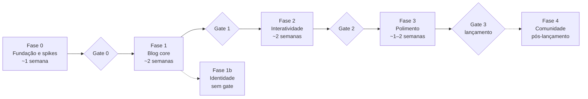
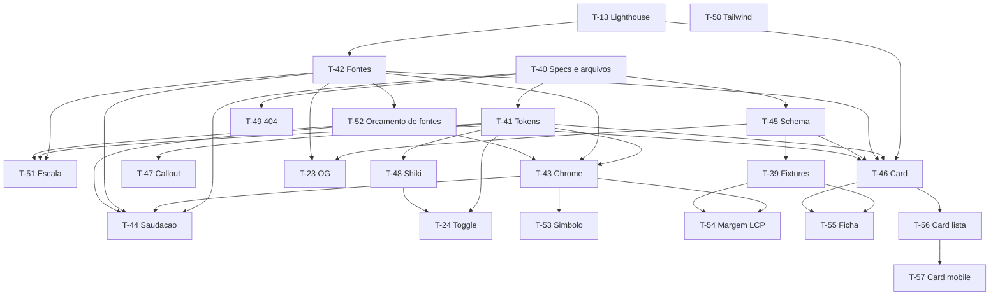

# Roadmap

A ordem de implementação do blog. O **quê** está em `SPEC.md`; aqui ficam as tarefas, as dependências entre elas, os gates e o status. Este arquivo muda a cada PR; a spec muda raramente.

## Como usar

1. Pegue a primeira tarefa `pendente` cujas dependências estejam todas `concluída`. Uma fase só começa depois que o gate da anterior estiver `aprovado`, salvo quando a coluna Depende de cita um gate anterior.
2. Marque-a `em andamento` no primeiro commit do PR. Branch: `t-XX-descricao-curta`.
3. Leia só as seções da SPEC ligadas aos requisitos citados na tarefa.
4. Ao fechar o PR, marque `concluída` e acrescente uma linha no [Registro de handoff](#registro-de-handoff), no mesmo PR.
5. Se a tarefa revelar trabalho novo, adicione uma tarefa nova com o próximo ID livre; não amplie a tarefa atual.
6. O PR que cumpre o último critério de um gate também muda a linha **Status do gate** para `aprovado (AAAA-MM-DD)`.

Status de tarefa: `pendente`, `em andamento`, `concluída`, `bloqueada (motivo)`, `cancelada (motivo)`. Status de gate: `pendente`, `aprovado (data)`.




## Fase 0 — Fundação e spikes


| ID   | Tarefa                                                                                                                                                                                                                                                                                                                                                                                                                                                                                                 | Requisitos             | Depende de | Status    |
| ---- | ------------------------------------------------------------------------------------------------------------------------------------------------------------------------------------------------------------------------------------------------------------------------------------------------------------------------------------------------------------------------------------------------------------------------------------------------------------------------------------------------------ | ---------------------- | ---------- | --------- |
| T-01 | Scaffold **Astro 7** + TypeScript strict + Tailwind v4 + ESLint/Prettier/Ruff, com `unified()` configurado em `markdown.processor` e no MDX. Vitest e Playwright configurados, com os cenários da SPEC §11 escritos como `test.fixme`. Arquivos de base: `.node-version`, `.python-version`, `.gitignore` (`dist/`, `.astro/`, `public/notebooks/`), `.cursorignore` (`exports/`) e `.github/pull_request_template.md` com "Requisitos afetados". Confirmar os comandos do AGENTS.md e remover o aviso | RNF-12, ADR-01         | —          | concluída |
| T-02 | `wrangler.jsonc`, primeiro deploy estático, variável `SITE_URL` apontando para o `workers.dev` e workflow do Actions com preview por PR (`wrangler versions upload`)                                                                                                                                                                                                                                                                                                                                   | ADR-04                 | T-01       | concluída |
| T-03 | Spike mdx-marimo a partir de `examples/with-astro` (Astro 7, runtime em custom element). Responder: peso e tempo até interativo; se o `remarkMarimo` executa Python no build (e, se sim, como acha o marimo e qual versão usa); qual versão do runtime marimo o pacote npm carrega e como alinhá-la ao `uv.lock`; se o `<script type="module">` dispara o Pyodide antes do primeiro paint; convivência com `remark-math` no mesmo `unified()` e com islands Svelte; origens que a CSP precisa liberar  | ADR-02, RNF-03, RNF-07 | T-01       | concluída |
| T-04 | Spike `marimo export html-wasm` em iframe com um notebook `torch` real: `cache_cells` + `--execute`, tamanho do export e da pasta `public/cache/`, o que continua interativo, o que vira stub, e como o `--execute` trata `torch` (a doc diz que ele usa, quando possível, um ambiente isolado com pacotes compatíveis com WASM)                                                                                                                                                                       | ADR-02, SPEC §7        | —          | concluída |
| T-05 | Validar `_headers`/`_redirects` em Static Assets servindo o export da T-04: `! Content-Security-Policy` seguido de nova CSP no mesmo bloco, padrão de URL com e sem barra final, CSP com `wasm-unsafe-eval` e as origens do Pyodide                                                                                                                                                                                                                                                                    | RNF-06, RNF-07         | T-02, T-04 | concluída |


Os spikes (T-03, T-04, T-05) rodam em branch própria. O código fica nesse branch e não entra na `main`. O doc em `specs/spikes/T-0X-<nome>.md` e o handoff entram por um PR próprio: perguntas, o que foi medido e o veredito. O branch da T-05 foi publicado só para o preview, num PR em rascunho fechado sem merge.

**Gate 0 — passa quando:**

- O deploy de preview funciona num PR real e o `_headers` é aplicado com detach de CSP (ou o plano B da SPEC §10 está escolhido).
- O doc da T-04 tem veredito com números e responde às perguntas da tarefa. O critério do mdx-marimo não se aplica: inline adiado por manutenção, ver doc da T-03.
- ADR-02 substituído em 14/10/2026 (inline adiado; ver doc da T-03). O ramo inline saiu da SPEC §6 e da T-15.

**Status do gate:** aprovado (2026-10-15)

## Fase 1 — Blog core


| ID   | Tarefa                                                                                                                                                                                                                                       | Requisitos             | Depende de       | Status   |
| ---- | -------------------------------------------------------------------------------------------------------------------------------------------------------------------------------------------------------------------------------------------- | ---------------------- | ---------------- | -------- |
| T-06 | `site.config.ts` (com `SITE_URL`), `content.config.ts` com a collection `posts` (única; autor vem do config; `generateId` pelo nome da pasta) e `getPublishedPosts()` com `SHOW_DRAFTS`. Testes unitários do slug e dos dois valores da flag | RF-11, RNF-09          | T-01             | concluída |
| T-07 | `BaseLayout`, header, footer, tema base e variáveis CSS de cor. Base: `lang`, landmarks, link de pular, um `h1` por página | RNF-04, RNF-05 | T-01 | concluída |
| T-08 | Home com destaque, grid de cards e paginação (`/page/[n]`)                                                                                                                                                                                   | RF-01, RF-03           | T-06, T-07       | concluída |
| T-09 | `PostLayout` com autor, datas, tempo de leitura (plugin remark no `unified()`) e TOC. Usar `prose` do `@tailwindcss/typography` com as cores dos tokens; remover `/exemplo-md` e `/exemplo-mdx`. O plugin já está registrado | RF-04, RF-05           | T-06, T-07       | concluída |
| T-10 | Shiki com botão copiar (`markdown.shikiConfig.themes` claro e escuro; conferir na doc atual como ele interage com `unified()`) + KaTeX                                                                                                       | RF-06, RF-07           | T-09             | concluída |
| T-11 | Páginas de tag                                                                                                                                                                                                                               | RF-02                  | T-06, T-08       | concluída |
| T-12 | SEO, JSON-LD, RSS e sitemap, com URLs absolutas a partir de `SITE_URL`. O `<title>` segue `{Título do fólio} · {site.title} · {autor}` com o config da hora. Os literais `pk.log` e `Pedro Knoll` entram na T-43. Não depende da Fase 1b; o Gate 1 não espera essa troca                                                                                                                                                                       | RF-10, RF-12           | T-06, T-09       | concluída |
| T-13 | Lighthouse CI, verificação de JS por página e verificador de links (`linkinator`, aprovado nesta tarefa) no pipeline, com os limites da SPEC §4. O `size-limit` por island foi para a T-19                                | RNF-01, RNF-02, RNF-05 | T-02, T-08, T-09 | concluída |
| T-36 | Job e2e no CI: Playwright e axe contra astro preview do build de produção; incluir e2e nos checks obrigatórios                                                                                                                               | RNF-04, RF-11          | T-02, T-07       | concluída |
| T-37 | Tornar exatas as asserções de texto de `tests/e2e/layout.spec.ts`: `exact: true` nos locators por nome acessível (ex.: linha 68, link do header) e comparação exata nos textos literais. Hoje "Nome do blog QUEBRA" passa no teste do link do header, porque o match é por substring (achado da T-36) | RNF-04, RNF-05 | T-07 | concluída |


T-06 e T-07 vêm primeiro; depois disso, T-08 a T-12 podem correr em paralelo.

**Gate 1 — passa quando:**

- Home e um post sem notebook passam nos budgets de RNF-01 e RNF-02 no CI.
- O cenário de rascunhos (SPEC §11) está verde contra o build de produção.
- O RSS valida no W3C Validator e o JSON-LD passa no Rich Results Test.

**Status do gate:** aprovado (2026-10-26)

## Fase 1b — Identidade

A Fase 1b não tem gate e não bloqueia a Fase 2. O texto do Gate 1 permanece. A T-13 não ganha dependência desta fase. T-40, T-41 e T-45 podem correr em paralelo com a T-12 e a T-13; não são critério do Gate 1. Fontes (T-42) e card (T-46) é que dependem da T-13. A trilha marimo segue dependendo só do Gate 0.

Nenhuma tarefa depende da T-43 por causa de arquivo. A seta T-43 → T-44 é o `Wordmark`: a T-43 cria o componente e a saudação da T-44 usa. Os `<link>` do favicon entram no `BaseLayout`, em cima dos arquivos que a T-40 já deixou em `public/`.



| ID | Tarefa | Requisitos | Depende de | Status |
| --- | --- | --- | --- | --- |
| T-40 | Atualiza SPEC, ROADMAP e AGENTS. Adiciona `specs/BRAND.md` e, no mesmo PR, a seção 0, os caminhos do apêndice, a §4 (lápis não é texto menor que 24 px sobre folha clara) e a §5 (Cormorant; a assinatura, Wordmark, também é exceção ao mínimo de 28 px, por ser desenho da marca e não texto). Move `pklog-brand/` para a árvore da SPEC §9 e apaga a pasta. `icon-192.png` e `icon-512.png` não são versionados. Prettier em `src/styles/shiki`. O comentário do `pk-claro.json` passa a `#5E5345`; o tema escuro não muda o comentário nesta tarefa | RF-01, RF-04, RF-06, RF-12, RF-16, RF-17, RF-22, RNF-04 | — | concluída |
| T-41 | Em `src/styles/global.css`, os nomes finais são `surface`, `sheet`, `ink`, `muted`, `pencil`, `line`, `accent`, `kind-concept`, `kind-tutorial`, `kind-lab`, `kind-playbook`. `kind-concept` é alias de `accent`. `muted` continua o grafite. Sem `graphite`, `gold`, `pixel`. `grid` não nasce aqui: só na tarefa que desenhar a grade (T-23 ou o diagrama da T-19). Prosa do código usa `sheet`. Paleta escura em `:root[data-theme="dark"]`, sem botão e sem `@custom-variant dark`. Pode sair antes do Gate 1. Foco: contorno 2 px em `accent`, afastamento 3 px, no lugar do `outline-offset-2` do link em `Card.astro` e do `outline-offset: 2px` de `.code-copy-button`. A tarefa escolhe um dos dois mecanismos e registra no PR: uma regra global de `:focus-visible`, ou a troca local nesses dois pontos. A nav de `TagFilter.astro` tem `overflow-x-auto` e `pb-2`; conferir que esse `pb-2` ainda deixa o contorno de 3 px visível | RNF-04 | T-40 | concluída |
| T-42 | Fonts API do Astro: `fontProviders.fontsource()` em `astro.config.mjs` e `<Font>` de `astro:assets` no `BaseLayout.astro`. Famílias: Cormorant Garamond, IBM Plex Sans, IBM Plex Mono, Caveat. Subset `latin`, `woff2`. Sem `fontProviders.google()` e sem `pnpm add` de `@fontsource/*`. A SPEC §9 não ganha esses pacotes. Conferir o HTML gerado: se o `<Font>` emitir `<style>` inline, o hash entra na lista da T-16. A CSP de página não ganha `unsafe-inline` por causa da fonte | RNF-01 | T-13 | concluída |
| T-43 | Não move arquivo. Cria `src/components/ui/Wordmark.astro` com `<span class="nome"><em>pk</em><span class="ponto">.</span><span class="ext">log</span></span>`, sem tamanho próprio: o tamanho vem de quem usa. O `Header.astro` usa esse componente no link para `/`, sem o símbolo, que fica para a T-53. `site.title` `pk.log`, autor `Pedro Knoll`, `author.bio` `Aprendizados e experimentos em IA`. O rodapé continua com autor e ano em texto, sem assinatura. No `BaseLayout.astro`, três `<link>`: `favicon.svg` com `type="image/svg+xml"`, `favicon.ico` com `sizes="32x32"` e `apple-touch-icon.png`; `favicon-16.png` e `favicon-32.png` ficam em `public/` sem `<link>`. Atualiza os literais em `tests/e2e/layout.spec.ts`, `tests/e2e/post.spec.ts` linhas 34–35 e `tests/e2e/site-literals.ts`. O orçamento de fontes da SPEC §9 vale aqui: o pk é Cormorant 600 normal, e o ponto e o log são Plex Mono 400. | RF-12 | T-41, T-42, T-52 | concluída |
| T-44 | Saudação e texto de apresentação. O nome dentro da saudação é o `Wordmark` da T-43. O aceno é um SVG component (`import Aceno from "~/assets/brand/icones/aceno.svg"`), com `aria-hidden` dentro do `h1`. 48 px, 32 px abaixo de 560 px. Esse é o único `h1` de `/`: o heading `Blog` sai da home. Em `/page/n` o `h1` permanece o do Listing, hoje `Blog — página N`. Páginas de tag seguem com o `h1` `Tag: <tag>`. Sem newsletter. E2E com `page.emulateMedia({ reducedMotion: "reduce" })`: a animação do aceno fica parada. Keyframes saem do `<style>` do SVG e vão para `global.css`. O orçamento de fontes da SPEC §9 vale aqui; o LCP da home hoje é a capa e esta tarefa o troca pela saudação. | RF-01 | T-40, T-42, T-43, T-52 | concluída |
| T-45 | Estende `src/content.config.ts`. `folio` inteiro, exibição `Fól. 006`. `kind`: `concept`, `tutorial`, `lab` ou `playbook`; rótulos pt-BR num mapa (`Conceito`, `Tutorial`, `Lab`, `Playbook`), não no frontmatter. `level`: `z.int().min(1).max(3)`. `benchMinutes`, `material` e `track` opcionais; `benchMinutes` não substitui `minutesRead`; `track` é `z.string().regex(/^[a-z0-9-]+$/).optional()`, mesma regra de tags, sem rota. `tags` continuam; temas da marca são rótulo em `src/data/tags.ts`, não um segundo campo. Lab exige ao menos um item em `notebooks`. Colab segue `gpuUrl`. Unicidade: função pura em `src/lib/`, chamada por `getPublishedPosts` sobre todas as entradas, rascunho incluído, antes do filtro de publicados. Teste unitário: dois fólios iguais falham e citam os ids; a série única passa. Fól. 001 é `2026-10-por-que-este-blog`; Fól. 002 é `2026-10-como-o-blog-e-feito`; os dois entram como `kind: concept` e `level: 1`. Pode sair antes do Gate 1 | RF-01, RF-04, SPEC §6 | T-40 | concluída |
| T-46 | Ícone parado na lista, animado no cabeçalho do post, os dois como SVG component. Os ícones vêm da T-40 por T-41; não depende da T-43. Hachura de três traços, com 1, 2 ou 3 marcados. Data visível `21.out.2026` em `src/lib/format-date.ts`; o `datetime` continua ISO. Atualiza `tests/e2e/home.spec.ts` linha 50, `tests/unit/format-date.test.ts` e `tests/e2e/post.spec.ts` linha 45. Capa, autor, tempo de leitura e tags permanecem. Meta em `pencil` sobre `surface`. Comentário de código não usa `pencil`. Título do card: Cormorant peso 600, cerca de 1,45rem, nunca abaixo de 22 px. E2E com `emulateMedia({ reducedMotion: "reduce" })` no ícone animado do cabeçalho. Keyframes no `global.css`, como na T-44. A ficha da seção 9.3 do BRAND foi para a T-55. O título do card em Cormorant 600 cabe no orçamento de fontes da SPEC §9. | RF-01, RF-04 | T-13, T-41, T-42, T-45, T-52 | concluída |
| T-47 | `src/components/ui/Callout.astro`, prop `variant` `note`, `caution` ou `result`. As três formas da seção 9.4 do BRAND, tudo em tinta. Rótulos visíveis: `// NOTA DE BANCADA`, `[!] CUIDADO`, `= RESULTADO` | RF-22 | T-41 | concluída |
| T-48 | Os temas `pk-claro` e `pk-escuro` entraram na T-41. `defaultColor: false` fica. Uma cerca com a meta `title=<arquivo>` depois da linguagem (```` ```py title=fol-001_embeddings.py ````) mostra o nome do arquivo na barra do bloco; sem `title=`, a barra não mostra nome. Teste prova que essa meta chega ao transformer do Shiki. O botão visível passa de "Código copiado" para "Copiado" (1,5 s). O `copyResetMs` está duplicado com `tests/e2e/code.spec.ts` (T-10); os dois passam a 1,5 s. O aria-label permanece "Copiar código" | RF-06 | T-41, T-10 | pendente |
| T-49 | `src/pages/404.astro` com "Esta página foi arrancada do caderno." Não depende da T-43. Os E2E que só checam status 404 ganham a frase | BRAND §10 | T-40 | pendente |
| T-50 | Tirar `tests/` da detecção de classes do Tailwind. A amostra `dark:bg-surface` de `tests/unit/color-tokens.test.ts` gera `.dark\:bg-surface` dentro de `@media (prefers-color-scheme: dark)` no CSS do site (achado da T-41). Conferir na doc atual do Tailwind v4 a diretiva de exclusão. Prova: `grep -o "prefers-color-scheme" dist/_astro/*.css \| wc -l` vai a 0, e o teste unitário continua verde | Q12 | — | pendente |
| T-51 | Escala tipográfica da BRAND §5 no site: texto 17 px, altura de linha 1,65, coluna de cerca de 65 caracteres; h1 44 e h2 30 em Cormorant, nunca abaixo de 28 px, inclusive a 360 px; h3 22 em IBM Plex Sans 600; rótulo 12; `text-wrap: balance` nos títulos. Usa os tokens da T-42. Troca o `font-serif` do h1 do `Listing.astro` e do h1 do `PostLayout.astro` pelo token de display; o título do card, hoje `font-serif` em `Card.astro`, é da T-46. Os rótulos de metadados (Destaque, Autor, Publicação, Leitura), hoje `text-xs` com `small-caps`, passam ao rótulo da BRAND §5: IBM Plex Mono 12 px, maiúsculas, letter-spacing de 0,08 a 0,14 em, sem `small-caps`. Achado da T-42: com a Plex Sans, as versaletes sintetizadas ficaram pequenas demais. Não inclui Wordmark (T-43), saudação (T-44) nem card (T-46). Refaz o Lighthouse e o teste de foco da T-41. A escala cabe no orçamento de fontes da SPEC §9: Cormorant só 600 normal nas páginas, h3 em Plex Sans 600 e rótulo em Plex Mono 400. | RNF-01, RNF-04 | T-41, T-42, T-52 | pendente |
| T-52 | Orçamento de fontes no LCP. Com as fontes da T-42, o LCP simulado subiu 300 ms na home e no post A e até 600 ms no post B (pior caso 1954 ms, a 46 ms do teto de 2000 ms). Cada arquivo de fonte usado na página entra antes do LCP na simulação de Slow 4G. Antes de pôr Cormorant ou Caveat acima da dobra, medir o custo de cada arquivo de fonte no Lighthouse do projeto e escolher a estratégia, sem mexer no budget. Candidatas: menos pesos, variable font, preload da família de display, `font-display: optional`. O preload da Plex Sans 400 não é a causa: sem ele a home ficou igual e os posts perderam 150 ms de FCP (experimento da T-42) | RNF-01 | T-42 | concluída |
| T-53 | Símbolo na assinatura do header, BRAND §3: `pklog-simbolo-currentcolor.svg` como SVG component com `aria-hidden`, antes do `Wordmark`, em 1,55em, com gap de 0,42em. O nome acessível do link continua `pk.log`. Conferir as cores do nó e do halo nos dois temas, sem hex fora de `src/assets/brand/`, e o mínimo de 140 px da assinatura horizontal. Mede LCP e CLS antes e depois | RF-12, RNF-04 | T-43 | pendente |
| T-54 | Margem de LCP dos posts depois da T-43: posts A e B a 1953–1954 ms, 46 ms do teto. A guarda de fontes admite um 5º arquivo nos posts, a Plex Sans 400 itálico, e um post com ênfase em itálico tende a passar de 2000 ms; o `lighthouserc.json` só mede A e B. Medir com uma fixture de post com itálico e decidir entre tetos da guarda, estratégia de fonte ou URLs do Lighthouse CI, sem relaxar o RNF-01. Hipótese a testar: limite de 6 conexões por origem em HTTP/1.1 no Lantern; o post A passou de 5 para 6 fontes antes do LCP e subiu dois degraus | RNF-01 | T-43, T-39 | pendente |
| T-55 | Ficha do cabeçalho do post, item 4 da seção 9.3 do BRAND. Quando o post tem `benchMinutes`, `material` ou `track`, o cabeçalho mostra só os itens presentes: tempo de bancada (`≈ 90 min`), material e caderno. `track` mostra a posição e o total de posts publicados com o mesmo `track` (`LLMs · 4 de 12`). A posição é calculada numa função pura em `src/lib/`, com entrada estrutural. A tarefa decide a ordem da contagem (sugestão: `pubDate` crescente, desempate por `id`) e o rótulo do caderno, já que `track` é um slug e `src/data/tags.ts` não existe. Saiu da T-46 porque nenhum post publicado tem esses campos; a prova usa a fixture da T-39. Mede LCP e CLS antes e depois, por causa da margem dos posts (T-54) | RF-04 | T-39, T-46 | pendente |
| T-56 | Card da listagem num DOM só: fólio e data, título sem sublinhado em repouso, resumo, tipo, nível e tempo de leitura com relógio parado; sem tags; capa só no destaque; destaque com borda embaixo e capa centralizada. O número do fólio é Cormorant 600 desde 22 px, via `folioDigits`. O tempo é o `minutesRead` da página do post, lido por `render()` em `src/lib/reading-minutes.ts`, sem cache. No desktop da lista, a faixa do fólio fica à esquerda e centralizada na altura do card. A lista separa os cards com `divide-line` | RF-01, RF-02 | T-46 | concluída |
| T-57 | Ajustes de mobile no card de fólio, BRAND §9.2. Resumo em 17 px com entrelinha 1,65. Título da lista em 26 px abaixo de `sm` e ~1,45rem de `sm` em diante, Cormorant 600 desde 22 px; o título do destaque não muda. O card inteiro é tocável pelo link esticado no título, com `active:text-accent`, sem hover de borda nem sombra. O rodapé leva `gap-y-1.5` e `pointer-events-none`, para o separador absoluto não ficar por cima do toque. No mobile, a capa do destaque fica depois do rótulo e do fólio com a data, e antes do título; de `sm` em diante continua à direita | RF-01 | T-56 | concluída |

## Fase 2 — Interatividade

Duas trilhas independentes; a T-21 junta as duas.


| ID                | Tarefa                                                                                                                                                                                                                                            | Requisitos             | Depende de             | Status   |
| ----------------- | ------------------------------------------------------------------------------------------------------------------------------------------------------------------------------------------------------------------------------------------------- | ---------------------- | ---------------------- | -------- |
| **Trilha marimo** |                                                                                                                                                                                                                                                   |                        |                        |          |
| T-14              | `scripts/build-notebooks.py` com cache por hash (`.py` + `uv.lock`) para notebooks iframe leves, saída em `public/notebooks/`. Decidir se o export mostra o código, para tutoriais passo a passo, em vez de `--no-show-code`; atualizar a SPEC §7 na mesma tarefa | RF-08, RNF-08          | Gate 0, T-06, T-35     | pendente |
| T-15              | `MarimoFrame` (iframe) com carga condicional. Remover ou reescrever os `test.fixme` de cenários inline em `tests/e2e/spec-11.spec.ts`                                                                                                               | RF-08, RNF-03, RNF-09  | T-14, T-09             | pendente |
| T-16              | Integração `src/integrations/headers.ts` que gera `dist/_headers` com a CSP global e a de `/notebooks/*` (SPEC §10), teste de artefato das regras e falha do build acima de 100 regras. Estilos da marca e fontes saem de `'self'` ou, se o `<Font>` emitir `<style>`, de hash. Sem origem do Google e sem `unsafe-inline` na página por causa da marca. Conferir que o `favicon.svg` troca de cor no modo escuro, no Chrome e no Firefox, com a CSP aplicada                                                            | RNF-06, RNF-07         | T-05, T-15             | pendente |
| T-17              | Modo `--heavy`: export local em `exports/<slug>/<nome>/`, `export.lock`, upload ao R2 acima de 25 MiB, verificação de frescor no CI e cópia de `exports/` para `public/notebooks/` no build; falha o build se a saída do export tiver `Cache save failed`; o `export.lock` registra o `marimo`, o `numpy` do `--execute` e o `Pyodide`                                                       | RF-08, RNF-09, SPEC §7 | T-14, T-33, T-34                   | pendente |
| T-18              | Componente `RunOnGpu` e botão "Ativar interatividade". A barra do lab é a pele desta tarefa, em cima de `notebooks` e `gpuUrl`. Sem campo `marimo` nem `colab`. "Abrir no Colab" só com `gpuUrl`. Não espera a Fase 1b                                                                                                                                                                                             | RF-08, SPEC §7         | T-15                   | pendente |
| T-33              | Spike `precomputed`: a partir do `treino.py` da T-04, treino dentro de uma função com `@mo.persistent_cache(method="lazy")` que retorna `numpy`. Prazo: meio dia. Pergunta única: as células dependentes funcionam no navegador? Se não, notebooks com `torch` ficam em `onnx` ou `static`. Atualiza a SPEC §7 com o resultado. | RF-08, SPEC §7 | Gate 0 | pendente |
| T-34              | Runtime do marimo compartilhado: um único `assets/` para os exports da mesma versão do marimo, ou commitar só `index.html` e `public/` e gerar os assets no CI. Contar os arquivos por versão contra o limite de 20.000. | RNF-08, SPEC §7 | T-14 | pendente |
| T-35              | Excluir `public/notebooks/` e `exports/` do `tsconfig.json`; o `astro check` analisa os JS do runtime do marimo e derruba o Node | RNF-12 | Gate 0 | pendente |
| **Trilha viz**    |                                                                                                                                                                                                                                                   |                        |                        |          |
| T-19              | `LineChart` e `BarChart` com testes e fallback acessível; datas ISO convertidas no componente; fixa o contrato que a T-20 copia. `size-limit` com `@size-limit/file` (fora da SPEC §9: perguntar), `gzip: true` e uma entrada por island; decidir como o `check:js` trata páginas com island, que hoje falham de propósito (T-13)                                                                                                                   | RF-09, RNF-04          | T-07                   | pendente |
| T-20              | `Scatter`, `Heatmap`, `Explorable`                                                                                                                                                                                                                | RF-09, RNF-04          | T-19                   | pendente |
| **Junção**        |                                                                                                                                                                                                                                                   |                        |                        |          |
| T-21              | Post de demonstração com um notebook iframe leve, um pesado com `compute: precomputed` e três gráficos. A primeira célula do lab é convenção no `AGENTS.md` de `src/components/marimo/` (antes da T-14) e neste post, com `src/components/marimo/pk.css`. O `pk.css` não vem no pacote da marca; nasce nessa convenção                                                                                                                                                  | RF-08, RF-09           | T-16, T-17, T-18, T-20 | pendente |


Antes de começar a T-14, crie `src/components/marimo/AGENTS.md` com o que os spikes ensinaram e com as seções 9.6–9.7 de `specs/BRAND.md`. O `src/components/marimo/pk.css` não vem no pacote da marca; nasce nessa convenção e no post da T-21. Antes da T-19, crie `src/components/viz/AGENTS.md` a partir da SPEC §8 e da seção 9.8 do BRAND. Isso não cria dependência da T-19 com a Fase 1b. O Cursor lê AGENTS.md aninhados e combina cada um com o da raiz, com prioridade para o mais específico. A trilha marimo segue dependendo só do Gate 0.

**Gate 2 — passa quando:**

- Todos os cenários de notebook, CSP e gráfico da SPEC §11 estão verdes contra o post de demonstração.
- A home continua sem requisitar `pyodide*` (RNF-03).
- O build completo fica abaixo de 5 min (RNF-08).

**Status do gate:** pendente

## Fase 3 — Polimento e lançamento


| ID   | Tarefa                                                                                                          | Requisitos     | Depende de       | Status          |
| ---- | --------------------------------------------------------------------------------------------------------------- | -------------- | ---------------- | --------------- |
| T-22 | Pagefind indexando só o corpo dos posts                                                                         | RF-15          | T-09             | pendente        |
| T-23 | Imagens OG geradas no build. A capa do autor ganha quando existe. Sem capa, o PNG segue a seção 11 do BRAND. Os SVG vêm da T-40, pela T-45. O desenho usa a Cormorant (T-42). Rasterizar com `sharp` é hipótese a provar na tarefa, inclusive se as fontes da marca existem no CI. Se a hipótese falhar, a tarefa para e pergunta. Sem Satori enquanto ninguém aprovar a dependência | RF-16 | T-12, T-42, T-45 | pendente |
| T-24 | Tema escuro com controle segmentado e sem flash; conferir os gráficos no escuro. A T-41 só declara as duas paletas. Até a T-24, nada no site aplica `data-theme` nem `prefers-color-scheme`; a T-41 só declara as paletas. O controle é o segmentado da marca, com `localStorage`. O script inline entra na lista de hashes da CSP quando a T-16 já tiver saído | RF-17 | T-07, T-19, T-41, T-48 | pendente |
| T-25 | Página Sobre e link "Editar no GitHub". Não espera a Fase 1b. Nome e bio vêm do `site.config` da hora; `pk.log`, `Pedro Knoll` e a descrição curta `Aprendizados e experimentos em IA` entram na T-43. Sem newsletter | RF-13, RF-14 | T-07, T-09 | pendente |
| T-26 | Posts relacionados                                                                                              | RF-18          | T-09             | pendente        |
| T-27 | Domínio, troca de `SITE_URL`, `X-Robots-Tag: noindex` no `workers.dev`, Web Analytics e checklist de lançamento | RNF-10, RNF-11 | Q4b, T-22 a T-26 | bloqueada (Q4b) |
| T-38 | Destaque da seção ativa na TOC como melhoria progressiva, com um `<script>` do Astro (sem Svelte, sem island), `IntersectionObserver` e `aria-current`. E2E com `scrollIntoView` e asserção com retry, sem `waitForTimeout`. Conferir o JS por página com a ferramenta da T-13 | RF-05, RNF-02 | T-09, T-13 | pendente |
| T-39 | Fixtures de teste para os casos que o conteúdo publicado pode não exercitar (`updatedDate`, h3 e h4, `.md` e `.mdx`, post sem h2/h3, remoção do bloco "Atualizado em"), sem depender dos posts reais; tirar o href literal do `home.spec.ts` (T-08). O mecanismo é decidido na tarefa. A fixture precisa poder exercitar `folio`, `kind`, `level`, `benchMinutes`, `material` e `track`. O post B tem um h4 sem h3 antes (audit `heading-order` do Lighthouse, acessibilidade 0,98, achado da T-13): corrigir a ordem ou tirar o heading de teste do post quando a fixture cobrir o h4 | RF-01, RF-04, RF-05 | T-09, T-45 | pendente |


**Gate 3 — lançamento — passa quando:**

- Lighthouse ≥ 95 nas quatro categorias, na home e num post sem notebook.
- Todos os requisitos Must da SPEC §3 estão entregues.
- Produção responde no domínio próprio com os headers de segurança (RNF-06).

**Status do gate:** pendente

## Fase 4 — Comunidade (pós-lançamento)


| ID   | Tarefa                                                                                                  | Requisitos | Depende de | Status   |
| ---- | ------------------------------------------------------------------------------------------------------- | ---------- | ---------- | -------- |
| T-28 | Giscus para comentários e reações, com carregamento lazy                                                | RF-19      | Gate 3     | pendente |
| T-29 | Componente `<Embed>` para HF Spaces e iframes genéricos                                                 | RF-20      | Gate 3     | pendente |
| T-30 | i18n, se fizer sentido                                                                                  | P5         | Gate 3     | pendente |
| T-31 | Avaliar migrar o preview por PR de Version URLs com alias para Workers Previews, via `wrangler preview` | ADR-04     | Gate 3     | pendente |
| T-32 | Reavaliar o modo inline adiado na T-03. Gatilho: mdx-marimo a partir de 0.1, ou uma opção pública para controlar Python e projeto no build | ADR-02 | Gate 3 | pendente |


RF-21 (artigos da comunidade com login e upvote) fica fora: não combina com um blog pessoal.

## Registro de handoff

Uma linha por tarefa concluída, escrita por quem a fechou. Diz o que a próxima sessão precisa saber e que não está óbvio no código: decisões tomadas durante a tarefa, o que foi tentado e descartado, pendências deixadas de propósito. Se o número do PR ainda não existir quando a linha for escrita, use o nome do branch.

- **T-01** (2026-10-13, branch t-01-scaffold): Astro 7.3.8, TypeScript 6.0.3 (o latest 7.0.2 quebra `astro check` e `typescript-eslint`; os peers pedem `^5 || ^6`), Tailwind 4.3.3. `unified()` está em `markdown.processor` e em `mdx({ processor })`. Rotas temporárias `/exemplo-md` e `/exemplo-mdx` só exercitam os dois processadores; apagar quando houver páginas de verdade. O comentário HTML do aviso não estava no `AGENTS.md` em disco; a tabela de comandos ficou intacta. Ainda não rodam: `scripts/build-notebooks.py`, `wrangler dev`, `marimo check`. `SHOW_DRAFTS` não muda o build (T-06). CI fica na T-02. `pnpm dev` escuta só em `[::1]:4321`: `localhost` responde, `127.0.0.1` não.
- **T-02** (2026-10-14, branch t-02-deploy-cloudflare): wrangler 4.150.0 (devDependency), Worker só de assets, sem `main`. `workers_dev` e `preview_urls` explícitos (omitir `preview_urls` mantém o setting do placeholder). Jobs `lint`, `test`, `build`, `preview`, `deploy`; exigir os quatro primeiros no ruleset (`deploy` não roda em PR). Preview pula fork e `dependabot[bot]`; alias `https://pr-<n>-blog.p-giacometo.workers.dev`. `versions upload` não troca a produção: o Hello World só sai no primeiro push em `main`. `deploy` usa `--no-autoconfig`: sem ele, o Wrangler rodaria `astro add cloudflare` e instalaria o adapter que o ADR-05 dispensa. `esbuild` e `workerd` negados em `allowBuilds` (`pnpm-workspace.yaml`): o pnpm 12 falha o install com scripts não revisados e nada da T-02 precisa deles; reavaliar se o `wrangler dev` falhar (T-05). Actions pinadas por SHA (`setup-uv` v10.3.0; o guia da Astral cita v9.0.0). Playwright fora (cenários em `test.fixme`). `SHOW_DRAFTS` e `SITE_URL` já entram no build, mas só a T-06 os lê. Version URLs habilitadas no dashboard em 2026-10-14: `versions upload` não aplica `preview_urls`, só o `deploy` aplica.
- **T-03** (2026-10-14, branch t-03-resultado-spike): Veredito adiado por manutenção. A pergunta 2 mostrou o uv embutido no npm, Python 3.12 fixo, `marimo>=0.23.15` resolvido na hora, `uv.lock` ignorado, rede obrigatória e falha com `requires-python >=3.14`. Perguntas 1, 3, 4, 5 e 6 não medidas. ADR-02 substituído: só iframe. Evidência no commit local `056cd88` do branch `t-03-spike-mdx-marimo`, que não entra na `main`. Perguntas abertas e gatilho no doc do spike. Reavaliação na T-32. Pendência: decidir na T-14 se o export de tutorial mostra o código em vez de `--no-show-code`, e atualizar a SPEC §7 nessa tarefa. Os `test.fixme` em `tests/e2e/spec-11.spec.ts` ainda descrevem os cenários inline; a T-15 remove ou reescreve.
- **T-04** (2026-10-15, branch t-04-resultado-spike): Veredito: `compute: cache` não funciona no marimo 0.25.1 para notebooks que treinam com `torch`. A célula de treino não entra no cache, nas variantes A e B; no navegador ela reexecuta, o `torch` vira stub e as células dependentes caem. O export sai com status 0 mesmo com `Cache save failed`. O `--execute` roda em `uv run --isolated --no-project --python 3.14`, com `marimo` 0.25.1, igual ao `uv.lock`, `numpy` 2.5.4 e `torch` 2.14.1; o navegador carrega `numpy` 2.4.3, do `Pyodide` 314.0.0. Export: 26 MB, cerca de 495 arquivos, maior de 4,4 MB, nenhum acima de 25 MiB; o runtime se repete a cada export, ver T-34. Origens para a T-05: `wasm.marimo.app`, `cdn.jsdelivr.net` e `files.pythonhosted.org`. A T-05 também investiga o aviso de interrupts indisponíveis, provavelmente COOP/COEP. Evidência nos commits locais `b8d736c` e `915ee3d` do branch `t-04-spike-html-wasm`, que não entra na `main`; a T-05 serve o `spike/t04/out` desse branch. O marimo entrou só no spike; na `main` ele chega com a T-14. Pendência: abrir uma issue no marimo com o `treino.py` do spike, gatilho para reabrir o `compute: cache`.
- **T-05** (2026-10-15, branch t-05-resultado-spike): Veredito: o detach no mesmo bloco funciona. `! Content-Security-Policy` seguido de nova CSP em `/notebooks/*` entrega uma única CSP, com `wasm-unsafe-eval`; a página que embute o iframe fica com a CSP global. Headers repetidos chegam como linhas separadas; os testes da T-16 contam ocorrências do header e de `default-src`. O `index.html` redireciona direto para a forma com barra. A regra de cache usa placeholders (`/notebooks/:slug/:nome/assets/*`). A CSP de notebook final leva hashes por export. Cada linha do `_headers` tem limite de 2.000 caracteres (a linha medida tem 577 com 4 hashes, cerca de 55 por hash); a T-16 coloca a CSP numa regra por export, `/notebooks/<slug>/<nome>/*`, cada uma com `! Content-Security-Policy` e os hashes do próprio `index.html`, calculados no build, e confere os limites de 100 regras e de 2.000 caracteres por linha. Interrupts fora da v1, por falta de isolamento de origem. O HEAD falhou numa rodada e não foi investigado; os testes usam GET. O export traz um `CLAUDE.md` do marimo (pendência da T-14). O `MarimoFrame` usa barra final e dimensões explícitas (T-15). O `astro check` derruba o Node ao analisar os JS de `public/notebooks/`; só essa pasta foi medida, e `exports/` é extrapolação. Isso é a T-35. O leitor vê as saídas do `--execute` e depois as perde quando a célula de `torch` falha, o que reforça a T-33. Evidência no branch local `t-05-spike-headers` e no PR #5 (rascunho, fechado sem merge). Gate 0 aprovado.
- **T-06** (2026-10-15, branch t-06-collection-posts): Slug e rascunhos ficam em funções puras: `postIdFromEntry` em `src/lib/post-id.ts`, `shouldShowDrafts` e `selectPublished` em `src/lib/published.ts`. O `getPublishedPosts` só chama `getCollection` e essas funções, e é o único arquivo de `src/lib/` que importa `astro:content`; por isso o Vitest roda sem `getViteConfig`. O Vitest não tem o alias `~/`: os testes importam por caminho relativo, e o `content.config.ts` também. Regras novas na SPEC §6: o build falha se o post não estiver em `<pasta>/index.md` ou `<pasta>/index.mdx`, ou se a pasta não casar com `^[a-z0-9-]+$`; `pubDate` empatada desempata por `id`. `SHOW_DRAFTS` liga rascunhos só com a string exata `true`. Sem posts, o build e o `astro check` avisam `[glob-loader] The base directory ".../src/content/posts/" does not exist.`; é esperado até a T-08, que cria os primeiros posts. O `getPublishedPosts` ainda não tem teste: o cenário E2E de rascunhos segue `test.fixme` até existirem home, tags, RSS e sitemap (Gate 1).
- **T-07** (2026-10-16, branch t-07-base-layout): `@types/node` 24 entrou como exceção aprovada e foi acrescentado à SPEC §9, Qualidade; os testes continuam tipados pelo `astro check`, e o `tsconfig.json` não mudou. O teste do axe já passava antes, porque a regra `bypass` aceita o `h1` da home; ele fica como guarda. Os textos esperados no E2E são literais (`Blog`, `Nome do blog`, `Seu Nome`); mudar o `site.config.ts` exige mudar o teste. O E2E ainda não roda no CI; isso é a T-36. O `main` não tem largura nem margem lateral de propósito; cada página define as suas, a começar pela T-08. `--site-accent` está definido e reservado para os links da T-08 e da T-09. O formato do `title` fica para a T-12; o slot `head` está reservado para ela.
- **T-36** (2026-10-16, branch t-36-e2e-ci): Job `e2e` baixa o artifact `dist` do `build` (mesmo `name` e `path` do `deploy`) e roda `pnpm exec playwright test` contra `pnpm preview` em 127.0.0.1:4321, sem refazer o build; o job leva cerca de 1 min. Com `CI`, o `webServer` só faz preview; `forbidOnly`, 2 retries, 1 worker, `trace: "on-first-retry"`, reporter `list` + `html` (`open: "never"`), `globalTimeout` de 10 min. Sem `reuseExistingServer`: com a porta 4321 ocupada, o teste local falha de propósito. Chromium com `pnpm exec playwright install --with-deps chromium`, sem cache de navegador. Artifact `playwright-report`, 14 dias, `if: ${{ !cancelled() }}`. O `deploy` espera o `e2e`; o `preview` não. O check `e2e` entra no ruleset à mão, depois do merge. O `test.fixme` de rascunhos segue até o Gate 1. A primeira quebra proposital (sufixo no título) não derrubou o e2e, por causa do match por substring no `getByRole`; ver T-37. A segunda (título trocado) derrubou: `1 failed`, com `retry #1` e `retry #2`, exit 1. O artifact `dist` cresce com os exports de notebook (cerca de 26 MB e 495 arquivos por export, T-04); o tempo de upload e download entra na conta da T-34.
- **T-08** (2026-10-16, branch t-08-home-paginacao): Paginação por função pura, `paginatePosts` em `src/lib/pagination.ts`, sem o `paginate()` do Astro, que com `[page].astro` gera `/page/1`. A página 1 é `/`; `src/pages/page/[page].astro` gera da 2 em diante; `/page/1/` responde 404. Links internos com barra final, porque a Cloudflare responde 307 sem ela (T-05). Destaque com `splitFeatured`: o mais recente com `featured: true`, só em `/`, fora da lista paginada. Data com `formatPubDate` (`Intl` pt-BR, `timeZone` UTC); o teste fixa `TZ` `America/Sao_Paulo` para falhar também no CI em UTC. `sharp` 0.35.5 entrou como dependência direta, exceção aprovada e registrada na SPEC §9: com pnpm, o `astro:assets` não acha o `sharp` opcional do Astro (`MissingSharp`). O pnpm não pediu revisão de build script; o `allowBuilds` não mudou. O `Image` não usa a prop `layout`: sem `image.layout` no config, o padrão é `none` e não sai `style`, o que o `home.spec.ts` confere. A capa sai em 1200 px mesmo na miniatura; se o Lighthouse da T-13 apontar imagem grande demais, usar `widths` e `sizes`. O `home.spec.ts` depende dos dois posts: o A (`2026-10-por-que-este-blog`) é `featured`, tem `cover` e o href dele está literal no teste; o B não tem `cover`. Mudar isso exige mudar o teste. A navegação de paginação não tem E2E, porque dois posts dão uma página só; a prova foi manual, com 13 rascunhos temporários e `SHOW_DRAFTS=true`: `/page/2/` com 2 entradas, "Anterior" para `/` e sem "Próxima" (saída no PR). Estilo minimalista: lista em uma coluna, data à esquerda, capa à direita só quando existe, sem token novo. O `title` de `/page/n/` fica "Blog" até a T-12. Os links `/blog/<slug>/` respondem 404 até a T-09. Conteúdo novo passa por `pnpm lint` antes do commit: o `astro check` não confere o Prettier.
- **T-37** (2026-10-19, branch t-37-e2e-match): O `layout.spec.ts` exige match exato nos dois locators por nome (`exact: true` em "Pular para o conteúdo" e em "Nome do blog", este limitado ao `banner`) e no nome do autor. O footer tem dois parágrafos, autor e ano; a asserção é `getByText("Seu Nome", { exact: true })` e `toHaveText("Seu Nome")` nesse parágrafo. `toHaveText`, `toHaveTitle` e `toHaveAttribute` com string já eram exatos; só os `getBy*` e o `toContainText` precisavam mudar. Prova: M1, M2, M3 e M5 verdes no spec antigo e vermelhas no novo; M4 descartada, porque nenhuma asserção lê o `h1`.
- **T-09** (2026-10-19, branch t-09-post-layout): O `.mjs` do plugin importa `reading-time.ts` direto e o build aceita; o plano B (lógica no `.mjs`) não foi preciso. As funções puras ficam em `reading-time.ts` e `toc.ts`; o plugin só chama essas funções. Os E2E da página do post são invariantes sobre todos os posts publicados, descobertos pelos links de título da home, seguindo a paginação. Não dependem do texto dos posts. Hoje o A (`.md`, três h2) e o B (`.mdx`, com `updatedDate`, h3 e h4, conteúdo de teste) exercitam os ramos. Teste que conta zero precisa exigir antes que o contêiner exista; senão passa no 404. O laço do `layout.spec.ts` agora roda em `/` e na página do B, e cada visita exige status 200. O teste "nenhum h1 dentro do header" trocou o seletor de tag `header` pelo landmark `banner`, porque a página do post tem um `<header>` legítimo dentro do `<article>`. A M6 prova que o teste ainda falha com um h1 no `Header.astro`. Sem E2E: a exclusão do h4 e o post sem sumário ficam no Vitest e na M3; a remoção do bloco "Atualizado em" inteiro não é pega pelos invariantes. As três lacunas vão para a T-39. `prose-site` usa só os cinco tokens, sem `--tw-prose-invert-*`. O `pre` invertido (fundo `ink`) é provisório até a T-10. As datas usam o separador "·" antes de "Atualizado em". Continuam abertos: o título da página é "Blog" até a T-12; as tags são texto até a T-11; o destaque da seção ativa é a T-38. As rotas `/exemplo-md` e `/exemplo-mdx` foram apagadas.
- **T-10** (2026-10-20, branch t-10-shiki-katex): `remark-math` 6.0.0, `rehype-katex` 7.0.1 e `katex` 0.19.0. O `pnpm add` não pediu revisão de build script; o pacote `shiki` não precisou ser instalado. `markdown.shikiConfig` fica fora do `unified()`, com `themes` `github-light`/`github-dark` e `defaultColor: false`; o MDX herda e não repete a opção. O CSS não usa `--shiki-dark`: o `global.css` não tem `prefers-color-scheme` nem `data-theme`; as variáveis `--shiki-dark` já saem no HTML, prontas para a T-24. Fundo do `pre` em `--site-surface`, borda de 1 px em `--site-line`. As crases que o typography punha no code inline foram removidas no `prose-site`. O script de copiar só sai quando `hasCode` é verdadeiro. `copyResetMs` está duplicado entre `CodeCopy.astro` e `tests/e2e/code.spec.ts`, e os dois mudam juntos. No `dist/` deste build o script do B é inline (`<script type="module">`, sem `src`) e pede hash sha256 em `script-src`; o CSS do post tem uma `url(data:font/woff2` e pede `font-src data:`; `style=` aparece 44 vezes no HTML do B (Shiki e KaTeX) e pede `'unsafe-inline'` em `style-src` ou em `style-src-attr`. O A não tem `<script>`; as outras fontes do KaTeX saem como arquivo em `dist/_astro/`. O E5 não detecta `data:`, porque URL `data:` não gera requisição no Playwright. A CSP não mudou. O teste "nenhum script além de JSON-LD" do `layout.spec.ts` virou "script só na página com bloco de código". O helper de descoberta de posts está em `tests/e2e/published-posts.ts`, para os próximos E2E. O teste "pelo menos dois posts com `.katex`" depende dos dois posts publicados terem fórmula e vai para a T-39 (fixture `.md` com fórmula). Chaves dentro de `$$` no `.mdx` (`\sum_{i=1}^{n}`) passaram no build. Se `writeText` rejeita, o botão permanece "Copiar código".
- **T-11** (2026-10-21, branch t-11-paginas-de-tag): A página de tag usa `BaseLayout` e reusa o `Listing` com `prev` e `next` nulos. `meta` é a tag compartilhada, e o empate de `pubDate` exercita o desempate por `id` no E4. No commit de testes, o `home.spec.ts` e o E4 contam os cards com `:scope > li`, porque a `TagList` aninha listas, e a guarda da T-09 no `post.spec.ts` saiu. O `chipNames` do `tags.spec.ts` lê `span` ou `li a`, e o ramo `span` só serviu ao vermelho da T-11; sai na T-39. A barra em `/page/n/` e o post sem tags ficam sem E2E até as fixtures da T-39. Rascunhos provados só no U6: uma página de tag com `getCollection` direto passaria nos E2E de hoje; a prova vem na T-39. `title`, SEO e sitemap das páginas de tag ficam na T-12. Componentes novos: `TagList`, a lista de tags no card e no post, e `TagFilter`, a barra. O link da `TagList` é `inline-block`, para o padding contar na altura dentro do `li`; a `nav` da barra tem `pb-2`, porque `overflow-x-auto` também recorta na vertical e cortava o contorno de foco.
- **T-40** (2026-10-22, branch t-40-marca-specs): Identidade em `specs/BRAND.md`; em conflito de comportamento, a SPEC ganha. A seção 14 do BRAND é sugestão e não é a ordem das tarefas. A Fase 1b não tem gate e não bloqueia a Fase 2. T-40, T-41 e T-45 não são critério do Gate 1. `pklog-brand/` foi apagada. Símbolo e ícones em `src/assets/brand/`, temas em `src/styles/shiki/`, cinco favicons em `public/`. `icon-192.png` e `icon-512.png` não foram versionados. O comentário do `pk-claro.json` passou de `#7B6F5A` para `#5E5345`; o do `pk-escuro.json` continua `#869EB6`. O Prettier reformatou os dois JSON. Cormorant: peso 600 desde 22 px só no título do card; a assinatura (Wordmark) também é exceção ao mínimo de 28 px, por ser desenho da marca e não texto; peso 500 e o resto só desde 28 px. Nenhum componente, layout, página, `astro.config.mjs`, `global.css` ou teste mudou. Fól. 001 e 002 estão na SPEC; os posts ainda não têm `folio` (T-45). O schema da SPEC §6 ainda não está no `content.config.ts`.
- **T-12** (2026-10-23, branch t-12-seo-rss-sitemap): `@astrojs/rss` 4.0.19 e `@astrojs/sitemap` 3.7.4; o sitemap saiu sem `filter`. O `site` da SPEC §7 entrou no `astro.config.mjs` nesta tarefa; antes não estava. As URLs absolutas saem só de `absoluteUrl` com `Astro.site` ou `context.site`; `site.url` não é lido. O post `2026-10-rascunho-de-teste` existe para o D1, que lê o frontmatter como o bloco entre os dois primeiros `---` e a linha `draft: true`. A T-45 precisa dar `folio`, `kind` e `level` a esse post. O cenário de rascunhos da SPEC §11 está verde; os validadores do RSS e do JSON-LD rodaram no preview do PR e o resultado está na descrição do PR. A T-43 também muda `tests/e2e/site-literals.ts` e os literais de title em `tests/e2e/layout.spec.ts`. E2 e E5 supõem canonical próprio; um post com `canonical` no frontmatter exige exceção, pendência da T-39. Sem capa não há `og:image` até a T-23; `author.url` fica para a T-25. A M3 derrubou também o E4 do `tags.spec.ts`, fechando o buraco anotado no handoff da T-11. Em PRs do Dependabot, se `vars.SITE_URL` chegar vazia, o build falha por site inválido; observar no próximo PR do Dependabot. O BaseLayout exige title, description, canonical, ogTitle e ogType; páginas novas, como /sobre na T-25 e a 404 na T-49, montam esses valores com pageTitle e absoluteUrl. Se o sitemap passar a listar a 404, o E7 falha; a correção é um filter no sitemap(), não mudar o teste. O Gate 1 continua pendente.
- **T-13** (2026-10-26, branch t-13-budgets-ci): `@lhci/cli` 0.15.1 (Lighthouse 12.6.1) e `linkinator` 8.1.0; o linkinator entrou como exceção aprovada e foi acrescentado à SPEC §9. O `pnpm add` não pediu revisão de build script. `puppeteer-core` 24.43.1 entra pela cadeia `@lhci/cli` → `lighthouse`; o pacote `puppeteer` não entra e nenhum navegador é baixado: no CI o LHCI usa o Chrome do runner (HeadlessChrome 155), no Mac o Chrome instalado. `lighthouserc.json`: `staticDistDir`, home e posts A e B com URLs literais (renomear um post exige mudar o arquivo), 3 execuções, perfil mobile padrão sem `settings` nem `preset`, todas as asserções `error` com `aggregationMethod: median` (LCP ≤ 2000 ms, CLS ≤ 0,05, as quatro categorias ≥ 0,95), upload `filesystem` em `lhci-report/`. Medianas no CI: LCP 907 ms na home, 1.359 ms no A e 1.358 ms no B; CLS 0; notas 1, menos acessibilidade 0,98 no B (`heading-order`, ver T-39). O canonical apontando para outro domínio não derrubou o SEO, nem local nem no CI. JS por página: função pura `countPageJs` em `src/lib/page-js.ts` (21 testes) e runner `scripts/check-page-js.mjs`, que o Node 24 roda importando o `.ts` direto; confere todo `dist/**/*.html` fora de `notebooks/`, limite 50.000 bytes gzip; hoje 381 bytes no B (script de copiar inline) e 0 nas outras seis páginas. Páginas com `astro-island` falham de propósito até a T-19. Links: `linkinator ./dist` com `recurse`, `checkFragments` e `skip` de tudo fora do servidor local; 11 URLs únicas hoje. Os links absolutos para `SITE_URL` (canonical, RSS, JSON-LD) ficam de fora, então o `/rss.xml` não é verificado por ele; o E2E da T-12 cobre. Jobs `lighthouse` (cerca de 2 min 20 s) e `artifact-checks` baixam o artifact `dist` e rodam em paralelo ao `e2e`; o `deploy` espera os três, o `preview` não. Os dois checks entram no ruleset à mão, depois do merge. Prova: M1 a M7 locais derrubaram cada verificação; a quebra no CI (M1+M3+M7, commit `d30456a`, revertido em `9c6ecb1`) deixou `artifact-checks` vermelho nos dois passos e `lighthouse` vermelho só em SEO (0,69 e 0,66); o `e2e` caiu só no E6 de `tags.spec.ts`. Saídas no PR. No Mac, o `lhci` roda no app Terminal: disparado pelo Cursor, o macOS pede permissão de acesso a apps. Gate 1 aprovado.
- **T-41** (2026-10-26, branch t-41-tokens-cor-foco): Onze tokens em `@theme static` no `global.css`, em hex. `static` emite os tokens sem uso: `pencil` e `kind-*` esperam a T-46. O alias `kind-concept: var(--color-accent)` fica só no bloco claro; resolve no `:root`, onde a T-24 vai pôr o `data-theme`. Paleta escura em `@layer base`, sob `:root[data-theme="dark"]`, com `color-scheme: dark`; nada a aplica até a T-24. O `--site-surface` de antes era o fundo do `pre` e virou `sheet`; o fundo da página é `surface`. Foco: uma regra global `:focus-visible` em `@layer base`, 2 px sólido em `accent` e afastamento de 3 px. Saiu o trio `focus-visible:outline-*` de Card, TagFilter, TagList, Toc e Pagination, porque utilitário vence a camada base. A Pagination fica sem E2E até a fixture da T-39. O padding da nav da TagFilter, `px-4 pt-10 pb-2`, ficou: dá ao menos 5 px nos quatro lados. Os temas do Shiki trocaram aqui, saindo da T-48: o `github-light` dava `#D73A49` 3,94 e `#E36209` 3,00 sobre `sheet`. O CSS segue só com `--shiki-light`, e o T4 exclui `pre.astro-code` até a T-24. O `pre.astro-code` tem `tabindex="0"` e entra no T3. O post B ganhou um link interno para o A, para o T2; o `check:links` seguiu em 11. O link da prosa no T2 é guarda: o mapa vem da T-09, e a M10 prova. `prose-site` sem `kbd`. Testes: 65 → 74 (10 `fixme`). Lighthouse local: 1 em tudo, acessibilidade do B 0,98 (`heading-order`, T-39). Achado: `.dark\:bg-surface` no CSS, vindo de um teste unitário; ver T-50. Mutações M1 a M10 no PR.
- **T-42** (2026-10-26, branch t-42-fontes): `fonts` no topo do `defineConfig`, `fontProviders.fontsource()`, `<Font>` de `astro:assets`. Dez woff2 em `dist/_astro/fonts/`: `0afc56df7fe9322d` 22588 (IBM Plex Sans 400 normal, o preload), `a2a359f1fdc16ef0` 24252 (Plex Sans 600 normal), `7a5baa17376fdd7f` 24356 (Plex Sans 400 itálico), `a3a0a8110b9e369d` 14708 (Plex Mono 400), `918b42621fe434fa` 14888 (Plex Mono 500), `8fab883bf1edc800` 23396 (Cormorant 600 normal), `b125810d47757a9d` 23924 (Cormorant 500 itálico), `4493aadfe52d4bc4` 23784 (Cormorant 600 itálico), `f16cb9aa02258cb4` 50904 (Caveat 500), `74b3cbbc94c25fc9` 51220 (Caveat 600). Em `dist/index.html`, no post B e em `dist/tags/astro/index.html`: quatro `<style>` sem atributo, dezoito `@font-face`, um `rel="preload"`; o sha256 dos quatro `<style>` juntos é `c998cbf48218bfc598abdf3364d25af3d459c504c80e2ec64864312137d723b8` nas três páginas (T-16). Esse sha256 só serve para comparar as páginas; a CSP da T-16 precisa do hash de cada `<style>`, calculado no build. O preload é só IBM Plex Sans 400 normal, `href="/_astro/fonts/0afc56df7fe9322d.woff2"`. A Caveat não ganhou fallback com `local(` nem `size-adjust`. Os `font-weight: 700` e `800` da prosa continuam no CSS e caem no arquivo 600. `check:links` foi de 11 para 12 porque o linkinator segue o woff2 do preload. `check:js` ficou 381 no B e 0 nas outras: o preload de fonte não entra. O build precisa de rede para baixar do Fontsource. Até a T-51 e a T-46, o `h1` de `Listing.astro`, o título do card em `Card.astro` e o `h1` de `PostLayout.astro` ficam na serif do sistema, ao lado do corpo em IBM Plex Sans; os chips da `TagList` (`font-mono`) passaram a IBM Plex Mono. O Astro registra cada família com um sufixo de hash, por exemplo `IBM Plex Sans-5951e6c7226f806d`. Os testes leem a família pelo valor da variável do `cssVariable` e exigem que ela comece com o `name` do config. Ninguém escreve o nome da família literalmente em CSS: só o token. Isso interessa à T-23, que vai achar a Cormorant pelo `fontData`. Lighthouse local, mediana de 3: home LCP 903 e 1203 ms, FCP 753 e 1053; post A LCP 1354 e 1654, FCP 1354 e 1504; post B LCP 1353 e 1953, FCP 1353 e 1653. CLS 0 nos dois. Notas: performance 0,99 nos posts depois, 1 na home; o resto igual à linha de base. O LCP do post B alterna entre 1804 e 1954 ms. Sem o preload, a home ficou igual e os posts perderam 150 ms de FCP; o preload da Plex Sans 400 não é a causa do LCP (T-52). O commit de prova foi emendado uma vez, antes de publicar, para ler a família pela variável. Os rótulos em small-caps foram para a T-51. Testes: 74 → 81 (10 `fixme`), com o `fonts.spec.ts` (F1 a F7). Mutações M1 a M8 e M1b no PR; todas derrubaram ao menos um teste. A M5 (`latin-ext`) também derrubou o F6: com dois subsets saem dois preloads, porque o filtro do preload é só por peso e estilo. A M1b, sem a Caveat no config e no layout, derruba o F3 porque `--font-caveat` fica vazia. Na M1, sem a entrada da Caveat no config e com a `<Font>` mantida, o build quebra com `FontFamilyNotFound`.
- **T-52** (2026-10-27, branch t-52-orcamento-fontes): Orçamento de fontes no LCP, sem mudar os budgets do `lighthouserc.json`. Medianas de LCP, home / post A / post B: V0 1202 / 1654 / 1953; V1 1352 / 1653 / 1953; V2 1652 / 1954 / 2104; V3 1652 / 1954 / 2104; V4 1502 / 1803 / 2104; V5 1502 / 1954 / 1955; V6 1952 / 2252 / 2252. O elemento do LCP da home é a capa do destaque, `section.mt-12 > article.grid > div.aspect-[1200/630] > img.h-full`; a T-44 deve trocá-lo pela saudação. No post A é o parágrafo "Este blog é o meu caderno de estudos em público…". No post B é a descrição, `p.mt-4.max-w-2xl.text-lg.leading-relaxed.text-ink`. Cada arquivo de fonte que a página baixa antes do LCP custa cerca de um degrau de 150 ms no Lantern; arquivo maior custa mais. O `lhci` local fala HTTP/1.1 (13 vezes `"protocol": "http/1.1"` num lhr do post B da V2, nenhum outro protocolo), diferente da produção em HTTP/2. O `font-display: optional` foi descartado: na V3 o LCP e a lista de `.woff2` ficaram iguais aos da V2, porque o Lantern conta a requisição, não o `font-display`; os 8 `swap` que restam são fallbacks `src:local()`, sem rede. A variável foi descartada: na V6, com o mesmo número de arquivos, a Plex Sans de 65488 bytes subiu a home de 1502 para 1952 e os posts para 2252. O `pk` da assinatura fica em Cormorant 600 normal, o mesmo arquivo dos títulos, e o ponto e o `log` em Plex Mono 400. A Caveat, a Cormorant 500 itálico e a Cormorant 600 itálico continuam no config e fora das páginas até uma tarefa medir. A nota à margem e as notas de diagrama passam a IBM Plex Sans itálico. O orçamento que fica, nas páginas de `pagesForTheme`: home e tag, 3 arquivos e 61.000 bytes; posts, 5 arquivos e 110.000 bytes. O post de pior caso, com itálico e h3, fica no mesmo número de arquivos da V5, que mediu 1955 ms; é estimativa pelo número de arquivos, não medida. Guarda nova `tests/e2e/font-budget.spec.ts`, um teste com um passo por página; testes 81 → 82 (10 `fixme`). O code inline da prosa fica em 400 pela regra `.prose-site :where(:not(pre) > code)` no `global.css`. A doc do Astro diz que o filtro de preload aceita peso, estilo e `subset` (https://docs.astro.build/en/reference/modules/astro-assets/); o handoff da T-42 diz "só peso e estilo" e está impreciso: o projeto é que não passa `subset` (`[{ weight: "400", style: "normal" }]`). O `<code>` solto da prosa pede peso 600 e, na Plex Mono, o navegador baixa o arquivo 500; por isso a V0 já pedia `918b42621fe434fa` no post B. O `fonts.spec.ts` não lê o config: a lista do F3 é própria, e a T-52 tirou só a Plex Mono 500, decisão de escopo. A D2, já sem esse arquivo e com o code solto em 400, mediu home 1202, post A 1654 e post B 1803, CLS 0. As mutações M1 a M4 derrubaram a guarda como previsto: M1, Caveat fora do orçamento nas quatro páginas e teto de bytes na home, na tag e no post B; M2, Cormorant 600 itálico fora do orçamento nos dois posts; M3, teto de arquivos na home; M4, teto de bytes na home com 2 arquivos e a face `100 700` fora do orçamento.
- **T-43** (2026-10-28, branch t-43-chrome-marca): `Wordmark.astro` tem o wrapper `.nome` e os filhos `em`, `.ponto` e `.ext`, só com utilitários do Tailwind sobre os tokens, sem `<style>`, sem `style=` e sem hex. O componente não define tamanho: no header, o link usa `text-[1.25rem]` e o `.nome` fica em 1.08em disso. O Prettier quebra a marcação em várias linhas; o `compressHTML: 'jsx'` remove os espaços que contêm quebra de linha, e as travas são o W1, com nome acessível e texto exatos `pk.log`, e os greps `</em><span class="ponto` e `</span><span class="ext` no `dist/`. Os três filhos de `.nome` ficam inline: com `inline-block`, o nome acessível ganha espaços e o W1 cai (M4). O header não lê mais `site.title`, e o link perdeu o `underline`, como pede a BRAND §3. O rodapé segue com autor e ano em texto. Favicons: `favicon.svg` com `type`, `favicon.ico` com `sizes="32x32"`, porque com `any` o Chrome escolhe o ICO, e `apple-touch-icon.png`; os PNG de 16 e 32 px ficam em `public/` sem `<link>`. O `check:links` foi de 12 para 15 URLs; o `check:js` não mudou; continuam 4 `<style>` por página. `site.config.ts`: `pk.log`, `Pedro Knoll` e `author.bio` `Aprendizados e experimentos em IA`; o `siteBio` não tem asserção em E2E. O `layout.spec.ts` e o `post.spec.ts` passaram a importar de `site-literals.ts` em vez de repetir os literais, que o handoff da T-07 pedia escritos em cada teste; o E1 e o E4 do `seo.spec.ts` já seguiam o `site-literals.ts`. Testes: 82 → 87 (10 `fixme`), com `tests/e2e/wordmark.spec.ts`, W1 a W5; o W1 tem a contagem do link como `expect` duro, para falhar rápido. Fontes por página, medidas pela guarda: home e tag com 3 arquivos e 60.692 bytes, a 308 bytes do teto; posts com 4 arquivos e 84.944 bytes. Lighthouse local, mediana de 3, antes → depois: home FCP 1052 → 1052 e LCP 1202 → 1352; post A FCP 1504 → 1654 e LCP 1654 → 1954; post B FCP 1503 → 1653 e LCP 1802 → 1953; CLS 0; notas iguais; elementos do LCP iguais. Duas hipóteses erraram: o FCP da home não subiu, e o post A subiu dois degraus em vez de um; ver T-54. Mutações M1 a M8 derrubaram os testes previstos; a tabela está no PR. Na M1, o W3 continuou verde, porque a face 600 normal segue carregada, e a guarda estourou arquivos e bytes na home e na tag. Na M8 a guarda não cai, porque não há arquivo Plex Mono 500. A verificação de `display` do W2 só dispara se o W1 passar; na M4 o W1 caiu antes. T-44, T-46 e T-51 reusam arquivos já carregados: Cormorant 600, Plex Sans 600 e Plex Mono 400. Face nova nos posts esbarra na T-54. O commit `8439e1b` saiu com a mensagem `est(e2e)`, sem o "t".
- **T-44** (2026-10-28, branch t-44-saudacao-home): Saudação em `src/components/ui/Greeting.astro`, usada só por `src/pages/index.astro`, antes da `TagFilter`: um `h1` com o aceno com `aria-hidden`, "Bem-vindo ao" e o `Wordmark`, e o `p` de apresentação. O `Listing.astro` ganhou `showHeading`, padrão `true`; só a home passa `false`, e `/page/n/` e as tags não mudaram. O `aceno.svg` perdeu o `<style>`, o `role` e o `aria-label`; a animação e o `prefers-reduced-motion` estão no fim do `global.css`, fora de `@layer`. O preflight do Tailwind põe `display: block` em `svg`, por isso o aceno leva `inline-block`. Na revisão visual, o tamanho do `h1` passou a `clamp(2.4rem, 4.4vw, 3.5rem)`: 56 px em 1280, 44 em 1000 e 38,4 em 360, abaixo do display de 64 px da BRAND §5. Achado: em 412 px a fonte reserva da Cormorant é mais larga; o "pk.log" caía para a segunda linha e subia quando a Cormorant chegava. O Lighthouse mediu CLS 0,227 e performance 0,89 na home. Correção: abaixo de 560 px o Wordmark da saudação é `block`, e a quebra antes do "pk.log" não depende da fonte; o CLS voltou a 0. O espaço entre "ao" e o Wordmark vem do Prettier, na mesma linha, e é vigiado pelo nome exato do G1; um `<!-- prettier-ignore -->` vazava para o HTML e foi descartado. Testes: 87 → 96 (10 `fixme`), com `tests/e2e/greeting.spec.ts`, G1 a G9; o G8 e o G9 são guardas provadas por mutação. Um G10 de CLS em E2E mediu 0 mesmo com a quebra removida e saiu; a guarda do CLS é o job `lighthouse`. Lighthouse local, mediana de 3, antes → depois: home FCP 1052 → 1052, LCP 1352 → 1352, CLS 0 → 0, performance 1; post A LCP 1804 → 1954, com o degrau alternando entre 1804 e 1954 nas duas versões; post B LCP 1953 → 1953. O LCP da home continua sendo a capa: a previsão da linha da T-44 e do handoff da T-52, de que a saudação viraria o LCP, não se confirmou, porque em 412 × 823 a capa tem área maior. Fontes da home sem mudança: 3 arquivos e 60.692 bytes; continuam 4 `<style>` por página. As mutações M1 a M13 e M15 derrubaram os testes previstos. Na M3 o `<style>` voltou ao HTML, que passou a ter 5, e o texto do CSS entrou no `textContent` do `h1`. Na M15 o G9 não cai em 360 px, porque nessa largura a frase já quebra antes do "pk.log" com a Cormorant. A M16 não rodou.
- **T-45** (2026-10-28, branch t-45-schema-folio): Schema da SPEC §6 no `content.config.ts`, com `kind: z.enum(KINDS)`. `src/lib/kind.ts` tem `KINDS`, `Kind` e `KIND_LABELS` (`Conceito`, `Tutorial`, `Lab`, `Playbook`), sem importar `astro:content` nem `astro/zod`; ninguém lê `KIND_LABELS` até a T-46. Unicidade em `src/lib/folio.ts`: `findFolioConflicts` devolve `{ folio, ids }[]`, com ids e fólios em ordem crescente, e `assertUniqueFolios` lança `Fólio repetido: <n> em <id1>, <id2>`, com vários conflitos separados por `; `. A entrada é estrutural (`{ id, data: { folio } }`), por isso o Vitest roda sem `astro:content`. O `getPublishedPosts` chama a asserção sobre o resultado inteiro de `getCollection("posts")`, antes de `selectPublished`. Fólios: 1 no post A, 2 no post B e 999 no rascunho `2026-10-rascunho-de-teste`, que nunca será publicado; o 003 fica para o próximo post. Os três são `kind: concept` e `level: 1`. As linhas novas entram depois de `pubDate` (ou de `updatedDate`, no B) e antes de `tags`; o leitor de frontmatter do teste de rascunhos do `spec-11.spec.ts` não mudou. Nenhum teste existente mudou: as entradas falsas dos testes unitários têm tipos locais, e `CollectionEntry<"posts">` só aparece em componentes e páginas. `src/data/tags.ts` não foi criado; a SPEC o trata como opcional. O HTML não mudou: `diff -rq` entre o `dist/` de base e o novo saiu vazio; `check:js` seguiu em 381 bytes no B e 0 nas outras; `check:links` em 15 URLs; sem Lighthouse. Testes: Vitest 107 → 109, com `tests/unit/folio.test.ts` (U1, série única; U2, fólio repetido com mensagem exata); Playwright 96, com 86 passed e 10 skipped. Mutações no build: M1, rascunho com `folio: 1`, cai com `Fólio repetido: 1 em 2026-10-por-que-este-blog, 2026-10-rascunho-de-teste`, o que prova a chamada antes do filtro de rascunhos; M2, B com `kind: lab`, cai com `kind lab exige ao menos um item em notebooks`; M3, A com `level: 4`, cai com `Too big: expected number to be <=3`; M4, A com `track: Caderno-ML`, cai com `Invalid string: must match pattern /^[a-z0-9-]+$/`. O Prettier quebra a linha de `track` no `content.config.ts`, no estilo de `tags`. O `package.json` não tem script `test`: a suíte é `pnpm vitest run` e `pnpm playwright test`. A exibição `Fól. 006`, com três dígitos, é da T-46; a fixture da T-39 precisa de fólio único.
- **T-46** (2026-10-28, branch t-46-card-cabecalho-folio): `formatPubDate` sem `Intl`: dia com dois dígitos, mês de lista fixa (`jan` … `dez`), getters UTC; o dia visível (`dayText`) é separado do dia do ISO, e o formato vale para a publicação e para o "Atualizado em". `formatFolio` em `src/lib/folio.ts`: três dígitos até 999 e o número inteiro acima. `src/lib/level.ts` tem `LEVEL_LABELS` e `levelHatch`, que devolve `{ marked, rest }`. Na revisão visual, a hachura passou a ter sempre três traços, com 1, 2 ou 3 marcados da esquerda (decisão do Pedro; BRAND §6 e §8 atualizados): marcados em `ink` e os outros em `line`, porque `ink` e `pencil` ficavam indistinguíveis a 12 px; o axe não acusou contraste. `KindLabel` (prop `animated`, `px` 12 ou 24; mapas `Record<Kind, …>` de ícone e de classe `text-kind-*`, conferidos pelo `astro check`) e `LevelLabel` saem em mono 12 px, maiúsculo, `tracking-widest`. Card: a coluna de 7rem saiu; linha 1 com fólio e data em `pencil` e o tipo à direita; título em `font-display` 600 `not-italic`, 1,45rem na lista e `text-3xl sm:text-4xl` no destaque, que não encolheu para não mover a capa (LCP da home); rodapé com nível e tags em `justify-between`; o `TagList` recebe a classe sem o `mt-3`. Post: linha de meta em `pencil` antes do `h1`, com o ícone animado de 24 px; o rótulo "Publicação" saiu e o "Atualizado em" fica na grade só quando há `updatedDate`. Os quatro SVG animados perderam o `<style>`; classes, keyframes e reduced-motion estão no fim do `global.css`, fora de `@layer`, como o aceno; os `-parado` não mudaram. O SVG component recebe `width`, `height`, `class` e `aria-hidden`; a doc atual não documenta a prop `size`, que não é usada. Achado: as quebras de linha entre os `<path>` do SVG inline entram no `textContent` do elemento pai; com o nome do tipo no mesmo `span` do ícone, o `getByText` com regex ancorada não achava o elemento, e o nome passou a um `span` próprio; o `uppercase` não muda o `textContent`. A ficha foi para a T-55. A linha 44 do `post.spec.ts` citada na tarefa era a 45. Testes que mudaram por decisão de escopo: `format-date.test.ts`, `home.spec.ts` linha 50 e `post.spec.ts` linha 45; o C1, o C4 e o L1 mudaram de novo com a hachura de três traços, no commit de implementação. Testes: Vitest 109 → 111 (14 arquivos), com N1 e L1; Playwright 96 → 103 (93 passed, 10 `fixme`), com `tests/e2e/card.spec.ts`, C1 a C7, invariantes sobre os posts publicados, sem mapa de href; o C7 é guarda provada pela M6. Lighthouse local, mediana de 3, antes → depois: home LCP 1352 → 1351, post A 1953 → 1953, post B 1953 → 1953; CLS 0 nos três; elementos do LCP iguais (capa do destaque; `p` da prosa no A; `header > p.mt-4` no B). O "depois" foi medido antes dos ajustes da hachura e do rodapé do card; o job `lighthouse` do CI cobre o PR. A conferência manual em 412 px com a Cormorant bloqueada não foi feita. Continuam 4 `<style>` por página; `check:js` 381 bytes no B e 0 nas outras; `check:links` 15 URLs; a guarda de fontes passou sem mudança. Mutações M1 a M7 derrubaram o teste previsto: M1, dia sem `padStart` (unitário de janeiro); M2, ícone animado no card (C3); M3, ícone parado no post (C5); M4, `.pkc-q0` fora do reduced-motion (C6); M5, `font-serif` no título (C2); M6, tipo dentro do link (C7); M7, `2 - level` (C1). O cabeçalho do post fica como está; ajustes visuais futuros viram tarefa nova.
- **T-56** (2026-10-29, branch t-56-card-listagem): Decisões 1A–4A: 1A os cards não mostram tags, que continuam como links na página do post e na barra "Filtrar por tag"; 2A os cards da lista não mostram capa, que fica no destaque, na página do post e no OG; 3A o destaque da home mantém a capa e o tamanho do título, perde as tags e usa o rodapé novo; 4A no desktop a faixa do fólio fica centralizada na altura do card. O adendo revoga o "nada em `src/assets/brand/`" só para `icone-relogio.svg`, 12×12, só parado, sem versão animada; os ícones existentes não mudaram. O relógio entra no span visível do tempo, `aria-hidden="true"`, antes de `{minutesRead} min`, e esse span continua o `previousElementSibling` do `.sr-only`. O título do card não tem sublinhado em repouso; no hover e no focus-visible, cor acento e sublinhado (`decoration-accent`), exceção à BRAND §9.10. Pagination, Toc e TagFilter não mudaram. `folioDigits` devolve três dígitos até 999 e o inteiro acima; `formatFolio` passou a usá-lo e a saída não mudou; o card escreve `Fól.` na marcação. `minutesReadOf` em `src/lib/reading-minutes.ts` chama `render()` toda vez, sem cache, porque um valor guardado ficaria velho no `pnpm dev`. A linha do fólio no mobile e no destaque fica inline, com os espaços fora do span do `·`, senão o `textContent` cola. A faixa da lista ficou em 8rem: o clone de "Fól. 1000" anexado ao `body` copia `fontFamily`, `fontSize`, `fontWeight`, `letterSpacing` e `lineHeight` de `getComputedStyle` da coluna e mediu `scrollWidth` 77 contra `clientWidth` 128, um rect. Lighthouse local, mediana de 3, antes → depois: home LCP 1353 (1352/1353/1353) → 1352 (1354/1352/1352), FCP 1053 → 1052, CLS 0 → 0,000083, notas 1; elemento `section.mt-12 > article.grid > div.aspect-[1200/630] > img.h-full` → `section.mt-12 > article.grid > div.mt-4 > img.h-full` (a mesma capa; `mt-4` passou na frente na ordem das classes). Post A LCP 1954 (1954/1954/1804) → 1954 (1954/1804/1954), FCP 1654 → 1654, CLS 0, performance 0,99, acessibilidade 1; elemento `article.mx-auto > div.mt-10 > div.prose > p`. Post B LCP 1953 (1953/1953/1954) → 1954 (1954/1954/1952), FCP 1653 → 1654, CLS 0, performance 0,99, acessibilidade 0,98; elemento `main#conteudo > article.mx-auto > header > p.mt-4`. `pnpm build` antes 2,04 s, 1,04 s e 1,09 s (o primeiro inclui o re-optimize do Vite); depois 1,02 s, 1,13 s e 1,04 s. O delta não justifica cache. Vitest 111 → 112. Playwright 103 (93 passed, 10 skipped) → 110 (100 passed, 10 skipped). O C14 falhou primeiro com `sem svg` e passou depois; C1–C13 não mudaram. Fontes sem mudança: home e tag, 3 arquivos e 60.692 bytes; posts, 4 arquivos e 84.944 bytes. `check:js` 381 bytes no B e 0 nas outras; `check:links` 15 URLs. Achado: o `npx wrangler dev` cria `.wrangler/` na raiz; entrou no `.gitignore` neste PR, por decisão do Pedro. Ajuste do destaque: borda de 1 px só embaixo, cor da linha, sem raio e sem sombra. O respiro é só vertical, `pt-5 pb-8 sm:py-8`, sem padding lateral em nenhuma largura, para o texto alinhar com os cards da lista também a 360 px. A lista segue sem borda, só com `divide-line`; o `mt-20` saiu e o vão até o post seguinte é o mesmo `py-8` dos dois lados do filete. De `sm` em diante, no destaque com capa, a grade é `sm:grid-rows-[1fr_auto_auto_auto_1fr]`: rótulo na linha 2, fólio na 3, conteúdo na 4, capa em `sm:row-span-5 sm:self-center`. O mobile mantém a ordem do DOM. C15 e C16 falharam antes da implementação e passaram depois. Vitest 112. Playwright 112 (102 passed, 10 skipped). Lighthouse da home, mediana de 3: LCP 1352 (1353/1352/1352), CLS 0,000074, elemento `section.mt-12 > article.grid > div.mt-4 > img.h-full`.
- **T-57** (2026-10-29, PR #26; fechamento no branch t-57-docs): Ajustes de mobile no card, BRAND §9.2. Resumo em 17 px (`text-[1.0625rem]`) com entrelinha 1,65, como pede a seção 5. Título da lista em 26 px (`text-[1.625rem]`) abaixo de `sm` e 1,45rem de `sm` em diante; o título do destaque não mudou. O card inteiro é tocável: o `article` ganhou `relative` e o link do título `after:absolute after:inset-0`, com `active:text-accent`; sem hover de borda nem sombra. O rodapé leva `pointer-events-none`, porque o separador absoluto ficava por cima do toque, e `gap-y-1.5`, para o vão entre as linhas quando ele quebra. No mobile, a capa do destaque saiu do fim do `article` para depois da linha do fólio e antes do título, com `my-4` (`sm:my-0`); de `sm` em diante continua à direita, centralizada. Testes C17 a C21 no `card.spec.ts`. Vitest 112 passed em 14 arquivos. Playwright 117 (107 passed, 10 skipped). Lighthouse local, asserções verdes nas 3 URLs (9 execuções); home, mediana de 3: LCP 1352 (1352/1352/1352), CLS 0,000083, elemento `section.mt-12 > article.relative > div.my-4 > img.h-full`. O PR #26 entrou com a T-57 `em andamento` e sem esta linha; o status, o handoff e três itens do BRAND §9.2 (resumo em 17 px, card tocável e vão do rodapé) vieram no PR de fechamento.
- **T-47** (2026-10-29, branch t-47-callout): `src/components/ui/Callout.astro`, estático, sem `<script>`, sem `<style>`, sem `style=` e sem hex. Props `variant` (`note`, `caution`, `result`) e `value?`, que só o `result` mostra, numa linha própria em mono 19 px entre o rótulo e o slot. O contêiner é um `div` com `role="note"`, sem `aside`. O rótulo é um `p` com `not-prose`, mono 12 px, `uppercase`, `tracking-widest` e tinta; o sinal (`//`, `!`, `=`) fica num `span` com `aria-hidden` e a palavra fica num `span` próprio, escrita em caixa normal ("Nota de bancada", "Cuidado", "Resultado"): o leitor de tela não lê "barra barra" e o `textContent` não muda com o `uppercase`. Para ler esse texto no teste, use `textContent`: o `innerText` do Chromium aplica o `text-transform` e devolve maiúsculas. O vão entre sinal e palavra vem de `gap-2`; o Prettier pôs o `{sign}` em linha própria e o `compressHTML` tira o espaço. O slot fica dentro da prosa, num `div` que zera a margem do primeiro e do último filho; o contêiner tem `my-5`. O MDX importa o componente no próprio arquivo; o `[slug].astro` não mudou. Achado: o Chrome arredonda a largura de borda para pixel CSS inteiro mesmo com `devicePixelRatio` 2 (um `div` com `border: 1.5px solid` mede `1px` no `getComputedStyle`, no Chrome do Pedro e no do Playwright). O Cuidado e o Resultado passaram de 1,5 px para 2 px, decisão do Pedro, com o BRAND §9.4 atualizado; o critério do teste mudou de `1.5px` para `2px` por emenda do commit de prova, antes do push. As classes do componente entram no CSS de todas as páginas, porque o Tailwind varre `src/`, mesmo sem post que use o Callout. O post B ganhou o import e um Callout de cada variante no fim, para a prova; a exigência de cada variante ao menos uma vez depende dele e vai para a T-39, como o teste do KaTeX. Testes: Playwright 117 → 118 (108 passed, 10 skipped), com `tests/e2e/callout.spec.ts`, um teste invariante sobre os posts publicados, com `deviceScaleFactor: 2`; Vitest 112 em 14 arquivos, sem mudança. As mutações M1 a M5 derrubaram o teste como previsto: M1, Nota sólida (`dashed` → `solid`); M2, sinal sem `aria-hidden` (contagem 0); M3, Cuidado sem fundo `sheet`; M4, Resultado com laterais de `2px`; M5, valor em Plex Sans em vez de Plex Mono. Lighthouse local, mediana de 3, antes → depois: home LCP 1352 (medido na T-57) → 1352 (1352/1352/1352), CLS 0,000083, elemento `section.mt-12 > article.relative > div.my-4 > img.h-full`; post A 1954 (1954/1954/1955) → 1954 (1954/1954/1954), CLS 0, elemento `article.mx-auto > div.mt-10 > div.prose > p`; post B 1954 (1954/1954/1953) → 1953 (1953/1953/1954), CLS 0, elemento `main#conteudo > article.mx-auto > header > p.mt-4`; asserções verdes nas 3 URLs. Fontes do post B sem mudança: 4 arquivos e 84.944 bytes. `check:js` 381 bytes no B e 0 nas outras; `check:links` 15 URLs. Revisão visual em 360 px e no desktop sem achados.
