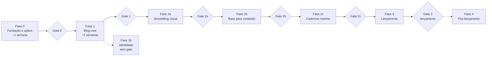

# Roadmap

A ordem de implementação do blog. O **quê** está em `SPEC.md`; aqui ficam as tarefas, as dependências entre elas, os gates e o status. Este arquivo muda a cada PR; a spec muda raramente.

## Como usar

1. Pegue a primeira tarefa `pendente` cujas dependências estejam todas `concluída`. Uma fase só começa depois que o gate da anterior estiver `aprovado`, salvo quando a coluna Depende de cita um gate anterior.
2. Marque-a `em andamento` no primeiro commit do PR. Branch: `t-XX-descricao-curta`.
3. Leia só as seções da SPEC ligadas aos requisitos citados na tarefa.
4. Ao fechar o PR, marque `concluída` e acrescente a entrada no [Registro de handoff](#registro-de-handoff), no mesmo PR: 1 linha na tarefa leve, até 3 na completa (AGENTS.md, Trilhas). O detalhe da tarefa fica na descrição do PR.
5. Se a tarefa revelar trabalho novo, adicione uma tarefa nova com o próximo ID livre; não amplie a tarefa atual.
6. O PR que cumpre o último critério de um gate também muda a linha **Status do gate** para `aprovado (AAAA-MM-DD)`.

Posts não são tarefas e não entram aqui: seguem a trilha Post do AGENTS.md (RNF-14).

Status de tarefa: `pendente`, `em andamento`, `concluída`, `bloqueada (motivo)`, `cancelada (motivo)`. Status de gate: `pendente`, `aprovado (data)`.

## Resumo dos gates

As Fases 0 a 3 estão fechadas, com todas as tarefas `concluída` ou `cancelada`. As tabelas, os critérios de cada gate e as notas das fases estão em [`specs/arquivo/roadmap-fases-0-a-3.md`](arquivo/roadmap-fases-0-a-3.md), e o handoff das tarefas, nos arquivos `handoff-*` da mesma pasta.

| Fase | Nome | Gate |
| --- | --- | --- |
| 0 | Fundação e spikes | aprovado (2026-10-15) |
| 1 | Blog core | aprovado (2026-10-26) |
| 1b | Identidade | sem gate |
| 2a | Storytelling visual | aprovado (2026-11-10) |
| 2b | Base para conteúdo | aprovado (2026-11-14) |
| 2c | Cadernos marimo | aprovado (2026-11-16) |
| 3 | Lançamento | aprovado (2026-11-18) |

## Fase 4 — Pós-lançamento

A Fase 4 vem da Q17 (Should e Could depois do lançamento), da Q20 (T-106), da Q22 (T-118) e da Q23 (T-126): é o mapa do trabalho depois do Gate 3. Não tem gate, como a Fase 1b.

A ordem é T-118, T-119, T-120, T-121, T-122, T-123, T-124, T-113, T-114, T-22, T-126, T-127, T-125, T-132, T-131, T-133, T-128, T-129, T-130, T-134, T-117, T-26, T-23, T-135, T-116, T-76, T-24, T-28 e T-31. Por gatilho: a T-89 antes do primeiro post com math além do teto do KaTeX, a T-86 por volta do 7º post publicado, e a T-83 e a T-95 em folgas.

Posts novos são publicados depois da T-120.

| ID    | Tarefa                                                                                                                                                                                                                                                                                                                                                                                                                                                                                                                                                                                                                                                                                                                                                                                                                                                                                                                                                                                                                                                                                                                                                                                                                                                                                                                                                                                                                                                                                                                                                                                                                                                                                                                                                      | Requisitos                                                    | Depende de                                  | Status                                                                         |
| ----- | ----------------------------------------------------------------------------------------------------------------------------------------------------------------------------------------------------------------------------------------------------------------------------------------------------------------------------------------------------------------------------------------------------------------------------------------------------------------------------------------------------------------------------------------------------------------------------------------------------------------------------------------------------------------------------------------------------------------------------------------------------------------------------------------------------------------------------------------------------------------------------------------------------------------------------------------------------------------------------------------------------------------------------------------------------------------------------------------------------------------------------------------------------------------------------------------------------------------------------------------------------------------------------------------------------------------------------------------------------------------------------------------------------------------------------------------------------------------------------------------------------------------------------------------------------------------------------------------------------------------------------------------------------------------------------------------------------------------------------------------------------------- | ------------------------------------------------------------- | ------------------------------------------- | ------------------------------------------------------------------------------ |
| T-106 | Decisões de produto da Fase 4 (Q20) e mapa da fase no ROADMAP. Tarefa leve, só docs. Fora: código, o arquivamento (T-107) e o texto que descreve o site como ele é hoje                                                                                                                                                                                                                                                                                                                                                                                                                                                                                                                                                                                                                                                                                                                                                                                                                                                                                                                                                                                                                                                                                                                                                                                                                                                                                                                                                                                                                                                                                                                                                                                     | RF-13, RF-14, RF-15, RF-18, RF-20, RF-23, RF-24, SPEC §1, §2  | Gate 3                                      | concluída                                                                      |
| T-107 | Arquivar em `specs/arquivo/` as notas de revisão da SPEC (fica só a mais recente) e, do ROADMAP, as Fases 0 a 3 e os handoffs desde 10/11. O ROADMAP fica com o "Como usar", o resumo dos gates e a Fase 4. Fora: a Fase 4. Tarefa leve, só docs; prova: o texto movido sai igual                                                                                                                                                                                                                                                                                                                                                                                                                                                                                                                                                                                                                                                                                                                                                                                                                                                                                                                                                                                                                                                                                                                                                                                                                                                                                                                                                                                                                                                                           | RNF-12                                                        | T-106                                       | concluída                                                                      |
| T-108 | Limpeza sem mudar comportamento. Sai o CSS do ícone do lab em `src/styles/global.css` (`.pkl-q0` a `.pkl-q2`, `@keyframes pkl-b0` a `pkl-b2` e o bloco de `prefers-reduced-motion` deles, sem uso desde a T-98); sai `public/notebooks/` do `.gitignore` e do `eslint.config.js`, e sai o `.cursorignore`, com a linha dele na árvore da SPEC §9; saem os exports sem uso `binaryExtensions` e `HEAT_OPACITY`, usados só no próprio arquivo, e `siteBio` e `separator`, de `tests/e2e/site-literals.ts`; sai a Caveat de `astro.config.mjs`, do `` do `BaseLayout.astro`, do `--font-hand` do `global.css`, dos testes de fonte, da SPEC §9 (fontes), do AGENTS (Fontes) e da BRAND §5 e §13. Fora: qualquer outra face. Tarefa leve. Prova pelo `dist/`: as páginas só trocam o nome do CSS e o `@font-face` da Caveat, e saem os 2 arquivos de fonte dela                                                                                                                                                                                                                                                                                                                                                                                                                                                                                                                                                                                                                                                                                                                                                                                                                                                                                           | RNF-12                                                        | T-106                                       | concluída                                                                      |
| T-109 | Revisão visual com mockups fora do repositório, como a T-63; o PR só muda `specs/`. Decide o card, o que a home lista, as listas de artigos e de protótipos e as rotas delas, se o tema tem página, a interface do filtro, o lugar da busca, o header e o footer, a "Comece aqui", o compartilhar, a área da newsletter, o layout da imagem OG, e a cor e o ícone dos tipos novos. Grava na BRAND (§8, §9) e nos critérios de aceite dos RF afetados. Fora: código                                                                                                                                                                                                                                                                                                                                                                                                                                                                                                                                                                                                                                                                                                                                                                                                                                                                                                                                                                                                                                                                                                                                                                                                                                                                                          | RF-01, RF-02, RF-14, RF-15, RF-16, RF-23, RF-24, BRAND §8, §9 | T-106                                       | concluída                                                                      |
| T-118 | Decisões de produto da refatoração da Fase 4 (Q22), só docs: grava a Q22 na SPEC §2, reescreve os requisitos ainda não entregues (RF-15, RF-16, RF-18, RF-24), cria o RF-25, marca o RF-21 como substituído e reescreve a Fase 4 do ROADMAP, com a T-110, a T-111 e a T-112 canceladas. Os requisitos já entregues mudam no PR do código de cada tarefa (decisão 1A), e o handoff diz em qual. Tarefa leve. Fora: a BRAND (T-119) e código                                                                                                                                                                                                                                                                                                                                                                                                                                                                                                                                                                                                                                                                                                                                                                                                                                                                                                                                                                                                                                                                                                                                                                                                                                                                                                                  | RF-15, RF-16, RF-18, RF-21, RF-24, RF-25, SPEC §2             | T-109                                       | concluída                                                                      |
| T-119 | Revisão visual com mockups fora do repositório, como a T-109. O PR só muda `specs/`. Grava a BRAND 1.29: §0 (a lista fechada de cores sem `kind-concept`, `kind-tutorial` e `kind-playbook`), §1 sem fólio, §4 (o latão e o verdete deixam de marcar tipo e ficam só no código), §6 sem hachura, §7 (os ícones dos tipos antigos saem da lista e da animação), §8 sem níveis nem temas, §9.1 a §9.3, §9.12 a §9.14, §10 e §11. Cenas: home com três listas, item, listas com filtro, botão de voto, modal de busca, header, lateral sem fólio e newsletter na home. Fora: código                                                                                                                                                                                                                                                                                                                                                                                                                                                                                                                                                                                                                                                                                                                                                                                                                                                                                                                                                                                                                                                                                                                                                                            | BRAND §0, §1, §4, §6, §7, §8, §9, §10, §11                    | T-118                                       | concluída                                                                      |
| T-120 | Modelo de conteúdo. Saem `folio`, `level` e `featured` do schema, dos posts, das quatro fixtures, do rascunho e de todo leitor. O `kind` passa a `article`/`prototype`, com slugs `artigos` e `prototipos`: os dois posts publicados viram `article`, o rascunho `2026-10-rascunho-de-teste` vira `prototype`, a `fixture-md` vira `prototype` e as outras três fixtures ficam `article`. Entram a folha e o frasco; saem os ícones, os keyframes e os tokens `kind-*` dos tipos antigos. O topo da lateral diz `/ ARTIGO` ou `/ PROTÓTIPO`, e a coluna do texto fica só com o filete, alinhado ao da lateral. A skill `novo-post` deixa de pedir fólio e nível. O card de produção perde o fólio e o nível, e a home perde o destaque. No mesmo PR: a §6, o RF-04 e o RF-01 nesse ponto (card sem fólio e sem nível, home sem destaque). No mesmo PR também mudam o AGENTS (Mapa: a linha de `src/assets/brand/icones/`; Cores: a lista fechada sem `kind-*`) e a lista de arquivos da marca na SPEC §9 (o bloco depois da árvore, com `src/assets/brand/icones/icone-...`). As rotas da §9 continuam na T-123. A prova de tipo só com rascunho é Vitest; o cenário Rascunhos da §11 continua no E2E só para o post, e a tarefa diz que teste do E2E sai ou muda. Estado aceito até a T-123: `/tipos/artigos/` em produção, no sitemap. Fora: a forma das três listas e as rotas novas                                                                                                                                                                                                                                                                                                                                                                     | RF-01, RF-04, SPEC §6, AGENTS, SPEC §9                        | T-119                                       | concluída                                                                      |
| T-121 | Votos, infraestrutura. O Worker ganha `main`, o binding do D1, `assets.binding` e `run_worker_first` para `/api/*`. GET e POST `/api/votes`. O POST exige Origin `https://pedroknoll.com` (no `wrangler dev`, a origem local quando `VOTES_WRITE=local`) e `Content-Type: application/json`; fora disso, 403 ou 415, sem gravar. Grava só no hostname `pedroknoll.com`. Slug desconhecido é 400: o Worker confere o catálogo dos posts publicados, lido do `dist/` pelo binding ASSETS, e o build grava esse arquivo. IPv6: hash do prefixo /64. IPv4: do endereço inteiro. O sal é o secret `VOTE_IP_SALT`, com hash SHA-256 e sem IP cru. O teto diário por hash é escolhido contra a doc atual do plano free e gravado no RF-25. Uma linha por par (hash, slug), sem desfazer. O `.dev.vars` entra no `.gitignore` antes de ser criado (`git check-ignore`). A primeira migração no D1 remoto, aplicada à mão pelo autor, é exceção única à regra de produção só pelo CI; o ESTADO registra o comando, a data e o motivo. As migrações seguintes só no job `deploy` de `main`, antes do `wrangler deploy`; o preview não migra o D1 de produção. A permissão de D1 no token `github-actions-blog-deploy` entra no ESTADO. O AGENTS ganha o comando `wrangler d1`. A tarefa confere na doc atual da Cloudflare se cabe um cache curto no GET (Cache API) e grava a decisão na §10. O projeto do Playwright contra `wrangler dev` com D1 local entra num job do `ci.yml`, sem tocar no E2E do `astro preview`, sem `CLOUDFLARE_API_TOKEN` e sem o D1 remoto. No preview, o `versions upload` sobe o binding e a API só lê. No mesmo PR: ADR-04, ADR-05, o diagrama da §5, a §10, o RNF-06 dos headers da API no Worker, o RNF-10 e o RNF-11. Fora: o botão | RF-25, ADR-04, ADR-05, RNF-06, RNF-10, RNF-11                 | T-120                                       | concluída                                                                      |
| T-122 | Botão de votar no fim do post, com a contagem. Votado, sem desfazer. O script entra no `check:js`. No mesmo PR, o RNF-02, junto com o primeiro script novo. O Lighthouse mede o `dist/` sem API, no estado de aviso. O CLS com números é no Playwright, com `page.route`, pela checagem de posição de menos de 3 px na `fixture-mdx`, no ponto do botão. O Web Analytics (RNF-13) é a medida de campo. Fora: as listas                                                                                                                                                                                                                                                                                                                                                                                                                                                                                                                                                                                                                                                                                                                                                                                                                                                                                                                                                                                                                                                                                                                                                                                                                                                                                                                                      | RF-25, RNF-02                                                 | T-121                                       | concluída                                                                      |
| T-123 | Listas. A home tem três listas, 5 recentes, top 10 e 5 protótipos, cada uma com Todos; a saudação continua à esquerda a partir de `lg`. A lista Protótipos da home não aparece sem protótipo publicado. Entram `/blog/`, `/artigos/`, `/prototipos/` e `/mais-votados/`, inteiras e sem paginação. Saem `/tipos/`, a barra Filtrar por tipo e `/page/n/`, que passam a 404, sem `_redirects`. O item é título, data, votos e tempo de leitura, também em `/tags/`. Um tipo sem post publicado não tem página. O catálogo dos posts publicados (slug, título, data, tipo, minutos, tags) vai no HTML como `<script type="application/json">`. O ranking do top 10 é feito no navegador. O `page-js.ts` não conta esse tipo de script. No mesmo PR: o resto do RF-01 (as três listas), o RF-02, o RF-03 removido com a exceção da Q10, o RF-12 (saem o title de tipo e o de `/page/n/`; entram os das quatro listas), a §9 (árvore e rotas, tirando `/sobre` da §9, da §10 e das Convenções do AGENTS) e a §11 (o cenário Rascunhos deixa de falar em páginas de tag e de tipo). O RNF-04 troca uma tag e um tipo pela primeira lista no `quality.spec.ts` e no `theme.spec.ts`. A guarda de fontes troca a página de tipo pela primeira lista, sem mudar os tetos. O Lighthouse mede o estado sem API. O CLS com números, no Playwright, é na home e em `/mais-votados/`. Fora: o filtro                                                                                                                                                                                                                                                                                                                                                                     | RF-01, RF-02, RF-03, RF-12, RNF-04, SPEC §9, §11              | T-122                                       | concluída |
| T-124 | Filtro por tag nas quatro listas: um `select` nativo, uma tag por vez, gravada em `?tag=`. Sem JavaScript, a lista inteira e os links de `/tags/`. Em `/mais-votados/`, sem JavaScript, o aviso. O script conta no `check:js`. O `Todos` da home mostra o total, `Todos · N`: recentes é o número de posts publicados e protótipos o de protótipos, os dois no HTML; mais votados, o script escreve os posts com pelo menos 1 voto, inclusive 0, e sem JavaScript o link fica `Todos`, sem número. O nome acessível inclui o número. O teste dos três Todos passa a exigi-lo. Fora: a busca                                                                                                                                                                                                                                                                                                                                                                                                                                                                                                                                                                                                                                                                                                                                                                                                                                                                                                                                                                                                                                                 | RF-02, RNF-02, BRAND §9.2                                     | T-123                                       | concluída                                                                      |
| T-113 | Header e footer, pela BRAND §9.13 (T-119): no header, a assinatura, o lugar de Comece aqui, Artigos, Protótipos (este só com protótipo publicado), o lugar do botão de busca e o lugar do controle de tema. No footer, o nome, o ano, RSS, GitHub e LinkedIn. Não reescreve requisito da SPEC. Fora: a página Comece aqui (T-114), o script da busca (T-22), o controle de tema (T-24) e a newsletter (T-116)                                                                                                                                                                                                                                                                                                                                                                                                                                                                                                                                                                                                                                                                                                                                                                                                                                                                                                                                                                                                                                                                                                                                                                                                                                                                                                                                               | BRAND §9.13                                                   | T-119, T-123                                | concluída                                                                      |
| T-114 | Página Comece aqui em `/comece-aqui/`: estrutura definida na própria tarefa, sem link para o GitHub, com o link em primeiro no header (BRAND §9.13). No mesmo PR, o RF-14. Fora: a newsletter                                                                                                                                                                                                                                                                                                                                                                                                                                                                                                                                                                                                                                                                                                                                                                                                                                                                                                                                                                                                                                                                                                                                                                                                                                                                                                                                                                                                                                                                                                                                                               | RF-14                                                         | T-113                                       | concluída                                                                      |
| T-22  | Busca: modal do Pagefind 1.5, aberto pelo botão no header ou com Cmd/Ctrl+K, em todas as páginas. O índice cobre só o corpo dos posts. O script do Pagefind entra por import dinâmico ao abrir. No mesmo PR, o RNF-07 e o teste que proíbe `wasm-unsafe-eval`: a CSP do site todo ganha a diretiva. Se o modal injetar `style` ou script inline em tempo de execução, ou pedir `unsafe-inline` em `style-src-elem`, a tarefa para e pergunta. Fora: outra interface de busca, indexar título ou outras páginas                                                                                                                                                                                                                                                                                                                                                                                                                                                                                                                                                                                                                                                                                                                                                                                                                                                                                                                                                                                                                                                                                                                                                                                                                                              | RF-15, RNF-07                                                 | T-113                                       | concluída                                                                      |
| T-126 | Decisões dos mockups da home e da página do post (Q23), feitos fora do repositório, como a T-119. O PR só muda `specs/`: a Q23 na SPEC §2, o RF-23 reescrito (voto e compartilhar num bloco da lateral), o RF-26 novo (índice do post), a nota do RF-05, os cenários do índice na §11, a BRAND 1.36 (§1, §4, §5, §7, §8, §9.1 a §9.3, §9.11, §9.14, §9.15 e §10) e as tarefas de código. Os requisitos já entregues mudam no PR do código de cada tarefa (decisão 1A). Tarefa leve. Fora: código, testes e o mockup | RF-05, RF-23, RF-26, SPEC §2, §11, BRAND §1, §4, §5, §7, §8, §9, §10 | T-22 | concluída |
| T-127 | Vocabulário do voto (Q23 item 8): `Curtir`, `Curtido` e `curtidas` viram `Votar`, `Votado` e `votos` (`voto` com 1) no `PostVote`, no `Card`, no `TopVoted` e nos testes que leem esses textos (`vote.spec.ts`, `card.spec.ts`, `home.spec.ts`, `most-voted.spec.ts`). A contagem do botão passa de `accent` a tinta (BRAND §4, §9.14). No mesmo PR, o RF-25 (o texto do botão). Fora: a forma dos itens (T-125, T-131) e o lugar do botão (T-130) | RF-25 | T-126 | concluída |
| T-125 | Home pela Q23 (BRAND §9.1, §9.2 e §9.11). Saudação: a foto do autor em `public/avatar.jpg`, fornecida pelo autor, redonda, 88 px de `lg` em diante e 72 px abaixo, com largura e altura no HTML; o h1 `Olá, eu sou o Pedro.` em Plex Sans 400 com "Pedro" em Condensed 600 e a mão no fim; o parágrafo; GitHub e LinkedIn; `Assinar via RSS` com contorno. Faixas: o link na linha de base do rótulo, em `accent` (`Todos os N posts →`, `Todos os N protótipos →`, `Ver ranking →`), com os nomes acessíveis e o singular revistos; o item de Recentes (data, título, tempo, `NOVO`), o de Mais votados (posição, título, `▲ N votos`) e o de Protótipos (miniatura do `cover` ou bloco `sheet`, `description` em 2 linhas); o hover com fundo `sheet` e título em `accent` sublinhado; abaixo de `sm`, rótulo de 15 px com filete de 2 px e título de 20 px. O `NOVO` é calculado no navegador, com o lugar reservado (sem CLS), e o script conta no `check:js`. O Lighthouse mede a home antes e depois (a foto pode virar o LCP); o teto de fontes e o `font-budget.spec.ts` não mudam. No mesmo PR: o RF-01, a árvore da SPEC §9 (`public/avatar.jpg`) e o AGENTS (Convenções → Ícones: a mão no fim do h1). Fora: as listas inteiras e a Comece aqui (T-131), a página do post e a newsletter (T-116) | RF-01, RNF-01, RNF-02, RNF-04, BRAND §9.1, §9.2, §9.11, SPEC §9 | T-127 | concluída |
| T-132 | Atalho da busca logo depois do Esc. O `isOpen` do `pagefind-modal` só vira `false` no evento `close`, que chega alguns ms depois de o `<dialog>` fechar; nesse intervalo, Cmd/Ctrl+K era ignorado e o `search.spec.ts` falhava às vezes (achado da T-131). O atalho passa a olhar o `open` do `<dialog>` e espera o `close` antes de reabrir. Tarefa leve; prova: um teste que aperta Esc e o atalho em seguida, visto falhando antes. Fora: o resto da busca | RF-15 | T-22 | concluída |
| T-131 | Listas inteiras pela Q24 (pedido do autor, com mockups; substitui ali a Q23 item 3) e item da Comece aqui pela Q23 (BRAND §9.2, §9.15): `/blog/`, `/artigos/`, `/prototipos/`, `/tags/<tag>/` e `/mais-votados/` ganham a lateral com o h1, a contagem e o filtro, o rótulo `/ LISTAGEM` e o item com a data, o título, a `description` em 2 linhas, o tempo e os votos (só com 1 ou mais), em colunas de `sm` em diante; em `/prototipos/`, a miniatura. O item de post da Comece aqui passa ao de Recentes, sem votos, e o item externo à mesma grade. O hover é o da home, sem a queda para 0,35. No mesmo PR: a Q24 na SPEC §2, o RF-02, o RF-14 e a BRAND 1.38. Fora: o filtro (T-124) e a home (T-125) | RF-02, RF-14, SPEC §2, BRAND §9.2, §9.15 | T-125 | concluída |
| T-133 | Ordenação das listas inteiras (`/blog/`, `/artigos/`, `/prototipos/`, `/tags/<tag>/` e `/mais-votados/`): o controle fica à direita do rótulo `/ LISTAGEM`, na mesma linha, no lugar que a T-131 deixou vazio. Começa decidindo, com o autor, os critérios de ordem e a forma do controle (BRAND §9.2), e se a escolha vai na URL, como o `?tag=` | RF-02, BRAND §9.2 | T-131 | concluída |
| T-128 | Cabeçalho do post pela Q23 (BRAND §9.3): o título e a linha fina na coluna do texto; logo abaixo, a linha de metadados (foto de 28 px e `Pedro Knoll` · data · relógio e minutos · `Artigo` ou `Protótipo`), as tags em etiquetas com contorno e link, e o filete que fecha o cabeçalho. Saem a tabela de chave e valor, o rótulo `/ ARTIGO` ou `/ PROTÓTIPO`, a linha Tipo só para leitor de tela e o título que aparece acima da lateral ao rolar. Se a escala de 80 px do h1 não couber na coluna, para e pergunta. Estado aceito até a T-130: o voto fica na lateral, no lugar da tabela, e no fim do texto abaixo de `lg`. O CLS do cabeçalho no Playwright. No mesmo PR: o RF-04. Fora: o índice (T-129) e o bloco de voto e compartilhar (T-130) | RF-04, RNF-01, RNF-04, BRAND §9.3 | T-125 | concluída |
| T-129 | Índice do post (BRAND §9.3): de `lg` em diante, na lateral, o `nav` `Neste artigo`, com `/ NESTE ARTIGO`, a porcentagem (`aria-hidden`) e a barra de progresso; um item por h2, numerado, com a seção atual em `sheet`, 600 e `aria-current="location"`; no fim, o relógio e os minutos. O alinhamento com o primeiro h2 e o sticky saem do CSS (grid e sticky), sem JavaScript que meça. Sem índice abaixo de `lg` e com menos de 2 h2. Os três cenários do RF-26 na §11, escritos e vistos falhando antes, na `fixture-mdx` e na `fixture-sem-titulos`. O script conta no `check:js`; sem rolagem suave com `prefers-reduced-motion`. Fora: o bloco de voto e compartilhar (T-130) | RF-26, RNF-01, RNF-02, RNF-04 | T-128 | concluída |
| T-130 | Bloco de voto e compartilhar (BRAND §9.14); absorve a T-115. De `lg` em diante, na lateral, abaixo do índice, sticky na borda de baixo, aparecendo por opacidade e transform quando o filete do cabeçalho sai da tela (`IntersectionObserver`); o índice e o bloco sobem juntos no rodapé só pelo CSS. Um fio em `line`, o botão `▲ Votar N` → `Votado N`, `Compartilhar` e, abaixo, X, LinkedIn e E-mail por links, sem script de terceiro, e `Copiar link` por script do próprio site, que vira `Link copiado` por 1,5 s. Abaixo de `lg`, no fim do texto, antes da faixa do apêndice, sem sticky. Sem JavaScript, parado, com o aviso do voto e os três links. Com `prefers-reduced-motion`, sem animação. O script conta no `check:js`. O CLS do bloco no Playwright. No mesmo PR: o RF-25 se o lugar do botão mudar o texto dele. Fora: copiar markdown, os relacionados (T-26) e a newsletter (T-116) | RF-23, RF-25, RNF-01, RNF-02, RNF-04 | T-127, T-129 | concluída |
| T-134 | Foto do autor no tamanho de cada uso. O `public/avatar.jpg` tem 420 × 420 px e 40.252 bytes, e o cabeçalho do post (T-128) o mostra em 28 px: cada post baixa cerca de 40 KB a mais (Lighthouse da T-128, `total-byte-weight` de 159 KB para 199 KB no post A). Servir uma variante de 56 px no post e uma de 176 px na home, sem mudar o LCP nem o CLS (RNF-01), com largura e altura no HTML. Decidir se a foto sai de `public/` para `src/assets/` (árvore da SPEC §9). Fora: o desenho do cabeçalho | RNF-01, SPEC §9 | T-128 | concluída |
| T-117 | Citações com tipo no fim do post e revisão visual da faixa (BRAND §9.3), com mockups fora do repositório, como a T-119. Tarefa completa: muda o schema e o RF-04. O campo `references` vira `citations` e reúne tudo o que o post cita, direta ou indiretamente, como as menções do blog do Hugging Face. Cada citação ganha `type`, obrigatório, no enum `model`, `dataset`, `paper`, `article`, `course` e `video`, com os rótulos pt-BR ao lado, como em `src/lib/kind.ts` (Modelos, Datasets, Papers, Textos, Cursos, Vídeos); os campos de hoje (`key`, `authors`, `title`, `year`, `venue`, `url`) valem para todos os tipos. O marcador `[@chave]` continua e vira `[n]`, com `aria-label` `Citação n`, mas fica opcional: sai o erro `Referência não citada`. Continuam quebrando o build a chave citada sem citação, a citação dentro de link e a chave repetida. A faixa `sheet` de largura inteira sai: o apêndice e as citações ficam logo abaixo do corpo, na coluna do texto, cada seção aberta por um rótulo mono com barra e filete (`/ APÊNDICE A`, `/ CITAÇÕES`), com o número `[n]` alinhado à borda do texto e um tracejado entre os itens; o bloco de voto e compartilhar continua parando no fim do corpo (RF-23 não muda). As citações vêm depois dos apêndices, sob o h2 `Citações` (`id` `citacoes`, item `cit-<chave>`), agrupadas por tipo na ordem do enum, só os grupos com itens, cada um com rótulo e contagem; o `n` corre contínuo pelos grupos, na ordem em que aparecem, e deixa de ser a posição no frontmatter. Os apêndices (`appendices`) não mudam. O fim do post continua o da Q23: o bloco de voto e compartilhar (na lateral de `lg` em diante, no fim do texto abaixo), a faixa, os relacionados e a newsletter. Muda: o schema em `src/content.config.ts`, `src/lib/references.ts` e `src/lib/remark-citations.mjs` (os identificadores passam a `citation`), `PostAppendix.astro`, a `fixture-md` e a `fixture-mdx` (citação de mais de um tipo e uma sem marcador), `tests/e2e/fixtures.ts`, os testes de referências, a skill `post-prosa`, a SPEC (§2 Q22 item 7, §4 e o critério do RF-04) e a BRAND §9.3. Testes primeiro: o tipo obrigatório e fora do enum reprovam o schema, a citação sem marcador passa o build, os grupos saem na ordem do enum e o `n` segue a ordem dos grupos. Fora: campos por tipo, link de volta da citação para o texto, mudança nos apêndices e o resto do fim do post | RF-04, BRAND §9.3 | T-130 | concluída |
| T-26  | Posts relacionados pelas tags: até 2 com tags em comum (eram 3; decisão do autor na T-26), nunca o próprio, ordenados pelo número de tags em comum e, no empate, pela data mais recente; sem post com tag em comum, a seção não aparece. Com o item da lista, depois da faixa do apêndice. Entrega o RF-18                                                                                                                                                                                                                                                                                                                                                                                                                                                                                                                                                                                                                                                                                                                                                                                                                                                                                                                                                                                                                                                                                                                                                                                                                                                                                                                                                                                                                                                                                     | RF-18                                                         | T-123                                       | concluída                                                                      |
| T-23  | Imagens OG geradas no build. A capa do autor ganha quando existe. Sem capa, o PNG segue a ficha da seção 11 do BRAND (T-119), sem fólio, tema e nível, com o título quebrado pelo gerador em até 3 linhas. Os SVG vêm da T-40, pela T-45. O desenho usa a fonte de display, IBM Plex Sans Condensed 600 (T-60), achada pelo `fontData`. Rasterizar com `sharp` é hipótese a provar na tarefa, inclusive se as fontes da marca existem no CI. Se a hipótese falhar, a tarefa para e pergunta. Sem Satori enquanto ninguém aprovar a dependência. Entrega o RF-16                                                                                                                                                                                                                                                                                                                                                                                                                                                                                                                                                                                                                                                                                                                                                                                                                                                                                                                                                                                                                                                                                                                                                                                             | RF-16                                                         | Gate 3, T-12, T-42, T-45, T-119, T-120      | concluída                                                                      |
| T-135 | Cartão do X nos posts. O `Seo.astro` gera as tags Open Graph, mas nenhuma `twitter:*`. O X lê título, descrição e imagem do `og:` quando falta a dele, mas o tipo de cartão (`twitter:card`) não tem equivalente no Open Graph, e sem ele o link compartilhado pelo botão `X.com` da T-130 pode sair sem o cartão grande. Conferir na doc atual do X quais tags ele exige; acrescentar `twitter:card` (`summary_large_image` com `og:image`, `summary` sem ela) e só o que a doc pedir, sem repetir em `twitter:` o que o `og:` já cobre. Prova: teste no `seo.spec.ts` (ou unitário do `seo.ts`) visto falhando antes. No mesmo PR, o RF-12. Fora: a imagem OG (T-23) e o validador em produção | RF-12 | T-130 | concluída |
| T-116 | Newsletter no Kit: formulário HTML do próprio site para `https://app.kit.com/forms/<id>/subscriptions`, sem o script do Kit, no fim do post e num bloco na home. O id sai nesta tarefa. No mesmo PR, o RNF-06 do `form-action`. O `form-action` também vale para o redirecionamento depois do envio: a tarefa mede o caminho completo antes de fixar as origens; se precisar de mais de uma origem, ou de um domínio que não seja do Kit, para e pergunta. O DNS, SPF e DKIM no lugar de `v=spf1 -all`, continua aqui                                                                                                                                                                                                                                                                                                                                                                                                                                                                                                                                                                                                                                                                                                                                                                                                                                                                                                                                                                                                                                                                                                                                                                                                                                       | RF-24, RNF-06                                                 | T-119, T-123                                | pendente                                                                       |
| T-76  | Cores das figuras de `src/components/viz/`. Na T-20, o autor quis rever as cores dos diagramas: folha nas células, prússia no destaque e tinta com transparência no mapa de calor (BRAND §9.8). Começa com mockup fora do repositório, com as figuras de prova do post B nos dois temas. Escopo: só as figuras; a prússia do site (links e foco) fica fora. Token novo é decisão de escopo na lista fechada (BRAND §0, §4 e §9.8), com o contraste medido na BRAND §4 e o T1 do `tests/e2e/theme.spec.ts`                                                                                                                                                                                                                                                                                                                                                                                                                                                                                                                                                                                                                                                                                                                                                                                                                                                                                                                                                                                                                                                                                                                                                                                                                                                   | RF-09, BRAND §4, §9.8                                         | Gate 3, T-20                                | pendente                                                                       |
| T-24  | Tema escuro com controle segmentado e sem flash; conferir os gráficos no escuro. A T-41 só declara as duas paletas. Até a T-24, nada no site aplica `data-theme` nem `prefers-color-scheme`. O controle é o sol e a lua, no lugar que a T-113 deixou no header, com `localStorage`. O script inline entra sozinho na CSP: os hashes saem do build desde a T-16. No mesmo PR, o RF-17                                                                                                                                                                                                                                                                                                                                                                                                                                                                                                                                                                                                                                                                                                                                                                                                                                                                                                                                                                                                                                                                                                                                                                                                                                                                                                                                                                        | RF-17                                                         | Gate 3, T-07, T-19, T-41, T-48, T-76, T-113 | pendente                                                                       |
| T-28  | Giscus para comentários e reações, com carregamento lazy. A CSP de hoje (`default-src 'none'`, sem `frame-src`) bloqueia o iframe; o script de outra origem fere o RNF-06 e o `check:js`. Se precisar de origem nova na CSP ou de JS de terceiro no `check:js`, a tarefa para e pergunta                                                                                                                                                                                                                                                                                                                                                                                                                                                                                                                                                                                                                                                                                                                                                                                                                                                                                                                                                                                                                                                                                                                                                                                                                                                                                                                                                                                                                                                                    | RF-19                                                         | Gate 3, T-24                                | pendente                                                                       |
| T-31  | Avaliar o ganho de trocar as Version URLs com alias pelo Workers Previews (`wrangler preview`), num spike com doc em `specs/spikes/`; a troca, se valer, é tarefa nova                                                                                                                                                                                                                                                                                                                                                                                                                                                                                                                                                                                                                                                                                                                                                                                                                                                                                                                                                                                                                                                                                                                                                                                                                                                                                                                                                                                                                                                                                                                                                                                      | ADR-04                                                        | Gate 3                                      | pendente                                                                       |
| T-89  | Math além do teto do KaTeX. O teto de 3 arquivos e 48.000 bytes (SPEC §9, T-61) só admite juntos `KaTeX_Main-Regular`, `KaTeX_Math-Italic` e `KaTeX_Size2` (47.920 bytes), e a `fixture-formulas` (T-87) está nele. Na T-87, uma variante com `\mathbf`, `\mathbb`, `\mathcal`, `\textit`, `\sum` inline e `\left…\right` alto pediu 9 arquivos do KaTeX (135.612 bytes, no clone do revisor), e um só `\sum` inline pede a `KaTeX_Size1` e leva o KaTeX a 4 arquivos e 53.388 bytes, que a guarda reprova. Antes do primeiro post com essa math, medir o custo de uma fixture com ela e decidir o teto, sem relaxar o RNF-01. Desde a T-94, o Lighthouse 13.6.0 não põe os arquivos de fonte no LCP simulado dos posts (o LCP é igual ao FCP, cerca de 905 ms no CI): a T-89 escolhe como medir esse custo. Sem dependência fora da SPEC §9                                                                                                                                                                                                                                                                                                                                                                                                                                                                                                                                                                                                                                                                                                                                                                                                                                                                                                                | RNF-01                                                        | Gate 3, T-87                                | pendente                                                                       |
| T-86  | Escala do job `lighthouse` com o número de posts. Na T-77, o passo `Lighthouse` do CI foi de 1 min 42 s, com 9 execuções, para 2 min 53 s, com 15: cerca de 11,5 s por execução. Com 5 execuções por URL, cada post publicado soma cerca de 1 min, e o job tem `timeout-minutes: 15`. Por volta do 7º post publicado (antes do 10º, para ter folga), medir de novo e decidir como o job acompanha o número de posts, sem relaxar o RNF-01 nem tirar post da lista (RNF-14). Mudança de CI                                                                                                                                                                                                                                                                                                                                                                                                                                                                                                                                                                                                                                                                                                                                                                                                                                                                                                                                                                                                                                                                                                                                                                                                                                                                   | RNF-01, RNF-14                                                | Gate 3, T-77                                | pendente                                                                       |
| T-83  | Higiene do `tsconfig.json`. O `baseUrl` está depreciado no TypeScript 6 e deixa de funcionar no 7; é o único warning do `pnpm check:svelte` (T-75). Tirar o `baseUrl` sem quebrar o alias `~/` no Astro, no Vite, no `astro check` e no `svelte-check` (sem `baseUrl`, os `paths` começam com `./`; conferir na doc atual do TypeScript e do Astro). Excluir também `playwright-report/` e `test-results/`, que cabem no `include` e são a origem dos 183 hints locais do `astro check`. Prova: `pnpm check:svelte` sem warning, `pnpm astro check` sem hints dessas pastas e o `dist/` igual por hash                                                                                                                                                                                                                                                                                                                                                                                                                                                                                                                                                                                                                                                                                                                                                                                                                                                                                                                                                                                                                                                                                                                                                      | RNF-12                                                        | Gate 3, T-75                                | pendente                                                                       |
| T-95  | Nomes de `/_astro/fonts/` pelo conteúdo e, então, cache longo nessa pasta. No Astro 7.3.8 e no 7.4.12, o nome de cada fonte remota é o xxhash da URL que a API do Fontsource devolve, e não dos bytes, e por isso a T-91 deixou a pasta fora do `immutable` (achado da T-91). A T-91 supôs essa URL com `@latest`; a T-93 mediu a URL com a versão do pacote (`…/ibm-plex-sans@5.3.0/latin-400-normal.woff2`): uma versão nova muda o nome, mas a forma da URL é escolha da API, e não do site. Fazer o nome mudar com os bytes (versão fixa ou arquivo local) e estender a regra de cache a `/_astro/fonts/`, sem relaxar o teto de fontes (SPEC §9) nem o RNF-01. Dependência nova só pela SPEC §9                                                                                                                                                                                                                                                                                                                                                                                                                                                                                                                                                                                                                                                                                                                                                                                                                                                                                                                                                                                                                                                        | RNF-01                                                        | Gate 3, T-91                                | pendente                                                                       |
| T-110 | Modelo de conteúdo. O `kind` passa a `article`/`prototype`, com rótulos e slugs, e entra o `theme` obrigatório, com slug gerado e a falha de build para grafias que colidem. Migra os posts publicados, as 4 fixtures e o rascunho `2026-10-rascunho-de-teste` (hoje o único `tutorial`, e prova que tipo só com rascunho não gera página). A skill `novo-post` passa a perguntar o tema. Saem os ícones dos tipos atuais (animados e parados), os keyframes `pkc-*`, `pkt-*` e `pkp-*`, os tokens `kind-*` e o teste C6 do `card.spec.ts`; os ícones animados nunca são renderizados desde a T-67. Entram os ícones parados dos tipos novos, a folha (`icone-artigo.svg`) e o frasco (`icone-prototipo.svg`), em tinta (BRAND §7, §8), e o rótulo do topo do texto passa a dizer o tipo, `/ ARTIGO` ou `/ PROTÓTIPO` (BRAND §9.3). Atualiza a SPEC §6 (schema, regras e as menções a `src/data/tags.ts`), a BRAND §4 (o latão e o verdete deixam de marcar tipo), §7 e §8 (os temas e o frontmatter; os tipos são da T-109) e o AGENTS (Mapa e Cores). Fora: o card e as listas (T-111)                                                                                                                                                                                                                                                                                                                                                                                                                                                                                                                                                                                                                                                                    | RF-01, RF-02, RF-04, SPEC §6                                  | T-109                                       | cancelada (substituída pela T-120; Q22)                                        |
| T-111 | Card e listas, pela BRAND §9.2 (T-109): o card sem resumo, com o tema no lugar do tipo; a home com todos os posts, paginada, sem destaque (o `featured` fica no schema, sem efeito); `/artigos/` e `/prototipos/`, inteiras, com o ícone do tipo no h1; as páginas `/temas/<slug>/`, com seções por tipo; e a linha Tema na lateral do post, com link para a página do tema. A barra "Filtrar por tipo" e as páginas `/tipos/` saem, e a guarda de fontes troca a primeira página de tipo pela de uma lista. Atualiza o RF-01, o RF-02, o RF-04, o RF-12 e a SPEC §6 (as regras da barra, de `/tipos/`, de `/tags/` e de `/temas/`). Fora: o filtro (T-112) e a busca (T-22)                                                                                                                                                                                                                                                                                                                                                                                                                                                                                                                                                                                                                                                                                                                                                                                                                                                                                                                                                                                                                                                                                | RF-01, RF-02, RF-04, RF-12                                    | T-110                                       | cancelada (substituída pela T-123; Q22)                                        |
| T-112 | Filtro por tema em `/artigos/` e `/prototipos/`, num `select`, pela BRAND §9.12 (T-109), por script do próprio site, com a escolha gravada na URL (`?tema=`). Sem filtro por tag. Entra o ícone do filtro (`icone-filtro.svg`). Sem JavaScript, o `select` desabilitado, a lista inteira e os links das páginas de tema. Conta no `check:js` (RNF-02). Fora: a busca (T-22), que entra ao lado do filtro                                                                                                                                                                                                                                                                                                                                                                                                                                                                                                                                                                                                                                                                                                                                                                                                                                                                                                                                                                                                                                                                                                                                                                                                                                                                                                                                                    | RF-02, RNF-02, RNF-04                                         | T-111                                       | cancelada (substituída pela T-124; Q22)                                        |
| T-115 | Compartilhar no fim do post, ao lado do voto: X, LinkedIn e e-mail por links com o título e a URL, sem script de terceiro, e Copiar link por script do próprio site, que vira Link copiado por 1,5 s. O script conta no `check:js`. O lugar é o fim da coluna do texto, antes da faixa do apêndice, sob o rótulo `/ COMPARTILHAR` (BRAND §9.14). No mesmo PR, o RF-23                                                                                                                                                                                                                                                                                                                                                                                                                                                                                                                                                                                                                                                                                                                                                                                                                                                                                                                                                                                                                                                                                                                                                                                                                                                                                                                                                                                       | RF-23, RNF-02                                                 | T-122                                       | cancelada (absorvida pela T-130; Q23) |
| T-25  | Página Sobre e link "Editar no GitHub". Não espera a Fase 1b. Nome e bio vêm do `site.config` da hora; `pk.log`, `Pedro Knoll` e a descrição curta `Aprendizados e experimentos em IA` entram na T-43. Sem newsletter                                                                                                                                                                                                                                                                                                                                                                                                                                                                                                                                                                                                                                                                                                                                                                                                                                                                                                                                                                                                                                                                                                                                                                                                                                                                                                                                                                                                                                                                                                                                       | RF-13, RF-14                                                  | Gate 3, T-07, T-09                          | cancelada (substituída pela T-114, "Comece aqui", sem link para o GitHub; Q20) |
| T-29  | Componente `<Embed>` para HF Spaces e iframes genéricos                                                                                                                                                                                                                                                                                                                                                                                                                                                                                                                                                                                                                                                                                                                                                                                                                                                                                                                                                                                                                                                                                                                                                                                                                                                                                                                                                                                                                                                                                                                                                                                                                                                                                                     | RF-20                                                         | Gate 3                                      | cancelada (sai do projeto; Q20)                                                |
| T-32  | Reavaliar o modo inline adiado na T-03. Gatilho: mdx-marimo a partir de 0.1, ou uma opção pública para controlar Python e projeto no build                                                                                                                                                                                                                                                                                                                                                                                                                                                                                                                                                                                                                                                                                                                                                                                                                                                                                                                                                                                                                                                                                                                                                                                                                                                                                                                                                                                                                                                                                                                                                                                                                  | ADR-02                                                        | Gate 3                                      | cancelada (sai do projeto: o caderno abre no molab, Q18; Q20)                  |
| T-33  | Spike `precomputed`: a partir do `treino.py` da T-04, treino dentro de uma função com `@mo.persistent_cache(method="lazy")` que retorna `numpy`. Prazo: meio dia. Pergunta única: as células dependentes funcionam no navegador? Se não, notebooks com `torch` ficam em `onnx` ou `static`. Atualiza a SPEC §7 com o resultado.                                                                                                                                                                                                                                                                                                                                                                                                                                                                                                                                                                                                                                                                                                                                                                                                                                                                                                                                                                                                                                                                                                                                                                                                                                                                                                                                                                                                                             | RF-08, SPEC §7                                                | Gate 3                                      | cancelada (o molab roda torch no servidor, T-96)                               |
| T-17  | Modo `--heavy`: export local em `exports/<slug>/<nome>/`, `export.lock`, upload ao R2 acima de 25 MiB, verificação de frescor no CI e cópia de `exports/` para `public/notebooks/` no build; falha o build se a saída do export tiver `Cache save failed`; o `export.lock` registra o `marimo`, o `numpy` do `--execute` e o `Pyodide`                                                                                                                                                                                                                                                                                                                                                                                                                                                                                                                                                                                                                                                                                                                                                                                                                                                                                                                                                                                                                                                                                                                                                                                                                                                                                                                                                                                                                      | RF-08, RNF-09, SPEC §7                                        | T-14, T-33, T-34                            | cancelada (caderno pesado roda no molab com GPU, T-96)                         |

O RF-21 foi substituído pelo RF-25, com os upvotes anônimos (Q22, T-121 e T-122). A T-115 foi absorvida pela T-130 (Q23). A T-125, citada na Q20 como o uso do `author.avatar`, é a home da Q23.

## Próxima fase

| ID | Tarefa | Requisitos | Depende de | Status |
| --- | --- | --- | --- | --- |
| T-30 | i18n, se fizer sentido | P5 | Gate 3 | pendente |

## Registro de handoff

Uma entrada por tarefa concluída, escrita por quem a fechou: 1 linha na tarefa leve, até 3 na completa. Diz só o que a próxima tarefa precisa saber e não está óbvio no código; o resto fica na descrição do PR. Se o número do PR ainda não existir quando a entrada for escrita, use o nome do branch.

As entradas das Fases 0 a 3 estão em `specs/arquivo/`, em ordem de fechamento: as 50 escritas até 10/11/2026, da T-01 à T-20, em [`handoff-ate-2026-11-10.md`](arquivo/handoff-ate-2026-11-10.md), e as 29 de 10/11 a 18/11/2026, da T-75 à T-105, em [`handoff-2026-11-10-a-2026-11-18.md`](arquivo/handoff-2026-11-10-a-2026-11-18.md).

- **T-106** (2026-11-18, PR #92): Só docs. A Q20 grava as decisões da Fase 4; mudaram agora só os requisitos ainda não entregues (RF-13 e RF-20 removidos, RF-14, RF-15 e RF-18 reescritos, RF-23 e RF-24 novos), a §1 e frases já falsas; o RF-01, o RF-02, o RF-04, o RF-12, a §6, a §7, as fontes da §9, a §10 e os RNF mudam na tarefa que muda o comportamento, como cada linha da Fase 4 diz. A tabela da Fase 4 está na ordem de execução, para o item 1 do "Como usar" seguir a ordem; a T-30 foi para "Próxima fase", e a T-25, a T-29 e a T-32 foram canceladas.
- **T-107** (2026-11-18, `t-107-arquivar-docs`): Só docs. As 25 notas de revisão da SPEC (da Revisão 5 de 10/11 à Revisão 5 de 17/11), as Fases 0 a 3 do ROADMAP e os handoffs da T-75 à T-105 foram para `specs/arquivo/` (`spec-revisoes-2026-11-10-a-2026-11-17.md`, `roadmap-fases-0-a-3.md` e `handoff-2026-11-10-a-2026-11-18.md`), iguais byte a byte ao texto da `main` em `2aa9b99`; no lugar das fases, o ROADMAP tem o resumo dos gates (119 KB → 16 KB; a SPEC, 117 → 105 KB), e o passo 1 do "Como trabalhar" do AGENTS aponta para o arquivo, onde estão a linha e o handoff das dependências das tarefas da Fase 4.
- **T-108** (2026-11-18, `t-108-limpeza`): Sem mudança de comportamento. Saíram o CSS `.pkl-`*, o `public/notebooks/` do `.gitignore` e do `eslint.config.js`, o `.cursorignore`, o `export` de `binaryExtensions`, `HEAT_OPACITY` e `separator`, o `siteBio` e a Caveat (config, ``, `--font-hand`, testes de fonte, SPEC §9, AGENTS e BRAND 1.27); o `dist/` foi de 100 a 98 arquivos e o `dist-fixtures` de 116 a 114 (os 2 `.woff2` da Caveat), o CSS do layout virou `BaseLayout.Dx9MY2jC.css`, cada página só perdeu o `<style>` da Caveat, e o `_headers`, o hash dele (maior linha 689 → 635 e 851 → 797).
- **T-109** (2026-11-18, `t-109-revisao-visual`): Só docs. A Q21 grava a revisão visual da Fase 4, feita em mockups fora do repositório, como a T-63, e a forma está na BRAND 1.28 (§7, §8, §9.1 a §9.3, §9.9, §9.12 a §9.14, §10, §11 e os seis ícones novos no apêndice); na SPEC, só a §2 e os critérios do RF-14, do RF-15, do RF-23 e do RF-24 mudaram, e o RF-01, o RF-02, o RF-04, o RF-12 e a §6 mudam com o código (T-110, T-111); as linhas da T-110 à T-116, da T-26, da T-23, da T-22 e da T-24 citam a seção da BRAND de cada uma, e a T-117 (referências e apêndices) é nova.
- **T-118** (2026-11-19, `t-118-q22`): Só docs. A Q22 substitui a Q20 e a Q21 onde discordam; mudaram agora a §1 (não-objetivos), a §2, o RF-15, o RF-16, o RF-18, o RF-24, o RF-21 (substituído) e o RF-25, e a Fase 4 do ROADMAP, com a T-110, a T-111 e a T-112 canceladas. O resto muda com o código: T-120 (§6, RF-04, o RF-01 no card sem fólio e sem nível e na home sem destaque, a lista de arquivos da marca na §9 e o AGENTS), T-121 (ADR-04, ADR-05, diagrama da §5, §10, RNF-06 dos headers da API, RNF-10, RNF-11), T-122 (RNF-02), T-123 (o resto do RF-01, as três listas; RF-02, RF-03 com a Q10, RF-12, as rotas da §9, §11 e o RNF-04), T-22 (RNF-07), T-116 (RNF-06 do form-action). O P1 não é revisto.
- **T-119** (2026-11-19, `t-119-revisao-visual`): Só docs. A forma da Q22 está na BRAND 1.29; a T-120 apaga fólio, nível, tokens `kind-`* e os ícones velhos, o top 10 não vem no HTML, e `icone-fogo.svg` e `icone-voto.svg` entram na T-123.
- **T-120** (2026-11-19, `t-120-modelo-de-conteudo`): Saíram `folio`, `level` e `featured`; o `kind` é `article`/`prototype` (Artigo e Protótipo, slugs `artigos` e `prototipos`). De `lg`, a lateral abre com `/ ARTIGO` ou `/ PROTÓTIPO` e a coluna do texto fica só com o filete, alinhado ao da lateral; abaixo de `lg`, o tipo é a primeira linha da tabela. O "Atualizado em" saiu da lateral e o `updatedDate` ficou no schema, no JSON-LD e no `article:modified_time`. `/tipos/artigos/` continua no sitemap até a T-123; em produção não há `/tipos/prototipos/`, porque o único protótipo é rascunho (a prova é o Vitest). Saíram do E2E o C6, o C10, o C13, o C15, o C16, o C21 e o C22, o destaque da home, o bloco de Destaque e o de tipo só com rascunho do spec-11, o 404 de tipo sem post em kinds, os tokens `kind-`* do theme e o rótulo Destaque do T2.
- **T-121** (2026-11-23, `t-121-votos`): O Worker atende só `/api/*`. GET `/api/votes` devolve `{ votes: { slug: n } }` com 0 incluído; POST devolve `{ slug, votes }` e só grava em `pedroknoll.com` com Origin `https://pedroknoll.com`. No preview e no `workers.dev` a API só lê. O teto é 20 votos novos por hash no dia UTC. O botão é a T-122. O `database_id` está no `wrangler.jsonc`; a primeira migração remota é a exceção do autor, antes do merge, e o secret `VOTE_IP_SALT` sobe no deploy da `main`.
- **T-122** (2026-11-23, `t-122-botao-votar`): O `PostVote` sai duas vezes, `max-lg:hidden` no fim da lateral e `lg:hidden` depois da prosa. A chave é `pk-vote:<slug>` com valor `1`; o texto vai de `Curtir` a `Curtido`, sem desfazer, e não há rótulo `/ VOTAR`. No `dist/` sem Worker o GET `/api/votes` responde 404: `errors-in-console` fica 0 e o Best Practices mediano dos posts fica 0,96, com as outras categorias em 1; a contagem permanece `–`.
- **T-123** (2026-11-23, `t-123-listas`): A home tem três faixas e as listas são inteiras; `/tipos/` e `/page/n/` são 404, sem `_redirects`. O ranking sai do catálogo no HTML e de um GET `/api/votes`; o `PostVote` ainda faz o próprio GET, e a T-26 o passa para o `votes-client` quando puser os itens no fim do post. O ranking, ao preencher, desloca o que está abaixo, e o C20 não quebra a linha do primeiro rodapé: os dois ficaram assim. O `Todos` da home ganha o total na T-124.
- **T-124** (2026-11-24, `t-124-filtro-por-tag`): O filtro é um `select` nativo; `?tag=` entra por `history.replaceState`, sem `popstate`. Em `/mais-votados/`, as opções saem com as tags de todos os posts, o select desabilitado e a contagem vazia, com uma linha reservada; o ranking tira a tag sem voto e só então habilita. Sem voto ou com a API falhando, continua desabilitado. O `Todos` de recentes e de protótipos traz o total no HTML; o de mais votados, o script, inclusive 0. Com 1 item o nome acessível é o singular. `Nenhum post com essa tag.` não existe. `/blog/` passa a 2 scripts executáveis.
- **T-113** (2026-11-24, `t-113-header-footer`): O nav Principal vem de `headerLinks`, na ordem de `KINDS`, e só inclui o tipo com post publicado: em produção fica só Artigos. A T-114 coloca Comece aqui no começo do `<ul>`. A busca (T-22) e o tema (T-24) entram no grupo vazio depois do nav (`ml-auto` no grupo abaixo de `md`; `md:ml-auto` no nav).
- **T-114** (2026-11-24, `t-114-comece-aqui`): A página é o MDX `src/content/comece-aqui.mdx`, fora da collection `posts`. O autor edita texto, seções e listas ali, com `<ReadingList>`. Slug que não está nos posts publicados sai da lista sem quebrar o build; href que não é `https:` quebra. O header põe Comece aqui antes dos tipos. O JS da página é só o do Card. O `author.avatar` fica para a T-125. O h2 e o h3 de `.prose-site` não entram em `.not-prose`: sem isso, o h3 do card pedia a Plex Sans 600 e passava do teto de 3 arquivos.
- **T-22** (2026-11-24, `t-22-busca`): O modal lê os tokens em `pagefind-modal`, sem `data-pf-theme`; `--pf-icon-search` e `--pf-icon-arrow` ficam `none` porque `img-src 'self'` bloqueia data URI, e o `pnpm dev` não gera índice. Um `<script>` no layout faz o MDX de Comece aqui emitir o script do Card por item, e o script do tema da T-24 fica no mesmo lugar. O índice é só `dist/blog/*/index.html`, o título se marca no cliente e o `pagefind.js` descarta o destaque de uma letra quando a consulta começa por `a`, `e`, `n` ou `o`.
- **T-126** (2026-11-25, `t-126-q23-mockups`): Só docs. A Q23 está na SPEC §2 e na BRAND 1.36; mudaram agora o RF-23, o RF-26 (novo), a nota do RF-05 e a §11, e mudam com o código o RF-25 (T-127), o RF-01, a árvore da §9 e o AGENTS (T-125), o RF-02, o RF-14 e a §6 (T-131) e o RF-04 (T-128); a T-125 é a home, a T-115 foi absorvida pela T-130, e os cenários do índice usam a `fixture-mdx`, porque a `fixture-md` tem só 1 h2.
- **T-127** (2026-11-25, `t-127-vocabulario-voto`): O botão diz `Votar` e `Votado`, e a contagem dele fica em tinta. O `.sr-only` da contagem (`data-vote-unit`) diz `voto` com 1 e `votos` nos outros casos. Nos itens das listas, a palavra é `votos`/`voto`, mas a ordem (`votos N`) e a contagem em `accent` só mudam na T-125 e na T-131. O `home.spec.ts` ainda confere essa cor.
- **T-125** (2026-11-25, `t-125-home-q23`): A home tem os itens próprios do `Card` (`recent`, `ranked`, `prototype`); `aligned` e `paired` ficam para a T-131, que só troca o layout do `Listing` e herda o `NOVO` (`src/lib/novo.ts`, dentro do script do `Card`, porque o `layout.spec.ts` exige 3 scripts em `/`). A queda para 0,35 só vale com `data-dim` no `[data-listing]`, e a home passa `dim={false}`. Sobre o `sheet` do hover, a data e o tempo vão para grafite (BRAND §4). Por pedido do autor, o `Assinar via RSS` ficou acima de GitHub e LinkedIn, com `icone-rss.svg` e cantos de 0,375rem, e os links em caixa normal com `↗`; no hover do item, o título vai para `accent` sem sublinhado (BRAND 1.37). A `fixture-md` ganhou capa para o E2E da miniatura; sem capa, o bloco `sheet` foi visto num build com `SHOW_DRAFTS=true`.
- **T-132** (2026-11-25, `t-132-atalho-busca`): O atalho da busca olha o `open` do `<dialog>`, e não o `isOpen` do `pagefind-modal`, que só muda no evento `close`; logo depois do Esc, o `openSearch` espera esse evento antes de chamar `open()`.
- **T-131** (2026-11-25, `t-131-item-listas`): As listas inteiras usam o `ListPage` (lateral, slot `aside` com o `TagFilter`, ou `count` estático em `/tags/`) e o `PostList` dentro do `ListSection` (o rótulo `/ LISTAGEM` em h2, com o lado direito vazio para a T-133, e o post em h3); o `/mais-votados/` usa o mesmo `ListSection`. O `Listing` ficou só para a home. O `Card` tem `list` (com `thumb` em `/prototipos/`), `recent`, `ranked` e `prototype`; os votos do `list` têm `data-votes-optional` e só aparecem com 1 ou mais, pelo script do `Card` ou do `TopVoted`. De `sm` em diante, o item das listas e o de Recentes da home centram as colunas na altura do item, com o `NOVO` e os votos absolutos abaixo da data e do tempo (o teste "colunas centradas" mede ±1,5 px). O catálogo da página (`listCatalog`, `CatalogPost`) ganhou a `description`, e o `TagFilter` mostra a contagem antes do select.
- **T-128** (2026-11-25, `t-128-cabecalho-post`): O cabeçalho é o `PostHeader` (`[data-post-header]`, linha 1 da coluna 2, com 65ch na fonte da prosa); o filete em tinta é o `border-bottom` dele, a sentinela da T-130. A lateral (`PostRail`, `[data-post-rail]`) fica na linha 2, escondida abaixo de `lg`, sticky, só com o voto, e é ali que a T-129 põe o índice; o post perdeu o script do título ao rolar (`layout.spec.ts`: 2 módulos sem `pre`). Saíram o `KindLabel`, o `data-prose-mark`, o `data-tipo-row` e o T2 do `typography.spec.ts` (rótulos da tabela); os minutos usam `formatMinutes` (`src/lib/format-minutes.ts`) no post e no `Card`. De `lg` em diante, o h1 do post é de 56 px (3,5rem), e não mais 80 px (decisão do autor).
- **T-129** (2026-11-25, `t-129-indice-do-post`): O índice é o `PostToc` (`[data-post-toc]`), dentro do `PostRail`, com os h2 de `render(post).headings`; a pedido do autor, começa na altura do texto, e não na do primeiro h2 (RF-26). O voto fica abaixo dele até a T-130, e o post sem índice continua só com o voto. O script (`src/lib/post-toc.ts`) ouve `scroll` com `requestAnimationFrame`. A seção ativa é a do último h2 acima de 15% da tela, e a última no fim do texto. O preenchimento da barra começa com `style="transform: scaleX(0)"`, porque o `scale-x-0` do Tailwind 4 usa `scale`, que se soma ao transform. O post com índice ganha 1 módulo (`layout.spec.ts`) e a Plex Sans 600, que fica fora do Lighthouse porque a lateral some no celular.
- **T-130** (2026-11-25, `t-130-voto-compartilhar`): O bloco é o `PostActions` (`[data-post-actions="rail"|"end"]`), com o `PostVote` dentro; o `PostRail` é uma coluna flex que estica na linha 2, com o índice sticky num invólucro `flex-1 pb-10` e o bloco `sticky bottom-0 mt-auto`, e as variantes `noscript:` devolvem, sem JavaScript, a lateral sticky no topo com o bloco abaixo do índice. O CSS esconde o bloco da lateral em `@media (scripting: enabled)` (`opacity`, `transform` e `visibility`), e o script (`src/lib/post-actions.ts`) liga `data-shown` pelo `IntersectionObserver` no cabeçalho e na sentinela `[data-rail-end]`, que faz o bloco aparecer também num post curto em que o filete não sai da tela; quem testa o bloco a 1280 com JS precisa rolar antes (`revealRail` no `vote.spec.ts`, e o `tests/api/votes.spec.ts`); o estado do carregamento entra sem animação (`data-instant` por 2 quadros), para o axe não medir o fade. Os links de compartilhar saem de `shareLinks` (`src/lib/share.ts`, `X.com` por `x.com/intent/tweet`), os quatro numa linha, e o `Votar` em Plex Sans 600 com a contagem em mono, pelo mockup do autor, com a URL do post no site (`postPath`), e não o `canonical`. O post soma 1 módulo (`layout.spec.ts`) e cerca de 660 bytes gzip no `check:js`.
- **T-133** (2026-11-26, `t-133-ordenacao-listas`): A ordenação é o `ListOrder` (`[data-list-order]`), no `ListSection` com `order` (só o `PostList` passa; `/mais-votados/` não). A lógica pura está em `src/lib/list-order.ts` (`sortRows`, `orderFromSearch`, `withParam`), e os `li` do `PostList` levam `data-slug` e `data-date`; `Mais recentes` é a ordem original do DOM. A pedido do autor, sem ordem por tempo de leitura, e o select sem caixa (valor em `accent`, seta no CSS). O `searchWith` do filtro recebe a busca atual e preserva `?ordem=`. Cada lista soma 1 módulo (`layout.spec.ts`, `tags.spec.ts`: 4 em `/blog/`, 3 na tag) e cerca de 1,2 KB gzip no `check:js`.
- **T-134** (2026-11-26, `t-134-foto-do-autor`): A foto está em `src/assets/avatar.jpg`, e `site.author.avatar` é o import (`ImageMetadata`). O `Greeting` e o `PostHeader` pedem ao `getImage` uma só variante, no dobro do tamanho mostrado (176 e 56 px, WebP de 4,1 KB e 0,8 KB), e põem num `` comum com a largura e a altura de exibição, sem `lazy`; o `<Image>` gravaria a largura do arquivo no HTML. Lighthouse: home de 123 para 87 KB e posts de 202 para 162 KB, com LCP e CLS iguais; nos testes, a foto se acha pelo alt ou por `/_astro/avatar.*`.
- **T-26** (2026-11-26, `t-26-posts-relacionados`): São até 2, e não 3 (decisão do autor, no RF-18 e na BRAND §9.14). A lógica é `relatedPosts` (`src/lib/related.ts`), calculada no `getStaticPaths`; a seção é o `PostRelated` (`[data-post-related]`), depois do apêndice, no grid dele, com o item `list` do `Card` montado por `listItemOf` (`src/lib/reading-minutes.ts`, também no `PostList`). O `PostVote` passou ao `loadVotes()`, e o post faz um só GET `/api/votes`; o script do `Card` lê só `[data-votes] [data-vote-value]`. Os itens são `<article>`: quem procura o artigo do post usa `article:has([data-post-header])` (`post-header.spec.ts`, E7 do `tags.spec.ts`, com o OK do autor). O post com relacionados soma 1 módulo (`layout.spec.ts`) e cerca de 960 bytes no `check:js`; a ordem por tags em comum e a ausência da seção só estão no Vitest, porque as fixtures têm só a tag `fixture` em comum.
- **T-117** (2026-11-26, `t-117-citacoes`): `references` virou `citations`, com `type` obrigatório; o schema, `CITATION_TYPES`, os rótulos (`article` é `Textos`) e `orderCitations` estão em `src/lib/citations.ts` (era `references.ts`), e o `n` segue a ordem dos grupos, não a do frontmatter. O `[@chave]` é opcional: a `fixture-mdx` tem o `gpt2` sem marcador, e a `fixture-md` inverte os números (`chave-b`, `paper`, é [1]). O `PostAppendix` saiu da faixa `sheet` e fica abaixo do corpo, na coluna do texto (BRAND 1.43), com rótulo `[data-appendix-label]` em filete de tinta, h3 por grupo, `ol start` e o `[n]` em `[data-citation-n]`, alinhado à borda do texto do post, numa coluna de 2,25rem; o RF-23 não mudou.
- **T-23** (2026-11-26, `t-23-imagem-og`): A hipótese do `sharp` valeu só com TTF: com o woff2 das páginas, o Pango cai noutra face sem erro, e no macOS ignora o `text.fontfile`. Por decisão do autor, a Fonts API baixa a Condensed 600 e a Mono 400 também em `ttf`, em `--font-og-display` e `--font-og-mono`, sem `` (2 arquivos a mais no `dist/_astro/fonts/`, que o leitor não baixa), e o `og-image.ts` monta um fontconfig só com elas. A rota é `/blog/<slug>/og.png`, só para post sem capa (`needsGeneratedOg`, `src/lib/og.ts`); o E3 do `seo.spec.ts` passou a exigir imagem em todo post, e o E9 e o E10 usam a `fixture-mdx` (sem capa) e a `fixture-md` (com capa). O domínio do pé é o host do `SITE_URL`.
- **T-135** (2026-11-26, `t-135-cartao-do-x`): O `Seo.astro` emite `twitter:card` em toda página (`summary_large_image` com imagem, `summary` sem ela) e, com imagem, `twitter:image:alt` igual ao `og:image:alt`; título, descrição e imagem ficam só no `og:`, e o E11 do `seo.spec.ts` reprova `twitter:` repetido. A doc do X (`developer.x.com/cards/markup`) responde 402 a leitura automatizada: valeu a tabela de equivalentes vista na busca e um guia de 2026 indicado pelo autor, em que o `og:image:alt` não aparece como equivalente. Sem `twitter:site` e `twitter:creator`, porque o `site.config.ts` não tem conta no X.
