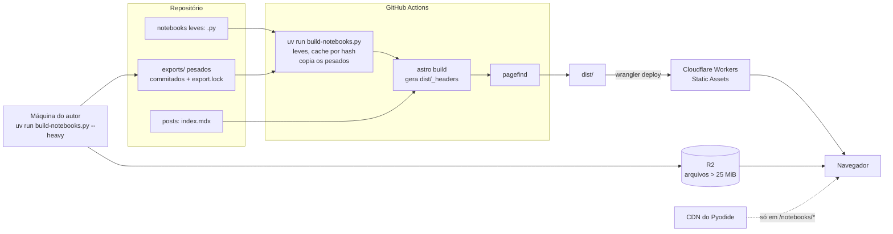

# Spec — Blog técnico estilo Hugging Face (Astro + marimo + Cloudflare)

Oct 6, 2026 · @Pedro Knoll · revisado em 10/11/2026

**Revisão 3 de 10/11/2026:** a §8 fixa os primeiros exploráveis (T-20). O `Figure.astro` ganha o modo island (prop `island`): não desenha `svg` nem grade, e o island entra direto na `<figure>`, antes da `<figcaption>`, que segue como último filho; o `svg` raiz, a grade e os controles são do `.svelte`. O `Stepper` e o `Explorable` só existem com `client:visible`, com os controles `disabled` no HTML do build. O `Heatmap` pinta a intensidade em tinta, com `fill-opacity` em cinco degraus, e destaca a linha com um contorno em `accent`; o `d3-scale-chromatic`, que devolve cores fora dos tokens, sai da tabela da biblioteca. A troca de cor tem transição curta, desligada com `prefers-reduced-motion`. O cenário "Gráfico acessível" da §11 troca o `<LineChart>` por um explorável.

**Revisão 2 de 10/11/2026:** a §8 fixa os dados pré-calculados (T-73). O `scripts/build-data.py` roda na máquina do autor, lê as entradas de `data/raw/`, grava o JSON reduzido em `data/` e o `data/data.lock` com o SHA-256 de cada entrada e de cada saída; o `pnpm check:data`, dentro do `pnpm lint`, refaz os hashes e falha com dado desatualizado, sem rodar Python no CI. O RNF-09 passa a cobrir o dado desatualizado; a §6 descreve a pasta `data/`; a §7 alinha o `export.lock` ao formato do `data.lock`; a §9 diz como o script trava dependência; a §10 põe o `check:data` no lint.

**Revisão de 10/11/2026:** a §8 fixa a moldura da figura estática (T-72). O `Figure.astro` é dono do `svg` raiz: `data-viz`, `role="img"`, `aria-label`, `<title>` e a grade milimetrada. A legenda, numerada pela prop `number`, é o último filho da `<figure>`; o "Ver dados" vem num `<details>` logo depois dela, fora da legenda, que dá o nome acessível da figura. A proporção fica reservada pelo `viewBox` e pelos atributos `width` e `height`, e a figura só encolhe. As primitivas `Vector`, `Matrix`, `Tensor`, `Arrow` e `Grid` são `.svelte` que desenham um `<g>` no sistema de coordenadas da raiz e entram autocontidas no slot do `Figure`: filhos do MDX para um `.svelte` chegam embrulhados em `astro-static-slot`, que não desenha dentro de um `svg`. O exemplo do `LineChart` perde o `<figure>` e a `<figcaption>`, que agora são do `Figure`. A figura de prova da T-19 segue sem moldura até a T-21; como o `Figure` emoldura um island que traz o próprio `svg` fica para a T-20.

**Revisão 2 de 09/11/2026:** o RNF-02 troca o `size-limit` pela conta por island no `check:js`: cada `astro-island` soma o componente, o renderer e os imports estáticos, até 40.000 bytes gzip, e os scripts inline do island contam no JS inicial da página. A §8 fixa o teto de 1.000 elementos por figura, com `data-viz` no `svg` raiz e verificação no E2E, e troca no contrato o `var(--viz-1)`, que não existe na lista fechada de cores, pela classe do token. O cenário "Figura estática" da §11 passa a exigir a figura fora de um `astro-island`, e não a página inteira sem island, porque o post da T-21 tem figura estática e explorável. A §9 tira o `size-limit` da lista pré-aprovada (T-19).

**Revisão de 09/11/2026:** a escada de interatividade usa o degrau mais baixo que explica o conceito. No artigo: 0 texto e fórmula, 1 figura estática (SVG no build, 0 JS), 2 figura em passos (Anterior/Próximo, no lugar de GIF) e 3 explorável (island Svelte com `client:visible` e dados pré-calculados). Fora do artigo: 4 notebook marimo e 5 GPU (`gpuUrl`). O mesmo componente de `src/components/viz/` sem `client:*` é figura estática e com `client:visible` é explorável. A Fase 2 se divide em 2a (storytelling visual) e 2b (lab marimo). O notebook sai do artigo e vira a página inteira em `/notebooks/<slug>/<nome>/`, aberta pela barra do lab; sem iframe, sem pôster e sem "Ativar interatividade" no post. O RF-08 continua Must só para `compute: browser`; os pesados ficam para depois do lançamento (T-17, T-33). O ADR-02 foi substituído; o texto anterior está em `specs/adr/ADR-02-v2-iframe.md`. A implementação é das tarefas da Fase 2a e 2b; até elas, o site segue o comportamento anterior (T-71).

**Revisão 3 de 06/11/2026:** a §9 fixa um só `katex` no lock: um `overrides` no `pnpm-workspace.yaml` leva o `rehype-katex` e o `remark-math` à versão do `katex` direto, a mesma do CSS e das fontes do KaTeX (T-68).

**Revisão 2 de 06/11/2026:** o RF-01 ganha a lateral da home: de `lg` em diante, na home e nas páginas de tipo, a saudação fica numa coluna sticky de 15rem à esquerda, com a mão acima do `h1` e os links do autor em texto (RSS, GitHub e LinkedIn); abaixo de `lg`, fica em cima da barra. A §6 troca os placeholders `github` e `huggingface` de `src/site.config.ts` pelas URLs do GitHub e do LinkedIn (T-69).

**Revisão de 06/11/2026:** o RF-12 define o `<title>` da página de tipo, `Tipo: <rótulo> · {site.title} · {autor}`, e a §6, a descrição e o nome acessível da lista dela, e tira da barra o ícone de cada tipo, que fica com o nome e a contagem. O rascunho de teste passa a `kind: tutorial`, para o cenário de rascunhos provar que tipo só com rascunho não gera página nem entra na barra. A §9 acrescenta `/tipos/[tipo]` às rotas, a página de tipo e o `KindFilter` à árvore, e a primeira página de tipo à guarda de fontes, com o teto da home; a §10 acrescenta `/tipos/*` ao plano B (T-64).

**Revisão 5 de 05/11/2026:** a §9 dá às fontes do KaTeX um teto próprio na guarda de fontes, de 3 arquivos e 48.000 bytes por página, separado do teto das fontes da marca, que não muda. A URL de pior caso com fórmula no Lighthouse CI fica para a T-39 (T-61).

**Revisão 4 de 05/11/2026:** na §6, a área de apêndice fica fora do `article`, logo depois dele, numa `section` com nome acessível `Apêndice`; a lista de referências é um `ol` nativo, e só o título de cada referência é link (T-66).

**Revisão 3 de 05/11/2026:** no RF-04, o título aparece acima da lateral quando o `h1` e a linha fina saem da tela, e não mais quando só o `h1` sai. Com o título acima da lateral, a troca no `h1` o punha sobre a linha fina ainda visível (T-67).

**Revisão 2 de 05/11/2026:** a §9 troca o `Toc` pelo `PostRail` na árvore de componentes, e o exemplo de commit, que citava o RF-05 removido, passa a citar o RF-04 (T-65).

**Revisão de 05/11/2026:** a §9 troca a Cormorant Garamond pela IBM Plex Sans Condensed na fonte de display: 600 normal, fallback `sans-serif`, sem itálico; saem a Cormorant 500 e 600 itálico (T-60).

**Revisão 3 de 04/11/2026:** a revisão visual da T-63 troca a barra "Filtrar por tag" pela "Filtrar por tipo", com páginas `/tipos/<tipo>/` que espelham a home (RF-02 e §6). O RF-05 sai: o post não tem mais sumário, e o cabeçalho ganha uma lateral com o fólio, os metadados e o título ao rolar (RF-04). A área de apêndice sai do `div` da prosa, e cada referência traz o título antes dos autores (§6). A v1 passa a ter 11 requisitos Must. A implementação é das T-64, T-65 e T-66; até elas, o site segue o comportamento anterior.

**Revisão 2 de 04/11/2026:** o RF-04 troca a ficha da seção 9.3 do BRAND por referências e apêndices no fim do post. Saem do schema da §6 `benchMinutes`, `material` e `track`; entram `references` e `appendices`. A citação `[@chave]` vira `[n]` pelo plugin `remarkCitations`, registrado nos dois `unified()` da §7 (T-62).

**Revisão de 04/11/2026:** a §10 registra que o `pnpm lint` começa pela guarda de codificação de `src/`, `pnpm check:utf8` (T-59).

**Revisão de 03/11/2026:** a §9 corrige o custo das fontes no LCP: ele segue os bytes e a página, e não um degrau por arquivo, e as fontes do KaTeX também entram (T-54).

**Revisão 3 de 30/10/2026:** a árvore da marca na §9 ganha `pklog-simbolo-404.svg`, a ilustração da página 404 (T-58).

**Revisão 2 de 30/10/2026:** o RF-12 define o `<title>` da página 404 e registra que ela não tem canonical nem `og:url` e leva `noindex` (T-49).

**Revisão de 30/10/2026:** o RF-06 registra que o `aria-label` do botão de copiar acompanha o texto visível (WCAG 2.5.3) e que a barra do bloco de código sai do build; a §7 cita o transformer da barra (T-48).

**Revisão 4 de 29/10/2026:** o card da listagem mostra fólio, data, título, resumo, tipo, nível e tempo de leitura com ícone de relógio parado, sem tags; só o destaque mostra capa; o número do fólio é Cormorant 600 desde 22 px; título do card sem sublinhado (T-56).

**Revisão 3 de 28/10/2026:** a data visível tem dia com dois dígitos e mês de uma lista fixa (`formatPubDate`); `formatFolio` mostra o número inteiro acima de 999; os rótulos e a hachura de nível ficam em `src/lib/level.ts`. A ficha do RF-04 é entregue pela T-55 (T-46).

**Revisão 2 de 28/10/2026:** o schema da §6 entrou no `content.config.ts` (T-45). `kind` usa `KINDS` de `src/lib/kind.ts`, os rótulos ficam em `KIND_LABELS`, a unicidade é `assertUniqueFolios` em `src/lib/folio.ts` e o rascunho de teste é Fól. 999.

**Revisão de 28/10/2026:** os literais `pk.log`, `Pedro Knoll` e a descrição curta entraram no `site.config.ts` na T-43.

**Revisão de 27/10/2026:** a §9 restringe a IBM Plex Mono ao peso 400 e registra o orçamento de fontes no LCP (T-52).

**Revisão 3 de 26/10/2026:** a §9 descreve as fontes da marca pela opção `fonts` no topo do `defineConfig`, com preload só de IBM Plex Sans 400 normal.

**Revisão de 26/10/2026:** o RNF-01 descreve o perfil do Lighthouse CI. O `size-limit` por island vai para a T-19. `linkinator` entra na §9. A §10 ganha os jobs `lighthouse` e `artifact-checks`, e o deploy em `main` passa a esperar os dois (T-13).

**Revisão 2 de 26/10/2026:** os temas `pk-claro` e `pk-escuro` do Shiki entram na T-41, não na T-48 (contraste sobre `sheet`).

**Revisão de 23/10/2026:** o `<title>` do post é o título do post. Home `{site.title} · {autor}`, post `{título} · {site.title} · {autor}`, `/page/n/` `Blog — página N · {site.title} · {autor}`, tag `Tag: <tag> · {site.title} · {autor}`. `og:image` e `image` do JSON-LD só existem quando há capa, até a T-23. `robots.txt.ts` entra na árvore da §9, ao lado de `rss.xml.ts`.

**Revisão de 22/10/2026:** identidade pk.log em `specs/BRAND.md` (Q12), Fase 1b no ROADMAP, RF-22 e campos `folio`, `kind` e `level` no schema.

**Revisão 2 de 15/10/2026:** detach de CSP validado em Workers Static Assets (T-05). A regra de cache de notebooks usa `/notebooks/:slug/:nome/assets/*`. A CSP de notebook leva hashes dos scripts inline, calculados no build. A v1 não tem interrupts. Gate 0 aprovado. Ver `specs/spikes/T-05-headers.md`.

**Revisão de 15/10/2026:** `compute: cache` não funciona no marimo 0.25.1 para notebooks que treinam com `torch`, ver T-04 e `specs/spikes/T-04-html-wasm.md`. Os exemplos passam a usar `precomputed`, a validar na T-33.

**Revisão de 14/10/2026:** o modo inline foi adiado por custo de manutenção (T-03). O blog fica só com notebooks marimo em iframe. O ADR-02 foi substituído; o texto anterior está em `specs/adr/ADR-02-v1-mdx-marimo.md`. Detalhes em `specs/spikes/T-03-mdx-marimo.md`.

**Revisão de 09/10/2026:** removidas as menções a `authors` e "autores" que contradiziam a Q2; Q4b reaberta (o domínio não está confirmado); o build chama o Python via `uv run`; os dois diagramas viraram Mermaid; o roadmap (seção 12) foi movido para `specs/ROADMAP.md`.

**Revisão 2 de 09/10/2026 (conferida nas docs oficiais):**

- ADR-01 passa de Astro 6 para **Astro 7**, com Markdown e MDX pelo processador `unified()`. O ADR antigo foi para `specs/adr/`.
- O modo inline (adiado em 14/10/2026) usava o runtime em custom element do mdx-marimo, sem React.
- O notebook inline (adiado em 14/10/2026) era declarado só com `{ mode: inline }`, sem `src`.
- Schemas atualizados para a API do Zod 4.
- `_headers` passa a ser gerado no build, com o limite de 100 regras.
- Exports pesados ficam em `exports/`.
- `SHOW_DRAFTS` substitui `PUBLIC_SHOW_DRAFTS`.
- `SITE_URL` destrava a T-12 enquanto a Q4b não fecha.
- Contrato do `LineChart` aceita datas ISO.
- Dependências pré-aprovadas listadas na seção 9.

## 1. Visão geral

O produto é um blog técnico estático, no estilo do [Hugging Face Blog](https://huggingface.co/blog), em que cada post pode trazer notebooks marimo executáveis no navegador e visualizações interativas, servido pela edge da Cloudflare com custo de hospedagem perto de zero.

Este documento é a fonte de verdade da implementação (spec-driven): cada requisito tem um ID, cada tarefa do roadmap aponta para IDs, e nenhuma feature entra no código sem estar aqui primeiro.

### Objetivos

- Publicar posts em Markdown/MDX com a mesma ergonomia de leitura do HF Blog: listagem em cards, página de post com os metadados ao lado do texto, autor, tags e data.
- Permitir que um post leve a um notebook marimo executável no navegador, numa página própria, sem servidor Python em produção.
- Permitir figuras estáticas e visualizações D3 em componentes Svelte: sem `client:*` a figura sai no HTML sem JavaScript; com `client:visible`, hidrata só quando visível.
- Deploy automático a cada push, com preview por pull request.

### Não-objetivos (v1)

- Posts da comunidade com login, upvotes e comentários nativos (o HF tem; aqui fica para v2).
- CMS visual. A autoria é via Git.
- Execução de código Python no servidor ou GPU.
- Captura de e-mail (newsletter).
- Peças gráficas que não são o site (YouTube, rede, slide, certificado, pergaminho, adesivo).
- Manifesto PWA.

### Personas


| Persona    | Precisa de                                                     | Como mede sucesso                                              |
| ---------- | -------------------------------------------------------------- | -------------------------------------------------------------- |
| Leitor     | Ler rápido no celular, achar posts por tag, rodar o exemplo    | Página carrega em < 2 s em 4G; notebook roda sem instalar nada |
| Autor      | Escrever em Markdown e notebook, ver preview antes de publicar | Do `git push` ao preview em < 5 min                            |
| Mantenedor | Pouca manutenção, custo previsível                             | Build verde, US$ 0 de hospedagem no plano free                 |


### Métricas de sucesso

- Lighthouse ≥ 95 em Performance, Accessibility, Best Practices e SEO na home e num post sem notebook.
- JavaScript inicial ≤ 50 KB (gzip) em post sem islands.
- Notebook marimo interativo em ≤ 10 s em desktop banda larga (download do runtime Pyodide incluso).

## 2. Premissas e decisões em aberto

A spec parte de seis premissas; as respostas de 06/10, 09/10, 14/10, 22/10 e 09/11 já estão incorporadas e só o domínio segue em aberto, então a Fase 0 pode começar já.

### Premissas assumidas


| #   | Premissa                                                                              | Por quê                                                                                                                                             | Se estiver errada                              |
| --- | ------------------------------------------------------------------------------------- | --------------------------------------------------------------------------------------------------------------------------------------------------- | ---------------------------------------------- |
| P1  | Site 100% estático (`output: 'static'`), sem adapter SSR                              | Blog não precisa de render por request; custo zero e cache total                                                                                    | Adicionar `@astrojs/cloudflare` (ADR-05)       |
| P2  | Hospedar em **Cloudflare Workers com Static Assets**, não em Pages                    | A [doc do Astro](https://docs.astro.build/en/guides/deploy/cloudflare) e a Cloudflare recomendam Workers para projetos novos; Pages segue suportado | Trocar só o passo de deploy; o build é o mesmo |
| P3  | Svelte é a camada de **UI interativa** (islands); as content collections são do Astro | Content collections são um recurso nativo do Astro (schemas Zod + loaders), não do Svelte                                                           | — (esclarecimento de papel, ver ADR-03)        |
| P4  | Autoria via Git (Markdown/MDX + notebooks `.py` no repositório)                       | Mesmo modelo do repositório [huggingface/blog](https://github.com/huggingface/blog)                                                                 | Avaliar CMS headless + live collections        |
| P5  | Idioma único pt-BR na v1, estrutura pronta para i18n                                  | Reduz escopo; Astro tem roteamento i18n nativo                                                                                                      | Ativar i18n na Fase 3                          |
| P6  | Gerenciadores: pnpm (JS) e uv (Python)                                                | uv é exigido pelo export WASM do marimo para resolver dependências e módulos locais                                                                 | —                                              |


### Decisões de 06/10/2026

- [x] **Q1 — Notebooks:** os dois modos, `inline` e `iframe`, foram a decisão de 06/10. Substituída em 14/10/2026: o modo inline foi adiado e o blog fica só com iframe (ver decisões de 14/10).
- [x] **Q2 — Autores:** autor único; sem collection `authors` nem páginas de autor (seção 6).
- [x] **Q3 — Comunidade:** fora do sprint 01; Giscus entra na Fase 4 do roadmap.
- [x] **Q4 — Ambientes:** sem staging; só preview por PR e produção.
- [ ] **Q4b — Domínio:** em aberto; falta confirmar se o domínio já está na Cloudflare. Bloqueia só a T-27. Até lá, a URL canônica vem da variável `SITE_URL`, que aponta para o endereço `workers.dev` do Worker, e as tarefas de SEO, RSS e sitemap seguem sem esperar.
- [x] **Q5 — Hospedagem:** Workers com Static Assets (P2 confirmada).
- [x] **Q6 — Volume:** blog pessoal, bem abaixo de 1.000 posts; build e paginação atuais bastam.
- [x] **Q7 — Notebooks pesados:** sim; implicações e estratégias na seção 7.

### Decisões de 09/10/2026

- [x] **Q8 — Versão do Astro:** Astro 7 com o processador `unified()` (ADR-01 revisado). O Astro 6 está em `specs/adr/ADR-01-v1-astro-6.md`.
- [x] **Q9 — Notebook inline:** em 09/10, declarado como `{ mode: inline }`, sem `src`. Substituída em 14/10/2026: o modo inline foi adiado (ver decisões de 14/10).
- [x] **Q10 — Rota de paginação:** fica `/page/2`. É a única rota fora do pt-BR, por decisão explícita.

### Decisões de 14/10/2026

- [x] **Q11 — Notebook inline adiado:** o modo inline fica adiado por custo de manutenção (T-03, `specs/spikes/T-03-mdx-marimo.md`). O blog segue só com notebooks marimo em iframe (`marimo export html-wasm`). Reavaliar quando o mdx-marimo chegar a 0.1, ou quando houver uma opção pública para controlar Python e projeto no build (T-32). Substituída em 09/11/2026 pela Q14.

### Decisões de 22/10/2026

- [x] **Q12 — Identidade:** a identidade visual e verbal está em `specs/BRAND.md`. Em conflito de comportamento, a SPEC ganha. Tags no lugar de temas; o tempo do post é só o `minutesRead` (o `benchMinutes` saiu na T-62); imagem OG só quando não há capa; newsletter fora da v1; sem `dark:` nos componentes; chaves de frontmatter em inglês; `kind` no enum inglês (`concept`, `tutorial`, `lab`, `playbook`).

### Decisões de 09/11/2026

- [x] **Q13 — Escada e primitivas em dois modos:** no artigo, o degrau mais baixo que explica o conceito: 0 texto e fórmula, 1 figura estática (SVG no build, 0 JS), 2 figura em passos (Anterior/Próximo, no lugar de GIF), 3 explorável (island Svelte com `client:visible` e dados pré-calculados). Fora do artigo: 4 notebook marimo e 5 GPU (`gpuUrl`). O mesmo componente de `src/components/viz/` sem `client:*` é a figura estática e com `client:visible` é o explorável.
- [x] **Q14 — Notebook em página própria:** `marimo export html-wasm` é a página inteira em `/notebooks/<slug>/<nome>/`. A barra do lab do post leva a ela ("Abrir no marimo"); "Abrir no Colab" só com `gpuUrl`. Sem iframe, sem pôster e sem "Ativar interatividade" no post. Substitui a Q11.
- [x] **Q15 — RF-08 só para leves no lançamento:** o RF-08 continua Must, só para `compute: browser`. Notebooks pesados (T-17, T-33) ficam para depois do lançamento; até lá, treino pesado só pelo `gpuUrl`.

## 3. Requisitos funcionais

A v1 entrega 11 requisitos Must; o restante entra por ordem de prioridade sem bloquear o lançamento. Os itens espelham o que o HF Blog oferece hoje, menos a camada social.


| ID    | Requisito                                                                             | Prioridade | Critério de aceite                                                                                                      |
| ----- | ------------------------------------------------------------------------------------- | ---------- | ----------------------------------------------------------------------------------------------------------------------- |
| RF-01 | Home com saudação, post em destaque e lista de cards (fólio, data, título, resumo, tipo, nível, tempo de leitura) | Must       | Saudação na home e nas páginas de tipo, com a mão acima do `h1` e os links do autor em texto (RSS, GitHub e LinkedIn); de `lg` em diante a saudação vira uma lateral sticky à esquerda, e abaixo de `lg` fica em cima da barra (BRAND §9.1); cards ordenados por data desc; destaque via `featured: true`; o card mostra fólio, data, título, resumo, tipo, nível e tempo de leitura com ícone de relógio parado, sem tags; só o destaque mostra capa; título do card e número do fólio na fonte de display, peso 600 (BRAND §5); o tempo de leitura do card é o mesmo `minutesRead` da página do post |
| RF-02 | Filtro por tipo e páginas `/tipos/[tipo]` e `/tags/[tag]`                             | Must       | Cada tipo com post publicado e cada tag usada geram uma página; tipo ou tag inexistente é 404; a barra de tipos funciona sem JavaScript |
| RF-03 | Paginação da listagem                                                                 | Must       | 12 posts por página; a página 1 é `/` e as seguintes são `/page/2`, `/page/3`… (exceção à regra de rotas em pt-BR, Q10) |
| RF-04 | Página do post com título, autor, fólio, data `21.out.2026`, tipo, nível, datas e tempo de leitura | Must       | O cabeçalho traz fólio, data visível, tipo e nível; o tempo de leitura permanece; os campos vêm do frontmatter validado. O título fica em cima; de `lg` em diante, o fólio e os metadados ficam numa lateral fixa ao lado do texto, e o título aparece acima dela quando o `h1` e a linha fina saem da tela, como melhoria progressiva, sem deslocar a página; sem JavaScript, a lateral mostra o fólio. Quando o post tem `references` ou `appendices`, o fim do post tem a área de apêndice, com os apêndices do autor (Apêndice A, B…) e a lista numerada de referências. No texto, a citação `[@chave]` vira `[n]`, com link para a referência e nome acessível `Referência n`, sem JavaScript. Chave citada sem referência, referência não citada, citação dentro de link e chave repetida quebram o build. Post sem os dois campos não muda |
| RF-05 | ~~TOC lateral fixa (h2–h3) com seção ativa destacada~~                                | Removido   | Saiu na T-63: o post não tem sumário; a lateral do cabeçalho é parte do RF-04                                           |
| RF-06 | Syntax highlighting com botão copiar                                                  | Must       | Shiki em build time, temas `pk-claro` e `pk-escuro`. Uma cerca com a meta `title=<arquivo>` depois da linguagem (```` ```py title=fol-001_embeddings.py ````) mostra o nome do arquivo na barra do bloco; sem `title=`, a barra não mostra nome. O botão diz Copiar e vira Copiado por 1,5 s; o `aria-label` é `Copiar código` e vira `Código copiado` junto com o texto, para o nome acessível conter o rótulo visível (WCAG 2.5.3). A barra existe com ou sem `title=` e com ou sem JavaScript; o nome do arquivo sai do build |
| RF-07 | Matemática LaTeX inline e em bloco                                                    | Must       | `remark-math` + `rehype-katex` no processador `unified()`, render no build                                              |
| RF-08 | Notebook marimo do post numa página própria                                           | Must       | Export `html-wasm` em `/notebooks/<slug>/<nome>/`, página inteira, com barra final; a barra do lab do post leva a ela; a página do post não carrega Pyodide nem o runtime do marimo; no lançamento, só `compute: browser` (seção 7) |
| RF-09 | Figuras e visualizações Svelte + D3 no MDX                                            | Must       | Sem `client:*`, a figura sai como SVG no HTML, sem JavaScript; com `client:visible`, vira explorável; nos dois casos o SVG está no HTML desde o build (seção 8) |
| RF-10 | Feed RSS e sitemap                                                                    | Must       | `/rss.xml` válido no W3C Validator; `sitemap-index.xml` gerado                                                          |
| RF-11 | Rascunhos (`draft: true`) visíveis só em preview                                      | Must       | Build de produção exclui drafts de páginas, feed e sitemap                                                              |
| RF-12 | SEO por post: title, description, canonical, Open Graph, JSON-LD `BlogPosting`        | Must       | O `<title>` do post é o título do post. Home `{site.title} · {autor}`, post `{título} · {site.title} · {autor}`, `/page/n/` `Blog — página N · {site.title} · {autor}`, tag `Tag: <tag> · {site.title} · {autor}`, tipo `Tipo: <rótulo> · {site.title} · {autor}`, 404 `Página não encontrada · {site.title} · {autor}`. A 404 não tem canonical nem `og:url` e leva `noindex`, porque a Cloudflare serve `/404` com status 200. `og:image` e `image` do JSON-LD só existem quando há capa, até a T-23. Validado no Rich Results Test; URLs absolutas montadas a partir de `SITE_URL` |
| RF-13 | Link "Editar no GitHub" por post                                                      | Should     | URL aponta para o arquivo-fonte na branch `main`                                                                        |
| RF-14 | Página Sobre `/sobre` com bio, foto e links                                           | Should     | Dados vêm do config do site (autor único)                                                                               |
| RF-15 | Busca full-text estática                                                              | Should     | Pagefind indexa só o corpo dos posts; sem backend                                                                       |
| RF-16 | Imagem OG gerada por post quando não houver capa                                      | Should     | Com capa, a capa ganha. Sem capa, PNG 1200×630 no layout da seção 11 do BRAND; o gerador é hipótese da T-23 |
| RF-17 | Tema escuro com controle segmentado, respeitando `prefers-color-scheme`               | Should     | O controle Claro/Escuro grava a escolha em `localStorage` e aplica `data-theme` na raiz. Sem escolha gravada, segue `prefers-color-scheme`. Sem flash de tema errado no carregamento |
| RF-18 | Posts relacionados ao fim (por tags em comum)                                         | Could      | Até 3 posts, nunca o próprio                                                                                            |
| RF-19 | Comentários e reações via Giscus                                                      | Could      | Fase 4, pós-sprint 01; carregamento lazy                                                                                |
| RF-20 | Embed de Hugging Face Spaces e iframes genéricos                                      | Could      | Componente `<Embed>` com `loading="lazy"` e aspect ratio                                                                |
| RF-21 | Artigos da comunidade com login e upvote                                              | Won't (v1) | Fora da v1; exigiria D1 + auth                                                                                          |
| RF-22 | `Callout` com `variant` `note`, `caution` ou `result`                                 | Should     | Rótulos visíveis `// NOTA DE BANCADA`, `[!] CUIDADO` e `= RESULTADO`, tudo em tinta                                    |


## 4. Requisitos não-funcionais

Cada RNF tem um número verificável no CI; o que não dá para medir automaticamente vira item de checklist de revisão.


| ID     | Área             | Requisito                                                                                                                                                               | Como verificar                                                                                                                                                                                                                             |
| ------ | ---------------- | ----------------------------------------------------------------------------------------------------------------------------------------------------------------------- | ------------------------------------------------------------------------------------------------------------------------------------------------------------------------------------------------------------------------------------------ |
| RNF-01 | Performance      | LCP < 2,0 s e CLS < 0,05 em 4G simulado (home e post sem notebook)                                                                                                      | Lighthouse CI no job `lighthouse`, contra o `dist/` do build servido localmente (`staticDistDir`), na home e nos dois posts publicados. Perfil mobile padrão do Lighthouse, com throttling simulado "Slow 4G" (150 ms de RTT, 1,6 Mbps, CPU 4×), mediana de 3 execuções. As quatro categorias ≥ 95 também são asserção `error` desde a T-13                                                                                                                                                                                                             |
| RNF-02 | Performance      | JS inicial ≤ 50 KB gzip **por página** sem islands; cada island D3 ≤ 40 KB gzip. O runtime marimo fica fora desse budget e só existe em `/notebooks/*`            | `pnpm check:js` (`scripts/check-page-js.mjs` sobre a função pura `src/lib/page-js.ts`) soma, por página de `dist/` fora de `notebooks/`, o JS que o HTML referencia: `<script src>`, script inline executável, `modulepreload` e os imports estáticos transitivos; `import()` dinâmico não conta. Limite de 50.000 bytes gzip. Página com JS externo ou referência inexistente falha a verificação. Cada `astro-island` conta à parte: o `component-url`, o `renderer-url` e o `before-hydration-url`, quando há, com os imports estáticos de cada um, até 40.000 bytes gzip por island; os scripts inline que o island acrescenta contam no JS inicial da página (T-19). Um glob único sobre `dist/_astro/*.js` não serve: somaria chunks de páginas diferentes |
| RNF-03 | Performance      | Pyodide e runtime do marimo só em `/notebooks/*`; nenhuma página fora de `/notebooks/` os requisita                                                                      | Teste E2E da §11: home, post sem notebook e post com notebook não requisitam `/pyodide|marimo/`                                                                                                                                            |
| RNF-04 | Acessibilidade   | WCAG 2.2 AA; gráficos D3 com `role="img"`, `aria-label` e tabela de dados alternativa. Animações da marca respeitam `prefers-reduced-motion`. Lápis não é texto menor que 24 px sobre folha clara | axe-core no Playwright, zero violações serious/critical; E2E com `prefers-reduced-motion: reduce` nas animações da marca |
| RNF-05 | SEO              | HTML semântico, um `h1` por página, URLs estáveis `/blog/[slug]`                                                                                                        | Teste de build + Lighthouse SEO ≥ 95                                                                                                                                                                                                       |
| RNF-06 | Segurança        | Headers: CSP, HSTS, `X-Content-Type-Options`, `Referrer-Policy`                                                                                                         | `dist/_headers` gerado no build e conferido por teste de artefato; securityheaders.com em produção                                                                                                                                         |
| RNF-07 | Segurança        | CSP com `wasm-unsafe-eval` e as origens do Pyodide só em `/notebooks/*`, não na página do post; o `dist/_headers` gerado tem no máximo 100 regras (limite da Cloudflare) | Teste de artefato: rotas sem notebook não têm `wasm-unsafe-eval`; o build falha acima de 100 regras                                                                                                                                        |
| RNF-08 | Build            | Build completo < 5 min com 200 posts e 20 notebooks                                                                                                                     | Medido no CI; cache de exports marimo por hash do `.py` + `uv.lock`                                                                                                                                                                        |
| RNF-09 | Confiabilidade   | Build falha se frontmatter for inválido, link interno quebrar, notebook falhar no `marimo check` ou dado pré-calculado não bater com o `data.lock`                                   | Zod + `astro check` + verificador de links + `marimo check` + `pnpm check:data`                                                                                                                                                            |
| RNF-10 | Custo            | US$ 0/mês até o limite do plano free (static assets não são cobrados)                                                                                                   | Revisão mensal no dashboard Cloudflare                                                                                                                                                                                                     |
| RNF-11 | Privacidade      | Analytics sem cookies                                                                                                                                                   | Cloudflare Web Analytics                                                                                                                                                                                                                   |
| RNF-12 | Manutenibilidade | TypeScript strict, ESLint + Prettier, Ruff para Python                                                                                                                  | Gates no CI                                                                                                                                                                                                                                |
| RNF-13 | Performance      | INP p75 ≤ 200 ms em campo                                                                                                                                               | Cloudflare Web Analytics (RNF-11), que reporta LCP, INP e CLS, revisado depois da T-27. O Lighthouse não mede INP                                                                                                                          |


## 5. Arquitetura e decisões de stack

A arquitetura é um build estático em duas linguagens: Python gera os artefatos marimo, Astro gera o HTML, e a Cloudflare só serve arquivos. Nada roda no servidor em produção na v1.




Python só existe no build; em produção, o único código que executa é o do navegador, e o Pyodide só baixa em `/notebooks/*`.

### ADRs


| ADR    | Decisão                                                                                                                                                                                | Alternativas descartadas                                                                                          | Motivo                                                                                                                                                                                                                                                                                                                                                                                                   |
| ------ | -------------------------------------------------------------------------------------------------------------------------------------------------------------------------------------- | ----------------------------------------------------------------------------------------------------------------- | -------------------------------------------------------------------------------------------------------------------------------------------------------------------------------------------------------------------------------------------------------------------------------------------------------------------------------------------------------------------------------------------------------- |
| ADR-01 | **Astro 7**, `output: 'static'`, content collections com loader `glob` e schemas Zod 4 (`astro/zod`). Markdown e MDX passam pelo processador `unified()` de `@astrojs/markdown-remark` | Next.js, Hugo, Docusaurus; Astro 6 (ver `specs/adr/ADR-01-v1-astro-6.md`); processador Sätteri, padrão do Astro 7 | Islands nativos, zero JS por padrão, MDX de primeira classe. O [Astro 7](https://docs.astro.build/en/guides/upgrade-to/v7/) saiu em 22/06/2026 e a doc do Astro 6 virou snapshot sem manutenção. O `unified()` mantém `remark-math`, `rehype-katex` e o tempo de leitura sem precisar portá-los para o Sätteri. Revisado em 09/10/2026 (Q8) |
| ADR-02 | **marimo só via `marimo export html-wasm`, numa página própria aberta pela barra do lab; sem iframe no post**                                                                 | Jupyter + nbconvert estático; Thebe/Binder; mdx-marimo no meio do texto (adiado, ver `specs/adr/ADR-02-v1-mdx-marimo.md` e `specs/spikes/T-03-mdx-marimo.md`); iframe no post (substituído em 09/11/2026, ver `specs/adr/ADR-02-v2-iframe.md`) | O artigo explica e o notebook é onde se pratica, como nas referências da Q13. O iframe pedia pôster, carga condicional, botão de execução e um layout dentro da prosa; a página própria dispensa tudo isso e deixa o Pyodide só em `/notebooks/*` (RNF-03). O export WASM isola o runtime e o marimo fica travado no `uv.lock` ([docs](https://docs.marimo.io/guides/exporting/webassembly_html/)). Revisado em 09/11/2026 (Q14, T-71) |
| ADR-03 | **Svelte 5** para islands interativos; **D3 v7** só para cálculo (escalas, eixos, layouts), com o Svelte dono do DOM                                                                   | React + D3; Observable Plot puro                                                                                  | Svelte compila para bundles pequenos; D3 manipulando DOM brigaria com a reatividade. Content collections ficam no Astro, não no Svelte. Não há segundo framework de UI. Componente Svelte sem `client:*` é renderizado no build e não envia JavaScript.                                                                                                                                                      |
| ADR-04 | **Cloudflare Workers com Static Assets** (`wrangler.jsonc` com `assets.directory: ./dist`)                                                                                             | Cloudflare Pages, Vercel, Netlify                                                                                 | [Recomendação atual](https://docs.astro.build/en/guides/deploy/cloudflare) para projetos novos; static assets não são cobrados; caminho direto para D1/KV no futuro. Confirmado em 06/10 (Q5)                                                                                                                                                                                                            |
| ADR-05 | Sem SSR na v1                                                                                                                                                                          | `@astrojs/cloudflare` desde o início                                                                              | YAGNI. Se vierem upvotes/comentários próprios, adiciona-se o adapter `@astrojs/cloudflare` compatível com a versão do Astro em uso, e D1                                                                                                                                                                                                                                                                 |
| ADR-06 | **Pagefind** para busca                                                                                                                                                                | Algolia, Orama                                                                                                    | Indexa o `dist/` no pós-build, roda 100% no cliente, sem custo                                                                                                                                                                                                                                                                                                                                           |
| ADR-07 | **Tailwind CSS v4** + plugin `typography` para a prosa                                                                                                                                 | CSS Modules, UnoCSS                                                                                               | O HF Blog usa Tailwind; tipografia de artigo pronta                                                                                                                                                                                                                                                                                                                                                      |


### Riscos técnicos

- **Modo inline adiado** na T-03, por custo de manutenção. Reavaliação na T-32 (`specs/spikes/T-03-mdx-marimo.md`). O iframe no post saiu em 09/11/2026 (Q14): o notebook é uma página própria.
- **Pyodide pesa** dezenas de MB no primeiro acesso. Mitigação: a página própria em `/notebooks/<slug>/<nome>/`; nenhuma página fora de `/notebooks/` o requisita.
- **Pacotes sem wheel WASM** não rodam no browser. Mitigação: `marimo check --select MW` no CI (regras `MW001` import incompatível, `MW002` chamada de sistema insegura, `MW003` dependência sem wheel WASM) e cache de execução (seção 7).
- **Astro 7 é estrito com HTML.** O compilador Rust recusa tags não fechadas e não corrige aninhamento inválido; o padrão `compressHTML: 'jsx'` remove espaço entre elementos inline. Mitigação: `astro check` no CI e revisão visual do preview.
- **Cache de células com `torch`** não funciona no marimo 0.25.1, ver T-04. Mitigação: `precomputed`, a validar na T-33, ou `onnx` e `static`.

## 6. Modelo de conteúdo

A v1 tem uma única collection, `posts`. O autor é único e vem de `src/site.config.ts`; tags são derivadas dos posts. Todo campo é validado por Zod no build, e um frontmatter inválido quebra o build (RNF-09). O schema inclui `folio`, `kind` e `level`. A unicidade de `folio` não é um `refine` de entrada única: fica na função descrita nas regras derivadas. O schema abaixo é o do `content.config.ts` desde a T-45.

### Convenção de pastas

Cada post é uma pasta: o slug é o nome da pasta, e capa, imagens, dados e notebooks moram junto do texto.

```text
src/
├── site.config.ts
└── content/posts/
    └── 2026-10-intro-a-embeddings/
        ├── index.mdx
        ├── cover.png
        ├── figs/
        ├── data/              # JSON gerado pelo build-data.py e data.lock; raw/ com as entradas (T-73)
        └── notebooks/
            └── treino.py      # notebook da página própria

```

### Schemas (`src/content.config.ts`)

```ts
import { defineCollection } from 'astro:content';
import { glob } from 'astro/loaders';
import { z } from 'astro/zod'; // Zod 4
import { KINDS } from './lib/kind';
import { postIdFromEntry } from './lib/post-id';
import { duplicateReferenceKeys } from './lib/references';

// Página própria: notebook inteiro num .py da pasta do post, exportado com html-wasm.
const notebook = z.strictObject({
  src: z.string(),
  // estratégia de execução, ver seção 7
  compute: z.enum(['browser', 'cache', 'precomputed', 'onnx', 'static']).default('browser'),
  gpuUrl: z.url().optional(), // botão "Rodar com GPU" (molab, Colab, HF Space)
});

// Referência citada no texto por [@chave]; o número é a posição na lista.
const reference = z.strictObject({
  key: z.string().regex(/^[a-z0-9-]+$/), // mesma regra de tags
  authors: z.array(z.string().min(1)).min(1),
  title: z.string().min(1),
  year: z.int(),
  venue: z.string().min(1),
  url: z.url(),
});

// Apêndice do autor, em texto puro: um <p> por parágrafo.
const appendix = z.strictObject({
  title: z.string().min(1),
  paragraphs: z.array(z.string().min(1)).min(1),
});

const posts = defineCollection({
  loader: glob({
    pattern: '**/index.{md,mdx}',
    base: './src/content/posts',
    // id = nome da pasta, validado por postIdFromEntry; é o slug de /blog/[slug]
    generateId: ({ entry }) => postIdFromEntry(entry),
  }),
  schema: ({ image }) =>
    z
      .object({
        title: z.string().max(90),
        description: z.string().min(50).max(160),
        pubDate: z.coerce.date(),
        updatedDate: z.coerce.date().optional(),
        folio: z.int().min(1), // exibido como "Fól. 006"
        kind: z.enum(KINDS), // concept | tutorial | lab | playbook, em src/lib/kind.ts
        level: z.int().min(1).max(3),
        tags: z.array(z.string().regex(/^[a-z0-9-]+$/)).max(6).default([]),
        cover: image().optional(),
        coverAlt: z.string().optional(),
        featured: z.boolean().default(false),
        draft: z.boolean().default(false),
        references: z
          .array(reference)
          .refine((items) => duplicateReferenceKeys(items).length === 0, {
            error: (iss) =>
              `Chave de referência repetida: ${Array.isArray(iss.input) ? duplicateReferenceKeys(iss.input)[0] : ''}`,
          })
          .default([]),
        appendices: z.array(appendix).max(26).default([]),
        // declara os notebooks do post
        notebooks: z.array(notebook).default([]),
        canonical: z.url().optional(),
      })
      .refine((d) => !d.cover || d.coverAlt, {
        error: 'coverAlt é obrigatório quando há cover',
        path: ['coverAlt'],
      })
      .refine((d) => d.kind !== 'lab' || d.notebooks.length > 0, {
        error: 'kind lab exige ao menos um item em notebooks',
        path: ['notebooks'],
      }),
});

export const collections = { posts };

```

O `src/content.config.ts` ainda tem `mode: z.literal("iframe")`. O campo sai na T-14; esta tarefa não altera o arquivo.

Notas de Zod 4: `z.url()` substitui `z.string().url()`, e o parâmetro `error` substitui `message`. As formas antigas ainda funcionam, mas estão depreciadas.

### Autor (`src/site.config.ts`)

```ts
export const site = {
  title: 'pk.log',
  // até a Q4b fechar, SITE_URL aponta para o endereço workers.dev do Worker
  url: import.meta.env.SITE_URL ?? 'https://blog.exemplo.com',
  author: {
    name: 'Pedro Knoll',
    avatar: '/avatar.jpg',
    bio: 'Aprendizados e experimentos em IA',
    github: 'https://github.com/Pedroknoll',
    linkedin: 'https://www.linkedin.com/in/pedro-henrique-knoll-giacometo/',
  },
} as const;

```

Os literais `pk.log`, `Pedro Knoll` e a descrição curta entraram na T-43. `github` e `linkedin` são as URLs completas dos perfis, usadas nos links da saudação; o `huggingface` saiu (T-69).

### Exemplo de frontmatter

```yaml
---
title: "Embeddings na prática: similaridade de cosseno"
description: "Como calcular e visualizar similaridade entre frases, com um notebook marimo que roda no seu navegador."
pubDate: 2026-10-20
folio: 6
kind: lab
level: 2
tags: [nlp, embeddings]
cover: ./cover.png
coverAlt: "Pontos coloridos agrupados num plano 2D"
notebooks:
  - { src: ./notebooks/treino.py, compute: browser, gpuUrl: "https://colab.research.google.com/..." }
---

```

### Regras derivadas

- `getPublishedPosts()` é o único acesso à collection nas páginas. Antes do filtro de publicados, chama `assertUniqueFolios` (`src/lib/folio.ts`) sobre todas as entradas da collection, rascunho incluído. Dois fólios iguais falham o build com a mensagem `Fólio repetido: <n> em <id1>, <id2>`, com os ids em ordem crescente e vários conflitos separados por `; `. Em seguida filtra `draft` quando `SHOW_DRAFTS` não é `true` e ordena por `pubDate` desc, com desempate por `id` crescente.
- `folio` é inteiro e a exibição é `Fól. 006`: três dígitos até 999 e o número inteiro acima disso (`formatFolio`, em `src/lib/folio.ts`). **Fól. 001** é `2026-10-por-que-este-blog` ("Por que este blog existe"). **Fól. 002** é `2026-10-como-o-blog-e-feito`. Os dois entram como `kind: concept` e `level: 1`. O rascunho `2026-10-rascunho-de-teste` é Fól. 999, com `kind: tutorial` e `level: 1`: ele nunca será publicado, e o 003 fica para o próximo post. Ele é o único tutorial, e o cenário de rascunhos usa isso para provar que tipo só com rascunho não gera página nem entra na barra (T-64). Fixture ou rascunho novo também precisa de fólio único.
- `kind` usa o enum inglês. Os rótulos pt-BR (`Conceito`, `Tutorial`, `Lab`, `Playbook`) ficam em `KIND_LABELS`, em `src/lib/kind.ts`, ao lado de `KINDS`, que o schema usa. Não vão no frontmatter. Os rótulos de nível (`Iniciante`, `Intermediário`, `Avançado`) e a hachura ficam em `src/lib/level.ts` (`LEVEL_LABELS` e `levelHatch`).
- O tempo do post é só o `minutesRead`. Temas da marca são rótulo em `src/data/tags.ts`, não um segundo campo. Colab continua `gpuUrl`: não há campo `marimo` nem `colab`.
- Referências e apêndices ficam no frontmatter (`references` e `appendices`) e não contam no `minutesRead`. A citação no corpo, no `.md` e no `.mdx`, é `[@chave]`, uma chave por marcador; duas seguidas se escrevem `[@a] [@b]`.
  - **Plugin:** `src/lib/remark-citations.mjs`, registrado nos dois `unified()` entre o `remark-math` e o do tempo de leitura, lê as chaves em `file.data.astro.frontmatter.references` (o frontmatter cru) e chama `applyCitations`, de `src/lib/references.ts`. Cada marcador vira um link `[n]` para `#ref-<chave>`, com `aria-label` `Referência n`. O `n` é a posição na lista `references`, a partir de 1, e não a ordem da primeira citação. O marcador não é procurado em código, fórmula, HTML cru nem expressão MDX.
  - **Quebram o build:** chave citada que não está em `references` (`Citação sem referência: @<chave> em <arquivo>`), referência nunca citada no corpo (`Referência não citada: <chave> em <arquivo>`), citação dentro de link (`Citação dentro de link: @<chave> em <arquivo>`) e chave repetida (`Chave de referência repetida: <chave>`, pelo schema, que falha antes do plugin).
  - **Área:** sai de `postAppendix` e fica fora do `article`, logo depois dele, numa faixa própria com corpo menor (BRAND §9.3), uma `section` com nome acessível `Apêndice` (landmark `region` dentro do `main`, não `aside`): um h2 `Apêndice A · <título>` por apêndice (`id` `apendice-a`, `apendice-b`…), com um `<p>` de texto puro por parágrafo; e o h2 `Referências` (`id` `referencias`) com a lista numerada, um `ol` nativo. Cada item traz o título com link numa linha e, abaixo, `<autores>, <ano>. <veículo>.`, com `id` `ref-<chave>`; dois autores com " e ", três ou mais com vírgulas e " e " antes do último. Sem link de volta da referência para a citação e sem itálico na área.
- A data visível é `21.out.2026`. O dia tem dois dígitos (`05.out.2026`), o mês vem de uma lista fixa em minúsculas e sem ponto, e o ano tem quatro dígitos, sempre em UTC. A função é `formatPubDate`, em `src/lib/format-date.ts`, sem `Intl`. Vale para a publicação e para o "Atualizado em". O atributo `datetime` continua ISO.
- O slug é o `id` gerado pelo `generateId` do loader (nome da pasta). `postIdFromEntry` exige exatamente dois segmentos (`pasta/index.md` ou `pasta/index.mdx`) e pasta `^[a-z0-9-]+$`; caso contrário o build falha citando o entry. Nenhuma página recalcula slug por conta própria.
- O tempo de leitura é calculado por um plugin remark do projeto (`src/lib/remark-reading-time.mjs`), registrado nos dois `unified()`, o do Markdown e o do MDX. Ele grava o valor em `minutesRead`, que a página lê em `remarkPluginFrontmatter`.
  - **Conta:** o texto de nós `text` e `inlineCode`, inclusive dentro de headings, listas, links, citações e componentes MDX.
  - **Não conta:** blocos de código, fórmulas (`math` e `inlineMath`), HTML cru, frontmatter, `import`/`export` e expressões do MDX, atributos de componentes e `alt` de imagens.
  - **Palavra:** um trecho entre espaços com pelo menos uma letra ou um dígito.
  - **Resultado:** `max(1, ceil(palavras / 200))`.
- `hasCode` é calculado por um plugin remark do projeto (`src/lib/remark-has-code.mjs`), registrado nos dois `unified()`, depois do `remark-math`. Ele grava o booleano em `hasCode`, que a página lê em `remarkPluginFrontmatter`. O `PostLayout` só inclui o script de copiar quando `hasCode` é verdadeiro. O botão é criado pelo script, como melhoria progressiva; sem JavaScript não há botão.
  - **Conta:** nós `code` do mdast, com ou sem `lang` (`lang: null` é cerca sem linguagem), inclusive dentro de `blockquote` e de `list`/`listItem`.
  - **Não conta:** `inlineCode` nem `code` com `lang === "math"`.
- Tags são validadas pelo schema, com `^[a-z0-9-]+$` e até 6 por post, e o build falha fora disso; não há normalização. Um arquivo `src/data/tags.ts` opcional dá rótulo e descrição para as páginas de tag.
- A página `/tags/<tag>/` existe para cada tag de post publicado e lista todos os posts publicados com a tag, na ordem de `getPublishedPosts()`, sem paginação, com h1 `Tag: <tag>`. Não há página `/tags/`. As tags aparecem como links na página do post; os cards não mostram tags (T-56). As páginas de tag não têm barra.
- A página `/tipos/<tipo>/` existe para cada tipo com post publicado, com o slug em pt-BR (`conceito`, `tutorial`, `lab`, `playbook`) definido em `src/lib/kind.ts`, e lista todos os posts publicados do tipo, na ordem de `getPublishedPosts()`, sem paginação e sem destaque. Ela espelha a home: a saudação continua o h1, e o `<title>` (RF-12), a descrição (`Posts do tipo <rótulo>.`) e o nome acessível da lista (`Posts do tipo <rótulo>`) dizem o tipo. Não há página `/tipos/`.
- `/`, `/page/n/` e as páginas de tipo têm a barra "Filtrar por tipo", só com links e sem JavaScript, com "Todos" e os tipos com post publicado, na ordem de `KINDS`, cada um com o nome e o número de posts publicados, sem ícone. O filtro ativo leva `aria-current="true"`.
- A home mostra como destaque o post mais recente com `featured: true`, só em `/`, e ele sai da lista paginada. Sem nenhum `featured`, não há destaque.
- A página 1 da listagem é `/`; as seguintes são `/page/2/`, `/page/3/`…; `/page/1/` não é gerada.
- Links internos usam barra final (`/blog/<slug>/`, `/page/2/`): sem ela, a Cloudflare responde 307 (T-05).

## 7. Pipeline marimo

O notebook do post é uma página própria em `/notebooks/<slug>/<nome>/`, gerada com `marimo export html-wasm`. O Python roda no navegador via Pyodide, dentro dessa página; a página do post não carrega Pyodide nem o runtime do marimo. Nenhum notebook precisa de servidor.

O modo inline foi adiado em 14/10/2026 (T-03, `specs/spikes/T-03-mdx-marimo.md`). O iframe no post foi substituído em 09/11/2026 (Q14); o texto anterior do ADR-02 está em `specs/adr/ADR-02-v2-iframe.md`.

### Processador Markdown e MDX

`astro.config.mjs` usa o processador `unified()` para Markdown e MDX:

```js
import pkClaro from './src/styles/shiki/pk-claro.json';
import pkEscuro from './src/styles/shiki/pk-escuro.json';
import { defineConfig } from 'astro/config';
import mdx from '@astrojs/mdx';
import svelte from '@astrojs/svelte';
import sitemap from '@astrojs/sitemap';
import tailwindcss from '@tailwindcss/vite';
import { unified } from '@astrojs/markdown-remark';
import remarkMath from 'remark-math';
import rehypeKatex from 'rehype-katex';
import { remarkCitations } from './src/lib/remark-citations.mjs';
import { remarkReadingTime } from './src/lib/remark-reading-time.mjs';
import { remarkHasCode } from './src/lib/remark-has-code.mjs';

const remarkPlugins = [remarkMath, remarkCitations, remarkReadingTime, remarkHasCode];
const rehypePlugins = [rehypeKatex];

export default defineConfig({
  site: process.env.SITE_URL ?? 'https://blog.exemplo.com',
  output: 'static',
  markdown: {
    shikiConfig: {
      themes: { light: pkClaro, dark: pkEscuro },
      defaultColor: false,
    },
    processor: unified({ remarkPlugins, rehypePlugins }),
  },
  integrations: [
    mdx({ processor: unified({ remarkPlugins, rehypePlugins }) }),
    svelte(),
    sitemap(),
  ],
  vite: { plugins: [tailwindcss()] },
});

```

As opções `markdown.remarkPlugins` e `markdown.rehypePlugins` estão depreciadas no Astro 7; os plugins vão dentro de `unified()`. O Shiki fica em `markdown.shikiConfig`, fora do `unified()`; o MDX herda essa opção (`extendMarkdownConfig` tem default `true`) e não repete `shikiConfig`. Temas próprios entram como objeto importado do JSON, não pelo nome. `themes` aceita o JSON importado, sem `with { type: "json" }` (confirmado na T-41). A T-41 trocou os temas embutidos por esses arquivos, porque o `github-light` ficava abaixo de 4,5 sobre `sheet`. Com `defaultColor: false`, cada token sai só com `--shiki-light` e `--shiki-dark`. `shikiConfig.transformers` tem um transformer próprio, `shikiCodeFrame()` de `src/lib/shiki-code-frame.mjs` (T-48), que envolve o `pre` numa moldura com a barra do nome do arquivo; o MDX herda o transformer sem repetir. A meta da cerca chega ao transformer em `this.options.meta.__raw`, e a regra do `title=` é a função pura `codeTitle` de `src/lib/code-title.ts`. `markdown.syntaxHighlight` permanece no padrão. O CSS do KaTeX entra por import de `katex/dist/katex.min.css` no `PostLayout`, sem CDN, e a home não o recebe.

### Página do notebook

1. `scripts/build-notebooks.py` percorre os posts e, para cada notebook com `compute: browser`, roda `marimo check --select MW` e depois `marimo export html-wasm <nb>.py -o public/notebooks/<slug>/<nome>/ --mode run --no-show-code`.
2. O resultado é cacheado pelo SHA-256 do `.py` + `uv.lock`; notebook sem mudança não é reexportado (RNF-08). `public/notebooks/` é gerado e fica no `.gitignore`.
3. A barra do lab, `LabBar.astro`, fica logo após o cabeçalho de todo post `kind: lab`. "Abrir no marimo" aponta para `/notebooks/<slug>/<nome>/`, com barra final. "Abrir no Colab" só existe com `gpuUrl`. Sem iframe, sem pôster e sem "Ativar interatividade".
4. Dados do notebook são lidos via `mo.notebook_location()`, para funcionar local e no WASM. Módulos `.py` locais importados pelo notebook entram no export como wheel em `public/wheels` (exige uv).

A escolha entre `--mode run` e `edit`, e entre `--show-code` e `--no-show-code`, fica com a T-14. A primeira célula do lab é convenção no `AGENTS.md` de `src/components/marimo/` (antes da T-14) e no post da T-74, com `src/components/marimo/pk.css`. O `pk.css` não vem no pacote da marca.

A v1 não tem interrupts. O marimo em WASM usa `SharedArrayBuffer`, que exige isolamento de origem (`Cross-Origin-Opener-Policy: same-origin` e `Cross-Origin-Embedder-Policy: require-corp` ou `credentialless`). Sem isso, o leitor não consegue parar uma célula em execução. Ver `specs/spikes/T-05-headers.md`.

### Notebooks pesados (torch, GPU, dados grandes)

Depois do lançamento (T-17 e T-33). Até lá, treino pesado só pelo `gpuUrl`.

Notebook pesado nunca roda inteiro no navegador do leitor: o Pyodide só instala pacotes com wheel WebAssembly, o `torch` não tem, e não há GPU disponível para ele. Então a parte pesada roda **antes**, na sua máquina, e o leitor recebe os resultados prontos, com as partes leves ainda interativas.

#### O que isso implica

- **A execução sai do CI.** Os runners padrão do GitHub Actions não têm GPU, e treinar a cada push deixaria o build lento. Notebook pesado é executado localmente e o export é commitado.
- **Interatividade parcial.** Células que dependem de `torch` não podem ser reexecutadas pelo leitor. No export, um valor que o navegador não consegue restaurar vira um stub, e usar o stub tenta recomputar a célula (e falha sem `torch`). O que reage a sliders precisa operar sobre resultados já calculados (arrays numpy, tabelas).
- **É um snapshot.** Mudou uma célula cacheada ou um dado de entrada, o cache invalida: é preciso reexecutar e reexportar.
- **Limites de arquivo.** A Cloudflare serve até 25 MiB por arquivo e 20.000 arquivos por versão no plano free ([limites](https://developers.cloudflare.com/workers/platform/limits/)). Pesos de modelo e datasets maiores vão para um bucket R2 com domínio próprio e CORS liberado.
- **Peso para o leitor.** Pyodide mais numpy/pandas somam dezenas de MB no primeiro acesso. O custo fica na página do notebook, não no post.

#### Estratégias (campo `compute`)


| `compute`          | Como funciona                                                                                                                                                                                                                 | O leitor pode                                             | Quando usar                                                 |
| ------------------ | ----------------------------------------------------------------------------------------------------------------------------------------------------------------------------------------------------------------------------- | --------------------------------------------------------- | ----------------------------------------------------------- |
| `browser` (padrão) | Tudo roda no Pyodide; exportado no CI                                                                                                                                                                                         | Tudo, inclusive editar código                             | numpy, pandas, scikit-learn, matplotlib                     |
| `cache`            | `cache_cells = true` + `marimo export html-wasm --execute`; o marimo copia o cache para `public/cache/` **dentro do diretório do export**                                                                                     | Interagir com células leves que leem os valores cacheados | Treino curto, embeddings, métricas de avaliação. Não funciona com treino em `torch` no marimo 0.25.1, ver T-04             |
| `precomputed`      | `@mo.persistent_cache(method="lazy")` numa função indexada pelos controles; uma célula guardada por `sys.platform != "emscripten"` aquece todas as combinações antes do export (`method="pickle"` não empacota bem para WASM) | Trocar qualquer opção de slider/dropdown sem recomputar   | Poucos estados conhecidos (ex.: 3 modelos × 4 temperaturas) |
| `onnx`             | Modelo cacheado como ONNX com `moutils.onnx.OnnxRuntime`; no navegador a inferência roda em onnxruntime-web                                                                                                                   | Rodar inferência de verdade com entradas novas            | Modelos pequenos, abaixo do limite de 25 MiB                |
| `static`           | `marimo export html`, sem WASM                                                                                                                                                                                                | Só ler                                                    | Resultados finais que não justificam o Pyodide              |


Complemento para qualquer estratégia: um botão "Rodar com GPU" apontando para molab, Colab ou um HF Space, para quem quiser reproduzir o treino completo fora do blog.

#### Fluxo de um post pesado

1. Declarar no frontmatter `notebooks: [{ src: ./notebooks/treino.py, compute: precomputed }]`.
2. Marcar dependências nativas no bloco PEP 723 para que o export WASM as ignore:

```python
# /// script
# dependencies = [
#     "marimo",
#     "numpy",
#     "torch; sys_platform != 'emscripten'",
# ]
# [tool.marimo.runtime]
# cache_cells = true
# ///

```

1. Rodar localmente `uv run scripts/build-notebooks.py --heavy <slug>`: executa com torch (CPU ou GPU), exporta para `exports/<slug>/<nome>/` e grava `exports/<slug>/<nome>/export.lock` com o SHA-256 do `.py`, do `uv.lock` e a versão do marimo, no formato do `data.lock` da §8; a T-17 fixa os campos de versão.
2. Commitar `exports/<slug>/`; arquivos acima de 25 MiB são enviados ao R2 pelo mesmo script e substituídos por referência.
3. No CI, notebooks com `compute` diferente de `browser` não são executados. O CI confere se o `export.lock` bate com os hashes atuais (falha se o export estiver desatualizado) e o `build-notebooks.py` copia `exports/<slug>/<nome>/` para `public/notebooks/<slug>/<nome>/`, onde fica junto dos exports leves.

A mecânica de cache e pré-cômputo está descrita na [documentação do marimo](https://docs.marimo.io/guides/exporting/webassembly_html/). O spike T-04 mostrou que o `--execute` instala e roda o `torch` num sandbox isolado, mas a célula que treina com `torch` não entra no cache no marimo 0.25.1. Ver `specs/spikes/T-04-html-wasm.md`.

### Ordem do build

```bash
pnpm build   # = uv run scripts/build-notebooks.py && astro build && pagefind --site dist

```

`pnpm dev` não gera as páginas de notebook. Para ver uma, rode antes `uv run scripts/build-notebooks.py` (só leves, com cache) ou `pnpm build && npx wrangler dev`.

## 8. Visualizações interativas (Svelte + D3)

Cada figura usa o degrau mais baixo que explica o conceito. Os degraus 0 a 3 ficam no artigo; 4 e 5 ficam fora.


| Degrau | O que é                                                                 | Onde            |
| ------ | ----------------------------------------------------------------------- | --------------- |
| 0      | Texto e fórmula                                                         | Artigo          |
| 1      | Figura estática: SVG gerado no build, 0 JS                             | Artigo          |
| 2      | Figura em passos: botões Anterior/Próximo, no lugar de GIF             | Artigo          |
| 3      | Explorável: island Svelte com `client:visible` e dados pré-calculados  | Artigo          |
| 4      | Notebook marimo, página própria                                         | Fora do artigo  |
| 5      | GPU, `gpuUrl`                                                           | Fora do artigo  |


O mesmo componente de `src/components/viz/` sem `client:*` é figura estática (zero JS) e com `client:visible` é explorável. Nos dois, o SVG está no HTML desde o build. Cada gráfico é um componente Svelte 5 que usa módulos D3 só para cálculo e desenha o SVG no próprio template.

### Regras

- Importar módulos D3 avulsos (`d3-scale`, `d3-shape`, `d3-array`, `d3-format`), nunca o pacote `d3` inteiro (RNF-02).
- Proibido `d3-selection` para criar ou mudar elementos; o DOM é do Svelte. Exceção documentada: `d3-zoom`/`d3-drag` via action do Svelte.
- Dados vêm por props, importados no MDX a partir de JSON/CSV na pasta do post; nada de `fetch` em runtime. Se o dado não cabe nas props, a figura está no degrau errado.
- Dado que pede cálculo sai do `scripts/build-data.py`, rodado na máquina do autor com `uv run`. Ele lê as entradas de `data/raw/` e grava em `data/` o JSON reduzido (floats com 3 casas, chaves ordenadas, `indent=2`, UTF-8 e LF) e o `data/data.lock`, um JSON com `format` (1), `generator`, `inputs` e `outputs` (caminho a partir da raiz → SHA-256 dos bytes; o próprio script entra nas entradas, e o `scripts/build-data.py.lock`, quando existir) e `python`, só informativo. O CI não executa o script: o `pnpm check:data`, dentro do `pnpm lint`, refaz os hashes e falha com lock ausente ou inválido, gerador fora das entradas, caminho fora do lugar, lock sem saída, arquivo listado ausente, hash que não bate ou arquivo de `data/` fora do lock. Saída e lock são gerados: não se editam à mão e ficam fora do Prettier. Mudou a entrada ou a conta, rode o script de novo (T-73).
- Datas chegam como string ISO (é o que JSON e CSV entregam); o componente converte para `Date`. O autor não converte nada no MDX.
- Todo gráfico recebe `title` e `summary` (vira `aria-label`) e oferece "Ver dados" com a tabela (RNF-04).
- No degrau 3, a hidratação padrão é `client:visible`; `client:load` só com justificativa no PR. O `Stepper` e o `Explorable` só existem como island, com `client:visible`; a figura estática do mesmo desenho é a primitiva dentro do `Figure` (T-20).
- Cores pelos tokens da lista fechada, com as classes do Tailwind (`fill-ink`, `stroke-accent`…), que acompanham o tema. No `Heatmap`, a intensidade é tinta (`fill-ink`) com `fill-opacity` em cinco degraus (0,15, 0,3, 0,45, 0,6 e 0,75), tirados de uma tabela pelo valor entre o menor e o maior peso da matriz; o destaque único é o contorno da linha escolhida, em `accent`. Sem número dentro das células: os valores ficam no "Ver dados" e no texto ao vivo. Sem `d3-scale-chromatic`, que devolve cores fora dos tokens (T-20).
- `.svelte` sem `client:*` em `src/components/viz/` é permitido: é o modo estático.
- A geometria (posição de células, setas e cotas) fica em funções puras de `src/lib/viz/`, testadas no Vitest.
- Teto de 1.000 elementos SVG por figura, contando o `svg` e os descendentes. O `svg` raiz leva `data-viz`, e a verificação é `tests/e2e/viz.spec.ts`, sobre os posts publicados (T-19). Acima do teto, os dados são reduzidos no Python.
- O controle lê uma tabela pré-calculada e não recalcula modelo no navegador (INP, RNF-13).
- Passo a passo com botões Anterior/Próximo. Animação ligada à rolagem só em CSS, como melhoria progressiva, com `@supports` e `prefers-reduced-motion`. Sem GIF.
- Os controles de um explorável saem `disabled` no HTML do build e habilitam ao hidratar, sem mudar a altura da figura. A troca de cor usa `transition-colors`, e `motion-reduce:transition-none` a desliga com `prefers-reduced-motion` (T-20).
- Toda figura dentro de um `Figure.astro`, com legenda numerada, "Ver dados" e proporção reservada (CLS). Na figura estática, o `Figure` é dono do `svg` raiz e da grade; a `<figcaption>` é o último filho da `<figure>`, e o "Ver dados" vem num `<details>` logo depois dela. A proporção vem do `viewBox` e dos atributos `width` e `height`; a figura só encolhe. No explorável, o `Figure` vai no modo island (prop `island`, com `number`, `caption` e `data`): não desenha `svg` nem grade, e o island entra direto na `<figure>`, antes da `<figcaption>`, que segue como último filho. O `svg` raiz, a grade e os controles são do `.svelte`, com a proporção pelo `viewBox` e pelos atributos `width` e `height` dele (T-20). A prova da T-19 fica sem moldura até a T-21.
- As primitivas são `.svelte` que desenham um `<g>` no sistema de coordenadas da raiz e entram autocontidas no slot do `Figure`. Um `.svelte` não recebe filhos do MDX dentro de um `svg`: o renderer os embrulha em `astro-static-slot` (T-72).
- Rótulos em IBM Plex Mono 400 e notas em IBM Plex Sans itálico, sem face nova (orçamento de fontes da §9).

### Contrato do componente

```svelte
<!-- src/components/viz/LineChart.svelte -->
<script lang="ts">
  import { scaleLinear, scaleUtc } from 'd3-scale';
  import { line } from 'd3-shape';
  import { extent } from 'd3-array';

  type RawPoint = { date: string | Date; value: number }; // string ISO vinda de JSON/CSV
  type Point = { date: Date; value: number };

  let { data, title, summary, width = 640, height = 320 }:
    { data: RawPoint[]; title: string; summary: string; width?: number; height?: number } = $props();

  const m = { top: 16, right: 16, bottom: 28, left: 40 };
  let hover = $state<Point | null>(null);

  const points = $derived<Point[]>(data.map((d) => ({ date: new Date(d.date), value: d.value })));
  const x = $derived(scaleUtc(extent(points, (d) => d.date) as [Date, Date], [m.left, width - m.right]));
  const y = $derived(scaleLinear(extent(points, (d) => d.value) as [number, number], [height - m.bottom, m.top]).nice());
  const path = $derived(line<Point>((d) => x(d.date), (d) => y(d.value))(points));
</script>

<svg data-viz="line-chart" viewBox="0 0 {width} {height}" role="img" aria-label={summary}>
  <title>{title}</title>
  <path d={path} fill="none" class="stroke-accent" stroke-width="2" />
  <!-- eixos, pontos e tooltip controlados por `hover`; legenda e "Ver dados" são do Figure.astro -->
</svg>

```

### Uso no post

```mdx
import LineChart from '~/components/viz/LineChart.svelte';
import serie from './data/latencia.json'; // [{ "date": "2026-10-01", "value": 120 }, …]

<LineChart client:visible data={serie} title="Latência p95 por dia" summary="Latência caiu de 120 ms para 45 ms após o cache." />

```

### Biblioteca inicial (Fase 2a)

O contrato do `LineChart` acima permanece como exemplo do padrão. `LineChart`, `BarChart` e `Scatter` entram quando um post pedir.


| Componente   | Uso típico                                      | Módulos D3             |
| ------------ | ----------------------------------------------- | ---------------------- |
| `Vector`     | Primitiva estática, só desenho                  | geometria em `src/lib/viz/` |
| `Matrix`     | Primitiva estática, só desenho                  | geometria em `src/lib/viz/` |
| `Tensor`     | Primitiva estática, com cota                   | geometria em `src/lib/viz/` |
| `Arrow`      | Primitiva estática, só desenho                  | geometria em `src/lib/viz/` |
| `Grid`       | Primitiva estática, só desenho                  | geometria em `src/lib/viz/` |
| `Figure`     | Moldura Astro e `svg` raiz da figura estática: legenda numerada, "Ver dados" e proporção reservada; no modo island, só a moldura | —            |
| `Heatmap`    | Primitiva: matriz de intensidade (atenção, confusão), em tinta com opacidade por degrau | geometria em `src/lib/viz/` |
| `Explorable` | Explorável: um controle deslizante escolhe a linha de uma tabela pré-calculada e alimenta o `Heatmap` | —                    |
| `Stepper`    | Passo a passo: Anterior/Próximo percorrem os passos de uma `Matrix` | —                      |


Antes da T-19, crie `src/components/viz/AGENTS.md` a partir desta seção e da seção 9.8 de `specs/BRAND.md`. Isso não cria dependência da T-19 com a Fase 1b.

## 9. Estrutura do repositório e convenções

Um único repositório com dois ambientes (Node e Python) que se encontram no `public/` e no `dist/`. A spec mora no próprio repo em `specs/`, para que mudanças de requisito e de código passem pelo mesmo PR.

```text
.
├── AGENTS.md                 # manual para agentes de código (Cursor lê este e os aninhados)
├── .cursorignore             # exports/ e artefatos que não devem entrar no contexto
├── .github/
│   ├── workflows/ci.yml
│   └── pull_request_template.md   # campo "Requisitos afetados"
├── .node-version  ·  .python-version
├── specs/
│   ├── SPEC.md               # este documento
│   ├── ROADMAP.md            # tarefas, dependências, status e handoff
│   ├── BRAND.md              # identidade; em conflito de comportamento, esta spec ganha
│   ├── spikes/               # resultados de T-03 e T-04
│   └── adr/                  # só ADRs substituídos; os vigentes ficam na seção 5
├── src/
│   ├── site.config.ts        # título, URL (SITE_URL) e autor
│   ├── content.config.ts
│   ├── content/posts/
│   ├── assets/brand/         # símbolo e ícones; ver a árvore da marca abaixo
│   ├── components/
│   │   ├── ui/               # .astro: Card, TagList, PostRail, AuthorBadge, KindFilter
│   │   ├── viz/              # .svelte: primitivas e exploráveis; Figure.astro (AGENTS.md próprio, criado antes da T-19)
│   │   └── marimo/           # LabBar (AGENTS.md próprio, criado antes da T-14)
│   ├── integrations/
│   │   └── headers.ts        # gera dist/_headers no astro:build:done (CSP por rota)
│   ├── layouts/              # BaseLayout, PostLayout
│   ├── pages/
│   │   ├── index.astro
│   │   ├── page/[page].astro
│   │   ├── blog/[slug].astro
│   │   ├── tags/[tag].astro
│   │   ├── tipos/[tipo].astro
│   │   ├── sobre.astro
│   │   ├── rss.xml.ts
│   │   └── robots.txt.ts
│   ├── lib/                  # getPublishedPosts, readingTime, seo; unicidade de folio; viz/ (geometria pura)
│   └── styles/
│       ├── global.css
│       └── shiki/            # pk-claro.json, pk-escuro.json
├── scripts/
│   ├── build-notebooks.py    # leves no CI; --heavy <slug> para export local
│   └── build-data.py         # na máquina do autor; o CI só confere o lock (T-73)
├── exports/                  # pesados, commitados: <slug>/<nome>/ + export.lock
├── public/
│   ├── favicon.svg
│   ├── favicon.ico
│   ├── favicon-16.png
│   ├── favicon-32.png
│   ├── apple-touch-icon.png
│   ├── _redirects
│   └── notebooks/            # gerado no build (leves exportados + pesados copiados); no .gitignore
├── tests/                    # vitest (unit) e playwright (e2e)
├── astro.config.mjs
├── wrangler.jsonc
├── package.json  ·  pnpm-lock.yaml
└── pyproject.toml  ·  uv.lock

```

Arquivos da marca, sem `icon-192.png` e sem `icon-512.png`:

```text
specs/BRAND.md
src/assets/brand/pklog-simbolo{,-escuro,-currentcolor,-construcao,-pixel,-404}.svg
src/assets/brand/icones/aceno.svg
src/assets/brand/icones/icone-{conceito,tutorial,lab,playbook}.svg
src/assets/brand/icones/icone-{conceito,tutorial,lab,playbook}-parado.svg
src/styles/shiki/pk-claro.json
src/styles/shiki/pk-escuro.json
public/favicon.svg · favicon.ico · favicon-16.png · favicon-32.png · apple-touch-icon.png
```

### Convenções

- **Commits:** Conventional Commits citando o requisito, ex.: `feat(post): lateral do cabeçalho com o título ao rolar [RF-04]`.
- **Branches:** `main` = produção; toda mudança via PR com preview. Nome de branch: `t-XX-descricao-curta`.
- **Componentes:** `.astro` para tudo que é estático; `.svelte` só quando houver estado no cliente. Exceção: em `src/components/viz/`, o mesmo `.svelte` sem `client:*` é figura estática (0 JS) e com `client:visible` é explorável.
- **Rotas:** em pt-BR (`/sobre`, `/tags/[tag]`, `/tipos/[tipo]`), com `/blog/[slug]` e a exceção `/page/[n]` (Q10).
- **Alias:** `~/` aponta para `src/`.
- **Versões:** Node LTS fixado em `.node-version`; Python fixado em `.python-version`; marimo travado no `uv.lock`. A página do notebook usa os assets do próprio export, então já sai alinhada.
- **Mudança de spec:** PR que altera comportamento atualiza `specs/SPEC.md` no mesmo commit; o template de PR tem o campo "Requisitos afetados".

### Dependências pré-aprovadas

Um agente pode instalar, sem perguntar, as dependências abaixo, na versão estável atual. Qualquer outra exige pergunta (AGENTS.md, "Pare e pergunte").


| Área           | npm                                                                                                                                                                          | Python (uv)                                                       |
| -------------- | ---------------------------------------------------------------------------------------------------------------------------------------------------------------------------- | ----------------------------------------------------------------- |
| Núcleo         | `astro`, `@astrojs/mdx`, `@astrojs/markdown-remark`, `@astrojs/svelte`, `svelte`, `@astrojs/sitemap`, `@astrojs/rss`, `@astrojs/check`, `typescript`, `sharp` (serviço de imagem do `astro:assets`; com pnpm, precisa ser dependência direta) | `marimo`                                                          |
| Estilo         | `tailwindcss`, `@tailwindcss/vite`, `@tailwindcss/typography`                                                                                                                | —                                                                 |
| Conteúdo       | `remark-math`, `rehype-katex`, `katex`                                                                                                                                       | —                                                                 |
| Gráficos       | `d3-scale`, `d3-shape`, `d3-array`, `d3-format`, `d3-zoom`, `d3-scale-chromatic`                                                                                             | —                                                                 |
| Busca e deploy | `pagefind`, `wrangler`                                                                                                                                                       | —                                                                 |
| Qualidade      | `eslint`, `prettier` (e os plugins oficiais para Astro e Svelte), `vitest`, `@testing-library/svelte`, `@playwright/test`, `@axe-core/playwright`, `@lhci/cli`, `linkinator`, `@types/node` | `ruff`                                                            |
| Notebooks      | —                                                                                                                                                                            | `moutils` (só em notebooks com `compute: onnx`, no bloco PEP 723) |


Dependências de notebook (numpy, torch etc.) ficam no bloco PEP 723 de cada `.py`, não no `pyproject.toml`. O `scripts/build-data.py` segue a mesma regra e hoje usa só a stdlib; dependência nova nele é pergunta, e com ela o `uv lock --script scripts/build-data.py` grava o `scripts/build-data.py.lock`, que entra nas entradas do `data.lock` (T-73).

O `katex` é um só no `pnpm-lock.yaml`. O `rehype-katex` 7.0.1 e o `micromark-extension-math`, do `remark-math`, pedem `^0.16.0`; um `overrides` no `pnpm-workspace.yaml` os leva à versão do `katex` direto, de onde saem o CSS e as fontes do `PostLayout`. Desde o 0.18.0, que prefixou as classes internas, marcação e CSS de versões diferentes quebram as fórmulas. Ao subir o `katex`, o override sobe junto (T-68).

Fontes: a opção `fonts` no topo do `defineConfig`, estável desde o Astro 6, e não `experimental.fonts`. Com `fontProviders.fontsource()`, o build baixa IBM Plex Sans Condensed (600 normal; fallback `sans-serif`), IBM Plex Sans (400 e 600 normal; 400 itálico; fallback `sans-serif`), IBM Plex Mono (400 normal; fallback `monospace`) e Caveat (500 e 600 normal; fallback `cursive`), subset `latin` e `woff2`, e o site serve os arquivos de `/_astro/fonts/`, sem fonte de outra origem. Preload só de IBM Plex Sans 400 normal. Os tokens `--font-display`, `--font-sans`, `--font-mono` e `--font-hand` apontam para as variáveis das famílias; componente e página usam o token, e a troca de `--font-sans` e `--font-mono` é o que põe a IBM Plex Sans no texto e a IBM Plex Mono no código. Pacotes `@fontsource/*` não entram nesta lista. Não se usa `fontProviders.google()`. Os arquivos de fonte que a página baixa antes do LCP entram na simulação do Lantern em HTTP/1.1, e `font-display` e preload não mudam isso (T-52). O custo de um arquivo não é fixo: segue os bytes e a página, e não o número de requisições; o mesmo arquivo de 24 KB subiu um post 300 ms e outro menos de 2 ms (T-54). As fontes do KaTeX também entram no LCP dos posts com math (T-54, T-61). Nas páginas de `pagesForTheme`, as faces da marca carregadas cabem nesta lista: Plex Sans 400 normal, Plex Sans 600 normal, Plex Sans 400 itálico, Plex Mono 400 normal e Plex Sans Condensed 600 normal. O teto das fontes da marca é 3 arquivos e 61.000 bytes na home, na página de tag e na página de tipo, e 5 arquivos e 110.000 bytes nos posts. A guarda é `tests/e2e/font-budget.spec.ts`, nas páginas que ela confere: a home, os posts publicados, a primeira página de tag e a primeira página de tipo. Ela conta à parte os `.woff2` do KaTeX, pedidos de `/_astro/` com nome que começa por `KaTeX_`, com teto de 3 arquivos e 48.000 bytes em todas essas páginas: é o que o post B pede, com 1953 ms de LCP, e nenhum arquivo do KaTeX a mais cabe nele. A `KaTeX_Size3`, abaixo de 4 KB, vem embutida no CSS como `data:` e não conta. Qualquer outro `.woff2` fora de `/_astro/fonts/` reprova. Post que passe do teto do KaTeX pede uma tarefa que meça com o Lighthouse antes de mudar o teto (T-61). A Caveat continua no config e fica fora das páginas até uma tarefa medir. A fonte de display não tem itálico declarado: um trecho em itálico num título usa o itálico que o navegador sintetiza, sem arquivo a mais (T-60).

## 10. Deploy, CI/CD e ambientes

O deploy roda no GitHub Actions, e não no build nativo da Cloudflare, porque o build precisa de Node e de Python com uv no mesmo job. A Cloudflare recebe só o `dist/` pronto via Wrangler.

### `wrangler.jsonc` (site estático, sem Worker)

```jsonc
{
  "$schema": "./node_modules/wrangler/config-schema.json",
  "name": "blog",
  "compatibility_date": "2026-10-06",
  "workers_dev": true,
  "preview_urls": true,
  "assets": {
    "directory": "./dist",
    "not_found_handling": "404-page"
  }
}

```

`workers_dev: true` mantém o subdomínio `workers.dev` mesmo quando uma rota for adicionada: sem `route` nem `routes` o default já é `true`, e com rota o default passa a `false`. `preview_urls: true` liga as Version URLs. Omitir esse campo não altera a configuração que o Worker já tem na Cloudflare.

### Headers e redirecionamentos

A [doc da Cloudflare](https://developers.cloudflare.com/workers/static-assets/headers/) confirma `_headers` e `_redirects` em Static Assets, lidos do diretório de assets (`dist/`). Três regras dela orientam o desenho:

- Uma requisição que casa com várias regras herda os headers de todas. Header repetido tem os valores **unidos por vírgula**: duas CSPs viram uma lista, e o navegador aplica as duas (vence a mais restritiva).
- `! Nome-Do-Header` numa regra remove um header herdado de regra mais ampla.
- Limite de **100 regras** e 2.000 caracteres por linha.

Por isso o `_headers` é **gerado no build** pela integração `src/integrations/headers.ts`, no hook `astro:build:done`, escrevendo em `dist/_headers`:

1. Regra `/*` com a CSP estrita (sem `wasm-unsafe-eval`), HSTS, `X-Content-Type-Options`, `Referrer-Policy` e `frame-ancestors 'self'`. Não usar `X-Frame-Options: DENY`.
2. A CSP de notebook medida na T-05 vai numa regra por export, `/notebooks/<slug>/<nome>/*`, cada uma com `! Content-Security-Policy` e os hashes do próprio export. A página do post não executa Pyodide e não recebe essa CSP. Diretivas: `default-src 'none'`; `script-src 'self' 'wasm-unsafe-eval' https://cdn.jsdelivr.net` mais os hashes `sha256` dos scripts inline; `style-src 'self' 'unsafe-inline'`; `img-src 'self' data:`; `font-src 'self' data:`; `connect-src 'self' https://wasm.marimo.app https://cdn.jsdelivr.net https://files.pythonhosted.org`; `worker-src 'self'`; `frame-ancestors 'self'`; `base-uri 'none'`; `form-action 'none'`. Os hashes dependem do `index.html` de cada export. Cada linha do `_headers` tem limite de 2.000 caracteres: a linha medida tem 577 com 4 hashes, cerca de 55 por hash. A T-16 implementa essas regras, calcula os hashes no build e confere o limite de 100 regras e de 2.000 caracteres por linha. Hash em `style-src` não entra: com um hash na diretiva, o navegador ignora `'unsafe-inline'`. `'unsafe-inline'` em `style-src` não contradiz o RNF-07; `script-src` não tem `'unsafe-inline'` nem `'unsafe-eval'`.
3. Regras de cache (abaixo) e `X-Robots-Tag: noindex` para `https://:version.:subdomain.workers.dev/*` depois que o domínio próprio existir.
4. O build falha se o arquivo passar de 100 regras (RNF-07).

A T-05 confirmou o detach: `! Content-Security-Policy` seguido de nova CSP no mesmo bloco entrega uma única CSP, com `wasm-unsafe-eval`, na rota do notebook; a página que embute o iframe fica só com a CSP global. Headers repetidos chegaram como linhas separadas, não unidos por vírgula; os testes da T-16 contam ocorrências. Ver `specs/spikes/T-05-headers.md`. O plano B não foi necessário. Transform Rules exigem zona, e o `workers.dev` não é uma zona da conta: só depois da T-27. Até lá, se o detach falhar, a alternativa são regras explícitas por rota (`/`, `/blog/*`, `/tags/*`, `/tipos/*`, `/page/*`, `/sobre`, `/_astro/*`…). `_redirects` continua versionado em `public/`.

### Ambientes


| Ambiente | Gatilho                         | URL                                                         | Drafts   |
| -------- | ------------------------------- | ----------------------------------------------------------- | -------- |
| Local    | `pnpm dev` / `npx wrangler dev` | `localhost:4321` / `:8787`                                  | Visíveis |
| Preview  | Cada PR                         | URL de versão do Worker, comentada no PR                    | Visíveis |
| Produção | Merge em `main`                 | `SITE_URL`: `workers.dev` até a Q4b, depois domínio próprio | Ocultos  |


### Pipeline (`.github/workflows/ci.yml`)

1. **Setup:** pnpm, Node LTS, uv; cache de `~/.cache/uv`, `node_modules` e `public/notebooks` (chave = hash dos `.py` + `uv.lock`).
2. **Lint e tipos:** `pnpm lint`, que começa pela guarda de codificação (`pnpm check:utf8`: todo arquivo de texto em `src/` é UTF-8 válido e sem BOM) e segue pelo frescor dos dados pré-calculados (`pnpm check:data`: o `data.lock` de cada pasta `data/` bate com os arquivos, sem rodar Python), `astro check`, `ruff check`, `marimo check --select MW` em todos os notebooks.
3. **Testes unitários:** `vitest` em `src/lib`.
4. **Build de produção:** `pnpm build` sem `SHOW_DRAFTS` (notebooks leves → Astro → Pagefind; notebooks pesados não executam, só têm o `export.lock` conferido e são copiados).
5. **Verificações do artefato:** dois jobs sobre o `dist/` do passo 4 (artifact), em paralelo ao E2E. `artifact-checks` roda os links internos (`pnpm check:links`, linkinator com fragmentos) e o JS por página (`pnpm check:js`); o segundo roda mesmo se o primeiro falhar. `lighthouse` roda o Lighthouse CI com budgets e guarda o relatório no artifact `lighthouse-report` (14 dias). As regras do `dist/_headers` entram com a T-16; o `check:js` também conta cada island (T-19) (RNF-01/02/05/06/07).
6. **E2E:** Playwright + axe, só no Chromium, contra `astro preview` do `dist/` do passo 4 (artifact), o que inclui o cenário de rascunhos.
7. **Deploy:** em PR, um segundo `astro build` com `SHOW_DRAFTS=true` (reaproveita os notebooks do passo 4) seguido de `wrangler versions upload`, que gera a URL de preview. Em `main`, o deploy espera o E2E, o `lighthouse` e o `artifact-checks` e faz `wrangler deploy` do build do passo 4. O preview do PR não espera nenhum dos três.

`SHOW_DRAFTS` não tem prefixo `PUBLIC_`: só o build a lê, e ela não deve ir para o cliente.

Segredos necessários no repositório: `CLOUDFLARE_API_TOKEN` (Account API token com o papel Workers · Editor) e `CLOUDFLARE_ACCOUNT_ID`. Variável: `SITE_URL`.

### Cache na edge

- `/_astro/*` e `/notebooks/:slug/:nome/assets/*`: `Cache-Control: public, max-age=31536000, immutable` (nomes com hash). A Cloudflare aceita um splat por URL; a forma com dois `*` não vale. Use um placeholder por segmento.
- HTML: o padrão da Cloudflare já é `public, max-age=0, must-revalidate` com `ETag`; não precisa de regra.

## 11. Critérios de aceite e testes

Uma tarefa só fecha quando seus cenários passam no CI. Os cenários abaixo cobrem os requisitos de maior risco; os demais usam o critério da tabela da seção 3.

### Cenários (Given/When/Then)

```gherkin
Funcionalidade: Notebook em página própria [RF-08, RNF-03]
  Cenário: post sem notebook não carrega runtime
    Dado um post sem o campo notebooks
    Quando a página carrega
    Então nenhuma requisição casa com /pyodide|marimo/

  Cenário: post com notebook não carrega runtime
    Dado um post com notebooks
    Quando a página do post carrega
    Então nenhuma requisição casa com /pyodide|marimo/

  Cenário: a barra do lab aponta para a página do notebook
    Dado um post com notebooks
    Quando a página do post carrega
    Então "Abrir no marimo" aponta para /notebooks/<slug>/<nome>/, com barra final
    E /notebooks/<slug>/<nome>/ responde 200

Funcionalidade: Notebook pesado (depois do lançamento, T-17 e T-33) [RF-08, RNF-09]
  Cenário: export desatualizado
    Dado um notebook com compute: precomputed
    E o .py mudou depois do último export local
    Quando o CI roda
    Então o build falha pedindo para rodar build-notebooks.py --heavy <slug>

  Cenário: leitor interage com notebook cacheado
    Dado um notebook com compute: precomputed aberto no navegador
    Quando o leitor muda um controle que só depende de valores cacheados
    Então a saída atualiza sem nenhuma requisição de pacote torch

Funcionalidade: CSP por rota [RNF-06, RNF-07]
  Cenário: rota sem notebook
    Dado o dist/_headers gerado
    Quando inspeciono os headers efetivos de / e de um post sem notebook
    Então a CSP não contém wasm-unsafe-eval

  Cenário: rota com notebook
    Dado um post com notebooks e o export em /notebooks/
    Quando inspeciono os headers efetivos da página do post e de /notebooks/
    Então a página do post não contém wasm-unsafe-eval
    E /notebooks/ tem uma única CSP, com wasm-unsafe-eval

Funcionalidade: Rascunhos [RF-11]
  Cenário: draft em produção
    Dado um post com draft: true
    Quando o build roda sem SHOW_DRAFTS
    Então o post não aparece na home, nas páginas de tag e de tipo, no RSS nem no sitemap

Funcionalidade: Gráfico acessível [RF-09, RNF-04]
  Cenário: leitor sem JavaScript
    Dado um post com um explorável com client:visible
    Quando JavaScript está desabilitado
    Então o SVG está presente no HTML com aria-label igual ao summary
    E os controles do explorável estão desabilitados

Funcionalidade: Figura estática [RF-09, RNF-02]
  Cenário: figura sem island
    Dado um post com uma figura sem client:*
    Quando a página carrega
    Então o SVG está no HTML
    E a figura não está dentro de um astro-island

```

### Pirâmide de testes


| Nível      | Ferramenta                                                                   | O que cobre                                                                                                                                      |
| ---------- | ---------------------------------------------------------------------------- | ------------------------------------------------------------------------------------------------------------------------------------------------ |
| Unit       | Vitest                                                                       | `src/lib` (ordenação, filtros, `SHOW_DRAFTS` ligado e desligado, readingTime, SEO, geração do `_headers`), helpers de escala                      |
| Componente | Vitest + `@testing-library/svelte`                                           | Props e estados dos gráficos                                                                                                                     |
| Notebook   | `marimo check` + export nativo                                               | Notebook executa e é compatível com WASM                                                                                                         |
| E2E        | Playwright + axe-core                                                        | Cenários acima, navegação, busca, tema                                                                                                           |
| Artefato   | Lighthouse CI, JS por página e por island, link checker, regras do `_headers` | RNF-01, 02, 05, 06, 07                                                                                                                           |


### Definition of Done

- [ ] Requisito(s) citado(s) no PR e na mensagem de commit
- [ ] Testes do nível adequado escritos, vistos falhando antes e passando depois (spikes e tarefas de infraestrutura provam pelo doc de spike ou pelo pipeline rodando, ver AGENTS.md)
- [ ] Preview revisado em mobile (360 px) e desktop
- [ ] Budgets de performance e acessibilidade verdes
- [ ] `specs/SPEC.md` atualizado se o comportamento mudou
- [ ] `specs/ROADMAP.md` com a tarefa marcada como concluída e a linha de handoff, no mesmo PR

## 12. Roadmap

As tarefas, dependências, gates e o status de cada uma estão em `specs/ROADMAP.md`. Cada tarefa é uma unidade de PR e cita os IDs de requisito desta spec que entrega; esta spec define o quê, o roadmap define a ordem.

O lançamento leva cerca de 6 a 7 semanas para uma pessoa. A Fase 0 mata o maior risco (integração do marimo) antes das features. A Fase 2 se divide em 2a (storytelling visual) e 2b (lab marimo), cada uma com o seu gate. O notebook é uma página própria, aberta pela barra do lab. O modo inline foi adiado na T-03 e o iframe no post saiu na T-71. Notebooks pesados ficam para depois do lançamento.

## Fontes

Conferidas em 09/10/2026.

- [Upgrade to Astro v7](https://docs.astro.build/en/guides/upgrade-to/v7/): Vite 8, compilador Rust, Sätteri como padrão, `compressHTML: 'jsx'`, `src/fetch.ts` reservado
- [Markdown in Astro](https://docs.astro.build/en/guides/markdown-content/): `markdown.processor` com `unified()` ou `satteri()`
- [Content Loader API](https://docs.astro.build/en/reference/content-loader-reference/): opções do `glob()`, incluindo `generateId`
- [astro/zod](https://docs.astro.build/en/reference/modules/astro-zod/): re-export do Zod 4
- [Syntax Highlighting](https://docs.astro.build/en/guides/syntax-highlighting/): `markdown.shikiConfig` com `themes`
- [Zod 4: migration guide](https://zod.dev/v4/changelog): `z.url()`, parâmetro `error`, `z.strictObject()`
- [Deploy your Astro Site to Cloudflare](https://docs.astro.build/en/guides/deploy/cloudflare): Workers recomendado, `wrangler.jsonc`
- [Cloudflare Workers: Headers](https://developers.cloudflare.com/workers/static-assets/headers/): `_headers`, união por vírgula, detach com `!`
- [Cloudflare Workers: Limits](https://developers.cloudflare.com/workers/platform/limits/): 25 MiB por arquivo, 20.000 arquivos, 100 regras de `_headers`
- [Workers vs. Pages (compatibility matrix)](https://developers.cloudflare.com/workers/static-assets/compatibility-matrix): Cloudflare
- [WebAssembly HTML](https://docs.marimo.io/guides/exporting/webassembly_html/): export WASM, `--execute`, `--include-cloudflare`, cache, pré-cômputo, `MW001–003`, islands
- [moutils](https://github.com/marimo-team/moutils#onnx-runtime-adapter): adaptador ONNX
- [huggingface/blog](https://github.com/huggingface/blog): referência de modelo de autoria

