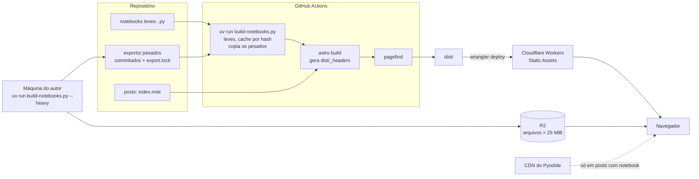

# Spec — Blog técnico estilo Hugging Face (Astro + marimo + Cloudflare)

Oct 6, 2026 · @Pedro Knoll · revisado em 09/10/2026

**Revisão de 09/10/2026:** removidas as menções a `authors` e "autores" que contradiziam a Q2; o componente do modo inline passa a se chamar só `MarimoRuntime`; Q4b reaberta (o domínio não está confirmado); o build chama o Python via `uv run`; os dois diagramas viraram Mermaid; o roadmap (seção 12) foi movido para `specs/ROADMAP.md`.

**Revisão 2 de 09/10/2026 (conferida nas docs oficiais):**

- ADR-01 passa de Astro 6 para **Astro 7**, com Markdown e MDX pelo processador `unified()`. O ADR antigo foi para `specs/adr/`.
- O modo inline usa o runtime em custom element do mdx-marimo, sem React.
- Notebook inline é declarado só com `{ mode: inline }`, sem `src`.
- Schemas atualizados para a API do Zod 4.
- `_headers` passa a ser gerado no build, com o limite de 100 regras.
- Exports pesados ficam em `exports/`.
- `SHOW_DRAFTS` substitui `PUBLIC_SHOW_DRAFTS`.
- `SITE_URL` destrava a T-12 enquanto a Q4b não fecha.
- Contrato do `LineChart` aceita datas ISO.
- Dependências pré-aprovadas listadas na seção 9.

## 1. Visão geral

O produto é um blog técnico estático, no estilo do [Hugging Face Blog](https://huggingface.co/blog), em que cada post pode trazer notebooks marimo executáveis no navegador e visualizações interativas, servido pela edge da Cloudflare com custo de hospedagem perto de zero.

Este documento é a fonte de verdade da implementação (spec-driven): cada requisito tem um ID, cada tarefa do roadmap aponta para IDs, e nenhuma feature entra no código sem estar aqui primeiro.

### Objetivos

- Publicar posts em Markdown/MDX com a mesma ergonomia de leitura do HF Blog: listagem em cards, página de post com TOC, autor, tags e data.
- Permitir que um post embuta células ou notebooks marimo interativos (Python no browser via WebAssembly), sem servidor Python em produção.
- Permitir gráficos D3 interativos encapsulados em componentes Svelte, hidratados só quando visíveis.
- Deploy automático a cada push, com preview por pull request.

### Não-objetivos (v1)

- Posts da comunidade com login, upvotes e comentários nativos (o HF tem; aqui fica para v2).
- CMS visual. A autoria é via Git.
- Execução de código Python no servidor ou GPU.

### Personas


| Persona    | Precisa de                                                     | Como mede sucesso                                              |
| ---------- | -------------------------------------------------------------- | -------------------------------------------------------------- |
| Leitor     | Ler rápido no celular, achar posts por tag, rodar o exemplo    | Página carrega em < 2 s em 4G; notebook roda sem instalar nada |
| Autor      | Escrever em Markdown e notebook, ver preview antes de publicar | Do `git push` ao preview em < 5 min                            |
| Mantenedor | Pouca manutenção, custo previsível                             | Build verde, US$ 0 de hospedagem no plano free                 |


### Métricas de sucesso

- Lighthouse ≥ 95 em Performance, Accessibility, Best Practices e SEO na home e num post sem notebook.
- JavaScript inicial ≤ 50 KB (gzip) em post sem islands.
- Notebook marimo interativo em ≤ 10 s em desktop banda larga (download do runtime Pyodide incluso).

## 2. Premissas e decisões em aberto

A spec parte de seis premissas; as respostas de 06/10 e 09/10 já estão incorporadas e só o domínio segue em aberto, então a Fase 0 pode começar já.

### Premissas assumidas


| #   | Premissa                                                                              | Por quê                                                                                                                                             | Se estiver errada                              |
| --- | ------------------------------------------------------------------------------------- | --------------------------------------------------------------------------------------------------------------------------------------------------- | ---------------------------------------------- |
| P1  | Site 100% estático (`output: 'static'`), sem adapter SSR                              | Blog não precisa de render por request; custo zero e cache total                                                                                    | Adicionar `@astrojs/cloudflare` (ADR-05)       |
| P2  | Hospedar em **Cloudflare Workers com Static Assets**, não em Pages                    | A [doc do Astro](https://docs.astro.build/en/guides/deploy/cloudflare) e a Cloudflare recomendam Workers para projetos novos; Pages segue suportado | Trocar só o passo de deploy; o build é o mesmo |
| P3  | Svelte é a camada de **UI interativa** (islands); as content collections são do Astro | Content collections são um recurso nativo do Astro (schemas Zod + loaders), não do Svelte                                                           | — (esclarecimento de papel, ver ADR-03)        |
| P4  | Autoria via Git (Markdown/MDX + notebooks `.py` no repositório)                       | Mesmo modelo do repositório [huggingface/blog](https://github.com/huggingface/blog)                                                                 | Avaliar CMS headless + live collections        |
| P5  | Idioma único pt-BR na v1, estrutura pronta para i18n                                  | Reduz escopo; Astro tem roteamento i18n nativo                                                                                                      | Ativar i18n na Fase 3                          |
| P6  | Gerenciadores: pnpm (JS) e uv (Python)                                                | uv é exigido pelo export WASM do marimo para resolver dependências e módulos locais                                                                 | —                                              |


### Decisões de 06/10/2026

- [x] **Q1 — Notebooks:** os dois modos, `inline` e `iframe` (ADR-02 confirmado).
- [x] **Q2 — Autores:** autor único; sem collection `authors` nem páginas de autor (seção 6).
- [x] **Q3 — Comunidade:** fora do sprint 01; Giscus entra na Fase 4 do roadmap.
- [x] **Q4 — Ambientes:** sem staging; só preview por PR e produção.
- [ ] **Q4b — Domínio:** em aberto; falta confirmar se o domínio já está na Cloudflare. Bloqueia só a T-27. Até lá, a URL canônica vem da variável `SITE_URL`, que aponta para o endereço `workers.dev` do Worker, e as tarefas de SEO, RSS e sitemap seguem sem esperar.
- [x] **Q5 — Hospedagem:** Workers com Static Assets (P2 confirmada).
- [x] **Q6 — Volume:** blog pessoal, bem abaixo de 1.000 posts; build e paginação atuais bastam.
- [x] **Q7 — Notebooks pesados:** sim; implicações e estratégias na seção 7.

### Decisões de 09/10/2026

- [x] **Q8 — Versão do Astro:** Astro 7 com o processador `unified()` (ADR-01 revisado). O Astro 6 está em `specs/adr/ADR-01-v1-astro-6.md`.
- [x] **Q9 — Notebook inline:** declarado como `{ mode: inline }`, sem `src`. As células são as fences ````python marimo` do próprio MDX (seção 7).
- [x] **Q10 — Rota de paginação:** fica `/page/2`. É a única rota fora do pt-BR, por decisão explícita.

## 3. Requisitos funcionais

A v1 entrega 12 requisitos Must; o restante entra por ordem de prioridade sem bloquear o lançamento. Os itens espelham o que o HF Blog oferece hoje, menos a camada social.


| ID    | Requisito                                                                             | Prioridade | Critério de aceite                                                                                                      |
| ----- | ------------------------------------------------------------------------------------- | ---------- | ----------------------------------------------------------------------------------------------------------------------- |
| RF-01 | Home com post em destaque e grid de cards (capa, título, data, tags)                  | Must       | Cards ordenados por data desc; destaque via `featured: true`                                                            |
| RF-02 | Filtro por tag e página `/tags/[tag]`                                                 | Must       | Cada tag usada gera uma página; tag inexistente é 404                                                                   |
| RF-03 | Paginação da listagem                                                                 | Must       | 12 posts por página; a página 1 é `/` e as seguintes são `/page/2`, `/page/3`… (exceção à regra de rotas em pt-BR, Q10) |
| RF-04 | Página do post com título, autor, datas de publicação e atualização, tempo de leitura | Must       | Todos os campos vêm do frontmatter validado                                                                             |
| RF-05 | TOC lateral fixa (h2–h3) com seção ativa destacada                                    | Must       | Funciona sem JS (links âncora); destaque é melhoria progressiva                                                         |
| RF-06 | Syntax highlighting com botão copiar                                                  | Must       | Shiki em build time, tema claro e escuro (`markdown.shikiConfig.themes`)                                                |
| RF-07 | Matemática LaTeX inline e em bloco                                                    | Must       | `remark-math` + `rehype-katex` no processador `unified()`, render no build                                              |
| RF-08 | Células ou notebooks marimo interativos no post                                       | Must       | Saída estática visível antes do Pyodide carregar (seção 7)                                                              |
| RF-09 | Visualizações Svelte + D3 usadas dentro do MDX                                        | Must       | Hidratam com `client:visible`; têm fallback estático (seção 8)                                                          |
| RF-10 | Feed RSS e sitemap                                                                    | Must       | `/rss.xml` válido no W3C Validator; `sitemap-index.xml` gerado                                                          |
| RF-11 | Rascunhos (`draft: true`) visíveis só em preview                                      | Must       | Build de produção exclui drafts de páginas, feed e sitemap                                                              |
| RF-12 | SEO por post: title, description, canonical, Open Graph, JSON-LD `BlogPosting`        | Must       | Validado no Rich Results Test; URLs absolutas montadas a partir de `SITE_URL`                                           |
| RF-13 | Link "Editar no GitHub" por post                                                      | Should     | URL aponta para o arquivo-fonte na branch `main`                                                                        |
| RF-14 | Página Sobre `/sobre` com bio, foto e links                                           | Should     | Dados vêm do config do site (autor único)                                                                               |
| RF-15 | Busca full-text estática                                                              | Should     | Pagefind indexa só o corpo dos posts; sem backend                                                                       |
| RF-16 | Imagem OG gerada por post quando não houver capa                                      | Should     | PNG 1200×630 gerado no build                                                                                            |
| RF-17 | Tema escuro com toggle, respeitando `prefers-color-scheme`                            | Should     | Sem flash de tema errado no carregamento                                                                                |
| RF-18 | Posts relacionados ao fim (por tags em comum)                                         | Could      | Até 3 posts, nunca o próprio                                                                                            |
| RF-19 | Comentários e reações via Giscus                                                      | Could      | Fase 4, pós-sprint 01; carregamento lazy                                                                                |
| RF-20 | Embed de Hugging Face Spaces e iframes genéricos                                      | Could      | Componente `<Embed>` com `loading="lazy"` e aspect ratio                                                                |
| RF-21 | Artigos da comunidade com login e upvote                                              | Won't (v1) | Fora da v1; exigiria D1 + auth                                                                                          |


## 4. Requisitos não-funcionais

Cada RNF tem um número verificável no CI; o que não dá para medir automaticamente vira item de checklist de revisão.


| ID     | Área             | Requisito                                                                                                                                                               | Como verificar                                                                                                                                                                                                                             |
| ------ | ---------------- | ----------------------------------------------------------------------------------------------------------------------------------------------------------------------- | ------------------------------------------------------------------------------------------------------------------------------------------------------------------------------------------------------------------------------------------ |
| RNF-01 | Performance      | LCP < 2,0 s e CLS < 0,05 em 4G simulado (home e post sem notebook)                                                                                                      | Lighthouse CI com budget no PR                                                                                                                                                                                                             |
| RNF-02 | Performance      | JS inicial ≤ 50 KB gzip **por página** sem islands; cada island D3 ≤ 40 KB gzip. O runtime marimo fica fora desse budget e só existe em páginas com notebook            | Script de artefato que soma, por página de `dist/`, o JS que o HTML referencia (home e post sem notebook); `size-limit` com uma entrada por island. Um glob único sobre `dist/_astro/*.js` não serve: somaria chunks de páginas diferentes |
| RNF-03 | Performance      | Pyodide e runtime marimo carregam só em páginas que usam notebook e só após o primeiro paint                                                                            | Teste E2E: home e post sem notebook não requisitam `/pyodide                                                                                                                                                                               |
| RNF-04 | Acessibilidade   | WCAG 2.2 AA; gráficos D3 com `role="img"`, `aria-label` e tabela de dados alternativa                                                                                   | axe-core no Playwright, zero violações serious/critical                                                                                                                                                                                    |
| RNF-05 | SEO              | HTML semântico, um `h1` por página, URLs estáveis `/blog/[slug]`                                                                                                        | Teste de build + Lighthouse SEO ≥ 95                                                                                                                                                                                                       |
| RNF-06 | Segurança        | Headers: CSP, HSTS, `X-Content-Type-Options`, `Referrer-Policy`                                                                                                         | `dist/_headers` gerado no build e conferido por teste de artefato; securityheaders.com em produção                                                                                                                                         |
| RNF-07 | Segurança        | CSP com `wasm-unsafe-eval` e as origens do Pyodide só nas rotas com notebook; o `dist/_headers` gerado tem no máximo 100 regras (limite da Cloudflare)                  | Teste de artefato: rotas sem notebook não têm `wasm-unsafe-eval`; o build falha acima de 100 regras                                                                                                                                        |
| RNF-08 | Build            | Build completo < 5 min com 200 posts e 20 notebooks                                                                                                                     | Medido no CI; cache de exports marimo por hash do `.py` + `uv.lock`                                                                                                                                                                        |
| RNF-09 | Confiabilidade   | Build falha se frontmatter for inválido, link interno quebrar, notebook falhar no `marimo check` ou houver fence marimo sem `{ mode: inline }` declarado (e vice-versa) | Zod + `astro check` + verificador de links + checagem de fences                                                                                                                                                                            |
| RNF-10 | Custo            | US$ 0/mês até o limite do plano free (static assets não são cobrados)                                                                                                   | Revisão mensal no dashboard Cloudflare                                                                                                                                                                                                     |
| RNF-11 | Privacidade      | Analytics sem cookies                                                                                                                                                   | Cloudflare Web Analytics                                                                                                                                                                                                                   |
| RNF-12 | Manutenibilidade | TypeScript strict, ESLint + Prettier, Ruff para Python                                                                                                                  | Gates no CI                                                                                                                                                                                                                                |


## 5. Arquitetura e decisões de stack

A arquitetura é um build estático em duas linguagens: Python gera os artefatos marimo, Astro gera o HTML, e a Cloudflare só serve arquivos. Nada roda no servidor em produção na v1.




Python só existe no build; em produção, o único código que executa é o do navegador, e o Pyodide só baixa em posts que declaram notebook.

### ADRs


| ADR    | Decisão                                                                                                                                                                                | Alternativas descartadas                                                                                          | Motivo                                                                                                                                                                                                                                                                                                                                                                                                   |
| ------ | -------------------------------------------------------------------------------------------------------------------------------------------------------------------------------------- | ----------------------------------------------------------------------------------------------------------------- | -------------------------------------------------------------------------------------------------------------------------------------------------------------------------------------------------------------------------------------------------------------------------------------------------------------------------------------------------------------------------------------------------------- |
| ADR-01 | **Astro 7**, `output: 'static'`, content collections com loader `glob` e schemas Zod 4 (`astro/zod`). Markdown e MDX passam pelo processador `unified()` de `@astrojs/markdown-remark` | Next.js, Hugo, Docusaurus; Astro 6 (ver `specs/adr/ADR-01-v1-astro-6.md`); processador Sätteri, padrão do Astro 7 | Islands nativos, zero JS por padrão, MDX de primeira classe. O [Astro 7](https://docs.astro.build/en/guides/upgrade-to/v7/) saiu em 22/06/2026 e a doc do Astro 6 virou snapshot sem manutenção. O exemplo oficial do mdx-marimo roda em Astro 7 com `unified()`. O `unified()` mantém `remarkMarimo`, `remark-math` e `rehype-katex` sem precisar portá-los para o Sätteri. Revisado em 09/10/2026 (Q8) |
| ADR-02 | **marimo via [mdx-marimo](https://github.com/marimo-team/mdx-marimo)** para células no meio do texto; `marimo export html-wasm` em iframe para notebooks inteiros                      | Jupyter + nbconvert estático; Thebe/Binder                                                                        | mdx-marimo renderiza a saída no build e hidrata a página como um notebook reativo no Pyodide; o export WASM é o caminho maduro e isolado ([docs](https://docs.marimo.io/guides/exporting/webassembly_html/))                                                                                                                                                                                             |
| ADR-03 | **Svelte 5** para islands interativos; **D3 v7** só para cálculo (escalas, eixos, layouts), com o Svelte dono do DOM                                                                   | React + D3; Observable Plot puro                                                                                  | Svelte compila para bundles pequenos; D3 manipulando DOM brigaria com a reatividade. Content collections ficam no Astro, não no Svelte. O mdx-marimo não exige React no Astro (o runtime é um custom element), então não há segundo framework de UI                                                                                                                                                      |
| ADR-04 | **Cloudflare Workers com Static Assets** (`wrangler.jsonc` com `assets.directory: ./dist`)                                                                                             | Cloudflare Pages, Vercel, Netlify                                                                                 | [Recomendação atual](https://docs.astro.build/en/guides/deploy/cloudflare) para projetos novos; static assets não são cobrados; caminho direto para D1/KV no futuro. Confirmado em 06/10 (Q5)                                                                                                                                                                                                            |
| ADR-05 | Sem SSR na v1                                                                                                                                                                          | `@astrojs/cloudflare` desde o início                                                                              | YAGNI. Se vierem upvotes/comentários próprios, adiciona-se o adapter `@astrojs/cloudflare` compatível com a versão do Astro em uso, e D1                                                                                                                                                                                                                                                                 |
| ADR-06 | **Pagefind** para busca                                                                                                                                                                | Algolia, Orama                                                                                                    | Indexa o `dist/` no pós-build, roda 100% no cliente, sem custo                                                                                                                                                                                                                                                                                                                                           |
| ADR-07 | **Tailwind CSS v4** + plugin `typography` para a prosa                                                                                                                                 | CSS Modules, UnoCSS                                                                                               | O HF Blog usa Tailwind; tipografia de artigo pronta                                                                                                                                                                                                                                                                                                                                                      |


### Riscos técnicos

- **mdx-marimo é jovem** (repositório recente, poucos usuários). No Astro, o runtime é um custom element carregado por `<script type="module">`, sem React. Mitigação: spike na Fase 0 com o exemplo `examples/with-astro`; se falhar, usar só o export WASM em iframe.
- **Pyodide pesa** dezenas de MB no primeiro acesso. Mitigação: saída estática pré-renderizada e botão "Ativar interatividade" quando o notebook for grande.
- **Pacotes sem wheel WASM** não rodam no browser. Mitigação: `marimo check --select MW` no CI (regras `MW001` import incompatível, `MW002` chamada de sistema insegura, `MW003` dependência sem wheel WASM) e cache de execução (seção 7).
- **Astro 7 é estrito com HTML.** O compilador Rust recusa tags não fechadas e não corrige aninhamento inválido; o padrão `compressHTML: 'jsx'` remove espaço entre elementos inline. Mitigação: `astro check` no CI e revisão visual do preview.

## 6. Modelo de conteúdo

A v1 tem uma única collection, `posts`. O autor é único e vem de `src/site.config.ts`; tags são derivadas dos posts. Todo campo é validado por Zod no build, e um frontmatter inválido quebra o build (RNF-09).

### Convenção de pastas

Cada post é uma pasta: o slug é o nome da pasta, e capa, imagens, dados e notebooks moram junto do texto.

```text
src/
├── site.config.ts
└── content/posts/
    └── 2026-10-intro-a-embeddings/
        ├── index.mdx          # células inline são fences ```python marimo aqui dentro
        ├── cover.png
        ├── figs/
        ├── data/              # JSON/CSV dos gráficos
        └── notebooks/
            └── treino.py      # só notebooks iframe têm arquivo .py

```

### Schemas (`src/content.config.ts`)

```ts
import { defineCollection } from 'astro:content';
import { glob } from 'astro/loaders';
import { z } from 'astro/zod'; // Zod 4

// Inline: as células são as fences do próprio MDX. Sem `src`; sempre roda no navegador.
const inlineNotebook = z.strictObject({
  mode: z.literal('inline'),
  gpuUrl: z.url().optional(), // botão "Rodar com GPU" (molab, Colab, HF Space)
});

// Iframe: notebook inteiro num .py da pasta do post, exportado com html-wasm.
const iframeNotebook = z.strictObject({
  mode: z.literal('iframe'),
  src: z.string(),
  // estratégia de execução, ver seção 7
  compute: z.enum(['browser', 'cache', 'precomputed', 'onnx', 'static']).default('browser'),
  gpuUrl: z.url().optional(),
});

// `strictObject` faz `{ mode: inline, compute: cache }` ou `{ mode: inline, src }` quebrar o build.
const notebook = z.discriminatedUnion('mode', [inlineNotebook, iframeNotebook]);

const posts = defineCollection({
  loader: glob({
    pattern: '**/index.{md,mdx}',
    base: './src/content/posts',
    // id = nome da pasta do post; é o slug de /blog/[slug]
    generateId: ({ entry }) => entry.split('/')[0],
  }),
  schema: ({ image }) =>
    z
      .object({
        title: z.string().max(90),
        description: z.string().min(50).max(160),
        pubDate: z.coerce.date(),
        updatedDate: z.coerce.date().optional(),
        tags: z.array(z.string().regex(/^[a-z0-9-]+$/)).max(6).default([]),
        cover: image().optional(),
        coverAlt: z.string().optional(),
        featured: z.boolean().default(false),
        draft: z.boolean().default(false),
        // dirige o carregamento do Pyodide e a CSP por rota
        notebooks: z.array(notebook).default([]),
        canonical: z.url().optional(),
      })
      .refine((d) => !d.cover || d.coverAlt, {
        error: 'coverAlt é obrigatório quando há cover',
        path: ['coverAlt'],
      })
      .refine((d) => d.notebooks.filter((n) => n.mode === 'inline').length <= 1, {
        error: 'declare no máximo um { mode: inline } por post: as fences da página formam um único notebook',
        path: ['notebooks'],
      }),
});

export const collections = { posts };

```

Notas de Zod 4: `z.url()` substitui `z.string().url()`, e o parâmetro `error` substitui `message`. As formas antigas ainda funcionam, mas estão depreciadas.

### Autor (`src/site.config.ts`)

```ts
export const site = {
  title: 'Nome do blog',
  // até a Q4b fechar, SITE_URL aponta para o endereço workers.dev do Worker
  url: import.meta.env.SITE_URL ?? 'https://blog.exemplo.com',
  author: {
    name: 'Seu Nome',
    avatar: '/avatar.jpg',
    bio: 'Uma linha sobre você.',
    github: 'usuario',
    huggingface: 'usuario',
  },
} as const;

```

### Exemplo de frontmatter

```yaml
---
title: "Embeddings na prática: similaridade de cosseno"
description: "Como calcular e visualizar similaridade entre frases, com um notebook marimo que roda no seu navegador."
pubDate: 2026-10-20
tags: [nlp, embeddings]
cover: ./cover.png
coverAlt: "Pontos coloridos agrupados num plano 2D"
notebooks:
  - { mode: inline }   # as células são as fences ```python marimo deste index.mdx
  - { mode: iframe, src: ./notebooks/treino.py, compute: cache, gpuUrl: "https://colab.research.google.com/..." }
---

```

### Regras derivadas

- `getPublishedPosts()` é o único acesso à collection nas páginas: filtra `draft` quando `SHOW_DRAFTS` não é `true` e ordena por `pubDate` desc.
- O slug é o `id` gerado pelo `generateId` do loader (nome da pasta). Nenhuma página recalcula slug por conta própria.
- Tempo de leitura é calculado por um plugin remark do projeto (200 palavras/min), excluindo blocos de código.
- Tags são normalizadas em kebab-case; um arquivo `src/data/tags.ts` opcional dá rótulo e descrição para as páginas de tag.
- Coerência inline: se o `index.mdx` tem fences ````python marimo`, o frontmatter precisa declarar `{ mode: inline }`; se declara, precisa ter ao menos uma fence. O build falha nos dois casos (RNF-09).

## 7. Pipeline marimo

O blog suporta dois modos de notebook, escolhidos por post no campo `notebooks[].mode`: `inline` (células intercaladas com o texto) e `iframe` (notebook inteiro isolado). Os dois rodam Python no navegador via Pyodide; nenhum precisa de servidor.


|                           | Modo `inline`                                                                                        | Modo `iframe`                                           |
| ------------------------- | ---------------------------------------------------------------------------------------------------- | ------------------------------------------------------- |
| Tecnologia                | [mdx-marimo](https://github.com/marimo-team/mdx-marimo) (`remarkMarimo` + runtime em custom element) | `marimo export html-wasm --mode run`                    |
| Declaração no frontmatter | `{ mode: inline }`, sem `src`                                                                        | `{ mode: iframe, src: ./notebooks/<nome>.py, compute }` |
| Autoria                   | Fences ````python marimo` no próprio `index.mdx`                                                     | Arquivo `.py` em `notebooks/`                           |
| Render inicial            | Saída gerada no build, hidrata depois                                                                | Pré-visualização com `--execute`                        |
| Isolamento                | Um notebook reativo por página, compartilhado entre fences                                           | Um kernel por iframe                                    |
| Estratégias `compute`     | Só `browser` (implícito)                                                                             | Todas (tabela abaixo)                                   |
| Maturidade                | Recente; validar no spike                                                                            | Estável, documentado                                    |
| Usar quando               | Artigo interativo, poucas células leves                                                              | Demo completa, dependências pesadas                     |


### Modo inline

1. O autor escreve células direto no MDX ou converte um notebook existente com `marimo export md notebook.py -o notebook.mdx --flavor mdx` e cola as fences no `index.mdx`.
2. O frontmatter declara `notebooks: [{ mode: inline }]`.
3. `astro.config.mjs` usa o processador `unified()` para Markdown e MDX e registra os plugins:

```js
import { defineConfig } from 'astro/config';
import mdx from '@astrojs/mdx';
import svelte from '@astrojs/svelte';
import sitemap from '@astrojs/sitemap';
import tailwindcss from '@tailwindcss/vite';
import { unified } from '@astrojs/markdown-remark';
import remarkMath from 'remark-math';
import rehypeKatex from 'rehype-katex';
import { remarkMarimo } from '@marimo-team/mdx-marimo/remark';
import { remarkReadingTime } from './src/lib/remark-reading-time.mjs';

const remarkPlugins = [remarkMath, remarkReadingTime];
const rehypePlugins = [rehypeKatex];

export default defineConfig({
  site: process.env.SITE_URL ?? 'https://blog.exemplo.com',
  output: 'static',
  markdown: {
    processor: unified({ remarkPlugins, rehypePlugins }),
  },
  integrations: [
    mdx({ processor: unified({ remarkPlugins: [remarkMarimo, ...remarkPlugins], rehypePlugins }) }),
    svelte(),
    sitemap(),
  ],
  vite: { plugins: [tailwindcss()] },
});

```

As opções `markdown.remarkPlugins` e `markdown.rehypePlugins` estão depreciadas no Astro 7; os plugins vão dentro de `unified()`. A configuração do Shiki (`markdown.shikiConfig`) é da T-10, que confere na doc atual como ela interage com `unified()`.

1. O `PostLayout` inclui o `MarimoRuntime.astro` (em `src/components/marimo/`) **somente** se o post declarar `{ mode: inline }` (RNF-03). O componente importa `@marimo-team/mdx-marimo/styles.css` e carrega o runtime em custom element (`@marimo-team/mdx-marimo/element/auto?url`) num `<script type="module">`, como no exemplo oficial `with-astro`. Não usa React nem diretiva `client:`*. Se o spike T-03 mostrar que o script dispara o Pyodide antes do primeiro paint, a carga passa para um import dinâmico após o paint.
2. Uso no texto (atributos de fence vistos no mdx-marimo: `editor=true`, `output=false`):

```mdx
```python marimo editor=true
import marimo as mo
k = mo.ui.slider(1, 10, label="Vizinhos")
k
```

O texto do artigo continua normalmente aqui.

```python marimo
mo.md(f"Usando **{k.value}** vizinhos.")
```

```

### Modo iframe

1. `scripts/build-notebooks.py` percorre os posts e, para cada notebook `iframe` com `compute: browser`, roda `marimo check --select MW` e depois `marimo export html-wasm <nb>.py -o public/notebooks/<slug>/<nome>/ --mode run --no-show-code`.
2. O resultado é cacheado pelo SHA-256 do `.py` + `uv.lock`; notebook sem mudança não é reexportado (RNF-08). `public/notebooks/` é gerado e fica no `.gitignore`.
3. O componente `<MarimoFrame src="..." title="..." height={600} />` renderiza um iframe com `loading="lazy"` e um pôster estático até o usuário clicar em "Executar".
4. Dados do notebook são lidos via `mo.notebook_location()`, para funcionar local e no WASM. Módulos `.py` locais importados pelo notebook entram no export como wheel em `public/wheels` (exige uv).

### Notebooks pesados (torch, GPU, dados grandes)

Notebook pesado nunca roda inteiro no navegador do leitor: o Pyodide só instala pacotes com wheel WebAssembly, o `torch` não tem, e não há GPU disponível para ele. Então a parte pesada roda **antes**, na sua máquina, e o leitor recebe os resultados prontos, com as partes leves ainda interativas.

#### O que isso implica

- **A execução sai do CI.** Os runners padrão do GitHub Actions não têm GPU, e treinar a cada push deixaria o build lento. Notebook pesado é executado localmente e o export é commitado.
- **Interatividade parcial.** Células que dependem de `torch` não podem ser reexecutadas pelo leitor. No export, um valor que o navegador não consegue restaurar vira um stub, e usar o stub tenta recomputar a célula (e falha sem `torch`). O que reage a sliders precisa operar sobre resultados já calculados (arrays numpy, tabelas).
- **É um snapshot.** Mudou uma célula cacheada ou um dado de entrada, o cache invalida: é preciso reexecutar e reexportar.
- **Limites de arquivo.** A Cloudflare serve até 25 MiB por arquivo e 20.000 arquivos por versão no plano free ([limites](https://developers.cloudflare.com/workers/platform/limits/)). Pesos de modelo e datasets maiores vão para um bucket R2 com domínio próprio e CORS liberado.
- **Peso para o leitor.** Pyodide mais numpy/pandas somam dezenas de MB no primeiro acesso; post pesado abre com a saída estática e um botão "Ativar interatividade".

#### Estratégias (campo `compute` de notebooks `iframe`)


| `compute`          | Como funciona                                                                                                                                                                                                                 | O leitor pode                                             | Quando usar                                                 |
| ------------------ | ----------------------------------------------------------------------------------------------------------------------------------------------------------------------------------------------------------------------------- | --------------------------------------------------------- | ----------------------------------------------------------- |
| `browser` (padrão) | Tudo roda no Pyodide; exportado no CI                                                                                                                                                                                         | Tudo, inclusive editar código                             | numpy, pandas, scikit-learn, matplotlib                     |
| `cache`            | `cache_cells = true` + `marimo export html-wasm --execute`; o marimo copia o cache para `public/cache/` **dentro do diretório do export**                                                                                     | Interagir com células leves que leem os valores cacheados | Treino curto, embeddings, métricas de avaliação             |
| `precomputed`      | `@mo.persistent_cache(method="lazy")` numa função indexada pelos controles; uma célula guardada por `sys.platform != "emscripten"` aquece todas as combinações antes do export (`method="pickle"` não empacota bem para WASM) | Trocar qualquer opção de slider/dropdown sem recomputar   | Poucos estados conhecidos (ex.: 3 modelos × 4 temperaturas) |
| `onnx`             | Modelo cacheado como ONNX com `moutils.onnx.OnnxRuntime`; no navegador a inferência roda em onnxruntime-web                                                                                                                   | Rodar inferência de verdade com entradas novas            | Modelos pequenos, abaixo do limite de 25 MiB                |
| `static`           | `marimo export html`, sem WASM                                                                                                                                                                                                | Só ler                                                    | Resultados finais que não justificam o Pyodide              |


Complemento para qualquer estratégia: um botão "Rodar com GPU" apontando para molab, Colab ou um HF Space, para quem quiser reproduzir o treino completo fora do blog.

#### Fluxo de um post pesado

1. Declarar no frontmatter `notebooks: [{ mode: iframe, src: ./notebooks/treino.py, compute: cache }]`.
2. Marcar dependências nativas no bloco PEP 723 para que o export WASM as ignore:

```python
# /// script
# dependencies = [
#     "marimo",
#     "numpy",
#     "torch; sys_platform != 'emscripten'",
# ]
# [tool.marimo.runtime]
# cache_cells = true
# ///

```

1. Rodar localmente `uv run scripts/build-notebooks.py --heavy <slug>`: executa com torch (CPU ou GPU), exporta para `exports/<slug>/<nome>/` e grava `exports/<slug>/<nome>/export.lock` com o SHA-256 do `.py`, do `uv.lock` e a versão do marimo.
2. Commitar `exports/<slug>/`; arquivos acima de 25 MiB são enviados ao R2 pelo mesmo script e substituídos por referência.
3. No CI, notebooks com `compute` diferente de `browser` não são executados. O CI confere se o `export.lock` bate com os hashes atuais (falha se o export estiver desatualizado) e o `build-notebooks.py` copia `exports/<slug>/<nome>/` para `public/notebooks/<slug>/<nome>/`, onde fica junto dos exports leves.

A mecânica de cache e pré-cômputo está descrita na [documentação do marimo](https://docs.marimo.io/guides/exporting/webassembly_html/). O spike T-04 confirma como o `--execute` se comporta com `torch`: a doc diz que ele usa, quando possível, um ambiente isolado com pacotes compatíveis com WASM.

### Ordem do build

```bash
pnpm build   # = uv run scripts/build-notebooks.py && astro build && pagefind --site dist

```

`pnpm dev` não gera notebooks. Para ver um notebook iframe no servidor de dev, rode antes `uv run scripts/build-notebooks.py` (só leves, com cache) ou `pnpm build && npx wrangler dev`. O modo inline funciona direto no `pnpm dev`.

## 8. Visualizações interativas (Svelte + D3)

Cada gráfico é um componente Svelte 5 que usa módulos D3 só para cálculo e desenha o SVG no próprio template. Assim o Astro renderiza o SVG no build (o leitor vê o gráfico sem JS) e o island só adiciona interatividade ao ficar visível.

### Regras

- Importar módulos D3 avulsos (`d3-scale`, `d3-shape`, `d3-array`, `d3-format`), nunca o pacote `d3` inteiro (RNF-02).
- Proibido `d3-selection` para criar ou mudar elementos; o DOM é do Svelte. Exceção documentada: `d3-zoom`/`d3-drag` via action do Svelte.
- Dados vêm por props, importados no MDX a partir de JSON/CSV na pasta do post; nada de `fetch` em runtime.
- Datas chegam como string ISO (é o que JSON e CSV entregam); o componente converte para `Date`. O autor não converte nada no MDX.
- Todo gráfico recebe `title` e `summary` (vira `aria-label`) e oferece "Ver dados" com a tabela (RNF-04).
- Hidratação padrão `client:visible`; `client:load` só com justificativa no PR.
- Cores via variáveis CSS do tema, para respeitar modo escuro.

### Contrato do componente

```svelte
<!-- src/components/viz/LineChart.svelte -->
<script lang="ts">
  import { scaleLinear, scaleUtc } from 'd3-scale';
  import { line } from 'd3-shape';
  import { extent } from 'd3-array';

  type RawPoint = { date: string | Date; value: number }; // string ISO vinda de JSON/CSV
  type Point = { date: Date; value: number };

  let { data, title, summary, width = 640, height = 320 }:
    { data: RawPoint[]; title: string; summary: string; width?: number; height?: number } = $props();

  const m = { top: 16, right: 16, bottom: 28, left: 40 };
  let hover = $state<Point | null>(null);

  const points = $derived<Point[]>(data.map((d) => ({ date: new Date(d.date), value: d.value })));
  const x = $derived(scaleUtc(extent(points, (d) => d.date) as [Date, Date], [m.left, width - m.right]));
  const y = $derived(scaleLinear(extent(points, (d) => d.value) as [number, number], [height - m.bottom, m.top]).nice());
  const path = $derived(line<Point>((d) => x(d.date), (d) => y(d.value))(points));
</script>

<figure>
  <svg viewBox="0 0 {width} {height}" role="img" aria-label={summary}>
    <title>{title}</title>
    <path d={path} fill="none" stroke="var(--viz-1)" stroke-width="2" />
    <!-- eixos, pontos e tooltip controlados por `hover` -->
  </svg>
  <figcaption>{title}</figcaption>
</figure>

```

### Uso no post

```mdx
import LineChart from '~/components/viz/LineChart.svelte';
import serie from './data/latencia.json'; // [{ "date": "2026-10-01", "value": 120 }, …]

<LineChart client:visible data={serie} title="Latência p95 por dia" summary="Latência caiu de 120 ms para 45 ms após o cache." />

```

### Biblioteca inicial (Fase 2)


| Componente   | Uso típico                                      | Módulos D3             |
| ------------ | ----------------------------------------------- | ---------------------- |
| `LineChart`  | Séries temporais, curvas de treino              | scale, shape, array    |
| `BarChart`   | Comparação entre modelos ou benchmarks          | scale, array, format   |
| `Scatter`    | Embeddings 2D, correlações                      | scale, array, zoom     |
| `Heatmap`    | Matrizes de atenção e confusão                  | scale, scale-chromatic |
| `Explorable` | Wrapper com sliders que alimentam outro gráfico | —                      |


## 9. Estrutura do repositório e convenções

Um único repositório com dois ambientes (Node e Python) que se encontram no `public/` e no `dist/`. A spec mora no próprio repo em `specs/`, para que mudanças de requisito e de código passem pelo mesmo PR.

```text
.
├── AGENTS.md                 # manual para agentes de código (Cursor lê este e os aninhados)
├── .cursorignore             # exports/ e artefatos que não devem entrar no contexto
├── .github/
│   ├── workflows/ci.yml
│   └── pull_request_template.md   # campo "Requisitos afetados"
├── .node-version  ·  .python-version
├── specs/
│   ├── SPEC.md               # este documento
│   ├── ROADMAP.md            # tarefas, dependências, status e handoff
│   ├── spikes/               # resultados de T-03 e T-04
│   └── adr/                  # só ADRs substituídos; os vigentes ficam na seção 5
├── src/
│   ├── site.config.ts        # título, URL (SITE_URL) e autor
│   ├── content.config.ts
│   ├── content/posts/
│   ├── components/
│   │   ├── ui/               # .astro: Card, TagList, Toc, AuthorBadge
│   │   ├── viz/              # .svelte: gráficos D3 (AGENTS.md próprio, criado antes da T-19)
│   │   └── marimo/           # MarimoRuntime.astro, MarimoFrame, RunOnGpu (AGENTS.md próprio, criado antes da T-14)
│   ├── integrations/
│   │   └── headers.ts        # gera dist/_headers no astro:build:done (CSP por rota)
│   ├── layouts/              # BaseLayout, PostLayout
│   ├── pages/
│   │   ├── index.astro
│   │   ├── page/[page].astro
│   │   ├── blog/[slug].astro
│   │   ├── tags/[tag].astro
│   │   ├── sobre.astro
│   │   └── rss.xml.ts
│   ├── lib/                  # getPublishedPosts, readingTime, seo
│   └── styles/
├── scripts/
│   └── build-notebooks.py    # leves no CI; --heavy <slug> para export local
├── exports/                  # pesados, commitados: <slug>/<nome>/ + export.lock
├── public/
│   ├── _redirects
│   └── notebooks/            # gerado no build (leves exportados + pesados copiados); no .gitignore
├── tests/                    # vitest (unit) e playwright (e2e)
├── astro.config.mjs
├── wrangler.jsonc
├── package.json  ·  pnpm-lock.yaml
└── pyproject.toml  ·  uv.lock

```

### Convenções

- **Commits:** Conventional Commits citando o requisito, ex.: `feat(post): TOC com seção ativa [RF-05]`.
- **Branches:** `main` = produção; toda mudança via PR com preview. Nome de branch: `t-XX-descricao-curta`.
- **Componentes:** `.astro` para tudo que é estático; `.svelte` só quando houver estado no cliente.
- **Rotas:** em pt-BR (`/sobre`, `/tags/[tag]`), com `/blog/[slug]` e a exceção `/page/[n]` (Q10).
- **Alias:** `~/` aponta para `src/`.
- **Versões:** Node LTS fixado em `.node-version`; Python fixado em `.python-version`; marimo travado no `uv.lock`. O modo iframe usa os assets do próprio export, então já sai alinhado. No modo inline, a relação entre o pacote npm do mdx-marimo e o marimo Python é medida no spike T-03 e verificada por teste na T-15.
- **Mudança de spec:** PR que altera comportamento atualiza `specs/SPEC.md` no mesmo commit; o template de PR tem o campo "Requisitos afetados".

### Dependências pré-aprovadas

Um agente pode instalar, sem perguntar, as dependências abaixo, na versão estável atual. Qualquer outra exige pergunta (AGENTS.md, "Pare e pergunte").


| Área           | npm                                                                                                                                                                          | Python (uv)                                                       |
| -------------- | ---------------------------------------------------------------------------------------------------------------------------------------------------------------------------- | ----------------------------------------------------------------- |
| Núcleo         | `astro`, `@astrojs/mdx`, `@astrojs/markdown-remark`, `@astrojs/svelte`, `svelte`, `@astrojs/sitemap`, `@astrojs/rss`, `@astrojs/check`, `typescript`                         | `marimo`                                                          |
| Estilo         | `tailwindcss`, `@tailwindcss/vite`, `@tailwindcss/typography`                                                                                                                | —                                                                 |
| Conteúdo       | `remark-math`, `rehype-katex`, `katex`, `@marimo-team/mdx-marimo`                                                                                                            | —                                                                 |
| Gráficos       | `d3-scale`, `d3-shape`, `d3-array`, `d3-format`, `d3-zoom`, `d3-scale-chromatic`                                                                                             | —                                                                 |
| Busca e deploy | `pagefind`, `wrangler`                                                                                                                                                       | —                                                                 |
| Qualidade      | `eslint`, `prettier` (e os plugins oficiais para Astro e Svelte), `vitest`, `@testing-library/svelte`, `@playwright/test`, `@axe-core/playwright`, `size-limit`, `@lhci/cli` | `ruff`                                                            |
| Notebooks      | —                                                                                                                                                                            | `moutils` (só em notebooks com `compute: onnx`, no bloco PEP 723) |


Dependências de notebook (numpy, torch etc.) ficam no bloco PEP 723 de cada `.py`, não no `pyproject.toml`.

## 10. Deploy, CI/CD e ambientes

O deploy roda no GitHub Actions, e não no build nativo da Cloudflare, porque o build precisa de Node e de Python com uv no mesmo job. A Cloudflare recebe só o `dist/` pronto via Wrangler.

### `wrangler.jsonc` (site estático, sem Worker)

```jsonc
{
  "name": "blog",
  "compatibility_date": "2026-10-06",
  "assets": {
    "directory": "./dist",
    "not_found_handling": "404-page"
  }
}

```

### Headers e redirecionamentos

A [doc da Cloudflare](https://developers.cloudflare.com/workers/static-assets/headers/) confirma `_headers` e `_redirects` em Static Assets, lidos do diretório de assets (`dist/`). Três regras dela orientam o desenho:

- Uma requisição que casa com várias regras herda os headers de todas. Header repetido tem os valores **unidos por vírgula**: duas CSPs viram uma lista, e o navegador aplica as duas (vence a mais restritiva).
- `! Nome-Do-Header` numa regra remove um header herdado de regra mais ampla.
- Limite de **100 regras** e 2.000 caracteres por linha.

Por isso o `_headers` é **gerado no build** pela integração `src/integrations/headers.ts`, no hook `astro:build:done`, escrevendo em `dist/_headers`:

1. Regra `/*` com a CSP estrita (sem `wasm-unsafe-eval`), HSTS, `X-Content-Type-Options`, `Referrer-Policy` e `frame-ancestors 'self'`. Não usar `X-Frame-Options: DENY`: os iframes de notebook são do mesmo domínio.
2. Regra `/notebooks/*` com `! Content-Security-Policy` e a CSP de notebook (`wasm-unsafe-eval` e as origens do Pyodide medidas nos spikes). Cobre todos os iframes com uma regra só.
3. Uma regra por post com `{ mode: inline }`, com o mesmo par detach + CSP de notebook. O padrão de URL exato (`/blog/<slug>/` ou `/blog/<slug>/*`, por causa da barra final) sai da T-05. Posts só com iframe não precisam de regra: a página-pai não executa Pyodide.
4. Regras de cache (abaixo) e `X-Robots-Tag: noindex` para `https://:version.:subdomain.workers.dev/*` depois que o domínio próprio existir.
5. O build falha se o arquivo passar de 100 regras (RNF-07).

A T-05 valida na prática que detach e nova CSP no mesmo bloco funcionam. Se não funcionarem, plano B: Transform Rules da zona. `_redirects` continua versionado em `public/`.

### Ambientes


| Ambiente | Gatilho                         | URL                                                         | Drafts   |
| -------- | ------------------------------- | ----------------------------------------------------------- | -------- |
| Local    | `pnpm dev` / `npx wrangler dev` | `localhost:4321` / `:8787`                                  | Visíveis |
| Preview  | Cada PR                         | URL de versão do Worker, comentada no PR                    | Visíveis |
| Produção | Merge em `main`                 | `SITE_URL`: `workers.dev` até a Q4b, depois domínio próprio | Ocultos  |


### Pipeline (`.github/workflows/ci.yml`)

1. **Setup:** pnpm, Node LTS, uv; cache de `~/.cache/uv`, `node_modules` e `public/notebooks` (chave = hash dos `.py` + `uv.lock`).
2. **Lint e tipos:** `pnpm lint`, `astro check`, `ruff check`, `marimo check --select MW` em todos os notebooks.
3. **Testes unitários:** `vitest` em `src/lib`.
4. **Build de produção:** `pnpm build` sem `SHOW_DRAFTS` (notebooks leves → Astro → Pagefind; notebooks pesados não executam, só têm o `export.lock` conferido e são copiados).
5. **Verificações do artefato:** links internos, regras do `dist/_headers`, JS por página e `size-limit`, Lighthouse CI com budgets (RNF-01/02/06/07).
6. **E2E:** Playwright + axe contra `astro preview` desse build de produção, o que inclui o cenário de rascunhos.
7. **Deploy:** em PR, um segundo `astro build` com `SHOW_DRAFTS=true` (reaproveita os notebooks do passo 4) seguido de `wrangler versions upload`, que gera a URL de preview. Em `main`, `wrangler deploy` do build do passo 4.

`SHOW_DRAFTS` não tem prefixo `PUBLIC_`: só o build a lê, e ela não deve ir para o cliente.

Segredos necessários no repositório: `CLOUDFLARE_API_TOKEN` (permissão Workers Scripts:Edit) e `CLOUDFLARE_ACCOUNT_ID`. Variável: `SITE_URL`.

### Cache na edge

- `/_astro/*` e `/notebooks/*/assets/*`: `Cache-Control: public, max-age=31536000, immutable` (nomes com hash).
- HTML: o padrão da Cloudflare já é `public, max-age=0, must-revalidate` com `ETag`; não precisa de regra.

## 11. Critérios de aceite e testes

Uma tarefa só fecha quando seus cenários passam no CI. Os cenários abaixo cobrem os requisitos de maior risco; os demais usam o critério da tabela da seção 3.

### Cenários (Given/When/Then)

```gherkin
Funcionalidade: Notebook marimo inline [RF-08, RNF-03]
  Cenário: leitor abre post com notebook
    Dado um post com notebooks: [{ mode: inline }] e fences python marimo
    Quando a página carrega
    Então a saída estática das células aparece antes de qualquer download do Pyodide
    E ao mover o slider, a célula dependente atualiza em até 1 s após o kernel ficar pronto

  Cenário: post sem notebook não carrega runtime
    Dado um post sem o campo notebooks
    Quando a página carrega
    Então nenhuma requisição casa com /pyodide|marimo/

  Cenário: fences sem declaração
    Dado um post com fences python marimo e sem { mode: inline } no frontmatter
    Quando rodo pnpm build
    Então o build falha citando o arquivo e o campo notebooks

  Cenário: inline com src
    Dado um post com notebooks: [{ mode: inline, src: ./notebooks/x.py }]
    Quando rodo pnpm build
    Então o build falha citando o arquivo e o campo notebooks

Funcionalidade: Notebook pesado [RF-08, RNF-09]
  Cenário: export desatualizado
    Dado um notebook com compute: cache
    E o .py mudou depois do último export local
    Quando o CI roda
    Então o build falha pedindo para rodar build-notebooks.py --heavy <slug>

  Cenário: notebook pesado em modo inline
    Dado um post com notebooks: [{ mode: inline, compute: cache }]
    Quando rodo pnpm build
    Então o build falha citando o arquivo e o campo notebooks

  Cenário: leitor interage com notebook cacheado
    Dado um notebook com compute: cache aberto no navegador
    Quando o leitor muda um controle que só depende de valores cacheados
    Então a saída atualiza sem nenhuma requisição de pacote torch

Funcionalidade: CSP por rota [RNF-06, RNF-07]
  Cenário: rota sem notebook
    Dado o dist/_headers gerado
    Quando inspeciono os headers efetivos de / e de um post sem notebook
    Então a CSP não contém wasm-unsafe-eval

  Cenário: rota com notebook
    Dado um post com { mode: inline } e um export em /notebooks/
    Quando inspeciono os headers efetivos dessas rotas
    Então há uma única CSP, com wasm-unsafe-eval

Funcionalidade: Rascunhos [RF-11]
  Cenário: draft em produção
    Dado um post com draft: true
    Quando o build roda sem SHOW_DRAFTS
    Então o post não aparece na home, nas tags, no RSS nem no sitemap

Funcionalidade: Gráfico acessível [RF-09, RNF-04]
  Cenário: leitor sem JavaScript
    Dado um post com <LineChart client:visible>
    Quando JavaScript está desabilitado
    Então o SVG está presente no HTML com aria-label igual ao summary

```

### Pirâmide de testes


| Nível      | Ferramenta                                                                   | O que cobre                                                                                                                                      |
| ---------- | ---------------------------------------------------------------------------- | ------------------------------------------------------------------------------------------------------------------------------------------------ |
| Unit       | Vitest                                                                       | `src/lib` (ordenação, filtros, `SHOW_DRAFTS` ligado e desligado, readingTime, SEO, checagem de fences, geração do `_headers`), helpers de escala |
| Componente | Vitest + `@testing-library/svelte`                                           | Props e estados dos gráficos                                                                                                                     |
| Notebook   | `marimo check` + export nativo                                               | Notebook executa e é compatível com WASM                                                                                                         |
| E2E        | Playwright + axe-core                                                        | Cenários acima, navegação, busca, tema                                                                                                           |
| Artefato   | Lighthouse CI, size-limit, JS por página, link checker, regras do `_headers` | RNF-01, 02, 05, 06, 07                                                                                                                           |


### Definition of Done

- [ ] Requisito(s) citado(s) no PR e na mensagem de commit
- [ ] Testes do nível adequado escritos, vistos falhando antes e passando depois (spikes e tarefas de infraestrutura provam pelo doc de spike ou pelo pipeline rodando, ver AGENTS.md)
- [ ] Preview revisado em mobile (360 px) e desktop
- [ ] Budgets de performance e acessibilidade verdes
- [ ] `specs/SPEC.md` atualizado se o comportamento mudou
- [ ] `specs/ROADMAP.md` com a tarefa marcada como concluída e a linha de handoff, no mesmo PR

## 12. Roadmap

As tarefas, dependências, gates e o status de cada uma estão em `specs/ROADMAP.md`. Cada tarefa é uma unidade de PR e cita os IDs de requisito desta spec que entrega; esta spec define o quê, o roadmap define a ordem.

O lançamento leva cerca de 6 a 7 semanas para uma pessoa, em quatro fases com um gate cada. A Fase 0 existe para matar o maior risco (integração do marimo) antes de escrever features; se o spike reprovar o mdx-marimo, a Fase 2 segue só com o modo iframe.

## Fontes

Conferidas em 09/10/2026.

- [Upgrade to Astro v7](https://docs.astro.build/en/guides/upgrade-to/v7/): Vite 8, compilador Rust, Sätteri como padrão, `compressHTML: 'jsx'`, `src/fetch.ts` reservado
- [Markdown in Astro](https://docs.astro.build/en/guides/markdown-content/): `markdown.processor` com `unified()` ou `satteri()`
- [Content Loader API](https://docs.astro.build/en/reference/content-loader-reference/): opções do `glob()`, incluindo `generateId`
- [astro/zod](https://docs.astro.build/en/reference/modules/astro-zod/): re-export do Zod 4
- [Syntax Highlighting](https://docs.astro.build/en/guides/syntax-highlighting/): `markdown.shikiConfig` com `themes`
- [Zod 4: migration guide](https://zod.dev/v4/changelog): `z.url()`, parâmetro `error`, `z.strictObject()`
- [Deploy your Astro Site to Cloudflare](https://docs.astro.build/en/guides/deploy/cloudflare): Workers recomendado, `wrangler.jsonc`
- [Cloudflare Workers: Headers](https://developers.cloudflare.com/workers/static-assets/headers/): `_headers`, união por vírgula, detach com `!`
- [Cloudflare Workers: Limits](https://developers.cloudflare.com/workers/platform/limits/): 25 MiB por arquivo, 20.000 arquivos, 100 regras de `_headers`
- [Workers vs. Pages (compatibility matrix)](https://developers.cloudflare.com/workers/static-assets/compatibility-matrix): Cloudflare
- [WebAssembly HTML](https://docs.marimo.io/guides/exporting/webassembly_html/): export WASM, `--execute`, `--include-cloudflare`, cache, pré-cômputo, `MW001–003`, islands
- [Publishing with MDX](https://docs.marimo.io/guides/exporting/mdx/): `marimo export md --flavor mdx`
- [mdx-marimo](https://github.com/marimo-team/mdx-marimo): repositório; exemplo `examples/with-astro` em Astro 7 com runtime em custom element
- [moutils](https://github.com/marimo-team/moutils#onnx-runtime-adapter): adaptador ONNX
- [huggingface/blog](https://github.com/huggingface/blog): referência de modelo de autoria

